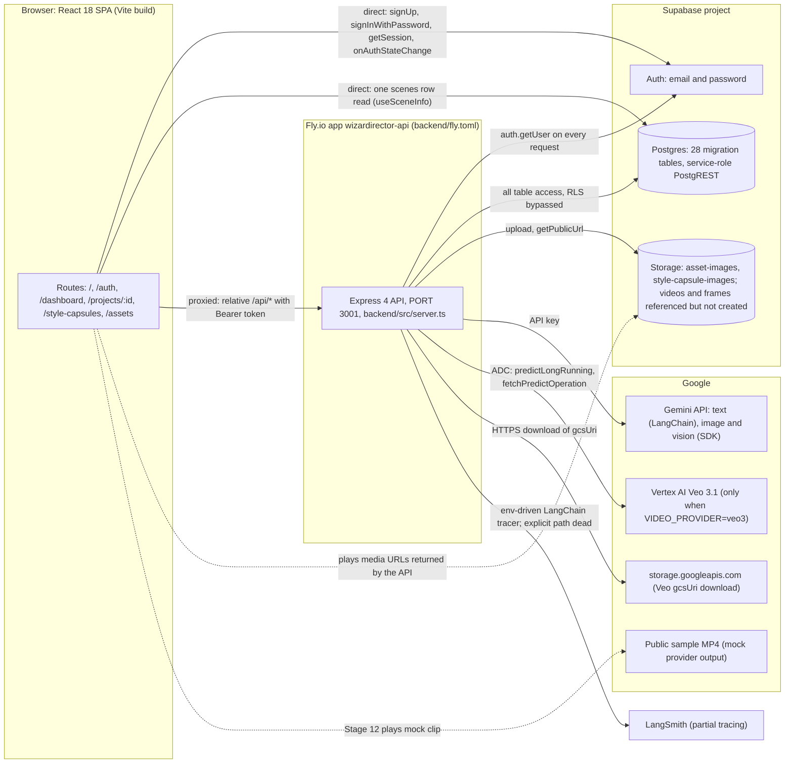

# 01 System overview: WizardDirector (Aiuteur) at HEAD

Scope: orientation map of the whole application as it exists at HEAD of `main`. Covers what the system is, its runtime topology, the repository layout, the 12-stage pipeline plus Script Hub, the frontend route tree, the backend route families, one-line subsystem status, external providers (real versus mocked), the facts a newcomer must know, and a status snapshot built from ledger flags. Static analysis only. Nothing was executed, no provider, database, or network was contacted. Facts only; no recommendations.

Sources: ledger kinds CAP, ROUTE, FACT, PROV, AI (canonical grouping from R2), STATE, INV, DEAD, TABLE, TEST, PRESSURE, ENTITY, from `merged2/merged.jsonl` (1,518 entries). Reports: V1-shell (read in full), I-infra-async (read in full), C-database (skimmed: sections 1, 2, 5, 7, 10), E-ai-calls (read in full; matrix sections 1, 2, 9 and sections 4, 6, 7, 14 used), V10-video-checkout (read in full), R1a and R1b verdict tables and claim sections, R2-ai-canonical. Code spot checks are listed at the end.

Reading notes: sibling documents are cited by number and filename where known. See `00-README.md` for the map: 02 capabilities (`02-FUNCTIONAL-CAPABILITIES.md`), 03 workflows (`03-USER-WORKFLOWS.md`), 04 domain and state, 05 data model, 06 writing, 07 assets and continuity, 08 shots, frames and generation (`08-SHOTS-FRAMES-AND-GENERATION.md`), 09 AI and prompts, 10 versioning, locking and invalidation, 11 architecture, 12 async and providers, 13 tests, 14 dead and duplicate, 15 pressure, 16 coverage and unknowns, 17 ledger (`17-IMPLEMENTATION-LEDGER.md`).

Notation: ledger ids are written in full (`WD-IMPL-<KIND>-NNNN`). Ids prefixed `I-ledger` come from `reports/I-infra-async.ledger.jsonl` (lids such as `H-FACT-04`), which is not part of the merged ledger. Report names (V1, I, C-database, E, V10, R1a, R1b, R2) refer to files in `reports/`; "section N" means that report's numbered section. Flags use the ledger letters Y, P, N, U. Status words follow the brief vocabulary.

---

## 1. What the application is

WizardDirector (the API identifies itself as `wizardirector-api`; the browser theme key and the brief use the name Aiuteur) is a multi-user web application that takes a written narrative through a staged production pipeline. A user creates a project (title only, from the dashboard), then works through Phase A: Stage 1 input (manual configuration or a document intake called "streamline"), Stage 2 treatment, Stage 3 beat sheet, Stage 4 master script, and Stage 5 project assets. Stage 6 is the Script Hub, which lists scenes. Phase B is a per-scene pipeline of Stages 7 to 12: shot list, visual definition, prompt segmentation, frame generation, confirmation, and video generation. Stage content is stored as versioned JSON rows in Supabase Postgres (28 tables are created by the migrations); generated images and videos are written to Supabase Storage. A React 18 SPA calls an Express 4 API, which holds every provider key and performs all database access with the Supabase service-role key. Text generation calls Gemini through LangChain, image and vision calls use the Google Generative AI SDK, and video is either a mock provider (the default, returning one public sample clip for every shot) or Veo 3.1 on Vertex AI when `VIDEO_PROVIDER=veo3` is set. Credits are a per-user balance seeded at 100.00 that is only decremented; there is no purchase or top-up code. Evidence: V1 sections 0 and 1, I sections 1 and 5, `backend/src/server.ts:28-99`, `backend/src/services/video-generation/createVideoProvider.ts:18`, `backend/src/services/userCreditsService.ts`, V10 section 4.

---

## 2. Runtime topology

| Link | Mode | Evidence |
|---|---|---|
| Browser to Supabase Auth | Direct, supabase-js with anon key, `persistSession` on | `src/lib/supabase.ts:4-17`, `src/lib/stores/auth-store.ts:28-124` |
| Browser to Supabase Postgres | Direct, two table reads. `scenes` (live, Stages 7, 9, 10, 11, 12) and `projects` (in `imageService.ts`, module has no importers, ORPHANED) | `src/hooks/useSceneInfo.ts:26`, `src/lib/services/imageService.ts:148`, WD-IMPL-FACT-0171 |
| Browser to API | Proxied: relative `/api/...`, Vite dev proxy to `localhost:3001`. Production routing of `/api` is not in the repo (UNKNOWN) | `vite.config.ts:12-18`, I section 1.3 |
| API to Supabase Auth | Direct, one `auth.getUser` round trip per protected request | `backend/src/middleware/auth.ts:16-44`, WD-IMPL-ROUTE-0134 |
| API to Postgres and Storage | Direct, service-role client, RLS bypassed | `backend/src/config/supabase.ts:17-22`, WD-IMPL-FACT-0171 |
| API to Gemini, Vertex, GCS, LangSmith | Direct, server side. The browser never holds provider keys | E section 3, I section 1.1 |
| Browser to media | Direct URLs taken from API responses (Storage public URL, mock sample MP4). Inferred from `getPublicUrl` and `public_url` fields; storage public flags not inspected | V10 section 6, I section 11 |
| Veo result path | API downloads `gcsUri` objects, then uploads to Storage bucket `videos` | `backend/src/services/video-generation/Veo3Provider.ts:337-354` |
| Hosting | API only, Fly.io, `auto_stop_machines=true`, `min_machines_running=0`, internal port 3001 | `backend/fly.toml`, I section 6.1 |

No WebSocket, SSE, Realtime channel, webhook receiver, cron, pg_cron, service worker, or Web Worker exists (grep of `src`, `backend/src`, migrations: zero matches). I section 1.1, I section 3.5.

---

## 3. Repo map

LOC is the raw line count (`wc -l`) over `.ts`, `.tsx`, `.css`, `.sql`, and `.js` files found under each path, test files included unless the row says otherwise. Counts were taken at HEAD.

| Area | Path | Files | LOC | Role | Central files |
|---|---|---|---|---|---|
| App shell | `src/App.tsx`, `src/main.tsx`, `src/pages/` | 9 pages + 2 | 2,793 (pages) | Provider stack, route table, stage host | `src/App.tsx:74-145`, `src/pages/ProjectView.tsx`, `src/pages/Dashboard.tsx` |
| Stage components | `src/components/pipeline/` | 89 | 32,825 | Stage 1 to 12 UI, Script Hub, shared panels | `Stage7ShotList.tsx` (1,769), `Stage10FrameGeneration.tsx` (1,754), `Stage5Assets.tsx` (1,749), `Stage1InputMode.tsx` (925) |
| Other components | `src/components/{auth,dashboard,landing,layout,assets,styleCapsules}/` | 18 | about 3,600 | Shell, library screens, landing | `src/components/layout/GlobalSidebar.tsx`, `src/components/auth/ProtectedRoute.tsx` |
| Design system | `src/components/ui/` | 50 | 4,015 | shadcn/ui primitives | Tailwind config at repo root |
| Frontend services | `src/lib/services/` | 30 (8 test files) | 10,283 | One HTTP client per backend family | `projectService.ts`, `stageStateService.ts`, `sceneStageLockService.ts`, `checkoutService.ts` |
| Frontend state and hooks | `src/lib/stores/`, `src/lib/hooks/`, `src/hooks/`, `src/lib/utils/` | about 20 | about 2,500 | Auth store (zustand), stage hooks, utils | `src/lib/stores/auth-store.ts`, `src/lib/hooks/useStageState.ts`, `src/hooks/useSceneInfo.ts` |
| Frontend types and config | `src/types/`, `src/config/`, `src/styles/` | 7 | 1,516 | Scene and project types, info copy, screenplay CSS | `src/types/scene.ts`, `src/types/project.ts`, `src/config/stageInfoContent.ts` |
| API routes | `backend/src/routes/` | 15 | 16,539 | HTTP surface, 198 router registrations | `projects.ts` (4,006), `projectAssets.ts` (3,451), `frames.ts` (2,410), `sceneAssets.ts` (2,332) |
| API services | `backend/src/services/` (includes `image-generation/` 3 files, 1,402 LOC, and `video-generation/` 5 files, 705 LOC) | 45 | 15,876 | Business logic, AI calls, background executors | `frameGenerationService.ts`, `videoGenerationService.ts`, `llm-client.ts`, `image-generation/ImageGenerationService.ts`, `promptGenerationService.ts`, `shotExtractionService.ts` |
| API support | `backend/src/{utils,middleware,config,transformers}/` | 15 | 1,650 | JSON repair, token estimates, auth middleware, Supabase client, style-capsule mappers | `utils/llmJson.ts`, `utils/token-utils.ts`, `middleware/auth.ts`, `config/supabase.ts` |
| Backend tests | `backend/src/tests/`, `backend/src/**/__tests__/` | 41 + 4 | 8,896 + 526 | Jest, ts-jest, Supertest | `streamlineSkip.test.ts`, `continuityBaseAndModeRoutes.test.ts`, `health.route.test.ts` |
| Migrations | `backend/migrations/` | 46 files (001 to 044; 022 and 024 each appear twice) | 3,962 | Schema, triggers, RPC functions | `001_initial_schema.sql`, `014_add_shot_list_locking_with_trigger.sql`, `044_streamline_atomic_intake_fix.sql` |
| Out-of-chain SQL | `backend/quickies-sql/` | 3 | 57 | Adds `scenes.stage_locks` (not in migrations) | `add_stage_locks.sql` |
| Scripts | `backend/scripts/` | 8 | 1,396 | Migration runner, bucket setup, seed scripts | `run-migrations.ts`, `setup-asset-images-bucket.ts`, `setup-storage-buckets.ts`, `seed-templates.ts` |
| End to end | `e2e/` | 2 specs | 639 | Playwright; assumes dev servers are already running | `enhanced-upload-modal.spec.ts`, `story-context-update.spec.ts` |
| Totals | `src/` (ts, tsx, css) and `backend/src/` (ts) | | 58,699 and 43,061 | | |

Frontend test files: 26, about 310 cases (grep of `it(` or `test(` at line start). Backend test files: 41, about 433 cases (same method). Counts are grep approximations, not executed runs. The test inventory with per-suite flags is in 13; the `TEST` ledger kind has 124 entries.

---

## 4. Stage structure

Stage names are the UI names (`src/components/pipeline/UnlockWarningDialog.tsx:23-35`, `SceneWorkflowSidebar.tsx:27-90`). Phase A is project-level (stages 1 to 5). Script Hub is stage 6. Phase B is per scene (stages 7 to 12). Sidebar labels for 11 and 12 are "Review" and "Video".

### 4.1 Phase A and Script Hub

| Stage | Component (LOC) | What it produces | Tables touched | AI calls (canonical WD-IMPL-AI) |
|---|---|---|---|---|
| 1 Input | `Stage1InputMode.tsx` (925) | Project config through `PUT /api/projects/:id`; stage 1 draft or lock. Streamline intake (upload, classify, questions, reconcile, commit through the `streamline_commit_atomic` RPC) | `projects`, `stage_states`, `intake_resolutions`, `intake_resolution_edits` (RPC only), `project_assets` (streamline import source) | 0027 prose classification, 0028 standalone asset draft, 0029 format as treatment, 0030 format as beats, 0031 questions, 0032 reconciliation, 0033 image classification |
| 2 Treatment | `Stage2Treatment.tsx` (888) | Stage 2 content JSON (versioned row per save) | `stage_states`, `style_capsule_applications` | 0068 (template `treatment_expansion`, dispatched by umbrella 0001), 0014 and 0015 section rewrites, 0002 streamline backfill (when skipped) |
| 3 Beat Sheet | `Stage3BeatSheet.tsx` (933) | Stage 3 beats JSON | `stage_states` | 0069 (template `beat_extraction`), 0017 beat brainstorm, 0003 streamline backfill; 0026 beat split has no caller |
| 4 Master Script | `Stage4MasterScript.tsx` (1,265) | Stage 4 script content; scene list through `PUT /api/projects/:id/scenes` | `stage_states`, `scenes` (replace-and-match write) | 0070 (template `master_script_generation`), 0021 and 0022 section rewrites, 0023 legacy scene-dependency fallback |
| 5 Assets | `Stage5Assets.tsx` (1,749) | Project assets (characters, props, locations), angle variants, location views, asset image jobs; stage 5 lock | `project_assets`, `project_asset_generation_attempts`, `asset_angle_variants`, `location_views`, `image_generation_jobs`, `stage_states` | 0004 visual distillation, 0005 description merge, 0035 vision description, 0036 vision merge, 0037 to 0040 image prompt builders, 0082 location-view prompt, 0010 image generation (all image jobs) |
| 6 Script Hub | `Stage6ScriptHub.tsx` (646) | Scene list, defer and restore flags, batch render badges, entry to a scene pipeline | `scenes` (`is_deferred`), `video_generation_jobs` (read through batch render status) | none |

Evidence: `src/pages/ProjectView.tsx:872-993` (Phase A render), `src/pages/ProjectView.tsx:849-869` (Script Hub render), `src/components/pipeline/Stage*.tsx` line counts from `wc -l`. AI canonical ids: `reports/R2-ai-canonical.json`. Umbrella 0001 is `POST /api/llm/generate-from-template`.

Phase A state: `stage_states` rows are append-only per `(branch, stage, version)`. Saves insert a new version (`WD-IMPL-STATE-0001`), locks insert `status=locked`, unlocks insert `draft` plus `outdated` for downstream stages (`WD-IMPL-STATE-0004`, `WD-IMPL-STATE-0005`, `WD-IMPL-INVALIDATE-0005`). Progress is derived three different ways (ProjectView, the projects list endpoint, and the project get endpoint). Detail: 04 and 10.

### 4.2 Phase B (per scene)

| Stage | Component (LOC) | What it produces | Tables touched | AI calls (canonical WD-IMPL-AI) |
|---|---|---|---|---|
| 7 Shot List | `Stage7ShotList.tsx` (1,769) | Shot list (extract, split, merge, edit); stage 7 lock | `shots`, `scenes` (`shot_list_locked_at`, `stage_locks`, expected-* cache columns) | 0071 extraction, 0072 malformed-JSON retry, 0073 split (also Stage 9), 0074 merge |
| 8 Visual Definition | `Stage8VisualDefinition.tsx` (939) | Scene asset instances, shot-to-asset assignments, location assignment, transformation events, scene image jobs | `scene_asset_instances`, `scene_asset_generation_attempts`, `shot_asset_assignments`, `transformation_events`, `text_field_versions`, `scene_asset_suggestions`, `shots` (location and camera columns), `location_match_events`, `image_generation_jobs` | 0024 and 0025 story-context inference, 0075 relevance detection, 0076 and 0077 transformation text, 0035 vision (`sceneAssets.ts:559`), 0048 scene image prompt, 0051 scene edit prompt, 0084 post-image prompt, 0010 image generation |
| 9 Prompt Segmentation | `Stage9PromptSegmentation.tsx` (994) | Start-frame prompt and video prompt on each shot; prompt text history | `shots` (`frame_prompt`, `video_prompt`), `text_field_versions` | 0006 start-frame prompt, 0009 video prompt |
| 10 Frame Generation | `Stage10FrameGeneration.tsx` (1,754) | Start and end frame images, continuity bases, frame links, frame cost totals | `frames`, `frame_links`, `shots` (`selected_continuity_base_frame_id`), `image_generation_jobs` | 0007 end-frame prompt, 0008 continuity prompt, 0012 reference-frame vision (camera change), 0078 surgical correction, 0083 inpaint and suffix markers, 0010 image generation |
| 11 Confirmation ("Review") | `Stage11Confirmation.tsx` (597) | Read-only cost summary; the Confirm and Render action queues one video job per shot that has a start-frame URL, charges credits, locks stage 11 | Reads `shots`, `frames`, `video_generation_jobs`, `user_credits`. Writes `video_generation_jobs`, `user_credits`, `scenes.stage_locks` | none (deterministic cost arithmetic) |
| 12 Video Generation ("Video") | `Stage12VideoGeneration.tsx` (344) plus `Stage12/` folder | Per-shot clip playback, job retry, scene completion (lock 12, `scenes.status` set to `video_complete`) | `video_generation_jobs`, `scenes`, `scenes.stage_locks` | 0080 Veo 3.1 (env-gated), 0067 mock provider (default) |

Evidence: `src/pages/ProjectView.tsx:765-846` (scene stage render), `src/components/pipeline/Stage11Confirmation.tsx`, V10 sections 3, 5, 7; `backend/src/routes/checkout.ts:91-142`; `backend/src/services/videoGenerationService.ts:318-408`.

Phase B state: `scenes.stage_locks` is one JSON map per scene with keys "7" to "12" (`WD-IMPL-STATE-0006` lock, `WD-IMPL-STATE-0007` unlock assessment, `WD-IMPL-STATE-0008` unlock confirm). The column is created by `backend/quickies-sql/add_stage_locks.sql` only, not by any migration (`WD-IMPL-FACT-0012`). Writes are read-modify-write with no version guard (`WD-IMPL-INVALIDATE-0010`). The scene `status` column is a second, coarser progress field. Detail: 04, 10.

### 4.3 Entry points into scene stages

- Script Hub "Enter Scene Pipeline" resumes at the first stage whose lock status is not locked or outdated (`ProjectView.tsx:515-551`, `WD-IMPL-CAP-0032`).
- "Review Video" enters stage 12 when batch render status is `complete` (`WD-IMPL-CAP-0033`).
- Direct URLs `?stage=N&sceneId=X` open any Phase B component without checking Phase A or lock status (`WD-IMPL-INVALIDATE-0013`; see section 9, fact 7).

---

## 5. Route tree summary (frontend)

Provider stack: `ThemeProvider` (next-themes, default dark) > `QueryClientProvider` (default `new QueryClient()`) > `TooltipProvider` > `AuthInitializer` plus two toast systems > `BrowserRouter` (`src/App.tsx:74-145`, `WD-IMPL-FACT-0014`).

| Path | Element | Guard | Layout | Evidence |
|---|---|---|---|---|
| `/` | `LandingOrDashboard`: spinner until auth initializes; signed-in user goes to `/dashboard`, otherwise `Landing` | none | none | `src/App.tsx:33-49,136` |
| `/landing` | `Landing` (always, even when signed in) | none | none | `src/App.tsx:133` |
| `/auth` | `Auth`: redirects to `/dashboard` when signed in, else `AuthForm` | none | none | `src/App.tsx:90`, `src/pages/Auth.tsx:6-44` |
| `/dashboard` | `Dashboard` | ProtectedRoute | MainLayout | `src/App.tsx:52-72,93-100` |
| `/projects/:projectId` | `ProjectView` (stage host) | ProtectedRoute | MainLayout | `src/App.tsx:101-110` |
| `/style-capsules` | `StyleCapsuleLibrary` | ProtectedRoute | MainLayout | `src/App.tsx:111-120` |
| `/assets` | `AssetLibrary` | ProtectedRoute | MainLayout | `src/App.tsx:121-130` |
| `*` | `NotFound` | none | none | `src/App.tsx:139` |

- Query parameters used by `ProjectView`: `?stage=1..12` and `?sceneId=<uuid>` (`ProjectView.tsx:141-148`).
- `/projects/new` is matched by `:projectId`, linked from nowhere, and creates a project through the Stage 1 path (`WD-IMPL-CAP-0049` N, `WD-IMPL-FACT-0358`).
- `ProtectedRoute` writes a return path that nothing reads, so login always lands on `/dashboard` (`WD-IMPL-FACT-0009`).
- `src/pages/Index.tsx` is not imported anywhere (`WD-IMPL-FACT-0011`, ORPHANED).
- No admin, settings, profile, or billing route exists.

## 6. Backend route families

Mount order and middleware: `helmet`, `cors` (production origin is the placeholder `https://your-frontend-domain.com`, `server.ts:36`), `express.json` and `urlencoded` with 10 MB limit, `/api/health` (no auth), then the protected mounts, then `errorHandler` (`backend/src/server.ts:31-90`). No JSON 404 handler, no rate limiter, no request logger, no process-level signal handlers (I section 1.2, section 4).

| Router file | Mount (each with `authenticateUser`) | Registrations | Project ownership on path | Notes |
|---|---|---|---|---|
| `projects.ts` | `/api/projects` | 29 | project lookup by `user_id` | Project CRUD, continuity mode and metrics, scene PUT (replace-and-match), defer and restore, shot extract, split, merge, `generate-prompts` (`:3573`), legacy dependency fallback |
| `projectAssets.ts` | `/api/projects` | 37 | project lookup; sub-resource binding not exhaustively verified (P) | Stage 5 assets, extraction, merge, angle variants, location views, image generation |
| `sceneAssets.ts` | `/api/projects` | 36 | project lookup on most routes; **none on 7 of 8 transformation-event routes** (`:1813` to `:1916`) | Stage 8 scene asset instances, relevance, inference, transformation events, scene image jobs |
| `shotAssignments.ts` | `/api/projects` | 8 | full chain: project, scene, branch (`verifyProjectOwnership`, `:36-72`) | Stage 8 shot-to-asset assignments; `DELETE /shot-assignments/all` is shadowed (`WD-IMPL-ROUTE-0120`) |
| `frames.ts` | `/api/projects` | 27 | project lookup | Stage 9 and 10: frame generation, inpaint, end-frame and continuity prompts; `GET .../frames/:id/status` has side effects and no UI caller (`:502`) |
| `checkout.ts` | `/api/projects` | 8 | project; scene bound on R1 and R4; video job not bound on R5 and R8 | Stage 11 cost breakdown and confirm-render; Stage 12 job list, job read, retry (V10 section 2) |
| `stageStates.ts` | `/api/projects` | 6 | project lookup | Phase A save, lock, skip, unlock |
| `streamline.ts` | `/api/projects` | 7 | project lookup | Stage 1 intake: extract file, classify image, format, analyze, reconcile, commit, backfill |
| `sceneStageLocks.ts` | `/api/projects` | 4 | project lookup | Phase B lock, unlock, relock |
| `llm.ts` | `/api/llm` | 13 | none; utility and template routes unscoped (`WD-IMPL-ROUTE-0139`) | `/generate`, `/generate-from-template`, estimate, usage stats, connectivity probe, template CRUD |
| `images.ts` | `/api/images` | 3 | generate checks project only; body ids (`assetId`, `shotId`, `sceneId`, `branchId`) not bound | `POST /generate`, job status GET |
| `assets.ts` | `/api/assets` | 7 | global assets filtered by owner | Global asset library CRUD, generate-image |
| `styleCapsules.ts` | `/api/style-capsules` | 11 | reads own or preset rows; writes compare owner | Capsule and library CRUD, reference-image upload |
| `seed.ts` | `/api/seed` | 1 | none beyond authentication | `POST /prompt-templates` (`WD-IMPL-CAP-0086`) |
| `health.ts` | `/api/health` (no auth) | 1 | n/a | Static JSON status |
| **Total** | | **198** | | Grep count of `router.get/post/put/patch/delete(` over `backend/src/routes` matches the per-file counts |

Sources: I section 1.2 and 2.3 (registration scan), V1 section 2 and 6, `backend/src/server.ts:46-87`. Mounts: nine routers share `/api/projects`, so a request handled by the ninth traverses nine `authenticateUser` calls (`WD-IMPL-ROUTE-0134`; I section 2.2).

## 7. Subsystem inventory

Status words: REACHABLE (a UI or API path exists), FUNCTIONAL (the path behaves as written in code), PARTIAL (some of the path is missing, dead, or contradicted), MOCK-ONLY (stub or fake output). DEAD, ORPHANED, CONTRADICTED, and UNKNOWN are used where the brief vocabulary requires.

| Subsystem | Status | One-line state | Evidence |
|---|---|---|---|
| Auth, email and password | FUNCTIONAL | Sign up, sign in, sign out through Supabase; no OAuth or reset UI. Email-confirmation setting UNKNOWN | `WD-IMPL-CAP-0001` (P), `WD-IMPL-CAP-0002` (Y), `WD-IMPL-PROV-0031` |
| Route gating and session state | PARTIAL | Client-side gate only; auth listeners registered without a guard (UNKNOWN runtime count) | `WD-IMPL-CAP-0006` (P), `WD-IMPL-FACT-0015`, I-ledger `H-STATE-12` |
| Dashboard list, create, open, delete | FUNCTIONAL | Title-only create; list with search; delete with confirm | `WD-IMPL-CAP-0009`, `0013`, `0014`, `0015` (all Y) |
| Dashboard Filter and Sort | MOCK-ONLY | Icon buttons with no handler | `WD-IMPL-CAP-0011` (N) |
| `/projects/new` direct path | PARTIAL | Project created, then the stage 1 lock returns 404 on id `new` | `WD-IMPL-FACT-0358` (C21 CONFIRMED), `WD-IMPL-CAP-0049` (N) |
| Project configuration (type, rating, genre, length) | PARTIAL | Works, except project type `audio-visual` is rejected (backend and DB use `audio_visual`) | `WD-IMPL-FACT-0346` (C09 CONFIRMED), `WD-IMPL-FACT-0147` |
| Phase A save, lock, skip, unlock | FUNCTIONAL | Versioned saves and locks work. Phase A unlock warning dialog never opens; unlock applies downstream "outdated" with no prompt | `WD-IMPL-CAP-0024` (Y), `WD-IMPL-CAP-0026` (P), `WD-IMPL-FACT-0340` (C03 CONFIRMED), `WD-IMPL-FACT-0005` |
| Phase A status derivation | CONTRADICTED | Three derivations disagree on skipped stages (ProjectView counts skipped as passed; the list endpoint shows pending) | V1 sections 5.2 and 6 (no single ledger id) |
| Streamline intake (Stage 1) | FUNCTIONAL | Upload, classify, questions, reconcile, commit through an atomic RPC. Commit ignores `formatChoice` and is not idempotent | `WD-IMPL-CAP-0110` to `0135` (V4 range), `WD-IMPL-FACT-0356` (C19 CONFIRMED), `WD-IMPL-FACT-0053` (N) |
| Treatment, beat sheet, master script generation | PARTIAL | Frontend-built prompts path is FUNCTIONAL. DB template path depends on seeded rows and drops regeneration guidance | `WD-IMPL-AI-0068`, `0069`, `0070`, `0014`, `0015`, `0017`, `0021`, `0022`; E section 14 items 1 and 2 |
| Project assets (Stage 5) | FUNCTIONAL | Extraction, merge, generation, angle variants, location views. `locked` has no unlock path and image routes ignore it | `WD-IMPL-FACT-0357` (C20 CONFIRMED); V5 range `WD-IMPL-CAP-0136` to `0161` (Y 19, P 7) |
| Script Hub and scene list | PARTIAL | Scene list, defer and restore, enter pipeline. Defer flag is not checked by any route. Re-approving a script can delete unmatched scenes | `WD-IMPL-CAP-0032` (Y), `WD-IMPL-FACT-0352` (C15 PARTIALLY CONFIRMED), `WD-IMPL-STATE-0015` (P) |
| Shot list (Stage 7) with AI extract, split, merge | FUNCTIONAL | Shot CRUD and AI operations work. Shot lock is UI-only; no shot route checks it | `WD-IMPL-FACT-0342` (C05 CONFIRMED), `WD-IMPL-INVALIDATE-0055`; V8 range `WD-IMPL-CAP-0222` to `0239` (Y 9, P 7, N 1, U 1) |
| Visual definition (Stage 8) and transformation events | PARTIAL | Assignments, instances, inference, relevance work. Seven transformation-event routes have no ownership check. Transformation flags are written but not read (C18 PARTIAL) | `WD-IMPL-PRESSURE-0059`, `WD-IMPL-ROUTE-0136`, `WD-IMPL-FACT-0355`; V6 range `WD-IMPL-CAP-0162` to `0192` (Y 14, P 16, N 1) |
| Continuity, locations, base frames (V7) | FUNCTIONAL | Location assignment, coverage, continuity base, risk rules. Two location classifiers with thresholds 0.72 and 0.8 disagree | `WD-IMPL-FACT-0344` (C07 CONFIRMED); V7 range `WD-IMPL-CAP-0193` to `0221` (Y 22, P 2, U 5) |
| Prompt segmentation (Stage 9) | FUNCTIONAL | Start-frame and video prompts generated and stored on shots | `WD-IMPL-AI-0006`, `WD-IMPL-AI-0009`; V9 range `WD-IMPL-CAP-0240` to `0265` |
| Frame generation (Stage 10) | PARTIAL | Failed frame jobs leave the frame `generating`. Inpaint mask is stored and not sent. Stage 10 polls every 2 s with no ceiling | `WD-IMPL-FACT-0350` (C13 CONFIRMED), `WD-IMPL-FACT-0189`, `WD-IMPL-STATE-0118` (Y) |
| Image generation jobs (all image kinds) | FUNCTIONAL | Gemini image jobs run in-process, without queue or recovery. Width, height and aspect ratio never reach the model | `WD-IMPL-FACT-0188` (P), `WD-IMPL-FACT-0349` (C12 CONFIRMED), I section 3.1 and 3.4 |
| Confirm and Render, credits (Stage 11) | PARTIAL | Charges the whole scene total (including shots without start frames), creates duplicate jobs on re-confirm, never refunds, no top-up route | `WD-IMPL-FACT-0351` (C14 CONFIRMED), `WD-IMPL-FACT-0125`, `WD-IMPL-FACT-0129` (P), `WD-IMPL-CAP-0271` (P), `WD-IMPL-CAP-0270` (Y) |
| Video job executor (Stage 12 backend) | PARTIAL | Global in-process serial loop. No startup recovery. Auto-retry ignores retryable flag. Manual retry gets one attempt | `WD-IMPL-FACT-0130` (P), `WD-IMPL-FACT-0131` (P), `WD-IMPL-PRESSURE-0009` (U) |
| Video playback and retry UI (Stage 12) | FUNCTIONAL | Per-shot clips play in sequence; polls every 3 s while active; retry button | V10 section 7; `WD-IMPL-CAP-0277` (P) |
| Export (MP4, YouTube, Drive, CapCut) | MOCK-ONLY | Four disabled buttons labelled "Soon"; no handler, route, or service | `WD-IMPL-CAP-0281` (N), `WD-IMPL-FACT-0136` (N) |
| Stitching, audio, voice | absent (no code) | No ffmpeg, TTS, STT, or voice code. Veo audio flag only | `WD-IMPL-FACT-0136`, `WD-IMPL-PROV-0029` (N) |
| Veo 3.1 video provider | PARTIAL | Complete-looking Vertex client, env-gated, never exercised by automated tests; needs a `videos` bucket that no repo script creates | `WD-IMPL-PROV-0013`, `WD-IMPL-PROV-0027` (U), `WD-IMPL-FACT-0172` |
| Mock video provider | MOCK-ONLY | Default when `VIDEO_PROVIDER` is unset; one public sample clip for every shot; 5 percent synthetic failure | `WD-IMPL-PROV-0014` (Y), `WD-IMPL-PROV-0019` (Y), `WD-IMPL-AI-0067` |
| Global asset library (`/assets`) | FUNCTIONAL | Search, tabs, create, edit, delete, image generation | `WD-IMPL-CAP-0048` (Y) |
| Style capsule library and injection | PARTIAL | Library works. Capsule id never reaches frame image jobs; project capsule columns have no writer; capsule reference images reach the image model only partly | `WD-IMPL-CAP-0047` (Y), `WD-IMPL-FACT-0338` (C01 CONFIRMED), `WD-IMPL-FACT-0339` (C02 CONFIRMED), `WD-IMPL-CAP-0072` (P) |
| Migration runner | PARTIAL | Cannot run as written (splits on `;`, calls an undefined `exec` RPC). Applied migrations on live DB by an unknown manual process | `WD-IMPL-FACT-0150`, `WD-IMPL-FACT-0345` (C08 CONFIRMED) |
| LangSmith tracing | PARTIAL | Explicit callback path is dead (caught throw). Env-driven tracer may be live. `traceId` is a request UUID, not a run id | `WD-IMPL-PROV-0020` (U), `WD-IMPL-PROV-0030`, `WD-IMPL-FACT-0353` (C16 CONFIRMED), I-ledger `H-PROV-07` |
| Realtime, webhooks, cron | absent (no code) | No inbound provider or Supabase callback, no scheduled job | I sections 1.1 and 3.5 |
| Landing page claims | CONTRADICTED | Copy claims OpenAI and Anthropic text providers, git-style branching, a monthly price, a free trial, and real-time cost tracking. None is in code. Gemini, which the same copy lists, is in code | `WD-IMPL-FACT-0013` (N), `WD-IMPL-PROV-0021` (N), `src/pages/Landing.tsx:32` |
| Stub buttons (project header, dashboard, Landing) | MOCK-ONLY | Artifact Vault, Story Timelines, New Branch show a "coming soon" toast; Explore Stage has no handler | `WD-IMPL-CAP-0020` (N), `WD-IMPL-CAP-0050` (N), `WD-IMPL-FACT-0016` |
| Access control on API | PARTIAL | Service-role client, per-route ownership checks, several routes unscoped (section 9, fact 2) | `WD-IMPL-FACT-0171`, `WD-IMPL-PRESSURE-0059`, I section 2.3 |
| Automated tests | PARTIAL | About 310 frontend and 433 backend cases by grep. No test for Stage 11, Stage 12, checkout, video, or credits. Most CAP entries are untested (N 219 of 287) | V10 section 10; section 10 of this document |

## 8. External providers: real versus mocked

| Provider | Real or mocked | Path and auth | Status | Ledger |
|---|---|---|---|---|
| Supabase Auth | Real | supabase-js in the browser (anon key); `auth.getUser` on the API (service role) | FUNCTIONAL | `WD-IMPL-PROV-0031`, `WD-IMPL-CAP-0002` |
| Supabase Postgres | Real | Service-role PostgREST from the API; one browser read of `scenes` | FUNCTIONAL | `WD-IMPL-FACT-0171`, `WD-IMPL-FACT-0001` (contradicted, see corrections) |
| Supabase Storage | Real | Service role; buckets `asset-images` and `style-capsule-images` have creation scripts; `videos` and `frames` have none | PARTIAL | `WD-IMPL-FACT-0172`, `WD-IMPL-PROV-0010` (P), `WD-IMPL-PROV-0023` (U) |
| Gemini text (LangChain `ChatGoogleGenerativeAI`) | Real | API key `GOOGLE_AI_API_KEY`; model from `GEMINI_MODEL` with three literal fallbacks | FUNCTIONAL in code; runtime UNKNOWN | `WD-IMPL-PROV-0016`, `WD-IMPL-PROV-0024` (U), `WD-IMPL-FACT-0105` |
| Gemini image (`gemini-2.5-flash-image`, `NanoBananaClient`) | Real | `@google/generative-ai`, API key; model hardcoded; dimensions never sent | FUNCTIONAL in code; runtime UNKNOWN | `WD-IMPL-PROV-0003`, `WD-IMPL-PROV-0025` (U), `WD-IMPL-FACT-0188` |
| Gemini vision (`gemini-2.5-flash`, `ImageAnalysisService`) | Real | `@google/generative-ai`, API key; model hardcoded; no retry | FUNCTIONAL in code; runtime UNKNOWN | `WD-IMPL-PROV-0002`, `WD-IMPL-PROV-0026` (U) |
| Vertex AI Veo 3.1 | Real code, env-gated | ADC via `GoogleAuth`, `GOOGLE_CLOUD_PROJECT` required; not in any env template | PARTIAL, untested | `WD-IMPL-PROV-0013`, `WD-IMPL-PROV-0018` (U), `WD-IMPL-PROV-0027` (U) |
| Google Cloud Storage (Veo `gcsUri`) | Real, Veo path only | HTTPS download with the ADC token | PARTIAL | `Veo3Provider.ts:370`, I section 1.1 |
| Mock video | Mocked | No auth; fixed public sample URL; ignores frames and prompt | MOCK-ONLY, default | `WD-IMPL-PROV-0019`, `WD-IMPL-AI-0067` |
| LangSmith | Partial real | `langsmith` client built in the constructor and unused; env tracer possibly live (value UNKNOWN; see section 11) | PARTIAL | `WD-IMPL-PROV-0020`, `WD-IMPL-PROV-0030`, `WD-IMPL-FACT-0353` |
| OpenAI, Anthropic, Perplexity, Mistral, and other vendor keys | Not implemented | Names only in `.env.example` and `backend/env.example`; no SDK, no reader | DEAD (names only) | `WD-IMPL-PROV-0021` (N), `WD-IMPL-PROV-0032` (N) |
| Audio, speech, TTS | Not implemented | None | absent (no code) | `WD-IMPL-PROV-0029` (N) |
| Fly.io | Real hosting, config only | `backend/fly.toml`; secrets set outside repo | UNKNOWN at runtime | I section 6.1 |

---

## 9. The 15 facts a newcomer must know

1. **The API has one database identity, and RLS never applies to API traffic.** Every backend query uses the service-role client. Tenant isolation is only the per-route `user_id` checks in code. `WD-IMPL-FACT-0171`, `WD-IMPL-FACT-0002`, `backend/src/config/supabase.ts:17-22`, I section 2.4.
2. **Several routes do not check ownership.** Seven Stage 8 transformation-event routes (`sceneAssets.ts:1813` to `:1916`) pass only scene or event ids to the service. The video-job read and retry routes check the project but not the job (`checkout.ts:208-237`, `:301-324`). The V1 claim that every slice route checks ownership is CONTRADICTED (I-ledger `H-ROUTE-04`). `WD-IMPL-PRESSURE-0059`, `WD-IMPL-ROUTE-0136`, `WD-IMPL-FACT-0135`, `WD-IMPL-INVALIDATE-0011` (contradicted).
3. **The default video provider is a mock.** With `VIDEO_PROVIDER` unset, every process uses `MockVideoProvider`. It returns one public sample MP4 for every job, ignores frames and prompts, and fails 5 percent of calls. The env templates do not set `VIDEO_PROVIDER`. `WD-IMPL-PROV-0019`, `WD-IMPL-PROV-0014`, `createVideoProvider.ts:18`, `MockVideoProvider.ts:10,23`.
4. **Veo 3.1 is written and never exercised by tests.** The Vertex client, its 10 s polling with a 5 min cap, and its upload to bucket `videos` are complete-looking code. No repo script creates the bucket, and the stored `storage_path` does not match the uploaded object key. `WD-IMPL-PROV-0013`, `WD-IMPL-PROV-0027`, `WD-IMPL-FACT-0172`, V10 section 6.1.
5. **Confirm and Render charges the whole scene.** The debit sums every shot's video cost and frame image costs, including shots that get no job. Re-confirming creates a second set of jobs and a second charge. No refund path exists and no top-up route exists. `WD-IMPL-FACT-0351` (C14 CONFIRMED), `WD-IMPL-FACT-0125`, `WD-IMPL-CAP-0271`, `WD-IMPL-TABLE-0025`, `videoGenerationService.ts:318-408`.
6. **The Phase A unlock warning never opens.** The 409 body nests `downstreamStages` under `details`. ProjectView reads the top-level field, so the client confirms the unlock without prompting and the downstream "outdated" cascade runs. `WD-IMPL-FACT-0340` (C03 CONFIRMED), `WD-IMPL-FACT-0005`, `src/pages/ProjectView.tsx:691-716`, `backend/src/routes/stageStates.ts:594-607`.
7. **Phase B gating exists only in the UI.** The sidebar disables stages, but URL parameters open any scene stage. No shot route checks the stage 7 lock, and the migration 014 trigger changes only the scene status. `WD-IMPL-INVALIDATE-0013`, `WD-IMPL-INVALIDATE-0055`, `WD-IMPL-FACT-0342` (C05 CONFIRMED), `WD-IMPL-FACT-0177`.
8. **Scene lock state lives in a column no migration creates.** `scenes.stage_locks` is added only by `backend/quickies-sql/add_stage_locks.sql`, a file whose comment says it ran on prod. Code also queries `videos` and `invalidation_logs`, which have no DDL in the repo. A database built from the migration chain alone lacks these. `WD-IMPL-FACT-0012`, `WD-IMPL-FACT-0341` (C04: CONFIRMED on repo DDL, live state UNKNOWN), `WD-IMPL-TABLE-0005`.
9. **The migration runner cannot run as written.** It splits every file on `;`, which breaks `$$` bodies, and calls `supabase.rpc('exec')`, which no repo file defines. The live schema was therefore built by a manual process whose order is UNKNOWN. `WD-IMPL-FACT-0150`, `WD-IMPL-FACT-0345` (C08 CONFIRMED), `backend/src/config/database.ts:32-64`, C-database section 1.
10. **Background work is in-process and has no recovery.** Image jobs run as unawaited promises. Video jobs run in one global serial loop per process, guarded by an in-memory flag. A restart leaves jobs in `processing`, `generating`, or `uploading` indefinitely. Two instances can select the same queued row. Stage 10 and Stage 12 poll with no ceiling. `WD-IMPL-FACT-0130`, `WD-IMPL-PRESSURE-0009` (U), `WD-IMPL-STATE-0118`, I-ledger `H-STATE-03`.
11. **Retry behaves differently from its description.** Automatic video retry runs up to three attempts for every error, including permanent safety rejections, because it ignores the retryable flag. Manual retry does not reset `attempt_count`, so it gets exactly one attempt. `WD-IMPL-FACT-0131`, `backend/src/services/video-generation/VideoJobExecutor.ts:144-171`, `videoGenerationService.ts:563-597`.
12. **A failed frame job leaves its frame in "generating".** Only the status endpoint writes `rejected`, and no UI calls that endpoint. Stage 10 polls the frame list every 2 s while any frame is generating. `WD-IMPL-FACT-0350` (C13 CONFIRMED), `WD-IMPL-FACT-0108`, `WD-IMPL-FACT-0219`, I-ledger `H-STATE-04`.
13. **Image requests never carry size.** Width, height, and aspect ratio are stored on the job row and never sent to `gemini-2.5-flash-image`. The frame inpaint mask is stored but not transmitted, and the only mask-aware method has no caller. `WD-IMPL-FACT-0188`, `WD-IMPL-FACT-0189`, `WD-IMPL-FACT-0349` (C12 CONFIRMED), `NanoBananaClient.ts:125-130`.
14. **A missing Gemini key fails at module load, not per request.** The image and vision clients throw in their constructors. Route modules and `frameGenerationService.ts:1600` construct them at module scope, so the process fails during import. This corrects `WD-IMPL-FACT-0198` (see corrections). I-ledger `H-FACT-04`.
15. **Prompt templates and seeds are writable by any signed-in user.** Rows seeded with `created_by` NULL can be updated, deleted, and activated by any authenticated user, because the service-role client bypasses RLS and the handlers skip the owner check for these rows. Two seed copies diverge in about 88 lines of template text. `WD-IMPL-FACT-0195`, `WD-IMPL-FACT-0354` (C17 CONFIRMED), `WD-IMPL-ROUTE-0139`, `WD-IMPL-TABLE-0061`.

---

## 10. Status snapshot

Ledger flags (Y, P, N, U) over the 287 capability entries (`CAP`). Flags are first letters of the ledger values; a few entries carry free text after the letter, which is counted under the letter.

| Flag | Y | P | N | U | Total |
|---|---|---|---|---|---|
| present | 285 | 2 | 0 | 0 | 287 |
| reachable | 280 | 2 | 3 | 2 | 287 |
| functional | 161 | 94 | 10 | 22 | 287 |
| persisted | 211 | 9 | 67 | 0 | 287 |
| tested | 37 | 31 | 219 | 0 | 287 |

Reading: 280 of 287 capabilities are reachable. 161 are functional without caveat, 94 are partial, 10 are not functional, and 22 are unknown without runtime. 37 are tested (Y) and 219 have no test (N). The V10 range (`WD-IMPL-CAP-0266` to `0287`, 22 entries) is summarized in section 4.2 and in the section 7 rows for Confirm and Render, the video executor, and playback.

Per reporter (ids are `WD-IMPL-CAP-` ranges):

| Reporter, area | Ids | Count | Reachable Y | Functional Y / P / N / U | Tested Y / P |
|---|---|---|---|---|---|
| V1 shell, auth, dashboard, Phase A and Script Hub | 0001 to 0052 | 52 | 50 | 35 / 12 / 4 / 1 | 7 / 1 |
| V2 style capsules and library | 0053 to 0087 | 35 | 35 | 22 / 12 / 1 / 0 | 0 / 0 |
| V3 narrative (treatment, beats, script) | 0088 to 0109 | 22 | 21 | 5 / 16 / 1 / 0 | 1 / 0 |
| V4 streamline intake | 0110 to 0135 | 26 | 24 | 10 / 12 / 1 / 3 | 13 / 7 |
| V5 project assets | 0136 to 0161 | 26 | 26 | 19 / 7 / 0 / 0 | 2 / 4 |
| V6 scene assets | 0162 to 0192 | 31 | 31 | 14 / 16 / 1 / 0 | 5 / 0 |
| V7 continuity and locations | 0193 to 0221 | 29 | 28 | 22 / 2 / 0 / 5 | 9 / 4 |
| V8 shots | 0222 to 0239 | 18 | 17 | 9 / 7 / 1 / 1 | 0 / 12 |
| V9 prompts and frames | 0240 to 0265 | 26 | 26 | 12 / 5 / 0 / 9 | 0 / 3 |
| V10 video and checkout | 0266 to 0287 | 22 | 22 | 13 / 5 / 1 / 3 | 0 / 0 |

Other ledger kinds in `merged2/merged.jsonl` (1,518 entries in total):

| Kind | Entries | Flag notes |
|---|---|---|
| CAP | 287 | Above |
| FACT | 359 | Functional: Y 107, P 58, N 92, U 93, remainder free text |
| ROUTE | 143 | Reachable: Y 131, P 10, N 2. Functional: Y 113, P 23, N 1, U 6 |
| PROV | 33 | Functional: Y 7, P 3, N 6, U 17. Several PROV entries repeat the same provider in different words; section 8 gives the resolved status per provider |
| STATE | 120 | Mostly transitions; see 04 and 10 |
| INV | 108 | Invalidation and cascade entries; see 10 |
| DEAD | 117 | Dead, orphaned, and duplicate code; see 14 |
| PRESSURE | 65 | Scale and reliability pressure; see 15 |
| TABLE | 63 | Table entries; see 05 |
| TEST | 124 | Test entries; see 13 |
| ENTITY | 38 | Domain entities; see 04 |
| AI | 61 | 58 canonical calls per R2. Unreachable: 0026, 0034, 0011, 0042, 0085. HTTP-only probe: 0079. Conditional: 0023 |

AI registry reconciliation: R2 groups the original 85 AI ids (0001 to 0085) into 58 canonical calls. `retired-ids.json` lists 27 retired ids that are absent from `merged2`. Three AI entries (0086, 0087, 0088, from the lead's M ledger) are in `merged2` but postdate R2 and are in no group. All 58 canonical primaries are present in `merged2`. Breakdown of the 58: 36 text, 4 vision, 2 image-model sink, 10 image prompt paths, 2 orphaned frontend image paths, 1 deterministic helper, 1 route umbrella, 1 Veo, 1 mock.

---

## 11. Contradictions and unknowns carried forward

Preserved contradictions. Each stays open unless a correction in the last section applies.

1. Phase A unlock dialog: frontend reads a top-level field, backend nests it. Confirmed by R1a (C03) and ledger `WD-IMPL-FACT-0340`.
2. Project type: frontend `audio-visual`, backend and DB `audio_visual` (`WD-IMPL-FACT-0346`, C09 CONFIRMED).
3. Skipped stages: the list endpoint shows `pending`, ProjectView counts `skipped` as passed (V1 section 6, contradiction 4). No single ledger id.
4. Branch name: DB row is `Main`; the list endpoint reads a to-one embed as an array and falls back to `main`. UNKNOWN until runtime (V1 section 4.3).
5. Ownership: V1 says every slice route checks ownership; I says seven transformation-event routes do not (`WD-IMPL-INVALIDATE-0011` versus I-ledger `H-ROUTE-04`).
6. Scene status values `frames_locked`, `outdated`, and `continuity_broken` have consumers but no writer found by grep. UNKNOWN (V1 contradiction 13).
7. Two location classifiers with thresholds 0.72 (route, can return `ambiguous`) and 0.8 (composition, never returns `ambiguous`). Both live (`WD-IMPL-FACT-0344`, C07 CONFIRMED).
8. Veo storage path: stored `videos/<project>/<ms>.mp4` differs from the uploaded object key (V10 section 6.1). CONTRADICTED by code.
9. `frames.status` set to `invalidated` by the shot-list unlock, but the CHECK constraint from migration 019 does not allow that value, and the result is not checked (C-database F-04). CONTRADICTED.
10. LangSmith tracing value: E section 2 and 7 state that `backend/.env` sets `LANGSMITH_TRACING=true`. I did not read values under its policy, so the value is UNKNOWN in this document. Both statements are preserved; `WD-IMPL-PROV-0020` is U.
11. Gemini text model: three literal fallbacks (`gemini-1.5-flash` at `llm-client.ts:106`, `gemini-2.5-flash-lite` at `:76` and `:310`). `WD-IMPL-FACT-0105`.
12. Phase A auto-save on mount may rewrite a locked or outdated row as a draft, and drop its origin. Inferred from hook code (`useStageState.ts:100-143`). Runtime UNKNOWN (V1 section 6, contradiction 7).
13. `videos` table: unlock impact counts and updates a table with no DDL. Errors are not handled, so impact counts are 0 in practice if the table is absent (`WD-IMPL-INVALIDATE-0070`). UNKNOWN in the live DB.
14. `WD-IMPL-FACT-0202` (shot-extraction timeout returns an empty success) was not re-opened by I and is taken from the ledger as stated, with the code at `shotExtractionService.ts:297-305`.

Unknowns and what would settle them:

| Unknown | Settled by |
|---|---|
| Production frontend host and whether `/api` is reverse-proxied to Fly | Deployment config outside the repo (I 10.2) |
| Production env names and presence: `VIDEO_PROVIDER`, `GOOGLE_CLOUD_PROJECT`, `GOOGLE_AI_API_KEY`, `LANGSMITH_TRACING` | Fly secrets listing, names only (I 10.2) |
| Whether buckets `videos` and `frames` exist in the live Supabase project | Read-only storage bucket list (I 10.2) |
| Whether the migrations were applied and in what order | Live schema comparison against the migration chain plus `quickies-sql` (C-database 1.3) |
| Whether Veo model ids and the `fetchPredictOperation` contract still work | One manual run of `backend/src/tests/veo3-test.ts` with credentials (V10 section 12) |
| Email confirmation setting (decides whether sign-up yields a session) | Supabase Auth settings (V1 section 2) |
| Whether Storage objects are removed when a project is deleted | Storage policies and triggers in the live project (V1 contradictions and unknowns, item 10) |
| Number of API machines (duplicate video execution risk) | `fly status` (I 10.2) |
| Real token usage and cost versus the character-based estimate | Provider usage metadata on a sample call (E section 6) |
| Live `prompt_templates` contents and which seed copy is live | Read-only query (E section 15) |
| Whether Express async errors outside try blocks crash the process | Runtime test with a forced throw (I 10.2) |

---

## Corrections made while synthesizing

1. V1 section 2 says the frontend makes zero `supabase.from` calls. Grep finds two: `src/hooks/useSceneInfo.ts:26` (`scenes`, live) and `src/lib/services/imageService.ts:148` (`projects`, module has no importers). Ledger `WD-IMPL-FACT-0001` ("Frontend has no direct table access") is therefore CONTRADICTED. Sections 2, 7, and 8 use the corrected count.
2. I section 1.3 says there are 157 `getSession()` call sites. Grep finds 141 `getSession()` in `src` (the V1 figure). 161 is the count of `supabase.auth` occurrences in `src`, which C-database attributes to `src/lib/services` only. The count is not limited to services.
3. Ledger `WD-IMPL-FACT-0198` ("image and vision clients throw at construction ... per route") is CONTRADICTED by I (I-ledger `H-FACT-04`). Verified: `NanoBananaClient.ts:20-27` throws in the constructor, `ImageGenerationService.ts:68-70` constructs it, and the route modules and `frameGenerationService.ts:1600` construct services at module scope. Nuance: `backend/src/config/supabase.ts:5-6` calls `dotenv.config()` only when `SUPABASE_URL` is unset, and `server.ts:25` calls dotenv after its imports. A `.env` file therefore loads before route construction only through that config module, so the failure happens when the key is missing from both the process environment and `.env`.
4. Ledger `WD-IMPL-FACT-0339` says "4 read sites". R1a counts five conditional read sites plus three select lists. This document uses the R1a wording.

Spot checks against code (21 claims: 18 matched, 3 corrected as corrections 1 to 3). Matched: server mounts and CORS placeholder (`server.ts:36,46-87`); 198 route registrations (per-file grep); `VIDEO_PROVIDER` default mock (`createVideoProvider.ts:18`); Phase A unlock shape (`ProjectView.tsx:691-716`, `stageStates.ts:594-607`); NanoBanana calls without `generationConfig` (`NanoBananaClient.ts:125,186`); `pollIntervalMs` declared and unused (`VideoJobExecutor.ts:16`); two Toaster components (`App.tsx:85-86`); undefined `exec` RPC call (`database.ts:48`); Landing OpenAI copy (`Landing.tsx:32`); mock sample URL and 5 percent failure (`MockVideoProvider.ts:10,23`); Veo uploads to `videos` (`Veo3Provider.ts:338,354`); checkout job read without job binding (`checkout.ts:208-222`); non-atomic credit deduction (`userCreditsService.ts:92-100`); Stage 4 double lock (`Stage4MasterScript.tsx:616,621`); Stage 5 lock call (`Stage5Assets.tsx:779`); transformation-event read without ownership (`sceneAssets.ts:1813-1822`); dotenv load in `config/supabase.ts:5-6` (correction 3); AI canonical primaries present in `merged2` (58 of 58).

Not re-run: LangSmith callback behavior (taken from E and I, which cite `node_modules/langsmith` source); all runtime statements.
