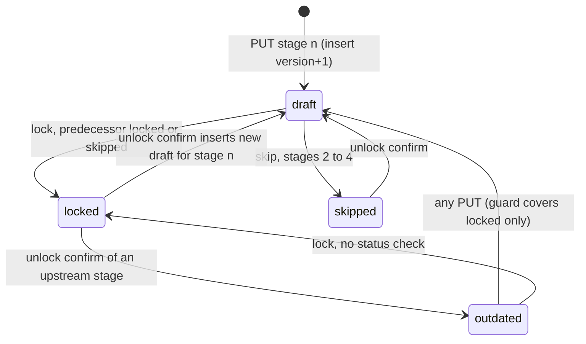
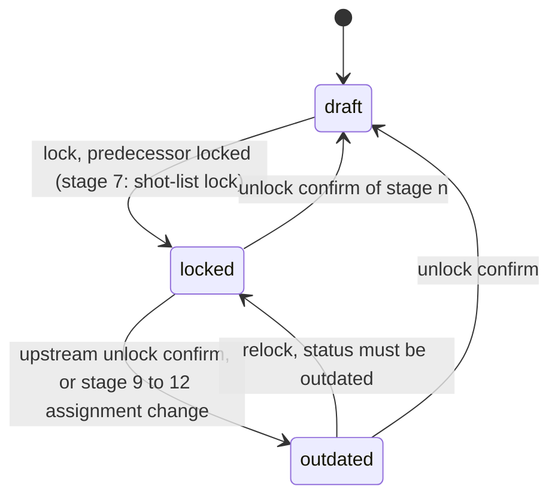
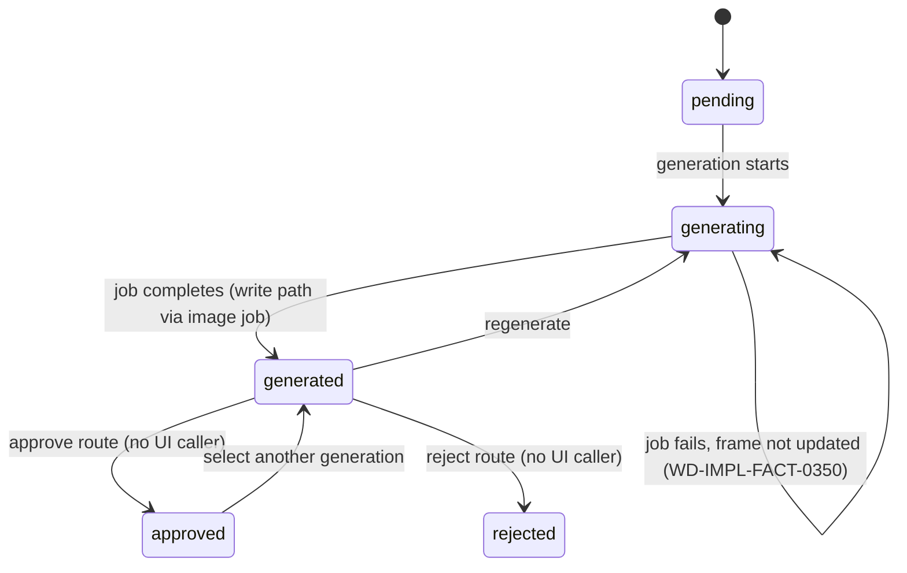
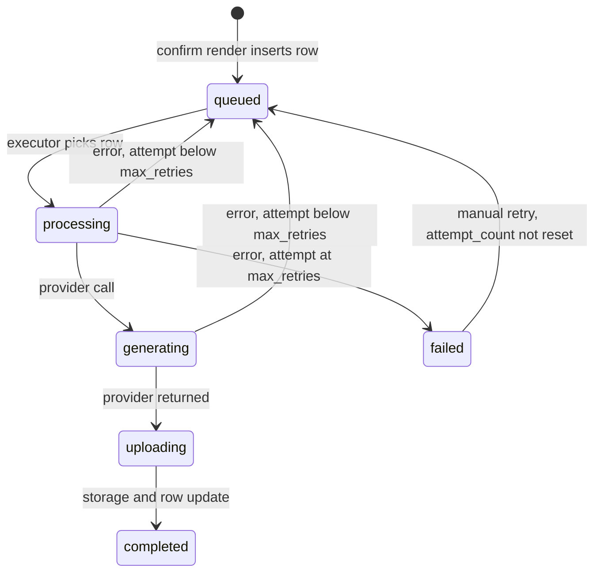

# 04. Domain and state model (effective)

**Scope.** This document is the effective domain model of WizardDirector (Aiuteur) at HEAD, reconstructed from code, migrations and the archaeology ledger. It gives one record per entity: code representations (every duplicate definition found), database representation, identity, relationships, creation, mutation, deletion, lifecycle, ownership, persistence, versioning, derived fields and competing representations. It also gives the client-side persisted state and a catalogue of same-concept, multiple-representation cases. It states facts only. Full state machines, transition tables and invalidation rules are in [10-VERSIONING-LOCKING-AND-INVALIDATION.md](10-VERSIONING-LOCKING-AND-INVALIDATION.md) and are not repeated here.

**Sources.** Ledger kinds ENTITY (38 entries), TABLE (63), FACT (359, cited by id), plus CAP, STATE, INV, DEAD, ROUTE and PROV ids where a record needs them. Reports: C-database and C-table-inventory (digested by a sub-agent that reports full reads, spot-checked here), V1, V3, V5, V6, V7, V8, V9, V10 (read by section, covering every entity record below), L-pressure sections 3 and 6, and H sections 0 to 7 and 10. R1a and R1b verdicts are applied where they exist. Not read for this document: V2, V4, E, I, J, K, R2. Their facts enter only through ledger ids. Repo spot-checks are listed in section 10.

**Reading notes.** Sibling documents: [00-README.md](00-README.md) (map), [01-overview.md](01-overview.md), [02-capabilities.md](02-capabilities.md), [03-workflows.md](03-workflows.md), [05-data-model.md](05-data-model.md) (full column lists), [07-assets-continuity.md](07-assets-continuity.md), [08-shots-frames-generation.md](08-shots-frames-generation.md), [09-ai-prompts.md](09-ai-prompts.md), [10-versioning-locking-invalidation.md](10-versioning-locking-invalidation.md), [11-architecture.md](11-architecture.md), [12-async-providers.md](12-async-providers.md), [13-tests.md](13-tests.md), [14-dead-dup.md](14-dead-dup.md), [15-pressure.md](15-pressure.md), [16-coverage-unknowns.md](16-coverage-unknowns.md), [17-ledger.md](17-ledger.md).

---

## 1. Conventions

- **Terms.** "Phase A" is project-level Stages 1 to 5. "Script Hub" is Stage 6. "Phase B" is per-scene Stages 7 to 12 (stage labels in section 5 row 24). "Scene asset instance" means a Stage 8 row. "Project asset" means a Stage 5 row.
- **Status vocabulary.** IMPLEMENTED, REACHABLE, FUNCTIONAL, PERSISTED, TESTED, PARTIAL, MOCK-ONLY, DEAD, ORPHANED, LEGACY, DUPLICATED, CONTRADICTED, UNKNOWN. A record's status line gives the ledger flags for its primary table or type where they exist.
- **Evidence.** Ledger ids are written in full (`WD-IMPL-<KIND>-NNNN`). Code is cited as `path:line`. Where a ledger entry carries a `correction` field, the corrected reading is used. Where the reports disagree, both readings are given.
- **Ledger-only.** Some records rest on ledger text that was not re-read in code for this document. They are marked as such in the status line.
- **Persistence.** "Transient" means the value exists only in a request, a React state, or a computed response. Client persistence is listed in section 4.

---

## 2. Entity inventory

| # | Entity | Primary code home | DB representation | Identity | Persisted | Status | Record |
|---|---|---|---|---|---|---|---|
| 1 | Project | `routes/projects.ts`, `types/project.ts` | `projects` | UUID; owner `user_id` | yes | IMPLEMENTED | 3.1 |
| 2 | Branch | DB trigger only | `branches` | UUID; UNIQUE(project_id, name) | yes | PARTIAL | 3.2 |
| 3 | Stage state (Phase A) | `routes/stageStates.ts`, `stageStateService.ts` | `stage_states` | UNIQUE(branch_id, stage_number, version) | yes, append-only | PARTIAL | 3.3 |
| 4 | Scene | `routes/projects.ts`, `types/scene.ts` | `scenes` | UUID; UNIQUE(branch_id, scene_number) | yes | PARTIAL | 3.4 |
| 5 | Scene stage lock (Phase B) | `routes/sceneStageLocks.ts` | `scenes.stage_locks` (quickies only), `scenes.shot_list_locked_at`, `scenes.status` | key "7" to "12" in JSONB | yes, overwrite-in-place | LEGACY, PARTIAL | 3.4 |
| 6 | Shot | `routes/projects.ts`, `types/scene.ts` | `shots` | UUID; UNIQUE(scene_id, shot_id) label | yes | PARTIAL | 3.5 |
| 7 | Shot prompt set (Stage 9 segments) | `promptGenerationService.ts`, `types/scene.ts` | prompt columns on `shots`, `text_field_versions` | shot UUID | yes | PARTIAL | 3.6 |
| 8 | Frame (start and end) | `frameGenerationService.ts`, `types/scene.ts` | `frames` | UUID; UNIQUE(shot_id, frame_type) | yes | PARTIAL | 3.7 |
| 9 | Frame link | `frames.ts` routes | `frame_links` | UUID; UNIQUE(target_frame_id) | yes | PARTIAL | 3.8 |
| 10 | Project asset | `routes/projectAssets.ts`, `types/asset.ts` | `project_assets` | UUID; no unique name | yes | PARTIAL | 3.9 |
| 11 | Asset generation attempt (project and scene) | attempt services | `project_asset_generation_attempts`, `scene_asset_generation_attempts` | UUID; one selected per parent | yes | PARTIAL | 3.10 |
| 12 | Asset angle variant | `projectAssets.ts` | `asset_angle_variants` | UNIQUE(project_asset_id, angle_type) | yes | PARTIAL | 3.11 |
| 13 | Location view and camera direction | `projectAssets.ts`, `locationResolverService.ts` | `location_views` | UNIQUE(project_asset_id, name) | yes | PARTIAL | 3.12 |
| 14 | Canonical location | `project_assets` row of type location | `project_assets`, `shots.location_asset_id` | project asset UUID | yes | PARTIAL | 3.13 |
| 15 | Scene asset instance | `routes/sceneAssets.ts`, `assetInheritanceService.ts` | `scene_asset_instances` | UNIQUE(scene_id, project_asset_id) | yes | PARTIAL | 3.14 |
| 16 | Scene asset suggestion | `sceneAssets.ts` | `scene_asset_suggestions` | UUID | yes | PARTIAL | 3.15 |
| 17 | Transformation event | `transformationEventService.ts` | `transformation_events` | UUID | yes | PARTIAL | 3.16 |
| 18 | Shot-asset assignment | `shotAssetAssignmentService.ts` | `shot_asset_assignments` | UNIQUE(shot_id, scene_asset_instance_id) | yes | PARTIAL | 3.17 |
| 19 | Location match event | `locationResolverService.ts` | `location_match_events` | UUID | yes, write-only | DEAD | 3.18 |
| 20 | Continuity base candidate, generation reference entry, continuity package | `continuityBaseService.ts`, `continuityCompositionService.ts` | none | none | no, computed | PARTIAL | 3.19 |
| 21 | Image generation job | `ImageGenerationService.ts` | `image_generation_jobs` | UUID; optional idempotency key | yes | PARTIAL | 3.20 |
| 22 | Video generation job | `videoGenerationService.ts`, `VideoJobExecutor.ts` | `video_generation_jobs` | UUID | yes | PARTIAL | 3.21 |
| 23 | Text field version | `textFieldVersionService.ts` | `text_field_versions` | UUID; polymorphic entity_id | yes | PARTIAL | 3.22 |
| 24 | Global asset (library) | `routes/assets.ts` | `global_assets` | UUID; owner `user_id` | yes | PARTIAL | 3.23 |
| 25 | Style capsule, library, application | `styleCapsuleService.ts`, `routes/styleCapsules.ts` | `style_capsules`, `style_capsule_libraries`, `style_capsule_applications` | UUID; UNIQUE(library_id, name) | yes | PARTIAL | 3.24 |
| 26 | Prompt template | `prompt-template.ts` | `prompt_templates` | UNIQUE(name, version) | yes | PARTIAL | 3.25 |
| 27 | Intake resolution and edit (Streamline "Ask Auteur") | commit RPC, `contextManager.ts` | `intake_resolutions`, `intake_resolution_edits` | UUID | yes | PARTIAL, DEAD (edits) | 3.26 |
| 28 | User credits | `userCreditsService.ts` | `user_credits` | UNIQUE(user_id) | yes | PARTIAL | 3.27 |
| 29 | Narrative artifacts (treatment, beat sheet, master script, scene text) | `stageStates.ts` content, Stage 2 to 4 components | `stage_states.content` JSONB | stage state row | yes | PARTIAL | 3.28 |

`auth.users` is Supabase-managed and is referenced by `user_id` throughout. The service-role bypass that governs ownership for every table is recorded in WD-IMPL-FACT-0002 and WD-IMPL-FACT-0171.

---

## 3. Entity records

### 3.1 Project
- **Code.** `Project` at `src/types/project.ts:57` (frontend, camelCase, 14 fields). `ProjectStatus` at `src/types/project.ts:1` has values draft, in-progress, complete, archived, but the list API returns the constant `'draft'` (V1 section 4.3). `ProjectType` at `src/types/project.ts:28` uses `'audio-visual'`. No backend project type was found in the reports. Backend rows are handled untyped (L-pressure section 3.3).
- **DB.** `projects` (WD-IMPL-TABLE-0001, WD-IMPL-TABLE-0029): `id`, `user_id` (FK auth.users, CASCADE), `title`, `target_length_min` and `target_length_max` (defaults 180 and 300), `project_type` CHECK (narrative, commercial, audio_visual), `content_rating` CHECK (G, PG, PG-13, M), `genre` TEXT[], `tonal_precision`, `active_branch_id` (FK branches), `aspect_ratio` CHECK (16:9, 9:16) (WD-IMPL-ENTITY-0038), `continuity_mode` CHECK (basic, advanced) (WD-IMPL-TABLE-0023), `writing_style_capsule_id` and `visual_style_capsule_id` (added by migration 004, never written by app code, WD-IMPL-FACT-0019 and WD-IMPL-FACT-0339), timestamps.
- **Identity.** UUID `id`. Owner key `user_id`. No natural key.
- **Relationships.** Parent of `branches` and, through cascades, of every project-owned table (section 8).
- **Creation.** The branch is created by the `on_project_created` trigger (WD-IMPL-FACT-0003). The UI path is Dashboard, NewProjectDialog, `POST /api/projects` with defaults `project_type` narrative, `content_rating` PG, target 180 and 300 (V1 section 4.2, `routes/projects.ts:553-637`). The `/projects/new` path is broken: it creates a project and a Stage 1 draft, then the lock returns 404 (WD-IMPL-FACT-0008, WD-IMPL-FACT-0358).
- **Mutation.** `PUT /api/projects/:id` (the only caller is Stage 1, V1 section 4.3, `routes/projects.ts:640-807`), `PUT /:id/continuity-mode` (`projects.ts:810-860`), and the streamline commit RPC `project_config` update (WD-IMPL-TABLE-0017).
- **Deletion.** `DELETE /api/projects/:id` deletes the row and relies on FK cascades (`projects.ts:3961-4004`). No storage object is removed by the route (WD-IMPL-FACT-0174). `global_assets.promoted_from_project_id` is NO ACTION, so deleting a project whose assets were promoted may be blocked. Not traced (UNKNOWN, C-table-inventory.md FK tables).
- **Lifecycle.** No live status column is used by the list (constant `'draft'`, V1 section 4.3). Stage progress is derived (3.3).
- **Ownership and auth.** Owner RLS policy (WD-IMPL-TABLE-0001). Backend uses the service-role client, so RLS does not apply to API traffic (WD-IMPL-FACT-0002, WD-IMPL-FACT-0063). Ownership is checked in route code (`projects.user_id = req.user.id`).
- **Persistence.** DB. ProjectView keeps `title`, `branch`, `aspectRatio` in React state (V1 section 5.1). Per-project localStorage keys are listed in section 4.
- **Versioning.** None. One row per project.
- **Derived.** `currentStage`, `stages[]`, `sceneProgress`, `updatedAt` are computed in `GET /api/projects` (`projects.ts:259-467`). `branch` falls back to the literal `'main'` because the embed is read as an array (WD-IMPL-FACT-0007, WD-IMPL-FACT-0149, UNKNOWN until runtime per V1).
- **Competing representations.** `project_type` is `'audio-visual'` in the frontend (`src/types/project.ts:31`, `Stage1InputMode.tsx:92`) and `'audio_visual'` in the DB and backend. The frontend value violates the CHECK (WD-IMPL-FACT-0006, WD-IMPL-FACT-0046, CONTRADICTED). The visual and writing capsule columns exist on the row and are read by several routes but never written (WD-IMPL-FACT-0019).
- **Status.** IMPLEMENTED for the row (TABLE-0001 flags Y, Y, Y, Y, N). The `audio-visual` path is CONTRADICTED.

### 3.2 Branch
- **Code.** No typed branch record in the reports. The branch appears as a name string on `Project.branch` (`src/types/project.ts:57`). Backend reads `branches` through embeds (`routes/projects.ts:279,444,490,529,597,617,751`).
- **DB.** `branches` (WD-IMPL-TABLE-0030, WD-IMPL-TABLE-0002): `id`, `project_id` (FK, CASCADE), `name`, `is_main`, `commit_message`, `parent_branch_id` (no reader, UNREF), `created_at`. UNIQUE(project_id, name). No `updated_at`. No DELETE policy.
- **Identity.** UUID. The only pointer is `projects.active_branch_id`. Scenes, assets, stage states and jobs are keyed by branch in code.
- **Creation.** Only the trigger `create_initial_branch` (WD-IMPL-FACT-0003, WD-IMPL-TABLE-0030). Application code never inserts a branch.
- **Mutation.** None in application code. Branch switching and creation are "coming soon" toasts (V1 section 4.1, V3 section 2).
- **Deletion.** Cascades from `projects`. Cascades to `stage_states`, `scenes`, `project_assets`, `intake_resolutions`, `image_generation_jobs`, `video_generation_jobs`, `location_match_events` (C-table-inventory.md FK tables).
- **Lifecycle.** Single Main branch per project in the code paths reported.
- **Ownership and auth.** Owner via project, RLS and service role as for projects.
- **Persistence.** DB. Name displayed in ProjectCard as `'main'` (WD-IMPL-FACT-0149).
- **Competing.** The DB name is "Main". The UI fallback is "main" (V1 section 4.3, contradiction 3, UNKNOWN until runtime). The `parent_branch_id` column is unused.
- **Status.** PARTIAL. The name read is CONTRADICTED (WD-IMPL-FACT-0149).

### 3.3 Stage state (Phase A, stages 1 to 5 used by the UI)
- **Code.** `StageState` at `src/lib/services/stageStateService.ts:6` (10 fields). `BackendStageStatus` at `stageStateService.ts:3` (draft, locked, invalidated, outdated, skipped). `StageStatus` at `src/types/project.ts:7` (locked, active, pending, outdated, skipped). `StageOrigin` at `src/types/project.ts:15`. `StageProgress` at `src/types/project.ts:41`. `StageLockStatus` at `src/lib/services/sceneStageLockService.ts:3` (3 values; Phase B). Backend `StageStateData` at `backend/src/services/continuityRiskAnalyzer.ts:29` (status union at `:34` without `skipped`). `StageStateRow` at `backend/src/routes/projects.ts:335`. Stage content shapes are in `treatmentService.ts:5`, `beatService.ts:5` (WD-IMPL-ENTITY-0008).
- **DB.** `stage_states` (WD-IMPL-TABLE-0031, WD-IMPL-TABLE-0009): `id`, `branch_id` (FK, CASCADE), `stage_number` (1 to 12; Phase A writes 1 to 5), `version`, `status` CHECK (draft, locked, invalidated, outdated, skipped), `origin` CHECK nullable (skipped, imported, ai-generated, authored) (WD-IMPL-TABLE-0013), `content` JSONB, `regeneration_guidance`, `inherited_from_stage_id` (self FK, no ON DELETE clause recorded), `created_by` (FK auth.users). Dead columns `prompt_template_version`, `final_prompt`, `langsmith_trace_id` (WD-IMPL-TABLE-0062). No `updated_at`. No UPDATE or DELETE path in app code.
- **Identity.** UNIQUE(branch_id, stage_number, version). Latest version is the max version.
- **Relationships.** Branch (CASCADE). `style_capsule_applications.stage_state_id` (CASCADE).
- **Creation.** `PUT /api/projects/:id/stages/:n` (INSERT version+1), lock, skip, unlock confirm, streamline commit RPC (migrations 041 to 044), streamline backfill, and the Stage 2 to 5 autosave effects (H section 1.2, which is the writer inventory).
- **Mutation.** None. Every change is an INSERT (H section 1.1, WD-IMPL-TABLE-0031). Lock copies the latest row's content with status locked. Unlock inserts a draft for the target stage and an outdated copy for each downstream locked or outdated stage. The transition table and rules are in doc 10.
- **Deletion.** No stage delete route. Rows go only with the branch or project (WD-IMPL-TABLE-0031).
- **Lifecycle.** A database trigger rejects a locked insert at stage n greater than 1 unless stage n-1 is locked or skipped (WD-IMPL-TABLE-0017, migration 044). `invalidated` is accepted by the CHECK and by the PUT validator but no code path writes it (WD-IMPL-ENTITY-0001, H section 1.1). Outdated status is erased to draft by any save of an outdated row (H section 1.5, WD-IMPL-FACT-0045).
- **Ownership and auth.** Route checks plus service role (WD-IMPL-FACT-0002).
- **Persistence.** DB. Client copy: `useProjectStageStates` holds an array in `useState`, not React Query (`src/lib/hooks/useStageState.ts:237-274`). ProjectView has its own `stages` and `currentStage` state (V1 section 5.1).
- **Versioning.** Append-only, versioned by row. No version-history UI (V3 section 2, "Version History" is a toast).
- **Derived.** `currentStage` in the list endpoint is the highest draft stage, otherwise min(highest locked + 1, 5), computed from latest rows (`projects.ts:296-330`). `GET /api/projects/:id` counts every version, so its `currentStage` differs (WD-IMPL-FACT-0217). Frontend status mapping: draft to active, invalidated and missing to pending (WD-IMPL-ENTITY-0001).
- **Competing representations.** Three status vocabularies (WD-IMPL-FACT-0281). `origin` is written NULL by lock, unlock, outdated and PUT without origin (WD-IMPL-FACT-0154, CONTRADICTED with the provenance badge intent). AI metadata exists both as dead columns and as `content` JSON fields (WD-IMPL-TABLE-0062). `frames.ts` reads `stage_states.state_data` and `project_id`, which do not exist (WD-IMPL-FACT-0141, WD-IMPL-FACT-0299, CONTRADICTED).
- **Status.** PARTIAL. Phase A content is PERSISTED and FUNCTIONAL. Dead-column readers are DEAD.

### 3.4 Scene and Phase B stage locks
- **Code.** `Scene` at `src/types/scene.ts:76` (17 fields, camelCase, includes `shots`, `continuityRisk`, `shotListLockedAt`, `isDeferred`, `assetInstances`). A second `Scene` at `src/lib/services/scriptService.ts:7` (5 fields, same name, different shape). `SceneData` at `backend/src/services/continuityRiskAnalyzer.ts:18` (5 fields, snake_case). `ScriptManifestScene` at `backend/src/utils/scriptManifest.ts:39` (9 fields). `SceneStatus` at `src/types/scene.ts:5` (6 values, equal to the DB CHECK, WD-IMPL-ENTITY-0003 and L-pressure section 3.1). `StageLockEntry` and `StageLocks` at `src/lib/services/sceneStageLockService.ts:5,10`. Backend `StageLockStatus` at `backend/src/routes/sceneStageLocks.ts:7` duplicates the frontend type.
- **DB, scene row.** `scenes` (WD-IMPL-TABLE-0042, WD-IMPL-TABLE-0010, WD-IMPL-TABLE-0003): `id`, `branch_id` (FK, CASCADE), `scene_number` (UNIQUE per branch, `003_add_scenes_table.sql:34`), `slug`, `script_excerpt`, `status` CHECK (draft, shot_list_ready, frames_locked, video_complete, outdated, continuity_broken), `end_state_summary` (read, no backend writer), `expected_characters`, `expected_location`, `expected_props` (cache from dependency extraction), `dependencies_extracted_at`, `shot_list_locked_at` (migration 014), `is_deferred` (migration 027), `end_frame_id` (no FK, unused, WD-IMPL-FACT-0168), `end_frame_thumbnail_url`.
- **DB, stage locks.** `scenes.stage_locks` JSONB, keys "7" to "12", values `{status: draft|locked|outdated, locked_at?}` (WD-IMPL-ENTITY-0003). Defined only in `backend/quickies-sql/add_stage_locks.sql:1`, a manual script that says "Ran successfully on prod" (WD-IMPL-FACT-0012, WD-IMPL-FACT-0143). Repo-level grep of `backend/migrations` finds zero occurrences this pass. Live presence is UNKNOWN. A database built only from numbered migrations lacks the column and the stage 7 lock and unlock routes fail (R1a verification, line 438).
- **Identity.** Scene UUID. Natural key (branch_id, scene_number). The slug embeds the number, for example `int-kitchen-day-3` (WD-IMPL-ENTITY-0009, V3 section 6.1). Transient frontend id `scene-N-<timestamp>` (V3 section 6.1, never sent to the backend).
- **Relationships.** Parent of shots, scene asset instances, scene asset suggestions, transformation events, image and video jobs, location match events (all CASCADE, C-table-inventory.md FK tables).
- **Creation.** `PUT /api/projects/:id/scenes` inserts unmatched rows with status draft (`routes/projects.ts:1478-1499`, WD-IMPL-FACT-0352).
- **Mutation.** `PUT /scenes` updates matched rows (slug, script_excerpt, expected arrays, dependencies_extracted_at) and never writes status, stage_locks, shot_list_locked_at, end_state_summary, is_deferred or end_frame fields (V3 section 6.2 step 7). Stage locks: `sceneStageLocks.ts` routes and `projects.ts` shot-list lock and unlock routes (H section 2.2). `status` is set by the lock trigger and by `video_complete` on job completion (H section 2.3). Defer and restore write `is_deferred` (WD-IMPL-FACT-0314).
- **Deletion.** `PUT /scenes` hard-deletes unmatched rows (`projects.ts:1420-1442`, WD-IMPL-FACT-0313). This cascades to shots, frames, jobs, instances and assignments. The operation is not transactional (WD-IMPL-FACT-0352). Matching is by `slug:number`, then by `scene_number` alone (V3 section 6.2 step 5).
- **Lifecycle.** Code writes draft, shot_list_ready and video_complete. Values frames_locked, outdated and continuity_broken have no writer (WD-IMPL-FACT-0209, WD-IMPL-FACT-0044). Stage lock states per key are draft, locked and outdated (WD-IMPL-ENTITY-0003). Full machine in doc 10.
- **Ownership and auth.** Branch-level ownership checks in routes. Service role. Anon direct read of `scene_number` and `slug` through `src/hooks/useSceneInfo.ts:26-29` (C-database.md section 5, WD-IMPL-FACT-0225).
- **Persistence.** DB. React Query key `['scenes', projectId]` (`Stage10FrameGeneration.tsx:230`, `Stage8VisualDefinition.tsx:219`, `ContentAccessCarousel.tsx:1011`).
- **Versioning.** None for scenes. Stage lock has no history (H section 7, "overwrite").
- **Derived.** Scene continuity risk (`safe`, `risky`, `broken`) is computed per request in `continuityRiskAnalyzer.ts:59-126` (V7 section 1). `sceneProgress` is computed in the list endpoint (V1 section 4.3). Scene `expected_*` values are a cache of dependency extraction. Asset extraction reads them with the Stage 4 manifest as fallback. The LLM receives names, types, scene numbers and style, not script text (WD-IMPL-ENTITY-0011).
- **Competing representations.** Stage 7 lock is held in both `shot_list_locked_at` and `stage_locks["7"]` (WD-IMPL-INVALIDATE-0008, section 5 row 1). Scene `status` and stage locks are separate, and `status` values can disagree with stage locks (WD-IMPL-FACT-0044). The three identities are transient id, slug and row UUID (WD-IMPL-ENTITY-0009). The `stage_locks` JSON is read with no version guard (WD-IMPL-INVALIDATE-0010).
- **Status.** Slice columns PERSISTED and FUNCTIONAL (WD-IMPL-TABLE-0003). `stage_locks` LEGACY and ORPHANED from the migration chain (WD-IMPL-TABLE-0042). Live state UNKNOWN.

### 3.5 Shot
- **Code.** `Shot` at `src/types/scene.ts:50` (22 fields, mixed camelCase and snake_case for camera and location fields, WD-IMPL-ENTITY-0028, L-pressure section 3.2). `ShotWithFrames` at `src/types/scene.ts:350`. Backend `ShotData` at `backend/src/services/promptGenerationService.ts:13` (21 snake_case fields). `ShotRowForMerge` at `backend/src/services/shotMergeService.ts:12`. `OriginalShotRow` and `ShotForInsert` at `backend/src/services/shotSplitService.ts:25,11`. A local `Shot` at `backend/src/services/shotValidationService.ts:28` (9 camelCase fields). LLM shapes `ExtractedShot`, `LLMShotRaw` at `backend/src/services/shotExtractionService.ts:20,53`. `ShotRef` at `backend/src/services/transformationEventService.ts:82`. Mappers: `transformShotForClient` at `backend/src/routes/projects.ts:190-223`, `toShotForInsert` at `backend/src/services/shotSplitService.ts:71`, `normalizeShot` at `src/lib/services/shotService.ts:21-45`, `toBackendShotUpdate` at `src/lib/services/shotService.ts:51`. Seven or more shot shapes across the two languages (L-pressure section 3.2).
- **DB.** `shots` (WD-IMPL-TABLE-0043): `id` UUID, `scene_id` (FK, CASCADE), `shot_id` TEXT with UNIQUE(scene_id, shot_id), `duration` (default 8), `dialogue`, `action`, `characters_foreground` and `characters_background` (TEXT[]), `setting`, `camera` (free text), `continuity_flags`, `beat_reference`, `shot_order` (no uniqueness), `camera_distance`, `camera_height`, `camera_movement` (no CHECK, WD-IMPL-FACT-0158), `camera_direction_id` (FK location_views, SET NULL), `location_asset_id` (FK project_assets, SET NULL), `location_match_confidence`, `location_match_source`, `location_match_notes`, `transformation_flags` (JSONB, write-only, WD-IMPL-FACT-0100), `start_continuity`, `selected_continuity_base_frame_id` (FK frames, SET NULL), prompt columns (3.6), timestamps with an `updated_at` trigger. No per-shot lock column (V8 section 1).
- **Identity.** UUID `id` (row identity and FK target). Display label `shot_id`, for example `1A`, `1A-1`, `1A-M` (WD-IMPL-ENTITY-0031). Extraction generates labels by scene index (WD-IMPL-FACT-0102).
- **Relationships.** Parent scene (CASCADE). Children: frames, video and image jobs, transformation events (`trigger_shot_id`), shot-asset assignments, location match events (all CASCADE). `transformation_events.completion_shot_id` is SET NULL (C-table-inventory.md FK tables).
- **Creation.** Only AI extraction: `POST /api/projects/:id/scenes/:sceneId/shots/extract` (`projects.ts:1711-1977`), triggered by Stage 7 mount when the list is empty (V8 section 2.1). Split and merge also insert rows (`projects.ts:2515-2788`). No manual add route or UI (WD-IMPL-FACT-0096).
- **Mutation.** PUT shot (inspector), reorder (`projects.ts:1980-2040`), split, merge, camera-direction assignment, Stage 9 prompt writes (3.6), location resolution (writes `location_asset_id` and match fields, WD-IMPL-ENTITY-0032).
- **Deletion.** `DELETE` shot (`projects.ts:2791-2840`) cascades to frames, jobs, assignments, transformation events and location match events. Text versions for the shot are orphaned because `text_field_versions` has no FK (WD-IMPL-FACT-0159). `location_views.established_from_shot_id` has no FK and is left dangling. The last shot in a scene cannot be deleted (WD-IMPL-FACT-0094, `projects.ts:2825-2831`). Split deletes the original row after re-inserting its assignments (`projects.ts:2558`, `2599`). Merge deletes two rows (`projects.ts:2713`, `2715`). Re-extraction does not delete existing shots, so a second run collides on the label (WD-IMPL-FACT-0160, V8 section 2.3, inferred from schema).
- **Lifecycle.** No per-shot status. Locking is scene-level (V8 section 1). Shot validation thresholds gate the Stage 7 lock (WD-IMPL-FACT-0091).
- **Ownership and auth.** Route check on project. Service role (WD-IMPL-FACT-0002).
- **Persistence.** DB. React Query key `['shots', projectId, sceneId]` (`Stage8VisualDefinition.tsx:296`, `ContentAccessCarousel.tsx:1026`). Stage 7 autosaves shot edits (WD-IMPL-FACT-0329).
- **Versioning.** None for shot rows. Prompt text history is in `text_field_versions` (3.6). `shot_order` has no uniqueness constraint (V8 section 1).
- **Derived.** Location state is computed on every shot GET (WD-IMPL-FACT-0333, `locationState` in `transformShotForClient`). Split copies the original duration to every new shot (WD-IMPL-FACT-0092). Merge sums durations and suffixes `-M` (WD-IMPL-FACT-0093).
- **Competing representations.** `requires_end_frame` (user override) and `ai_recommends_end_frame` (backfilled) are both live (section 5 row 11). `reference_image_order` and `end_frame_reference_image_order` are both read and written (row 12). `shots.setting` (text), `scenes.expected_location` (cache), `shots.location_asset_id` (canonical) and the location match columns are separate expressions of location (row 14, WD-IMPL-FACT-0081). Camera is free text in `camera` and also structured in three columns (WD-IMPL-FACT-0101). No lineage columns exist (WD-IMPL-FACT-0099).
- **Status.** PARTIAL. Columns PERSISTED. `transformation_flags` is write-only (WD-IMPL-FACT-0100, CONTRADICTED with WD-IMPL-CAP-0192 until corrected, see section 9).

### 3.6 Shot prompt set (Stage 9 "segments")
- **Code.** Frontend `PromptSet` at `src/types/scene.ts:286` (framePrompt, videoPrompt, systemPrompt, requiresEndFrame, aiRecommendsEndFrame, compatibleModels, referenceImageOrder, promptsGeneratedAt, duration). `systemPrompt` is never populated by the backend (V9 section 1). Backend `ShotData` at `promptGenerationService.ts:13`. There is no separate typed "segment" record. The Stage 9 "segments" are the per-shot prompt sets.
- **DB.** Columns on `shots` (WD-IMPL-ENTITY-0037, V9 section 1): `frame_prompt`, `video_prompt`, `requires_end_frame` (default TRUE), `ai_recommends_end_frame`, `compatible_models` (default `{Veo3}`), `reference_image_order` (JSONB), `end_frame_reference_image_order` (JSONB), `end_frame_prompt`, `prompts_generated_at`, `start_continuity` CHECK (none, match, camera_change), `ai_start_continuity`, `continuity_frame_prompt`, `selected_continuity_base_frame_id`. There is no separate start-frame prompt column. `frame_prompt` is the start-frame image prompt (V9 section 1).
- **Identity.** Owning shot UUID.
- **Creation.** `POST generate-prompts` (`projects.ts:3573-3891`) writes all prompt columns for each shot. Prompts are inline template literals, not `prompt_templates` rows (V9 section 3.3, WD-IMPL-FACT-0107).
- **Mutation.** `PUT .../prompts` (`projects.ts:3459-3570`), reference-image PUT, `PUT end-frame-prompt` (no UI caller, V9 section 4), frame regenerate with correction or prompt (`frames.ts:759-762`, `837-840`), text version write-back (`textFieldVersionService.ts:226-241`), camera-change generation writes `continuity_frame_prompt` (`frameGenerationService.ts:820-827`).
- **Overwrite behavior.** Generate-prompts overwrites `start_continuity` with the AI value (`projects.ts:3855-3856`) and replaces both reference order arrays wholesale (V7 section 8, H section 7). A user choice in `start_continuity` is discarded on regeneration.
- **Deletion.** With the shot.
- **Lifecycle.** `prompts_generated_at` is the only timestamp. No status column.
- **Versioning.** `frame_prompt`, `video_prompt` and `end_frame_prompt` are versioned in `text_field_versions` (cap 8, one selected row per field, selection written back to the shot column, `textFieldVersionService.ts:226-241`, WD-IMPL-ENTITY-0035). Other prompt columns are not versioned.
- **Derived.** The video prompt snapshot is taken from `shots.video_prompt` at confirm time (V10 section 5.2, H section 5.5). `end_frame_prompt` falls back to `frame_prompt` plus a fixed suffix when empty (`frameGenerationService.ts:466-468`, `1195-1197`).
- **Competing representations.** `continuity_frame_prompt` is written by camera-change generation and by the generate-continuity-prompt route, but no generation path reads it (WD-IMPL-DEAD-0024, V7 section 8, CONTRADICTED with the Stage 9 help text). Prompt text limits differ between UI and server (WD-IMPL-FACT-0115). `frame_prompt_snapshot` is stored on jobs and never sent to the provider (WD-IMPL-DEAD-0095, V10 section 5.2).
- **Status.** PARTIAL. Columns PERSISTED. `continuity_frame_prompt` read path not found.

### 3.7 Frame (start and end)
- **Code.** `Frame` at `src/types/scene.ts:327` (camelCase, 20 fields) and `Frame` at `backend/src/services/frameGenerationService.ts:11` (20 fields, same list, L-pressure section 3.4). `FrameStatus` at `src/types/scene.ts:323` and `frameGenerationService.ts:7`. `FrameType` at `src/types/scene.ts:324` and `frameGenerationService.ts:8`. `GenerationMode` at `src/types/scene.ts:325` and `frameGenerationService.ts:9`. `FrameJobStatus` at `src/types/scene.ts:394` and `frameGenerationService.ts:110`. `ShotWithFrames` at `src/types/scene.ts:350` and `frameGenerationService.ts:34`. `FramePair` at `src/types/scene.ts:314`. `FrameGeneration` at `src/lib/services/frameService.ts:67` (7 fields). `ApprovedFrameRow` at `backend/src/services/continuityBaseService.ts:46`. `SelectedContinuityBaseFrameRow` at `backend/src/services/frameGenerationService.ts:86`.
- **DB.** `frames` (WD-IMPL-TABLE-0044, WD-IMPL-ENTITY-0033): `shot_id` (FK, CASCADE), `frame_type` CHECK (start, end), `status` CHECK (pending default, generating, generated, approved, rejected), `image_url`, `storage_path`, `current_job_id` (FK image_generation_jobs, SET NULL), `generation_count`, `total_cost_credits`, `previous_frame_id`, `generated_from_frame_id`, `promoted_to_view_id` (SET NULL), `continuity_base_role` CHECK (reuse_match, reuse_edit, camera_change_ref, match_copy, manual; nullable, migration 040), `prompt_snapshot`, `inpaint_count`, `last_inpaint_mask_path`, `generated_at`, `approved_at`, timestamps with trigger. UNIQUE(shot_id, frame_type).
- **Identity.** UUID. Natural key (shot_id, frame_type).
- **Relationships.** Shot (CASCADE). Frame links in both directions (CASCADE). `video_generation_jobs.start_frame_id` and `end_frame_id` (NO ACTION). `shots.selected_continuity_base_frame_id` (SET NULL). `location_views.promoted_from_frame_id` (SET NULL).
- **Creation.** On demand, not at shot creation. `frameGenerationService.ts:510-520` inserts a new frame after a lookup finds none. ENTITY-0033 describes "one start and one end row per shot" as the steady state.
- **Mutation.** Generation completion updates the frame by (shot_id, frame_type), not by `current_job_id` (H section 4.2 F3, `ImageGenerationService.ts:521-531`). Status endpoint sets generated or rejected (F4, F5). Regenerate deletes incoming links and resets status (F7, `frames.ts:365-410`). Select-generation changes `image_url` and `prompt_snapshot` (F10, `frames.ts:1340-1372`). Upload variant, copy-frame, batch-link-copy and inpaint also write (V7 section 7, V9 section 6). Approve and reject routes exist (`frames.ts:297-356`), but no UI calls them (WD-IMPL-FACT-0109; `frameService.approveFrame` and `rejectFrame` have zero callers in `src`).
- **Generation history.** A frame has no history table. Its history is the set of completed `image_generation_jobs` with the same `shot_id` and `job_type` (`frames.ts:1282-1288`). The selected one is `current_job_id` (WD-IMPL-ENTITY-0034).
- **Deletion.** No frame delete route. Frames leave only by shot cascade (WD-IMPL-TABLE-0044). Deleting a generation (`frames.ts:1436-1470`) deletes a job row and a storage object from bucket `frames` (WD-IMPL-FACT-0155, bucket never written).
- **Lifecycle.** pending to generating to generated, approved or rejected, with regenerate returning to generating. A failed job leaves the frame in `generating` because the failure path does not update the frame (H section 4.2 F6, WD-IMPL-FACT-0350). The only path to rejected is the status endpoint, which the UI does not call (WD-IMPL-FACT-0219). Full machine in doc 10.
- **Ownership and auth.** Route checks project ownership. Approve checks by `frameId` and does not verify that the frame belongs to the scene (H section 4.2 F8). Service role (WD-IMPL-FACT-0002).
- **Persistence.** DB. React Query `['frames', projectId, sceneId]` (`Stage10FrameGeneration.tsx:250`, invalidated 24 times). `FramePanel.tsx:205` uses `['frame-generations', projectId, sceneId, frameId]`. Stage 10 polls every 2 s while any frame is generating (H section 4.3).
- **Versioning.** Generation jobs are the history (above). Approval state is not versioned.
- **Derived.** Stage 10 progress counts frames in status generating (`frameService.ts:670-710`). `total_cost_credits` is incremented on every status poll that sees completion, with no idempotence guard (H section 4.2 F4, `frameGenerationService.ts:1365-1427`).
- **Competing representations.** `frames.status` value `invalidated` is written by shot unlock but rejected by the CHECK (WD-IMPL-FACT-0116, WD-IMPL-FACT-0207, WD-IMPL-FACT-0284). Frame status is UNREACHABLE for approved or rejected from the UI (WD-IMPL-FACT-0109). Frame storage deletion targets a bucket that is never written (WD-IMPL-FACT-0155). `FrameStatus` is defined twice (above).
- **Status.** PARTIAL. Table CONTRADICTED on the `invalidated` write (TABLE-0044). Approval states DEAD in the UI.

### 3.8 Frame link
- **Code.** `FrameLink` at `src/types/scene.ts:381`. The continuity link shape used by Stage 10 (`linkType`, `role`, label from the other shot) is built at `src/components/pipeline/Stage10FrameGeneration.tsx:644-684` (WD-IMPL-ENTITY-0026). Backend has no separate type in the reports.
- **DB.** `frame_links` (WD-IMPL-TABLE-0045, WD-IMPL-TABLE-0021): `id`, `source_frame_id` (CASCADE), `target_frame_id` (CASCADE), `link_type` CHECK (match default, reference), `created_at`. UNIQUE(target_frame_id) after migration 035, which dropped UNIQUE(target_frame_id, link_type). No `updated_at`.
- **Identity.** UUID. Unique per target frame.
- **Creation.** Copy-frame, batch-link-copy and add-frame-as-reference, each deleting the target's prior link then inserting (H section 4.4; the frame_links insert is at `frames.ts:1038`).
- **Mutation.** Propagation: `propagateFrameLinks` (`frameGenerationService.ts:1545-1596`) copies the source image into `match` targets and rewrites their prompt snapshot. Call sites `frames.ts:408`, `468`, `1372` (H section 4.4).
- **Deletion.** Cascades with either frame. Explicitly deleted by regenerate (`frames.ts:393`), upload, select-generation (`frames.ts:1350`), the DELETE frame-links route and pull-reference replacement. Not deleted by correction, edited-prompt regenerate or inpaint (H section 4.4).
- **Lifecycle.** Existence only. `start_continuity` set to none does not delete links (V7 section 11).
- **Ownership and auth.** RLS owner policy on `source_frame_id` (C-database.md section 5). Service role. Authorization gaps on continuity routes are recorded in WD-IMPL-FACT-0089.
- **Persistence.** DB.
- **Competing representations.** `match` links are reactive. `reference` links are one-shot copies (`035` header, V7 section 2.3). `reference` type is used by the camera-change lookup (WD-IMPL-ENTITY-0036). Cross-scene links surface only for adjacent scenes (WD-IMPL-ENTITY-0026).
- **Status.** PARTIAL. Propagation was not fully traced (WD-IMPL-TABLE-0045 notes).

### 3.9 Project asset (Stage 5, including character, prop, location and extra_archetype)
- **Code.** `ProjectAsset` at `src/types/asset.ts:19` (22 fields, snake_case). `GlobalAsset` at `src/types/asset.ts:3`. `AssetType` at `src/types/asset.ts:1` (character, prop, location, extra_archetype). `AssetDecision` at `src/types/asset.ts:50` (keep, defer, delete). `ProjectAssetGenerationAttempt` at `src/types/asset.ts:52`. `AssetAngleVariant` at `src/types/asset.ts:133`. `LocationView` at `src/types/asset.ts:166`. `SceneAsset` at `src/types/scene.ts:100` is a different entity with the same family name (9 fields, camelCase). Backend has no `ProjectAsset` type; rows are handled with `any` (33 occurrences in routes, 17 in services, L-pressure section 3.3).
- **DB.** `project_assets` (WD-IMPL-TABLE-0037, WD-IMPL-ENTITY-0010): `project_id` and `branch_id` (CASCADE), `global_asset_id` (FK global_assets, SET NULL), `source_version`, `name` NOT NULL, `asset_type` CHECK (character, prop, location, extra_archetype), `description` NOT NULL (an empty value can be written as NULL, WD-IMPL-FACT-0156), `image_prompt`, `image_key_url`, `visual_style_capsule_id` (SET NULL), `locked` (default false), `deferred`, `scene_numbers` int[], `source` CHECK (extracted, manual, cloned, streamline_import), `style_outdated`, `location_aliases` JSONB array (migration 039), `overridden_fields` text[], `last_synced_at` (write-only), timestamps. No UNIQUE on any name or type. No `metadata` column (WD-IMPL-ENTITY-0010, V5 section 2.1).
- **Identity.** UUID. Name is not unique (V5 section 2.3). Extraction dedupes by `name.trim().toLowerCase()` without type (`assetExtractionService.ts:174,210,244`). Preview and confirm key on `${type}:${name}` (`projectAssets.ts:334-343`). A character and a prop with the same name can collapse into one entity.
- **Relationships.** Attempts, angle variants, location views and scene asset instances (all CASCADE). `shots.location_asset_id` (SET NULL). `scene_asset_suggestions.asset_id` (SET NULL, never written). `location_match_events.result_location_asset_id` (SET NULL). Global asset (optional).
- **Creation.** Extract-confirm (`projectAssets.ts:273-377`, LLM pass 2). Deprecated one-shot extract (`projectAssets.ts:44-158`). Create route (`source` defaults to manual). Clone from global (`projectAssets.ts:1756-2041`, `source` not set, so the default `extracted` is stored, WD-IMPL-FACT-0179). Split (`projectAssets.ts:981-1124`). Stage 8 create-with-asset inserts `locked: true` (`sceneAssets.ts:925-962`, WD-IMPL-FACT-0214). Extraction does not check existing rows (WD-IMPL-FACT-0221).
- **Mutation.** PUT (blocked when locked, `projectAssets.ts:585-590`). Lock (`:1527-1585`) and lock-all (`:1675-1755`). Defer. Mark-style-outdated (`:1587-1618`). Clear-all images (`:1651`). Generate, upload, analyze and edit image. Merge (`:731-931`). Sync from global (`:2047-2280`). Promote (`:2286-2350`, does not link the project asset back, WD-IMPL-FACT-0032).
- **Deletion.** `DELETE` (`projectAssets.ts:673-730`) is blocked when `locked` (`:702-706`). Cascades to attempts, angle variants, location views and scene instances. Scene instances cascade to their attempts, transformation events and assignments. Storage objects are not removed (WD-IMPL-FACT-0174). Merge deletes the absorbed asset.
- **Lifecycle.** `locked` is set true by lock and lock-all and is never reverted. No unlock route (V5 section 2.4, WD-IMPL-FACT-0157). Stage 5 finalize is two requests with no rollback (WD-IMPL-FACT-0212). `style_outdated` is a flag set by the change-style action and cleared by a successful master job (V5 section 2.6).
- **Ownership and auth.** Route checks `projects.user_id`. Service role.
- **Persistence.** DB. React Query `['project-assets', projectId]` (`AssetDrawer.tsx:173`). Filter state in `AssetFilterModal.tsx` is transient.
- **Versioning.** Image history in `project_asset_generation_attempts` (3.10). No history for name or description (V5 section 2.5).
- **Derived.** `image_key_url` mirrors the selected attempt, except on the bypass paths listed in V5 section 2.5. `style_outdated` is derived from the style-change action.
- **Competing representations.** Description exists on the project asset, the global asset and the scene instance (section 5). `visual_style_capsule_id` is a snapshot taken at insert and not updated on style change (V5 section 9). The `asset_type` union in the frontend includes `extra_archetype`, but `AssetDrawer.tsx:62-78` and `AssetMatchModal.tsx:43-59` lack it, and rendering such an asset throws (V5 section 2.2). The frontend `source` union lacks `streamline_import` (`src/types/asset.ts:36`, section 5 row 21). `overridden_fields` is informational and does not prevent sync (V5 section 6).
- **Status.** PARTIAL. Table CONTRADICTED on the `description` NOT NULL path and the `metadata` phantom (DEAD).

### 3.10 Asset generation attempt (project and scene)
- **Code.** `ProjectAssetGenerationAttempt` at `src/types/asset.ts:52`. `SceneAssetGenerationAttempt` at `src/types/scene.ts:143`. `ImageGenerationJobResponse` at `src/lib/services/projectAssetService.ts:33`. Attempt logic is in `backend/src/services/projectAssetAttemptsService.ts` and `sceneAssetAttemptsService.ts` (no separate type in the reports).
- **DB, project.** `project_asset_generation_attempts` (WD-IMPL-TABLE-0038): `project_asset_id` (CASCADE), `image_url` NOT NULL, `storage_path`, `source` CHECK (generated, uploaded), `is_selected`, `attempt_number`, `original_filename`, `file_size_bytes`, `mime_type` (the last three write-only). Partial unique index: at most one selected per asset (`023:47-51`).
- **DB, scene.** `scene_asset_generation_attempts` (WD-IMPL-TABLE-0049): `scene_asset_instance_id` (CASCADE), `source` CHECK (generated, uploaded, master_copy), `is_selected` with partial unique index (`022:43-45`), `attempt_number`, `image_generation_job_id` (SET NULL), `prompt_snapshot`, `cost_credits`, `copied_from_url`, file metadata (write-only).
- **Identity.** UUID and attempt number. Selected row per parent.
- **Caps.** Project 4 (`projectAssetAttemptsService.ts:9`). Scene 8 (`sceneAssetAttemptsService.ts:8`). Enforcement is check-then-delete with no transaction (WD-IMPL-FACT-0152).
- **Creation.** Job completion (`ImageGenerationService.ts:400`, `456-478`), upload (`projectAssets.ts:1326`, `sceneAssets.ts:1713`), use-master (`sceneAssets.ts:1296-1339`), and a lazy backfill on list that creates a selected `generated` row from the current image (V6 section 1.2, V5 section 2.5).
- **Mutation.** Select deselects all, selects one, then writes the parent image pointer in separate statements (non-atomic, V5 section 2.5, H section 3.2). Delete refuses the selected row, then deletes row and object. Cap enforcement deletes the oldest non-selected row and its storage object, which can remove an uploaded original (V5 section 2.5).
- **Deletion.** Cascades with the parent. Storage objects are not removed when the parent is deleted (WD-IMPL-FACT-0174).
- **Ownership.** Service role plus route checks.
- **Persistence.** DB. React Query `['project-asset-attempts', projectId, assetId]` (`ProjectAssetCarousel.tsx:51`) and `['scene-asset-attempts', projectId, sceneId, instanceId]` (`GenerationAttemptCarousel.tsx:63`).
- **Derived.** The parent's `image_key_url` and `selected` row must agree. Several writers bypass the attempts table (V5 section 2.5, section 5 row 13).
- **Competing representations.** Project and scene variants differ in source values (scene has `master_copy`), cap (4 versus 8) and metadata columns. Both are the same concept, "image history for a parent" (WD-IMPL-FACT-0152).
- **Status.** PARTIAL. PERSISTED. Write-only metadata columns.

### 3.11 Asset angle variant (character only)
- **Code.** `AssetAngleVariant` at `src/types/asset.ts:133`. `AngleType` at `src/types/asset.ts:131`. `ANGLE_PROMPTS` is defined in `src/types/asset.ts:153-158` and in the backend image-generation service (V5 section 7). Backend `AngleVariantData` at `backend/src/services/promptGenerationService.ts:38`.
- **DB.** `asset_angle_variants` (WD-IMPL-TABLE-0039, WD-IMPL-ENTITY-0012): `project_asset_id` (CASCADE), `angle_type` CHECK (front, side, three_quarter, back), `image_url`, `storage_path`, `image_generation_job_id` (NO ACTION FK), `prompt_snapshot` (write-only), `status` CHECK (pending, generating, completed, failed), UNIQUE(project_asset_id, angle_type), `updated_at` trigger.
- **Creation.** Generate route upserts a `pending` row per angle (`projectAssets.ts:2520-2637`). Character type only (`projectAssets.ts:2560`).
- **Mutation.** Job start sets `generating` and the prompt snapshot. Completion and failure set the terminal status. Reads do not filter by status (WD-IMPL-TABLE-0039).
- **Deletion.** Delete removes storage and row (`projectAssets.ts:2643-2695`). Cascades with the parent asset.
- **Lifecycle.** pending, generating, completed, failed.
- **Derived.** Prompt built as `${ANGLE_PROMPTS[angle]} of ${asset.description}` at generation time (V5 section 7).
- **Versioning.** None. Never invalidated when the master description or image changes (V5 section 7).
- **Consumers.** Frame prompt and reference selection: `projects.ts:3665-3690`, `frames.ts:1729-1741`, `continuityCompositionService.ts:549-567`, `promptGenerationService.ts:379-382`.
- **Status.** PARTIAL. PERSISTED. Dialog polls every 2 s while any angle is generating (V5 section 7).

### 3.12 Location view and camera direction
- **Code.** `LocationView` at `src/types/asset.ts:166`. `LocationViewType` at `src/types/asset.ts:161`. `LocationViewSource` at `src/types/asset.ts:164`. `LocationViewSummary` at `src/types/locationContinuity.ts:41` and at `backend/src/services/continuityCompositionService.ts:38` (two definitions). `LocationViewData` at `backend/src/services/promptGenerationService.ts:44`. `CameraDirectionParent` at `backend/src/services/locationResolverService.ts:22`.
- **DB.** `location_views` (WD-IMPL-TABLE-0040, WD-IMPL-TABLE-0019, WD-IMPL-ENTITY-0013): `project_asset_id` (CASCADE), `name` (system key, UNIQUE per asset), `alias`, `description`, `view_type` CHECK (establishing, direction), `camera_distance` CHECK (wide default, medium, close), `camera_height` CHECK (eye_level default, high_angle, low_angle, overhead, ground_level), `image_key_url`, `is_primary`, `source` CHECK (user, established, stage7_inferred), `established_from_scene` (text), `established_from_shot_id` (no FK, dangling after shot delete), `promoted_from_frame_id` (SET NULL, migration 040), `sort_order`.
- **Camera direction.** A camera direction is a `location_views` row with `view_type = direction` (WD-IMPL-ENTITY-0023). `shots.camera_direction_id` points to it (SET NULL). The shot's location is derived from the direction when assigned through the camera-direction route (`projects.ts:2180-2313`). Establishing views share the table but the route never selects them as camera direction.
- **Creation.** Suggest-defaults (three rows, `source` user, `projectAssets.ts:2854-2975`). Create (`projectAssets.ts:2761-2848`, 409 on duplicate name). Stage 7 inference (`projects.ts:1832-1880`, `source` stage7_inferred, camera_distance wide, camera_height eye_level or overhead). Establish from frame (`projectAssets.ts:3193-3287`, which copies shot camera fields and sets `frames.promoted_to_view_id`).
- **Mutation.** PUT (`projectAssets.ts:2981-3045`, sets primary and unsets others). Upload (`:3051-3122`). Generate image (`:3298-3448`).
- **Deletion.** Row delete (`projectAssets.ts:3128-3181`). The route deletes the storage object derived from `image_key_url`. For an established view this deletes the frame's image in the shared bucket (V5 section 8). `shots.camera_direction_id` is set NULL.
- **Lifecycle.** None.
- **Ownership.** Route checks, service role.
- **Derived.** Fallback primary direction for unmatched shots is application convention (H section 7).
- **Competing representations.** Camera is free text (`shots.camera`), structured fields on shots without CHECK (WD-IMPL-FACT-0101, WD-IMPL-FACT-0158), and structured fields on views with CHECK. The UI names new directions `direction_${count+1}`, which collides with an existing name after a delete (V5 section 8).
- **Status.** PARTIAL. PERSISTED.

### 3.13 Canonical location (project asset of type location)
- **Code.** No separate type. `ShotLocationState` at `src/types/locationContinuity.ts:64` and `backend/src/services/continuityCompositionService.ts:53`. `LocationResolvableShotRow` at `backend/src/routes/projects.ts:32`. `LocationResolveResult` in `locationResolverService.ts`.
- **DB.** `project_assets` rows with `asset_type = location` on the active branch (WD-IMPL-ENTITY-0022). `location_aliases` (JSONB array, migration 039). Children: `location_views`. Referenced by `shots.location_asset_id`.
- **Identity.** Project asset UUID. Names are read from branch-scoped rows only (WD-IMPL-ENTITY-0022).
- **Creation.** As any project asset of type location (extraction, create, clone). Shot resolution does not create a location.
- **Mutation.** Resolver writes `shots.location_asset_id` and the match columns (`locationResolverService.ts`, called from `projects.ts:1951`, `2142`, `2488`, `2606`, `2746`). Alias edit exists in the API only (`projectAssets.ts:628-638`, no frontend control, WD-IMPL-TABLE-0022).
- **Resolution rules.** Deterministic. Constants and decision rules are in `locationResolverService.ts` (WD-IMPL-FACT-0079, V7 section 3.2). Auto-apply confidence is 0.72 in the route. Shot state classifiers disagree: route 0.72 with an `ambiguous` state; composition 0.8 with no `ambiguous` state (WD-IMPL-FACT-0083, WD-IMPL-FACT-0344, CONTRADICTED).
- **Competing representations.** Location appears as `shots.setting` (text), `scenes.expected_location` (text cache), `shots.location_asset_id` (canonical), `location_views.established_from_scene` (text) and `location_match_events` (DEAD audit), per section 5 row 14.
- **Status.** PARTIAL. Resolver tested (WD-IMPL-FACT-0079).

### 3.14 Scene asset instance (Stage 8)
- **Code.** `SceneAssetInstance` at `src/types/scene.ts:113` (19 fields, snake_case). `SceneAsset` at `src/types/scene.ts:100` (9 fields, camelCase, different entity). `SceneAssetInstanceData` at `backend/src/services/promptGenerationService.ts:57` (16 fields; 8 shared with the frontend, 11 frontend-only, L-pressure section 3.3). `InstanceWithAsset` at `backend/src/services/storyContextService.ts:35`. `LocalContextSceneAsset` at `backend/src/services/contextManager.ts:51`.
- **DB.** `scene_asset_instances` (WD-IMPL-TABLE-0048, WD-IMPL-ENTITY-0017): `scene_id` (CASCADE), `project_asset_id` (CASCADE), `description_override`, `effective_description` (stored snapshot, not synced, WD-IMPL-FACT-0161), `image_key_url`, `status_tags` TEXT[], `carry_forward` (default true), `inherited_from_instance_id` (SET NULL), `modification_count` and `last_modified_field` (trigger, WD-IMPL-FACT-0162), `modification_reason`, `use_master_as_is`, `selected_master_reference_url`, `selected_master_reference_source` CHECK (stage5_master, prior_scene_instance, transformation), `selected_master_reference_instance_id` (SET NULL), timestamps. UNIQUE(scene_id, project_asset_id).
- **Identity.** UUID. Natural key (scene, project asset).
- **Creation.** Several paths (V6 section 3 table): inherit from scene N-1 (`assetInheritanceService.ts:66-96`), bootstrap for scene 1 from locked or deferred project assets (`:184-188`), populate from dependencies (`sceneAssets.ts:1029-1103`), AI detect (relevance then create), manual add from the library (`AssetDrawer.tsx`), create new inline (`sceneAssets.ts:925-962`), and story-context accept. Only inherit and bootstrap copy an image. Every other path leaves `image_key_url` NULL, and the Stage 8 Proceed gate blocks until each instance has an image (`Stage8VisualDefinition.tsx:713-720`).
- **Mutation.** PUT (`sceneAssets.ts:582-656`): `effective_description` changes only when `descriptionOverride` is in the body. Tags and carry-forward. Select attempt. Upload (sets `use_master_as_is` false, `sceneAssets.ts:1748-1758`). Use-master. Select-master-reference (`sceneAssets.ts:1628-1638`). Generation completion (`ImageGenerationService.ts:484-488`). Transformation events write only through their own table.
- **Deletion.** `DELETE` (`sceneAssets.ts:690-692`) cascades to attempts, transformation events and shot assignments. Storage is not removed (C-database.md section 4.3). Prior-scene deletion sets `inherited_from_instance_id` NULL.
- **Lifecycle.** No status column. `status_tags` includes the literal `'locked'`, which disables client controls without a server check (V6 section 6.3). `use_master_as_is` flips with upload and select.
- **Ownership and auth.** Service role. Route checks (V6 section 15).
- **Persistence.** DB. React Query `['scene-assets', projectId, sceneId]` (`Stage8VisualDefinition.tsx:229`, invalidated 19 times).
- **Versioning.** `description_override` history in `text_field_versions` (cap 8). Images in `scene_asset_generation_attempts` (cap 8). `modification_count` increments on every UPDATE, including image-job completion and attempt selection (WD-IMPL-FACT-0162).
- **Derived.** `effective_description` is stored, computed at write time as `override ?? project_asset.description ?? ''` (`assetInheritanceService.ts:272`). The list badge "locked" is computed from `image_key_url` and `modification_count` (V6 section 6.3 item 3). The source badge is derived from `inherited_from_instance_id` (`SceneAssetListPanel.tsx:55-58`).
- **Competing representations.** Description triplet: `description_override`, `effective_description`, and `text_field_versions` rows, with partial sync (V6 section 5, WD-IMPL-FACT-0161). Five meanings of "locked" (V6 section 6.3). `use_master_as_is` and selected master reference. `selected_master_reference_source` and `_instance_id` are written from the request body and have no backend reader (C-table-inventory.md per-table notes). `effective_description` can be the empty string (V6 section 5).
- **Status.** PARTIAL. Table PERSISTED with write-only and read-only columns.

### 3.15 Scene asset suggestion
- **Code.** `SceneAssetSuggestion` at `src/types/scene.ts:172`. `SceneAssetRelevanceResult` at `src/types/scene.ts:223` and at `backend/src/services/sceneAssetRelevanceService.ts:13` (same name, two definitions).
- **DB.** `scene_asset_suggestions` (WD-IMPL-TABLE-0050, WD-IMPL-ENTITY-0019): `scene_id` (CASCADE), `asset_id` (FK project_assets, SET NULL, never written), `name`, `asset_type` CHECK (character, location, prop; no extra_archetype), `description`, `justification`, `suggested_by` (default `ai_relevance`), `accepted`, `dismissed`, `updated_at` (no trigger, set by hand at `sceneAssets.ts:847`). One FOR ALL policy.
- **Identity.** UUID.
- **Creation.** Relevance output `new_assets_required` (`sceneAssets.ts:793-810`). The LLM `asset_type` is not validated, so one bad value fails the bulk insert (WD-IMPL-FACT-0163).
- **Mutation.** Patch to accept or dismiss (`sceneAssets.ts:847-857`). Accepting does not set `asset_id`.
- **Deletion.** Cascades with the scene.
- **Status.** PARTIAL. `asset_id` is never written, so an accepted suggestion has no link to the asset it created.

### 3.16 Transformation event
- **Code.** `TransformationEvent` at `src/types/scene.ts:27` and at `backend/src/services/transformationEventService.ts:19`. `ShotAssetOverride` at `backend/src/services/transformationEventService.ts:43`. `TransformationEventCardProps` at `src/components/pipeline/Stage8/TransformationEventCard.tsx:24`.
- **DB.** `transformation_events` (WD-IMPL-TABLE-0051, WD-IMPL-ENTITY-0020): `scene_asset_instance_id` (CASCADE), `scene_id` (CASCADE), `trigger_shot_id` (CASCADE), `completion_shot_id` (SET NULL), `transformation_type` CHECK (instant, gradual, within_shot), `detected_by` CHECK (stage7_extraction, stage8_relevance, manual), `pre_description` and `post_description` NOT NULL, `transformation_narrative`, `pre_image_key_url` (accepted from the create body at `sceneAssets.ts:1803` and `transformationEventService.ts:261`, never sent by the UI), `post_image_key_url`, `pre_status_tags` (never read), `post_status_tags` (never written by UI), `confirmed` (boolean), `confirmed_at` (write-only).
- **Identity.** UUID.
- **Creation.** Manual "Add Transformation" (V6 section 8.2). Convert-to-transformation absorbs another instance and infers trigger and type from its shot assignments (`transformationEventService.ts:430-464`). No automatic detection exists (WD-IMPL-FACT-0073, V6 section 8.2).
- **Mutation.** Update (`updateTransformationEvent` does not write `confirmed`, H section 3.4). Confirm sets `confirmed` true and `confirmed_at` (`transformationEventService.ts:302-312`). AI post-description generation (`:327-374`). Post image generation after confirm (V6 section 8.3).
- **Deletion.** Cascades with the instance, scene and trigger shot. Setting `completion_shot_id` to NULL leaves gradual events without a post state (`transformationEventService.ts:174`, WD-IMPL-TABLE-0051).
- **Lifecycle.** `confirmed` is the only gate. Only confirmed events affect resolution, inheritance, the reference chain and Stage 10 (H section 3.4, V6 section 8.1). There is no un-confirm route (H section 3.4). Stage 8 Proceed is blocked by unconfirmed events (V6 section 8.3).
- **Derived.** `resolveOverridesForShot` computes the shot's effective state from confirmed events at read time (`transformationEventService.ts:107-201`). Nothing is stored.
- **Competing representations.** `shots.transformation_flags` is written at Stage 7 extraction and never read (WD-IMPL-FACT-0100). Events are not created from flags (WD-IMPL-CAP-0192, corrected in section 9). The "AI Detected" label is unreachable (V6 section 8.2). Inherited tags become `[]` because post tags are never populated (V6 section 8.4).
- **Status.** PARTIAL. PERSISTED. Two columns are write-only or unread.

### 3.17 Shot-asset assignment
- **Code.** `ShotAssetAssignment` at `src/types/scene.ts:246` and at `backend/src/services/shotAssetAssignmentService.ts:10` (two definitions). `ShotAssetAssignmentWithData` at `backend/src/services/shotAssetAssignmentService.ts:19`. `ShotAssetAssignmentForPrompt` at `backend/src/services/promptGenerationService.ts:114`.
- **DB.** `shot_asset_assignments` (WD-IMPL-TABLE-0052, WD-IMPL-ENTITY-0029): `shot_id` (CASCADE), `scene_asset_instance_id` (CASCADE), `presence_type` CHECK (throughout default, enters, exits, passes_through), UNIQUE(shot_id, scene_asset_instance_id), `updated_at` trigger.
- **Identity.** UUID. The pair is unique.
- **Creation.** Upsert on `POST` (`onConflict shot_id, instance`). Auto-populate creates a `throughout` row for each unpaired shot and instance (V8 section 8). Bulk templates and the AssetDrawer checklist also create rows.
- **Mutation.** PUT presence. The timeline cycles presence values (null, throughout, enters, exits, passes_through, delete).
- **Deletion.** Per-row delete. Bulk delete per scene (`DELETE /all`) is shadowed by `DELETE /:assignmentId`, so the bulk route fails with a 500 (V8 section 8, WD-IMPL-FACT-0343). Cascades with shot or instance.
- **Derived.** Presence scopes which non-location assets feed prompts. A shot with zero assignments falls back to all non-location assets (WD-IMPL-FACT-0098).
- **Lifecycle.** None on the row. Writes trigger outdated marking of stages 9 to 12 (H section 2.2 S7, doc 10).
- **Status.** PARTIAL. Functional P (WD-IMPL-ENTITY-0029).

### 3.18 Location match event
- **Code.** No typed read record in the reports. The `candidates` JSON shape is at `backend/src/services/locationResolverService.ts:40-48` (C-table-inventory.md section J).
- **DB.** `location_match_events` (WD-IMPL-TABLE-0041, WD-IMPL-TABLE-0020): `project_id`, `branch_id`, `scene_id`, `shot_id` (CASCADE), `raw_setting`, `scene_expected_location`, `camera_direction_id` (no FK), `result_location_asset_id` (SET NULL), `result_confidence` NUMERIC(4,3), `result_source` CHECK (manual, resolver_exact, resolver_alias, resolver_fuzzy, stage7_inferred, legacy_backfill, camera_direction_parent), `reason`, `ambiguity`, `applied`, `candidates` JSONB array. RLS for SELECT and INSERT only.
- **Creation.** `recordMatchEvent` on each resolver run (`locationResolverService.ts:485-501`). Callers are `projects.ts:1951`, `2142`, `2488`, `2606`, `2746` and `backend/scripts/backfill-shot-locations.ts:203`.
- **Read paths.** None in backend, frontend or scripts (WD-IMPL-FACT-0090, WD-IMPL-DEAD-0026).
- **Status.** DEAD (write-only audit).

### 3.19 Computed continuity records (candidate, reference entry, package, preview)
- **Code.** Frontend `ContinuityBaseCandidate` at `src/types/locationContinuity.ts:166`. Backend `ContinuityBaseCandidate` at `backend/src/services/continuityBaseService.ts:5` and at `backend/src/services/continuityCompositionService.ts:90` (two backend definitions). `ContinuityBaseSuitability` at `backend/src/services/continuityBaseService.ts:3` (strong, usable, weak, missing). `GenerationReferenceManifestEntry` at `src/types/locationContinuity.ts:146` and `continuityCompositionService.ts:70`. `GenerationReferenceRole` at `src/types/locationContinuity.ts:21` and `continuityCompositionService.ts:18`. `ShotContinuityPreview` at `src/types/locationContinuity.ts:183` and `continuityCompositionService.ts:107`. `GenerationContinuityPackage` at `src/types/locationContinuity.ts:198` and `continuityCompositionService.ts:122`. `ShotLocationState` at `src/types/locationContinuity.ts:64` and `continuityCompositionService.ts:53`. `ContinuityBaseChooserProps` at `src/components/pipeline/Stage10FrameGeneration.tsx:69`.
- **DB.** None. Computed per request (WD-IMPL-ENTITY-0024, WD-IMPL-ENTITY-0027).
- **Persisted parts.** The selected base as `shots.selected_continuity_base_frame_id` (SET NULL). The reference manifest snapshot in `shots.reference_image_order` and `end_frame_reference_image_order` (WD-IMPL-ENTITY-0025). Nothing else.
- **Identity.** Candidate identity is the start frame UUID.
- **Derivation.** The candidate pool is every approved or generated start frame in the branch at the same canonical location (`continuityBaseService.ts:138-173`). Tiers: strong 0.95, usable 0.7 or 0.6, weak 0.4. `missing` is declared and never produced (WD-IMPL-ENTITY-0024). Sort and limit are in V7 section 6.1.
- **Competing representations.** The preview manifest differs from the generation references (WD-IMPL-FACT-0085). Preview instruction fields are not consumed by image generation (WD-IMPL-FACT-0086). Suitability tiers and location tiers use different vocabularies.
- **Status.** PARTIAL. Ranking tested (WD-IMPL-ENTITY-0024, `continuityBaseService.test.ts`). Preview consumed by the UI, instruction fields unused (WD-IMPL-ENTITY-0027).

### 3.20 Image generation job
- **Code.** `ImageGenerationRequest` at `src/lib/services/imageService.ts:5`. `ImageGenerationResponse` at `src/lib/services/imageService.ts:15`. `ImageGenerationJobResponse` at `src/lib/services/projectAssetService.ts:33`. Backend `ImageGenerationOptions` at `backend/src/services/image-generation/ImageProviderInterface.ts:12` and `ImageGenerationResult` at `:36`. No frontend job-type union was found in the reports.
- **DB.** `image_generation_jobs` (WD-IMPL-TABLE-0046, WD-IMPL-TABLE-0024, WD-IMPL-ENTITY-0016): `project_id`, `branch_id` (CASCADE, nullable), `scene_id` and `shot_id` (CASCADE), `asset_id` (no FK), `job_type` CHECK (master_asset, start_frame, end_frame, inpaint, scene_asset, angle_variant, transformation_post), `status` CHECK (queued default, processing, generating, uploading, completed, failed), `failure_stage` CHECK (generating, uploading, persisting), `prompt` NOT NULL, `width`, `height`, `storage_path`, `public_url`, `cost_credits`, `estimated_cost`, `provider_metadata` JSONB, `error_code` (comment only, no CHECK), `error_message`, `attempt_count`, `retry_count` (never referenced), `max_retries`, `idempotency_key` (partial unique on (project_id, key), and on (asset_id, key) for global jobs, migration 010), `visual_style_capsule_id` (NO ACTION FK). RLS SELECT only, so user JWTs cannot write. Several timestamps are write-only.
- **Identity.** UUID. Optional idempotency key.
- **Creation.** `ImageGenerationService` insert (`ImageGenerationService.ts:146-173`). Execution is in-process and fire-and-forget (WD-IMPL-FACT-0065, WD-IMPL-FACT-0110, WD-IMPL-FACT-0308).
- **Mutation.** Status and storage updates (`ImageGenerationService.ts:304, 349, 363, 402, 468, 503, 524, 540, 894`). Completion side effects by job type: frame update by (shot, frame type), asset `image_key_url` and `style_outdated`, attempt insert, scene instance `image_key_url`, global asset version (H section 7, V5 and V6).
- **Deletion.** Cascades with parents. `frames.current_job_id` SET NULL. `scene_asset_generation_attempts.image_generation_job_id` SET NULL. `asset_angle_variants.image_generation_job_id` NO ACTION. The generation delete route removes the job and a storage object (`frames.ts:1436-1470`).
- **Lifecycle.** queued to processing to generating to uploading to completed or failed. There is no retry path (`retry_count` unused). A failed frame job leaves the frame `generating` (WD-IMPL-FACT-0350).
- **Ownership.** Writes by service role. JWT read only.
- **Persistence.** DB. Frame polling through the status endpoint (H section 4.3).
- **Derived.** Cost recorded per job. Aspect ratio is not sent to the provider (WD-IMPL-FACT-0111, WD-IMPL-FACT-0188). The inpaint mask is stored but not transmitted (WD-IMPL-FACT-0189).
- **Competing representations.** `inpaint` is allowed by the CHECK but absent from the list of written job types (section 9, item 11). `width` and `height` are stored and not sent.
- **Status.** PARTIAL. Integration test present (WD-IMPL-ENTITY-0016, `image-generation.test.ts`).

### 3.21 Video generation job
- **Code.** `VideoJobStatus` at `src/types/scene.ts:473` and `backend/src/services/videoGenerationService.ts:10` (both six values). `VideoGenerationJob` at `src/types/scene.ts:475` and `videoGenerationService.ts:51`. `VideoJobsResponse` at `src/types/scene.ts:507`. `ModelVariant` at `src/types/scene.ts:418`, `videoGenerationService.ts:9` and inline in `backend/src/services/video-generation/VideoProviderInterface.ts:11`. `ShotCheckoutDetail` at `src/types/scene.ts:420` and `videoGenerationService.ts:12`. `SceneCheckout` at `src/types/scene.ts:405`. `VideoGenerationParams` at `backend/src/services/video-generation/VideoProviderInterface.ts:6`.
- **DB.** `video_generation_jobs` (WD-IMPL-TABLE-0047, WD-IMPL-TABLE-0026): `project_id`, `branch_id`, `scene_id`, `shot_id` (CASCADE), `start_frame_id` NOT NULL and `end_frame_id` (NO ACTION), `model_variant` CHECK (veo_3_1_fast default, veo_3_1_standard), `status` CHECK (six values), start and end frame URL snapshots, `video_prompt_snapshot`, `frame_prompt_snapshot` (stored, never sent, WD-IMPL-DEAD-0095), `duration_seconds`, `estimated_cost` NOT NULL, `actual_cost`, `video_url`, `storage_path`, `error_code`, `error_message`, `attempt_count` (default 0), `max_retries` (default 3), `provider_job_id`, `provider_metadata` JSONB, `processing_started_at`, `completed_at`, `queued_at` (default only). RLS SELECT, INSERT and UPDATE. No DELETE policy.
- **Identity.** UUID. No uniqueness per shot. Re-confirming a scene creates duplicate jobs and charges again (WD-IMPL-FACT-0126, WD-IMPL-FACT-0351).
- **Creation.** `confirmAndQueueRender` (`videoGenerationService.ts:318-408`) inserts jobs, then deducts credits, then triggers the executor (H section 5.4, WD-IMPL-FACT-0129).
- **Mutation.** Executor transitions and retry (V10 sections 5.2 and 5.4). Retry resets status and error fields but not `attempt_count`. Scene status side effect (`videoGenerationService.ts:516-537`).
- **Deletion.** Cascades only. No delete route.
- **Lifecycle.** queued to processing to generating to uploading to completed or failed. Automatic retry while `attempt_count` is below `max_retries`. Jobs left in processing, generating or uploading after a restart are not recovered (WD-IMPL-FACT-0130, V10 section 5.5). Full machine in docs 10 and 12.
- **Ownership.** Retry and single-job routes do not verify job ownership (WD-IMPL-FACT-0135).
- **Persistence.** DB. React Query `['video-jobs', projectId, sceneId]` (`Stage12VideoGeneration.tsx:57`), polled every 3 s while any job is active (V10 section 5.5).
- **Versioning.** None. All historical rows count toward scene status (WD-IMPL-FACT-0220).
- **Derived.** Estimated cost uses per-second rates. The rate constants are duplicated in six places (WD-IMPL-FACT-0123, WD-IMPL-FACT-0124). Charged duration is un-clamped while Veo bills clamped values (WD-IMPL-FACT-0127).
- **Competing representations.** `VideoJobStatus` and `ModelVariant` each have two or three definitions (L-pressure section 3.7). The recorded `storage_path` differs from the uploaded object (WD-IMPL-FACT-0132, WD-IMPL-FACT-0190). `queued_at` is default-only.
- **Status.** PARTIAL. The executor is serial, in-memory and has no recovery (WD-IMPL-FACT-0130).

### 3.22 Text field version
- **Code.** `TextFieldVersion` at `src/lib/services/textFieldVersionService.ts:8` and at `backend/src/services/textFieldVersionService.ts:15` (two definitions). `VersionedTextarea` component. Test files use local re-declared constants (WD-IMPL-TABLE-0011).
- **DB.** `text_field_versions` (WD-IMPL-TABLE-0053, WD-IMPL-TABLE-0011, WD-IMPL-ENTITY-0021, WD-IMPL-ENTITY-0035): `entity_type` CHECK (shot, scene_asset_instance), `entity_id` (polymorphic, no FK), `field_name` CHECK (frame_prompt, video_prompt, end_frame_prompt, description_override), `content`, `is_selected`, `source` (user_save default, ai_generation; taken from the request body without validation), `version_number`, `created_at`. Partial unique index on (entity_id, field_name) where selected. RLS policy `FOR ALL USING (true) WITH CHECK (true)` with no TO clause (`036_text_field_versions.sql:30-34`).
- **Correction to WD-IMPL-ENTITY-0021.** That entry says the policy applies to "any authenticated role". The policy has no TO clause, so it applies to every role, including anon (C-database.md section 5.3, R1b C22, verified in `backend/migrations/036_text_field_versions.sql:30-34`). The comment at `036:29` reads "Allow authenticated users full access (project ownership checked at API layer)". The policy enforces neither half of that comment.
- **Identity.** UUID. Natural key (entity_id, field_name, version_number).
- **Creation.** `createVersion` on save, select and AI generation (`textFieldVersionService.ts:44-221`). Backfill labels a pre-existing override as `ai_generation` regardless of origin (V6 section 5).
- **Mutation.** Select sets the selected flag and writes the value back to the source column. For `description_override` the write-back changes only `description_override`, not `effective_description` (V6 section 5, `textFieldVersionService.ts:226-241`).
- **Deletion.** Cap of 8. The oldest non-selected row is deleted before insert (`textFieldVersionService.ts:179-199`). No FK, so rows are orphaned when the parent shot or instance is deleted (WD-IMPL-FACT-0216, WD-IMPL-FACT-0359).
- **Ownership.** No ownership enforced by RLS. Route checks only (WD-IMPL-FACT-0359).
- **Persistence.** DB. The frontend uses HTTP only, with no direct `.from('text_field_versions')` in `src` (C-database.md section 5).
- **Competing representations.** Shot prompt columns and their version rows, with selection writing back to the column (section 5 row 10). Override column and version rows for the same field (section 5 row 9).
- **Status.** PARTIAL. RLS policy CONTRADICTED with its intent comment.

### 3.23 Global asset (library)
- **Code.** `GlobalAsset` at `src/types/asset.ts:3` (13 fields, snake_case). The `asset_type` union in `src/types/asset.ts:1` includes `extra_archetype`. No typed backend record in the reports.
- **DB.** `global_assets` (WD-IMPL-TABLE-0036, WD-IMPL-TABLE-0008, WD-IMPL-ENTITY-0005, WD-IMPL-ENTITY-0015): `user_id` (FK auth.users, CASCADE), `name`, `asset_type` CHECK (character, prop, location, extra_archetype), `description`, `image_prompt`, `image_key_url`, `visual_style_capsule_id` (SET NULL), `voice_profile_id` (write-only placeholder), `promoted_from_project_id` (NO ACTION), `version` (incremented in code, not atomic), timestamps. Index on (user_id, name), not unique. RLS `auth.uid() = user_id`.
- **Identity.** UUID. Owner `user_id`.
- **Creation.** `routes/assets.ts` create (`assets.ts:33-418`). Promote from a project (`projectAssets.ts:2286-2350`) copies the same image URL, with no duplicate check, so each click creates a row.
- **Mutation.** Update increments `version` on every save (WD-IMPL-FACT-0036). Global image generation (`ImageGenerationService.ts:800-927`).
- **Deletion.** The API blocks delete while any `project_assets` row references the asset (WD-IMPL-TABLE-0036). `project_assets.global_asset_id` is SET NULL at the DB level.
- **Lifecycle.** The version counter drives sync status: a project asset is outdated when its `source_version` is below the global `version` (V5 section 6).
- **Ownership.** Owner filter in code, service role.
- **Persistence.** DB. React Query `['global-assets']` (`AssetDrawer.tsx:179`).
- **Competing representations.** `extra_archetype` is in the DB CHECK and the frontend union, but the API accepts three types (WD-IMPL-FACT-0178). An `extra_archetype` global asset crashes the card and cannot be edited (WD-IMPL-FACT-0030). Clone writes `extracted` for `source` (WD-IMPL-FACT-0179). Sync ignores `overridden_fields` (WD-IMPL-FACT-0031).
- **Status.** PARTIAL.

### 3.24 Style capsule, library and application
- **Code.** Frontend: `StyleCapsuleLibrary` at `src/types/styleCapsule.ts:17`. `WritingStyleCapsule` at `src/types/styleCapsule.ts:41` (5 camelCase fields). `VisualStyleCapsule` at `src/types/styleCapsule.ts:49` (4 camelCase fields). `StyleCapsule` union at `src/types/styleCapsule.ts:56`. `StyleCapsuleCreate` and `StyleCapsuleUpdate` at `:76` and `:96`. `StyleCapsuleResponse` at `:103`. `StyleCapsuleType` at `:6`. Backend: `StyleCapsule` at `backend/src/services/styleCapsuleService.ts:8` (16 flat snake_case fields with a `type` discriminator, L-pressure section 3.6). `StyleCapsuleLibrary` at `styleCapsuleService.ts:27`. `StyleCapsuleCreate` at `:37`. `StyleCapsuleUpdate` at `:50`. `StyleCapsuleApplication` at `:62`. Transformer `capsuleToApi(c: any)` at `backend/src/transformers/styleCapsule.ts:6`.
- **DB.** `style_capsule_libraries` (WD-IMPL-TABLE-0033): `user_id`, `is_preset`, `updated_at` trigger. Presets have `user_id` NULL and are readable by every role. `style_capsules` (WD-IMPL-TABLE-0034, WD-IMPL-ENTITY-0004): 16 columns, `type` (writing or visual), `library_id` (nullable since migration 005; written NULL at `styleCapsules.ts:112`), `user_id`, `is_preset`, `is_favorite` (one shared column, WD-IMPL-FACT-0025), `design_pillars` JSON, `reference_image_urls` text[] (removing an image clears the URL only). `style_capsule_applications` (WD-IMPL-TABLE-0035): one audit row per stage-state PUT that carries style metadata.
- **Identity.** UUID. UNIQUE(library_id, name) DEFERRABLE from migration 004. The per-user uniqueness that migration 005 attempted is invalid DDL, so it does not exist (WD-IMPL-FACT-0142, C-database.md section 5 and C-table-inventory.md).
- **Presets.** Eight rows created by an operator script that is not idempotent. Writing: Hemingway Minimalist, Victorian Ornate, Hard-Boiled Noir, Whimsical Fantasy. Visual: Neo-Noir, Pixar Animation, Cinema Verite, Cyberpunk Neon (WD-IMPL-ENTITY-0006). `PRESET_CAPSULE_IDS` constants are not UUIDs and are unused.
- **Creation.** `routes/styleCapsules.ts:127` and `192`. A library is created automatically and is unused (WD-IMPL-FACT-0023).
- **Mutation.** Update through `styleCapsuleService`. Presets are immutable through the API (WD-IMPL-FACT-0024).
- **Deletion.** Deleting a capsule referenced by projects, image jobs or applications is blocked by NO ACTION FKs (WD-IMPL-FACT-0021). Deleting a library cascades to its capsules.
- **Applications.** Written only by the stage-state PUT (`stageStates.ts:262-270`). `applied_at` is the DB default. The service method that would write it is never called (WD-IMPL-TABLE-0035). The frontend calls a method that does not exist (WD-IMPL-FACT-0029).
- **Ownership.** RLS owner or preset (WD-IMPL-TABLE-0033, WD-IMPL-TABLE-0034). Backend uses the service role. Capsule reads in generation paths have no ownership check (WD-IMPL-FACT-0026). A diagnostic endpoint exposes capsule internals to owners and preset readers (WD-IMPL-FACT-0241).
- **Persistence.** DB. The Stage 5 locked capsule is a key in `stage_states(5).content` (`src/components/pipeline/Stage5Assets.tsx:103, 172`), and assets snapshot it.
- **Competing representations.** The visual capsule identifier appears in four places (section 5). The Stage 5 content key is the live one. `projects.visual_style_capsule_id` is never written (WD-IMPL-FACT-0339).
- **Status.** PARTIAL. Application table DEAD (write-only). Uniqueness CONTRADICTED.

### 3.25 Prompt template
- **Code.** `PromptTemplate` at `backend/src/services/prompt-template.ts:8`. `PromptTemplateCreate` at `:21`. `PromptTemplateUpdate` at `:31`. No frontend type found in the reports. Seed copies at `backend/src/routes/seed.ts:19-188` and `backend/scripts/seed-templates.ts:16-203`.
- **DB.** `prompt_templates` (WD-IMPL-TABLE-0061, WD-IMPL-TABLE-0032): `id`, `name`, `stage_number` (1 to 12), `version` (TEXT), `system_prompt`, `user_prompt_template`, `description`, `is_active`, `created_at`, `created_by` (FK auth.users, nullable), UNIQUE(name, version). RLS: SELECT where `is_active`, with no TO clause, so anon can read active rows (WD-IMPL-FACT-0170). INSERT for authenticated. UPDATE and DELETE where `created_by = auth.uid()`. Service role bypasses.
- **Identity.** (name, version). The active row per name is the one with `is_active` true and the newest `created_at`. Activation is two non-transactional updates (WD-IMPL-TABLE-0061).
- **Seeded names.** `treatment_expansion` (stage 2), `beat_extraction` (stage 3), `master_script_generation` (stage 4), all version 1.0.0 (WD-IMPL-ENTITY-0007).
- **Runtime use.** `POST /api/llm/generate-from-template` (`llm.ts:138-311`) for stages 2 to 4 only. Shot and frame prompts use inline constants (WD-IMPL-FACT-0107, V9 section 3.3).
- **Mutation.** Update and activate (`prompt-template.ts:368-403`).
- **Deletion.** Delete by owner. Rows with `created_by` NULL can be updated and deleted by any authenticated user (WD-IMPL-FACT-0195).
- **Competing representations.** Two diverging seed copies (WD-IMPL-FACT-0193, WD-IMPL-FACT-0280). Which copy is live depends on the database (UNKNOWN). The seeded templates lack the `{regeneration_guidance}` placeholder, so guidance is sent and not consumed (WD-IMPL-FACT-0034, WD-IMPL-FACT-0040, WD-IMPL-FACT-0187). `stage_states.prompt_template_version` is a dead column (WD-IMPL-TABLE-0062).
- **Status.** PARTIAL. FUNCTIONAL U (WD-IMPL-ENTITY-0007).

### 3.26 Intake resolution and intake resolution edit (Streamline "Ask Auteur")
- **Code.** `IntakeResolution` at `backend/src/services/contextManager.ts:32` (backend only). `AskAuteurQuestion` at `src/components/pipeline/streamline/AskAuteurQuestionUI.tsx:7` and `StreamlineQuestion` in `src/lib/services/streamlineService.ts` (two question shapes, L-pressure section 3.7). `StreamlineAssetDraft` at `src/lib/services/streamlineService.ts:33` and `src/lib/utils/streamlineRouting.ts:14`. `StandaloneAssetDraft` at `backend/src/services/streamlineStandaloneAssetService.ts:13`. `StageTransition` at `src/lib/services/streamlineService.ts:4`.
- **DB, resolutions.** `intake_resolutions` (WD-IMPL-TABLE-0015, WD-IMPL-TABLE-0055): `branch_id` (CASCADE), `question_text`, `question_category` CHECK (contradiction, vague_trait, ambiguous_structure, missing_info, conflict_resolution), `options` JSONB, `selected_answer`, `answer_source` CHECK (option, freetext, ai_inferred), `subject_entity_type` (nullable enum), `subject_entity_name`, `conflicting_sources` (array or NULL), `created_by`. RLS SELECT and INSERT only.
- **DB, edits.** `intake_resolution_edits` (WD-IMPL-TABLE-0016, WD-IMPL-TABLE-0056): `resolution_id` (CASCADE), `target_type` CHECK (stage, asset), `target_stage_number`, `target_asset_name`, `edit_scope` CHECK (word_patch, paragraph_rewrite, structural_cascade), `diff_summary`.
- **Creation.** Only the `streamline_commit` RPC (migrations 041 to 044, WD-IMPL-TABLE-0017). The frontend always sends `target_type` stage and never a stage number (`Stage1InputMode.tsx:386-394`).
- **Mutation.** None. Insert only.
- **Deletion.** Cascades from branch. Edits cascade from resolution.
- **Reads.** `contextManager.fetchAuteurResolutions` (`contextManager.ts:512-529`) reads four columns of resolutions. No code reads edits (WD-IMPL-TABLE-0016). No UI displays stored resolutions (WD-IMPL-TABLE-0015).
- **Ownership.** RLS by branch to project owner. The commit RPC is called with the service role, and its ownership check runs in Node only (WD-IMPL-FACT-0063).
- **Competing representations.** `conflict_resolution` is never produced (WD-IMPL-DEAD-0013). Ask Auteur facts are not in the Stage 2 to 4 generation prompt (WD-IMPL-FACT-0043). Declined questions become "established facts" text (WD-IMPL-FACT-0057). Reconciled text is not propagated to formatted output (WD-IMPL-FACT-0055).
- **Status.** Resolutions PARTIAL. Edits DEAD.

### 3.27 User credits
- **Code.** `UserCredits` at `backend/src/services/userCreditsService.ts:3`. `UserCreditBalance` at `backend/src/services/userCreditsService.ts:14` and `src/types/scene.ts:459` (same name, two definitions).
- **DB.** `user_credits` (WD-IMPL-TABLE-0025, WD-IMPL-TABLE-0054): `user_id` UNIQUE (FK auth.users, CASCADE), `balance` NUMERIC(12,4) default 100.00, `low_credit_threshold` default 10.00, `last_topup_at` (effectively never written), `last_deduction_at`, timestamps with trigger. RLS select, insert and update on own row. No DELETE policy.
- **Creation.** `ensureUserCredits` is called lazily from every balance read (`userCreditsService.ts:28-73`). Every Stage 11 load provisions a row (V10 section 4).
- **Mutation.** `deductCredits` is a read-modify-write with no transaction and no row lock (`userCreditsService.ts:92-121`). `addCredits` has no caller (`:126-150`, WD-IMPL-DEAD-0039). No top-up or payment path (WD-IMPL-FACT-0128).
- **Ledger.** None. There is no credit transaction table and no refund path (WD-IMPL-FACT-0128).
- **Charging.** Once, at confirm-render, for the full scene estimate, including skipped shots (WD-IMPL-FACT-0125). Not charged for image generation, automatic retries or manual retries (V10 section 4). Not reconciled to `actual_cost` (V10 section 4).
- **Ownership.** RLS own row. Service role for backend writes.
- **Status.** PARTIAL. Top-up path DEAD.

### 3.28 Narrative artifacts (treatment, beat sheet, master script, scene text)
- **Code.** `TreatmentVariation` at `src/lib/services/treatmentService.ts:5`. `Beat` at `src/lib/services/beatService.ts:5` and at `backend/src/services/contextManager.ts:23` (two definitions). `ScriptConfidenceResult` at `src/lib/utils/scriptConfidence.ts:6` and `backend/src/utils/scriptConfidence.ts:14` (duplicate detector, WD-IMPL-FACT-0275). `ScriptManifest` at `backend/src/utils/scriptManifest.ts:51`. `StageContext` at `backend/src/services/contextManager.ts:75`. `SceneStoryContext` at `backend/src/services/storyContextService.ts:10`. `AssetContextSuggestion` at `backend/src/services/storyContextService.ts:17`. Stage 4 `tiptapDoc` is TipTap JSON.
- **DB.** Only `stage_states.content` (WD-IMPL-TABLE-0009). There is no separate narrative table. Input (stage 1), treatment (2), beats (3) and master script (4) are versions of JSON content. The `scenes.script_excerpt` column holds the normalized formatted script (V3 section 0 item 5).
- **Shapes.** Stage 2: `variations[]` with `id`, `content`, `structuralEmphasis`, `estimatedRuntimeSeconds`, `createdAt`, plus `activeVariation` (WD-IMPL-ENTITY-0008). Stage 3: `beats[]` with `id`, `order`, `text`, `rationale`, `estimatedScreenTimeSeconds`, `isExpanded`. `originalTreatmentExcerpt` is never set (WD-IMPL-ENTITY-0008). Stage 4: `formattedScript`, `tiptapDoc`, `scenes`, `syncStatus` (`out_of_date_with_beats` is never set), `beatSheetSource` (V3 section 2).
- **Creation.** Stage 2 and Stage 3 generate on mount when empty (`Stage2Treatment.tsx:121-149`, `Stage3BeatSheet.tsx:273-284`). Stage 4 generates on first visit when no script exists (`Stage4MasterScript.tsx:354-373`). Generation calls use prompt templates (3.25).
- **Mutation.** Every autosave appends a version (3.3, WD-IMPL-FACT-0045). Stage 2 and Stage 3 remain editable while locked (V3 section 0 item 3). The Stage 4 TipTap round-trip is lossy and not idempotent (WD-IMPL-FACT-0038, V3 section 7).
- **Deletion.** Versions are never pruned (H section 7).
- **Ownership.** Service role.
- **Persistence.** DB content. Client copies live in component state and in `useStageState`. No localStorage is used for narrative text (section 4).
- **Derived.** Story context assembly. The treatment section is always empty (WD-IMPL-FACT-0042, WD-IMPL-FACT-0148). The beat and script sections populate (WD-IMPL-FACT-0347). Section 9 records the Stage 2 and Stage 3 key mismatch correction.
- **Competing representations.** Scene headings are parsed by at least four parsers that disagree (WD-IMPL-FACT-0041). The frontend `extractScenes` counts differently from the backend manifest, so dependencies can attach to the wrong scene (V3 section 0 item 6). Treatment lookup can select the wrong variant (WD-IMPL-FACT-0191). Regeneration guidance is sent and dropped (WD-IMPL-FACT-0040).
- **Status.** PARTIAL.

---

## 4. Client-side persisted state

Searches run for this section: `localStorage`, `sessionStorage`, `document.cookie`, `indexedDB`, `persist(`, `create<` and `queryKey` across `src/` (non-test files). Results below.

### 4.1 Browser storage keys

| Mechanism | Key or name | Owner (file:line) | Holds | Survives reload | Evidence |
|---|---|---|---|---|---|
| localStorage | `project_<projectId>_stage` | `src/pages/ProjectView.tsx:116-126, 129-138, 165` | Last stage number | Yes, never cleared, including on project delete or sign-out | V1 section 5.2 |
| localStorage | `project_<projectId>_sceneId` | `src/pages/ProjectView.tsx:118-120, 138, 252, 278, 418` | Scene UUID, written when stage is 7 or higher | Yes | V1 section 5.2 |
| localStorage | `project_<projectId>_reachedPhaseB` | `src/pages/ProjectView.tsx:206-221` | `'true'` once current stage is above 5 | Yes | V1 section 5.2 |
| localStorage | `tag-prompt-<sceneId>` | `src/components/pipeline/Stage8VisualDefinition.tsx:376, 403, 867` | Dismissal flag for the tag carry-forward prompt | Yes | V6 section 6.2 |
| localStorage | `skipContinuityBreakConfirm` | `src/components/pipeline/FramePanel.tsx:424, 967` | `'true'` suppresses the continuity-break confirm | Yes | WD-IMPL-FACT-0285 |
| localStorage | `landing-theme` | `src/pages/Landing.tsx:98, 107` | `dark` or `light` | Yes | grep this pass |
| localStorage (zustand persist) | `auth-storage` | `src/lib/stores/auth-store.ts:130-134` | `user` and `session` (partialize) | Yes | grep this pass |
| localStorage (next-themes) | `aiuteur-theme` (storageKey) | `src/App.tsx:75-79` | Theme. Storage backend is the next-themes default, which is localStorage (inference) | Yes | grep this pass |
| Cookie | `sidebar:state`, max-age 7 days | `src/components/ui/sidebar.tsx:15-16, 68` | Sidebar open state | Yes | grep this pass |
| URL query | `?stage=`, `?sceneId=` | `src/pages/ProjectView.tsx:141-148, 239-240, 393-394` | Stage and scene. Written with `replace: true` | Yes (URL) | V1 section 5.2 |
| sessionStorage | none found | n/a | n/a | n/a | grep this pass |
| IndexedDB | none found | n/a | n/a | n/a | grep this pass |

Notes. `reachedPhaseB` is a gate for rendering Phase B (WD-IMPL-FACT-0285). A refresh returns the user to the URL or localStorage stage, which can be later than the sidebar selection (V1 section 5.2).

### 4.2 Zustand stores
- One store exists: `useAuthStore` at `src/lib/stores/auth-store.ts:20`, persisted under `auth-storage` (section 4.1). No other `create<` store was found in `src`.
- `auth-storage` persists `user` and `session` only (`auth-store.ts:130-134`). `loading` and `initialized` are not persisted.

### 4.3 React Query
- One `QueryClient` at `src/App.tsx:19` with default options. No global `staleTime` is set (V1 section 1).
- Per-hook `staleTime` values: `Stage10FrameGeneration.tsx` 60 s, 30 s, 30 s, 60 s, 30 s (lines 233, 268, 275, 303, 325); `Stage12VideoGeneration.tsx:67` 1 s; `Stage11Confirmation.tsx:72` 30 s; `VersionedTextarea.tsx:86` 30 s; `ContentAccessCarousel.tsx:1014, 1029` 60 s.
- React Query caches are in memory. They do not persist across reload.

| Query key | Used by (file:line) | Domain entity |
|---|---|---|
| `['scenes', projectId]` | `Stage10FrameGeneration.tsx:230`, `Stage8VisualDefinition.tsx:219`, `ContentAccessCarousel.tsx:1011` | Scene |
| `['shots', projectId, sceneId]` | `Stage8VisualDefinition.tsx:296`, `ContentAccessCarousel.tsx:1026` | Shot |
| `['frames', projectId, sceneId]` | `Stage10FrameGeneration.tsx:250` (invalidated at 24 sites) | Frame |
| `['frame-generations', projectId, sceneId, frameId]` | `FramePanel.tsx:205` | Image generation jobs for a frame |
| `['available-references', projectId, sceneId, shotUuid]` | `FramePanel.tsx:174` | Reference candidates |
| `['stage10-continuity-preview', projectId, sceneId]` | `Stage10FrameGeneration.tsx:265` | Computed continuity package |
| `['continuity-metrics', projectId, sceneId]` | `LocationCoveragePanel.tsx:165`, `Stage10FrameGeneration.tsx:272` | Computed metrics |
| `['scene-assets-stage10', projectId, sceneId]` | `Stage10FrameGeneration.tsx:300` | Scene asset instance |
| `['location-views-stage10', projectId, assetIds]` | `Stage10FrameGeneration.tsx:313` | Location view |
| `['scene-assets', projectId, sceneId]` | `Stage8VisualDefinition.tsx:229` (invalidated 19 times) | Scene asset instance |
| `['scene-suggestions', projectId, sceneId]` | `Stage8VisualDefinition.tsx:276` | Scene asset suggestion |
| `['transformation-events', projectId, sceneId]` | `Stage8VisualDefinition.tsx:315` | Transformation event |
| `['scene-asset-attempts', projectId, sceneId, instanceId]` | `GenerationAttemptCarousel.tsx:63` | Scene asset attempt |
| `['master-reference-chain', projectId, sceneId, instanceId]` | `MasterReferenceCarousel.tsx:51` | Reference chain |
| `['project-asset-attempts', projectId, assetId]` | `ProjectAssetCarousel.tsx:51` | Project asset attempt |
| `['project-assets', projectId]` | `AssetDrawer.tsx:173` | Project asset |
| `['global-assets']` | `AssetDrawer.tsx:179` | Global asset |
| `['location-coverage', projectId, sceneId, continuityMode]` | `LocationCoveragePanel.tsx:156` | Computed coverage |
| `['continuity-mode', projectId]` | `LocationCoveragePanel.tsx:134` | Project `continuity_mode` |
| `['stage8-approved-frames', projectId, sceneId]` | `LocationCoveragePanel.tsx:181` | Frame |
| `['video-jobs', projectId, sceneId]` | `Stage12VideoGeneration.tsx:57` | Video generation job |
| `['checkout', projectId, sceneId]` | `Stage11Confirmation.tsx:70` | Computed checkout |
| `['all-stills', projectId, sceneId]`, `['all-completed-clips', projectId, sceneId]` | `ContentAccessCarousel.tsx:1125, 1132` | Frames and video jobs |
| `['location-views', projectId, assetId]`, `['location-views']`, `['location-coverage-views']`, `['location-views-stage10']` | invalidation sites only (grep) | Location view and coverage |
| Caller-supplied key | `VersionedTextarea.tsx:84`, `GenerationAttemptCarousel.tsx:66`, `ProjectAssetCarousel.tsx:54`, `MasterReferenceCarousel.tsx:54` | Text field versions and attempts |

### 4.4 Transient React state that holds domain data
- `useProjectStageStates` holds the Phase A stage state array in `useState` (`src/lib/hooks/useStageState.ts:237-274`). It is not a React Query key. `refresh` is never called by ProjectView (V1 section 5.1).
- ProjectView local state: `currentStage`, `stages`, `activeSceneId`, `sceneStage`, `completedSceneStages`, `sceneStageLocks`, the Phase A unlock dialog state, `projectTitle`, `currentBranch`, `projectAspectRatio`, `hasReachedPhaseB` (V1 section 5.1).
- Stage 4 debounced save timer (`Stage4MasterScript.tsx:145-168`). A timer that fires after approve rewrites the locked content (WD-IMPL-FACT-0212, H section 1.7).
- `VersionedTextarea` local value (typing updates only local state until Save, V6 section 6, `VisualStateEditorPanel.tsx:568-570`).
- `TransformationEventCard` local `postDesc` and `narrative` initialized once from props (`TransformationEventCard.tsx:49-50`, V6 section 8.3).
- Transformation list in `VisualStateEditorPanel` is `useState` and is not invalidated on confirm, add or delete (V6 section 8.3).
- Stage 1 Streamline draft and staging state (`Stage1InputMode.tsx`), not persisted until commit (V3 section 2).

---

## 5. Same concept, multiple representations

Rows 1 to 23 cover the duplicate representations found in the database review. Rows 24 onward come from L-pressure section 6, FACT ledger entries and the entity records. Entity records cite rows as "section 5 row N".

| # | Concept | Representations (file:line or id) | Status | Evidence |
|---|---|---|---|---|
| 1 | Stage 7 shot-list lock | `scenes.shot_list_locked_at` and `scenes.stage_locks["7"]`, written together "for backward compatibility" (`sceneStageLocks.ts:116-118`, `projects.ts:2968-2977`) | DUPLICATED | WD-IMPL-INVALIDATE-0008, WD-IMPL-TABLE-0003 |
| 2 | Scene `status` vs stage lock values | `scenes.status` values `frames_locked`, `outdated`, `continuity_broken` have no writer. Stage locks carry draft, locked, outdated | DEAD for those status values | WD-IMPL-FACT-0209, WD-IMPL-FACT-0044 |
| 3 | Stage status vocabulary | `stage_states.status` (5 values, `stageStateService.ts:3`); `StageStatus` (5 different values, `src/types/project.ts:7`); `StageLockStatus` (3 values, `sceneStageLockService.ts:3`); `continuityRiskAnalyzer.ts:34` (4 values, no `skipped`) | DUPLICATED, CONTRADICTED | WD-IMPL-ENTITY-0001, WD-IMPL-FACT-0281 |
| 4 | Skipped stage | `status = 'skipped'` and `origin = 'skipped'` both written by the skip route | DUPLICATED | WD-IMPL-STATE-0003, WD-IMPL-ENTITY-0002 |
| 5 | Stage AI metadata | Columns `langsmith_trace_id`, `prompt_template_version`, `final_prompt` (dead) vs `content.langsmithTraceId`, `content.promptTemplateVersion` (live) | DUPLICATED; column side DEAD | WD-IMPL-TABLE-0062 |
| 6 | Writing style capsule | `projects.writing_style_capsule_id` (never written) vs `stage_states(1).content.writingStyleCapsuleId` | DUPLICATED | WD-IMPL-FACT-0019, WD-IMPL-TABLE-0012, V3 section 2 |
| 7 | Visual style capsule | `projects.visual_style_capsule_id` (never written, `frames.ts` reads a nonexistent `state_data`); `stage_states(5).content.locked_visual_style_capsule_id` (`Stage5Assets.tsx:103, 172`); `project_assets.visual_style_capsule_id` (snapshot); `image_generation_jobs.visual_style_capsule_id` | CONTRADICTED | WD-IMPL-FACT-0339, WD-IMPL-FACT-0141, WD-IMPL-FACT-0338, V5 section 9 |
| 8 | Asset description | `project_assets.description`, `global_assets.description`, `scene_asset_instances.effective_description` (stored, not synced), `description_override`, `text_field_versions` rows | DUPLICATED | WD-IMPL-FACT-0161, V6 section 5, V5 section 2.7 |
| 9 | Scene asset override | `scene_asset_instances.description_override` vs `text_field_versions` rows for `description_override`, with write-back on select | DUPLICATED | V6 section 5, WD-IMPL-TABLE-0053 |
| 10 | Shot prompts | `shots.frame_prompt`, `video_prompt`, `end_frame_prompt` vs `text_field_versions` rows; selection writes back to the column (`textFieldVersionService.ts:226-241`) | DUPLICATED | WD-IMPL-ENTITY-0035, V9 section 1 |
| 11 | Shot end-frame recommendation | `shots.requires_end_frame` (user override) vs `shots.ai_recommends_end_frame` (backfilled, `029:6-7`). Both live | Both live | V9 section 1, V8 section 1 |
| 12 | Reference image order | `shots.reference_image_order` vs `shots.end_frame_reference_image_order` (added by 039 as a compatibility fix). Both read and written | Both live | WD-IMPL-ENTITY-0037, WD-IMPL-FACT-0164 |
| 13 | Selected image | `scene_asset_instances.image_key_url` vs the selected row in `scene_asset_generation_attempts`; `project_assets.image_key_url` vs the selected row in `project_asset_generation_attempts`. Some writers bypass attempts | Writers sync; some bypass | V5 section 2.5, V6 section 1.1 |
| 14 | Location link | `shots.setting` (text), `scenes.expected_location` (text cache), `shots.location_asset_id` (canonical), `location_match_events` (audit, dead), `location_views.established_from_scene` (text) and `established_from_shot_id` (no FK) | Multiple | WD-IMPL-TABLE-0018, WD-IMPL-TABLE-0040, WD-IMPL-FACT-0081 |
| 15 | Location match source enum | Same seven values in `shots.location_match_source` and `location_match_events.result_source` | DUPLICATED enum | WD-IMPL-TABLE-0018, WD-IMPL-TABLE-0020 |
| 16 | Camera fields | `shots.camera_distance`, `camera_height` (no CHECK) vs the same columns on `location_views` (CHECK) | PARTIAL | WD-IMPL-FACT-0158 |
| 17 | Attempt caps | Scene asset attempts 8, project asset attempts 4, text field versions 8. Separate constants, check-then-delete, no transaction (`sceneAssetAttemptsService.ts:8`, `projectAssetAttemptsService.ts:9`, `textFieldVersionService.ts:9`) | DUPLICATED | WD-IMPL-FACT-0152, WD-IMPL-FACT-0067 |
| 18 | Stored paths and URLs | `storage_path` plus `image_url`, `image_key_url` or `public_url` on the same row | Both kept | C-database.md section 4.3 |
| 19 | Two storage path roots | `project_{id}/branch_...` and `project/{id}/...` in the same bucket | DUPLICATED | WD-IMPL-FACT-0173 |
| 20 | Project type enum | DB and backend `audio_visual`; frontend `audio-visual` (`src/types/project.ts:31`) | CONTRADICTED | WD-IMPL-FACT-0006, WD-IMPL-FACT-0046 |
| 21 | Asset source enum | DB CHECK includes `streamline_import`; frontend union lacks it (`src/types/asset.ts:36`) | Competing | WD-IMPL-TABLE-0014 |
| 22 | Clone source | `source` value `cloned` allowed by the CHECK and never written. Clone stores the default `extracted` | DUPLICATED | WD-IMPL-FACT-0179, WD-IMPL-TABLE-0037 |
| 23 | `updated_at` maintenance | Trigger and explicit code writes on the same tables | Both | WD-IMPL-FACT-0175, C-table-inventory.md |
| 24 | Stage names and labels | `ProjectView.tsx:30-34` ("Input", "Treatment", "Beat Sheet", "Script", "Assets"); `UnlockWarningDialog.tsx:23-35` ("Master Script", "Shot List", ...); `Landing.tsx:14-25` ("Story Seed", "Screenplay", "Asset Bible", "Shot Design", ...); `src/config/stageInfoContent.ts:24` | CONTRADICTED labels | WD-IMPL-FACT-0325 |
| 25 | Scene shape | `Scene` at `src/types/scene.ts:76` (17 fields) vs `Scene` at `src/lib/services/scriptService.ts:7` (5 fields); `SceneData` (`continuityRiskAnalyzer.ts:18`); `ScriptManifestScene` (`scriptManifest.ts:39`) | DUPLICATED | L-pressure section 3.1 |
| 26 | Scene identity | Transient frontend `scene-N-<timestamp>`, slug with embedded number, row UUID, `scene_number` | Four identities | WD-IMPL-ENTITY-0009, V3 section 6 |
| 27 | Shot shape | Seven or more shot types in two languages and three casings | DUPLICATED | L-pressure section 3.2 |
| 28 | Asset type | `AssetType` includes `extra_archetype` (`src/types/asset.ts:1`); `AssetDrawer.tsx:62-78` and `AssetMatchModal.tsx:43-59` lack it; global API rejects it (`WD-IMPL-FACT-0178`); scene asset suggestion CHECK excludes it (`WD-IMPL-FACT-0163`) | CONTRADICTED across layers | V5 section 2.2, WD-IMPL-FACT-0030 |
| 29 | "Locked" | Five meanings: scene stage 8 lock, the `'locked'` status tag, the list badge, `project_assets.locked`, and `transformation_events.confirmed` | Five concepts, one word | V6 section 6.3 |
| 30 | Frame status | `FrameStatus` in `src/types/scene.ts:323` and `frameGenerationService.ts:7`; DB CHECK with five values; `invalidated` written but rejected | CONTRADICTED on write | WD-IMPL-FACT-0116, WD-IMPL-FACT-0207, WD-IMPL-FACT-0284 |
| 31 | Video job status | `VideoJobStatus` in `src/types/scene.ts:473` and `videoGenerationService.ts:10`; active-status list duplicated across layers | DUPLICATED | L-pressure section 3.7, WD-IMPL-FACT-0138 |
| 32 | Scene asset instance shape | `SceneAssetInstance` (`src/types/scene.ts:113`, 19 fields) vs `SceneAssetInstanceData` (`promptGenerationService.ts:57`, 16 fields, 8 shared) | DUPLICATED | L-pressure section 3.3 |
| 33 | Script scene detection | Frontend `extractScenes` (`scriptService.ts:401-469`) vs backend manifest (`scriptManifest.ts`) vs two more parsers | DUPLICATED, disagree | WD-IMPL-FACT-0041, WD-IMPL-FACT-0050 |
| 34 | Stage 2 to 4 content keys | `storyContextService` reads `treatmentProse`, `treatments`, `selectedTreatmentId` (none written); writers use `variations` and `treatmentSource` | CONTRADICTED (treatment only; beat keys match) | WD-IMPL-FACT-0075 (corrected), WD-IMPL-FACT-0042, WD-IMPL-FACT-0148 |
| 35 | Seed prompt text | Two diverging copies: `backend/src/routes/seed.ts` and `backend/scripts/seed-templates.ts` | DUPLICATED | WD-IMPL-FACT-0193, WD-IMPL-FACT-0280 |
| 36 | Pricing rates | Per-second rates duplicated in six places | DUPLICATED | WD-IMPL-FACT-0124 |
| 37 | Continuity types | `ContinuityBaseCandidate`, `GenerationReferenceManifestEntry`, `GenerationReferenceRole`, `ShotContinuityPreview`, `GenerationContinuityPackage`, `ShotLocationState`, `LocationViewSummary`: frontend (`src/types/locationContinuity.ts`) and backend (`continuityCompositionService.ts`), some defined twice on the backend | DUPLICATED | section 3.19, WD-IMPL-FACT-0274 |
| 38 | Location state classifiers | Route classifier (threshold 0.72, can return `ambiguous`) vs composition classifier (threshold 0.8, never `ambiguous`) | CONTRADICTED | WD-IMPL-FACT-0083, WD-IMPL-FACT-0344 |
| 39 | Frame approval | Routes exist (`frames.ts:297-356`), `frameService.approveFrame` and `rejectFrame` exist (`frameService.ts:152, 178`), no UI calls them | Route REACHABLE, UI unreachable | WD-IMPL-FACT-0109, H section 4.2 F8 |
| 40 | Text field version access | RLS allows every role (`036:30-34`); comment at `036:29` says authenticated and API-layer ownership | CONTRADICTED with comment | WD-IMPL-FACT-0359, C-database.md section 5.3 |
| 41 | Phase A and Phase B locks | Stage 1 to 5 locks in `stage_states`; Stage 6 to 12 locks in `scenes.stage_locks`; no foreign key between them. The Phase B gate on Phase A is UI-only | Separate systems | H section 2.4 |

---

## 6. Effective entity relationships

Foreign keys and their ON DELETE behavior as recorded in the migrations (C-table-inventory.md per-table sections, C-database.md section 3.1). Tables with no foreign key to their logical parent are shown in a separate group. ON UPDATE is not recorded for any FK.

```mermaid
erDiagram
    AUTH_USERS ||--o{ PROJECTS : "user_id CASCADE"
    AUTH_USERS ||--o{ GLOBAL_ASSETS : "user_id CASCADE"
    AUTH_USERS ||--o| USER_CREDITS : "user_id CASCADE"
    AUTH_USERS ||--o{ STYLE_CAPSULE_LIBRARIES : "user_id CASCADE"
    PROJECTS ||--o{ BRANCHES : "project_id CASCADE"
    BRANCHES ||--o{ STAGE_STATES : "branch_id CASCADE"
    BRANCHES ||--o{ SCENES : "branch_id CASCADE"
    BRANCHES ||--o{ PROJECT_ASSETS : "branch_id CASCADE"
    BRANCHES ||--o{ INTAKE_RESOLUTIONS : "branch_id CASCADE"
    PROJECTS ||--o{ IMAGE_GENERATION_JOBS : "project_id CASCADE"
    PROJECTS ||--o{ VIDEO_GENERATION_JOBS : "project_id CASCADE"
    STAGE_STATES ||--o{ STYLE_CAPSULE_APPLICATIONS : "stage_state_id CASCADE"
    STYLE_CAPSULE_LIBRARIES ||--o{ STYLE_CAPSULES : "library_id CASCADE"
    STYLE_CAPSULES |o--o{ GLOBAL_ASSETS : "visual_style_capsule_id SET NULL"
    GLOBAL_ASSETS |o--o{ PROJECT_ASSETS : "global_asset_id SET NULL"
    PROJECT_ASSETS ||--o{ PROJECT_ASSET_GENERATION_ATTEMPTS : "CASCADE"
    PROJECT_ASSETS ||--o{ ASSET_ANGLE_VARIANTS : "CASCADE"
    PROJECT_ASSETS ||--o{ LOCATION_VIEWS : "CASCADE"
    PROJECT_ASSETS ||--o{ SCENE_ASSET_INSTANCES : "CASCADE"
    PROJECT_ASSETS |o--o{ SHOTS : "location_asset_id SET NULL"
    PROJECT_ASSETS |o--o{ SCENE_ASSET_SUGGESTIONS : "asset_id SET NULL, never written"
    LOCATION_VIEWS |o--o{ SHOTS : "camera_direction_id SET NULL"
    LOCATION_VIEWS |o--o| FRAMES : "promoted_from_frame_id SET NULL"
    SCENES ||--o{ SHOTS : "CASCADE"
    SCENES ||--o{ SCENE_ASSET_INSTANCES : "CASCADE"
    SCENES ||--o{ SCENE_ASSET_SUGGESTIONS : "CASCADE"
    SCENES ||--o{ TRANSFORMATION_EVENTS : "CASCADE"
    SCENES ||--o{ VIDEO_GENERATION_JOBS : "CASCADE"
    SCENES ||--o{ IMAGE_GENERATION_JOBS : "CASCADE"
    SHOTS ||--o{ FRAMES : "CASCADE"
    SHOTS ||--o{ SHOT_ASSET_ASSIGNMENTS : "CASCADE"
    SHOTS ||--o{ TRANSFORMATION_EVENTS : "trigger_shot CASCADE"
    SHOTS |o--o{ TRANSFORMATION_EVENTS : "completion_shot SET NULL"
    SHOTS ||--o{ VIDEO_GENERATION_JOBS : "CASCADE"
    SHOTS ||--o{ IMAGE_GENERATION_JOBS : "CASCADE"
    SHOTS ||--o{ LOCATION_MATCH_EVENTS : "CASCADE"
    FRAMES ||--o{ FRAME_LINKS : "source and target CASCADE"
    FRAMES |o--o{ VIDEO_GENERATION_JOBS : "start and end, NO ACTION"
    IMAGE_GENERATION_JOBS |o--o{ FRAMES : "current_job_id SET NULL"
    IMAGE_GENERATION_JOBS |o--o{ SCENE_ASSET_GENERATION_ATTEMPTS : "SET NULL"
    IMAGE_GENERATION_JOBS |o--o{ ASSET_ANGLE_VARIANTS : "NO ACTION"
    SCENE_ASSET_INSTANCES ||--o{ SCENE_ASSET_GENERATION_ATTEMPTS : "CASCADE"
    SCENE_ASSET_INSTANCES ||--o{ TRANSFORMATION_EVENTS : "CASCADE"
    SCENE_ASSET_INSTANCES ||--o{ SHOT_ASSET_ASSIGNMENTS : "CASCADE"
    SCENE_ASSET_INSTANCES |o--o{ SCENE_ASSET_INSTANCES : "inherited_from SET NULL"
    INTAKE_RESOLUTIONS ||--o{ INTAKE_RESOLUTION_EDITS : "CASCADE"
    STAGE_STATES |o--o{ STAGE_STATES : "inherited_from, no ON DELETE"
    PROJECT_ASSETS |o--o{ LOCATION_MATCH_EVENTS : "result_location_asset SET NULL"
    %% No foreign key, logical links only
    TEXT_FIELD_VERSIONS }o..o| SHOTS : "entity_id, polymorphic, no FK"
    TEXT_FIELD_VERSIONS }o..o| SCENE_ASSET_INSTANCES : "entity_id, polymorphic, no FK"
    LOCATION_MATCH_EVENTS }o..o| LOCATION_VIEWS : "camera_direction_id, no FK"
    PROMPT_TEMPLATES }o..o| AUTH_USERS : "created_by, nullable"
```

Notes: `projects.writing_style_capsule_id` and `visual_style_capsule_id` (NO ACTION FKs, never written, section 5 row 7) are omitted. Dashed relations are logical links with no FK.

---

## 7. Key lifecycles at a glance

Each diagram shows the entity-level status values and the writers that the records above name. Full transition tables, preconditions and invalidation rules are in [10-VERSIONING-LOCKING-AND-INVALIDATION.md](10-VERSIONING-LOCKING-AND-INVALIDATION.md).

### 7.1 Stage state row (Phase A)

### 7.2 Scene stage lock key (Phase B, stage n in 7 to 12)

### 7.3 Frame status

### 7.4 Video generation job status

### 7.5 Flags and selection rules

| Entity and field | Set by | Cleared by | Notes |
|---|---|---|---|
| `project_assets.locked` | lock, lock-all, Stage 8 create-with-asset | none (no unlock route) | Monotonic (WD-IMPL-FACT-0157) |
| `project_assets.style_outdated` | mark-style-outdated | successful master job, clear-all | Pure flag, no readers beyond a badge (V5 section 2.6) |
| `transformation_events.confirmed` | confirm route | none | Monotonic (H section 3.4) |
| `scene_asset_instances.use_master_as_is` | use-master | toggle off, upload, select-master-reference | Also sets `image_key_url` |
| Attempt `is_selected` (project and scene) | select, upload, generation completion, use-master, backfill | another selection | One selected per parent, partial unique index |
| `text_field_versions.is_selected` | select, create | another version | One per entity and field |

---

## 8. Deletion and cascade summary

Deletion behavior by parent, as recorded in the migrations and routes. Invalidation rules that are not deletions are in doc 10.

| Parent deleted | Cascades (CASCADE) | SET NULL | NO ACTION or no FK | Storage objects |
|---|---|---|---|---|
| Project (`DELETE /api/projects/:id`) | branches, project assets, image and video jobs, location match events; through branches: stage states, scenes, intake resolutions; through scenes and shots: most scene and shot tables | global asset `visual_style_capsule_id`, project asset `global_asset_id` | `global_assets.promoted_from_project_id` (may block, UNKNOWN) | Not removed (WD-IMPL-FACT-0174) |
| Branch | stage states, scenes, project assets, jobs, intake resolutions | none | `branches.parent_branch_id` (no FK use) | Not removed |
| Scene (`PUT /scenes` hard delete, or any scene delete) | shots, scene asset instances, scene asset suggestions, transformation events, image and video jobs, location match events | none | `scenes.end_frame_id` (no FK) | Not removed by cascade |
| Shot (`DELETE` shot) | frames, image and video jobs, shot-asset assignments, transformation events (trigger), location match events | `transformation_events.completion_shot_id` | `text_field_versions` and `location_views.established_from_shot_id` have no FK and are orphaned | Not removed |
| Frame | frame links (both directions) | `previous_frame_id` and `generated_from_frame_id` on other frames, `shots.selected_continuity_base_frame_id`, `location_views.promoted_from_frame_id` | `video_generation_jobs` start and end frame (NO ACTION). Whether this blocks a delete is UNKNOWN | Not removed by cascade. Generation delete route removes its own object |
| Project asset | attempts, angle variants, location views, scene asset instances (which cascade to attempts, transformation events and assignments) | `shots.location_asset_id`, `scene_asset_suggestions.asset_id`, `location_match_events.result_location_asset_id` | `asset_angle_variants.image_generation_job_id` | Not removed. The location-view delete route removes one object |
| Scene asset instance | attempts, transformation events, shot-asset assignments | `inherited_from_instance_id` on other instances, `selected_master_reference_instance_id` | none | Not removed |
| Style capsule | none | `projects` none (NO ACTION); `global_assets.visual_style_capsule_id` and `project_assets.visual_style_capsule_id` SET NULL | `image_generation_jobs.visual_style_capsule_id`, `style_capsule_applications.style_capsule_id`, `projects` writing and visual columns (NO ACTION). Blocked when referenced (WD-IMPL-FACT-0021) | Not removed (WD-IMPL-CAP-0059) |
| Global asset | none | `project_assets.global_asset_id` | `promoted_from_project_id` is the other direction. API blocks delete while referenced | Not removed |
| Stage state | style capsule applications | none | `inherited_from_stage_id` (no ON DELETE recorded) | none |
| User | projects, global assets, credits, capsule libraries (CASCADE through auth.users) | none | `prompt_templates.created_by`, `stage_states.created_by`, `intake_resolutions.created_by` have no ON DELETE recorded | Not applicable |

---

## 9. Contradictions and unknowns preserved

### 9.1 Database contradictions (numbered as in the database contradiction review)

1. Migration runner viability. The runner splits SQL on semicolons and calls an undefined `exec` RPC. Code proves the runner DEAD (WD-IMPL-DEAD-0001). Production build method UNKNOWN.
2. Frontend direct table access. WD-IMPL-FACT-0001 and the K report say no direct access. C-database.md section 5 and L-pressure report two reads (`src/hooks/useSceneInfo.ts:26-29`, `src/lib/services/imageService.ts:148-152`). CONTRADICTED. Both reads are corroborated at line level, so the two reads exist (WD-IMPL-FACT-0225).
3. Existence of `videos` and `invalidation_logs`. TABLE-0005 UNKNOWN. TABLE-0028 and TABLE-0057 say nonexistent. C-FACT-11 CONTRADICTED. R1a: repo-level absence confirmed, live existence not determinable statically (R1a-FACT-04). The word "nonexistent" is overstated in those entries. Here they are "not created by any repo migration or quickie script".
4. `text_field_versions` comment. C-database.md section 5.3 and WD-IMPL-FACT-0359 quote the comment at `036:29` as checking ownership at the API layer. R1b C22 quotes it as "authenticated only". The file contains both phrases (correction recorded in section 3.22). The policy is USING true with no TO clause, which both reports agree on.
5. `updated_at` trigger count. C-table-inventory.md lists 16 tables with a trigger and 12 without, which totals 28. WD-IMPL-FACT-0175 and C-FACT-35 say 15 and 12. The inventory count matches the 28-table schema.
6. Stage 1 double write on commit. C-database.md section 2.2 describes one `stage_1_draft` insert then `streamline_commit`. WD-IMPL-STATE-0031 says each commit adds two Stage 1 versions. Not contradictory in mechanics. The version count follows STATE-0031.
7. Stage 7 outdated writer. WD-IMPL-DEAD-0031 said no code writes outdated to stage 7. Withdrawn by correction: `sceneStageLocks.ts:245-249` does write it (K report).
8. Treatment and beat keys. WD-IMPL-FACT-0075 says both mismatch. Corrected: beat keys match. Treatment keys mismatch (R1a C10).
9. `transformation_flags` writer. WD-IMPL-CAP-0192 says Stage 3 and Stage 7 derive flags. Corrected: Stage 7 only (R1b C18).
10. Project type value. Frontend `audio-visual`, backend and DB `audio_visual`. CONTRADICTED (WD-IMPL-FACT-0006, WD-IMPL-FACT-0046).
11. `job_type` written values. C-table-inventory.md lists written values without `inpaint`. The CHECK allows `inpaint`. C-database.md section 4.2 has an inpaint path template. Whether inpaint jobs are inserted is not traced.
12. Capsule uniqueness. C-table-inventory.md and C-database.md say migration 005 intended a per-user partial unique index and its DDL is invalid. The 005 comment says it is enforced. CONTRADICTED (comment against DDL). The constraint does not persist.
13. `style_capsules` RLS for NULL `library_id`. C-table-inventory.md says INSERT, UPDATE and DELETE require owned-library membership, and also that `library_id` is written NULL (`styleCapsules.ts:112`). UNRECONCILED. Relevant only to non-service-role clients, which the backend does not use. UNKNOWN.
14. Streamline staging line citation. K cites `streamline.ts:277`. C-database.md section 4.2 cites `:279-281`. Citation difference only.
15. `frames.status` writer. WD-IMPL-FACT-0116 and R1a confirm the CHECK and no later ALTER. Consistent. CONTRADICTED on the write.
16. Frame link uniqueness. Consistent across sources (UNIQUE(target_frame_id) after 035).
17. Lock on scene status. The lock trigger overwrites `frames_locked` or `video_complete`. `frames_locked` and `outdated` are not written by code. Consistent, and the overwrite path applies only to `video_complete`.

### 9.2 Entity-level contradictions and UNKNOWNs
- Referenced in code but not created by any migration: `users` (script only, WD-IMPL-TABLE-0059) and `hello` (test only, WD-IMPL-TABLE-0060).
- Phase A unlock impact dialog cannot open. The backend nests `downstreamStages` under `details` and the frontend reads it at top level. Unlock is therefore unconditional (WD-IMPL-FACT-0005, WD-IMPL-FACT-0206, H section 1.4).
- Frame approval. The route is REACHABLE and no UI caller exists (section 5 row 39, WD-IMPL-FACT-0109). H section 4.2 F8 describes the route as a transition, not as UI behavior.
- Stage 4 warning dialog says deleted scenes are marked `continuity_broken`. The code hard-deletes them (`projects.ts:1431-1434`, V3 section 6.3). CONTRADICTED.
- Branch name is "Main" in the DB and "main" in the UI. UNKNOWN until runtime (WD-IMPL-FACT-0149).
- Scene shot-list unlock leaves `scenes.status` at `video_complete` while stage 7 is draft. CODE-DERIVED inconsistency (H section 2.6).
- Video scene completion requires every historical job to be completed (WD-IMPL-FACT-0220), and a manually retried job gets one attempt (V10 section 5.4).
- Stage 4 approve and debounced save can rewrite locked content after the lock (WD-IMPL-FACT-0212, H section 1.7). Timing dependent.
- Attempt selection writes two statements. A failure between them leaves the parent image and the selected attempt out of step (V5 section 2.5).

### 9.3 UNKNOWN items and what would settle them
- Live schema: whether `scenes.stage_locks`, `videos`, `invalidation_logs`, the `exec` RPC and the migration 005 uniqueness exist in the deployed database. Settled by `information_schema` and `pg_constraint` queries. Not run.
- Anon exposure of `text_field_versions` and `prompt_templates` through PostgREST grants. Settled by an anon request. Not run.
- Whether NO ACTION FKs (`global_assets.promoted_from_project_id`, video job frame references, `asset_angle_variants.image_generation_job_id`) block parent deletes in practice. Not traced.
- Whether inpaint image jobs are inserted (section 9.1 item 11), which seed copy of prompt templates is live (WD-IMPL-FACT-0193), and whether StreamlineReviewScreen commit is reachable on a locked project (WD-IMPL-FACT-0223).
- Runtime behavior of the frame paths that read `state_data` (WD-IMPL-FACT-0141), the frame invalidation write (WD-IMPL-FACT-0144), the unlock cost query (WD-IMPL-FACT-0151) and the backfill (WD-IMPL-FACT-0154). Not run.
- Shapes of `provider_metadata` and of `shots.reference_image_order` elements. Not traced.

## 10. Corrections made while synthesizing

### 10.1 Corrections to ledger or report text

1. **WD-IMPL-ENTITY-0021.** "RLS policy is USING true (any authenticated role)" corrected to "applies to every role including anon". The policy has no TO clause (`backend/migrations/036_text_field_versions.sql:30-34`). Recorded in section 3.22.
2. **WD-IMPL-TABLE-0005, WD-IMPL-TABLE-0028, C-FACT-11.** The word "nonexistent" is replaced by "not created by any repo migration or quickie script", per R1a-FACT-04. Live existence is UNKNOWN.
3. **WD-IMPL-CAP-0192.** Corrected to Stage 7 as the only writer of `shots.transformation_flags` (R1b C18). Used in section 3.16.
4. **WD-IMPL-FACT-0075.** Corrected to treatment-only mismatch (R1a C10). Used in section 3.28 and section 5 row 34.
5. **WD-IMPL-DEAD-0031.** Withdrawn by the K correction. `sceneStageLocks.ts:245-249` does write outdated to stage 7.
6. **Frame approve and reject.** H section 4.2 treats the routes as transitions. Recorded here as route REACHABLE with no UI caller (WD-IMPL-FACT-0109).
7. **Stage name labels.** Five stage label sets exist. The Stage 4 name is "Script" in ProjectView, "Master Script" in the unlock dialog and "Screenplay" on the landing page (section 5 row 24). No single name is canonical in code.
8. **WD-IMPL-TABLE-0051** says the create route never sets pre or post image keys. Corrected: the create route accepts `pre_image_key_url` from the request body (`sceneAssets.ts:1803`, `transformationEventService.ts:261`), but no UI path sends it (V6 section 1.4, section 3.16).
9. **Ledger citations.** Every cited ledger id was checked against `_evidence/merged/merged.jsonl`. Where a drafted citation did not match its wording it was replaced (video prompt snapshot now cites H section 5.5, frame prompt snapshot cites WD-IMPL-DEAD-0095).

### 10.2 Spot checks against the repo

Each check was run in this pass with grep or sed on the cited path.

1. `backend/src/routes/stageStates.ts:211-222` preserves `locked` when a draft save arrives. The guard checks only `locked`, so `outdated` and `skipped` are not protected (section 3.3).
2. `backend/src/routes/projects.ts:3103-3109` writes `frames.status = 'invalidated'` (section 3.7).
3. `backend/migrations/014_add_shot_list_locking_with_trigger.sql:31-50` trigger function `fn_sync_scene_lock_status` matches section 3.4 and section 9.1 item 17.
4. `backend/migrations/036_text_field_versions.sql:30-34` policy `FOR ALL USING (true) WITH CHECK (true)`, no TO clause (section 3.22).
5. Attempt caps: `sceneAssetAttemptsService.ts:8` = 8, `projectAssetAttemptsService.ts:9` = 4, `textFieldVersionService.ts:9` = 8 (section 5 row 17).
6. `scenes.stage_locks` is absent from every file under `backend/migrations`, and `videos` and `invalidation_logs` have no `CREATE TABLE` in any `backend` SQL file (grep, zero matches for each).
7. `sceneAssets.ts:1803` and `transformationEventService.ts:261` accept `pre_image_key_url` from the create body (correction 8).
8. `backend/migrations/020_user_credits.sql:11` `balance NUMERIC(12,4) NOT NULL DEFAULT 100.00` (section 3.27).
9. `backend/src/routes/frames.ts:1465` deletes from bucket `frames`, which no code writes (section 3.7).
10. `backend/src/routes/frames.ts:262-267` reads `stage_states.state_data` (section 3.3). The column is not in any migration.
11. `backend/src/routes/sceneStageLocks.ts:116-118` sets `shot_list_locked_at` for stage 7 "backward compat" (section 3.4).
12. `src/lib/services/frameService.ts:152, 178` defines `approveFrame` and `rejectFrame`. Grep for callers in `src/components` and `src/lib/hooks` finds none (section 3.7).
13. Browser storage keys: `src/lib/stores/auth-store.ts:130-134` (`auth-storage`, partialize of `user` and `session`), `src/pages/ProjectView.tsx:116-138, 206-218` (project keys), `src/pages/Landing.tsx:98, 107` (`landing-theme`), `src/components/ui/sidebar.tsx:15-16, 68` (`sidebar:state` cookie). Section 4.1.
14. `src/types/asset.ts:36` `source` union is `'extracted' | 'manual' | 'cloned'`, without `streamline_import` (section 3.9).
15. Stage label maps at `ProjectView.tsx:30-34`, `UnlockWarningDialog.tsx:23-35`, `Landing.tsx:14-25` (section 5 row 24).
16. `src/types/scene.ts:50` `Shot`, `:327` `Frame`, `:76` `Scene`, `:113` `SceneAssetInstance` (sections 3.4, 3.5, 3.7, 3.14).
17. `backend/src/services/frameGenerationService.ts:510-520` inserts a new frame when none exists (section 3.7).

### 10.3 Coverage and limits
- Digested by a sub-agent that reports full reads of C-database.md and C-table-inventory.md. Its digest was spot-checked against R1a, R1b and the repo (section 10.2 items 4, 6, 7 and 8).
- Read by section for this document: V1 (sections 1, 4, 5, contradictions), V3 (sections 0, 2, 6, and the artifact map), V5 (sections 2, 4 to 9), V6 (sections 1, 3 to 6, 8), V7 (sections 1, 2, 6, 8, 11), V8 (sections 1, 2, 8), V9 (sections 1, 3, 4), V10 (sections 4, 5). H (sections 0 to 7 and 10). L-pressure (sections 3 and 6).
- Not read for this document: V2, V4, E, I, J, K, R2, R1a and R1b directly (their verdicts are used through ledger ids and the database review). Facts from those reports enter only where a ledger id is cited.
- Ledger entries were used through `_evidence/merged/merged.jsonl`. Records that rely only on ledger text are marked "ledger-only" in their status line where that applies. Unmarked records were checked against at least one repo path.
- Several records state UNKNOWN where runtime would settle the answer. The list is in section 9.3.
