# 05. Data model: effective database and storage model at HEAD

This document describes the database and storage model that the repository at HEAD produces when its migrations are applied and its code runs against them. It covers the migration runner and what it actually does, the 28 tables created by `backend/migrations/`, the table, column and bucket names that code uses without a migration that creates them (`scenes.stage_locks` exists only in `backend/quickies-sql/`), functions and triggers, RLS, storage buckets and path templates, the access model (service-role backend, anon-key frontend), and the agreement between DB CHECK constraints, TypeScript unions and UI values. No database, storage bucket or server was inspected. Statements about the live Supabase project are UNKNOWN unless stated. Column usage is a static grep over non-test code, so USED-READ and USED-WRITE mean "referenced by code", not "exercised at runtime".

Sources: ledger kinds TABLE and FACT from reporter C (cross-mapped with `merged2/lid-map.json`), INV and STATE from reporter H, and the R1a and R1b verdicts (WD-IMPL-FACT-0338 to WD-IMPL-FACT-0359). Reports read in full: `reports/C-database.md`, `reports/C-table-inventory.md`, `reports/R1a-verification.md`, `reports/R1b-verification.md`, `reports/H-state-invalidation.md`. The C ledger was read for its TABLE and FACT entries. Other reporters are cited only through their ledger ids.

Reading notes: the document map is `00-README.md`. State machines, locking and invalidation logic are in docs 04 and 10. Asset and continuity tables are in doc 07. Shot, frame and generation tables are in doc 08. Job, queue and provider behaviour is in doc 12. Dead and duplicate objects are in doc 14. Unknowns are in doc 16. Ledger ids are in doc 17.

## Conventions

- Paths are relative to `/home/user/workspace/repo` unless shown otherwise. Line numbers are as cited by the reporter and were re-checked for the spot-checks listed in section 13.
- Ledger ids are the final `WD-IMPL-*` ids. Mapping for reporter C: `C-TABLE-nn` is `WD-IMPL-TABLE-(nn+28)`, `C-FACT-nn` is `WD-IMPL-FACT-(nn+140)`. In `C-database.md`, `F-nn` equals `C-FACT-nn` for nn 01 to 28, and `F-29` and `F-30` are `C-FACT-38` and `C-FACT-39`. H ids: `H-FACT-nn` is `WD-IMPL-FACT-(nn+223)`, `H-INV-nn` is `WD-IMPL-INVALIDATE-(nn+72)`.
- Status tags use the brief vocabulary (IMPLEMENTED, REACHABLE, FUNCTIONAL, PERSISTED, TESTED, PARTIAL, MOCK-ONLY, DEAD, ORPHANED, LEGACY, DUPLICATED, CONTRADICTED, UNKNOWN). Ledger labels such as CONTRADICTED, DEAD, ORPHANED, LEGACY, DUPLICATED and PARTIAL are quoted as the ledger assigns them.
- Usage tags: USED-READ (non-test code reads the table or column), USED-WRITE (non-test code writes it), UNREFERENCED (no non-test reference). Column tags: `[W-ONLY]` written and never read back, `[R-ONLY]` read and never written by code, `[UNREF]` no non-test reference, `[NO-FK]` column looks like a reference but has no foreign key.
- "service-role" means the backend client created with `SUPABASE_SERVICE_ROLE_KEY` (`backend/src/config/supabase.ts:10,17`). It bypasses RLS.

---

## 1. Migration runner and application

### 1.1 Runner mechanics

- Order. `backend/scripts/run-migrations.ts:19-21` reads `migrations/` with `readdirSync().filter(.sql).sort()`. The sort is lexical over the full filename, so `022_add_aspect_ratio` sorts before `022_scene_asset_generation_attempts`. [WD-IMPL-FACT-0150]
- Preflight. `run-migrations.ts` calls `DatabaseService.testConnection()` first and throws when it returns false. `backend/src/config/database.ts:5-30` selects `count` from `projects` (`:8-11`). `projects` has no `count` column. Only PGRST205 (missing table) is accepted as success (`:14`). Inference, not run: on a database that has a `projects` table the preflight returns false and the runner stops before any file. On an empty database PGRST205 passes preflight and the first statement reaches `exec` (below). Both paths fail. [WD-IMPL-FACT-0145]
- Execution. `database.ts:32-64` reads each file, splits it on `;` (`:40-43`) with no awareness of `--` comments or `$$` bodies, and sends each fragment with `supabase.rpc('exec', { query })` (`:48`). Any error throws "Migration failed: Supabase doesn't support direct SQL execution via API" (`:54`). [WD-IMPL-FACT-0150]
- `exec` is not defined in the repository. `grep` for `FUNCTION exec` and `function exec` across `backend/src`, `backend/scripts`, `src` and `backend/migrations` returns 0 (R1a). Whether the live database has an `exec` function is UNKNOWN. [WD-IMPL-FACT-0226, WD-IMPL-FACT-0345]
- `$$` bodies. 21 of the 46 migration files contain dollar-quoted bodies (R1a). The `;` split breaks them, for example 001:168-181, 014:29-50, 035:5-61, 041:64-220, 042:34-226, 043:137-460 and 044:4-100. Even with a working `exec`, the fragments would be invalid SQL. [C-database.md section 1.3]
- Package script. `backend/package.json:14` defines `"migrate": "tsx scripts/run-migrations.ts"`. Not run for this document.

Status: the runner path is DEAD as written (`exec` undefined, `;` split). How production was built is UNKNOWN. The quickies comment "Ran successfully on prod" (`backend/quickies-sql/add_stage_locks.sql:10`) and the SQL-editor message in `database.ts:54` are consistent with the chain being applied by hand. The process and its order are not recorded in the repository. [WD-IMPL-FACT-0150, WD-IMPL-FACT-0145]

### 1.2 Effective order (46 files, 44 numbers)

The repository holds 46 `.sql` files in `backend/migrations`. Numbers 022 and 024 each appear twice. Lexical order (the runner's order) is shown.

| Order | File | Data-model change |
|---|---|---|
| 001 | `001_initial_schema` | projects, branches, stage_states; `create_initial_branch` trigger; RLS |
| 002 | `002_add_langsmith_fields` | `stage_states.langsmith_trace_id`; `prompt_templates` table and RLS |
| 003 | `003_add_scenes_table` | scenes (per branch); `end_frame_id` placeholder without FK |
| 004 | `004_style_capsule_system` | style_capsule_libraries, style_capsules, style_capsule_applications; drops projects RAG columns; adds projects capsule FK columns |
| 005 | `005_make_library_optional` | `library_id` nullable; unique constraints; Step 4 invalid (section 1.4) |
| 006 | `006_shots_table` | shots (UNIQUE scene_id, shot_id) |
| 007 | `007_image_generation_jobs` | image_generation_jobs |
| 008 | `008_global_assets` | global_assets; project_assets |
| 009 | `009_asset_versioning_enhancements` | project_assets sync columns |
| 010 | `010_global_asset_image_generation` | image jobs project_id and branch_id nullable; global idempotency index |
| 011 | `011_add_scene_dependencies` | scenes `expected_*` cache columns |
| 012 | `012_add_shot_order_to_shots` | shots.shot_order, backfilled by ROW_NUMBER per scene |
| 013 | `013_add_end_frame_thumbnail` | scenes.end_frame_thumbnail_url |
| 014 | `014_add_shot_list_locking_with_trigger` | scenes.shot_list_locked_at; scenes.status CHECK rewritten; `fn_sync_scene_lock_status` trigger |
| 015 | `015_scene_asset_instances` | scene_asset_instances |
| 016 | `016_add_scene_asset_job_type` | image job_type CHECK widened |
| 017 | `017_scene_asset_modification_tracking` | modification_count, last_modified_field; tracker trigger |
| 018 | `018_stage9_prompts` | shots prompt columns, compatible_models, prompts_generated_at |
| 019 | `019_frames_table` | frames (UNIQUE shot_id, frame_type); status CHECK |
| 020 | `020_user_credits` | user_credits |
| 021 | `021_video_generation_jobs` | video_generation_jobs |
| 022a | `022_add_aspect_ratio` | projects.aspect_ratio |
| 022b | `022_scene_asset_generation_attempts` | scene_asset_generation_attempts; master-reference columns on instances |
| 023 | `023_stage5_asset_enhancements` | project_assets deferred, scene_numbers, source; project_asset_generation_attempts |
| 024a | `024_extra_archetype_and_style_outdated` | asset_type CHECK adds extra_archetype (global and project); project_assets.style_outdated |
| 024b | `024_scene_asset_suggestions` | scene_asset_suggestions |
| 025 | `025_asset_angle_variants` | asset_angle_variants; generic `update_updated_at_column()` |
| 026 | `026_add_angle_variant_job_type` | image job_type CHECK widened |
| 027 | `027_add_scene_deferral` | scenes.is_deferred |
| 028 | `028_ref_image_num_end_frame` | shots.reference_image_order, end_frame_prompt |
| 029 | `029_ai_recommends_end_frame` | shots.ai_recommends_end_frame, backfilled from requires_end_frame |
| 030 | `030_transformation_events` | transformation_events; shots.transformation_flags |
| 031 | `031_regarding_continuity_in_frames` | shots start_continuity, ai_start_continuity (CHECK), continuity_frame_prompt |
| 032 | `032_add_transformation_post_job_type` | image job_type CHECK widened |
| 033 | `033_shot_asset_assignments` | shot_asset_assignments |
| 034 | `034_frame_links` | frame_links (match only) |
| 035 | `035_frame_links_reference` | frame_links widened to match or reference; uniqueness changed to one link per target |
| 036 | `036_text_field_versions` | text_field_versions; open RLS policy (section 4) |
| 037 | `037_add_transformation_to_master_reference_source` | master-reference source CHECK adds `transformation` |
| 038 | `038_location_views_and_shot_camera_metadata` | location_views; shots camera columns (no CHECK on shots) |
| 039 | `039_shot_location_identity` | shots.location_asset_id and match columns; location_match_events; project_assets.location_aliases; shots.end_frame_reference_image_order |
| 040 | `040_continuity_lineage` | frames lineage columns; shots.selected_continuity_base_frame_id; projects.continuity_mode |
| 041 | `041_stage_states_skip_and_commit` | stage_states status adds skipped; origin column; `streamline_commit` (first version) |
| 042 | `042_streamline_asset_import_and_commit` | project_assets.source adds streamline_import; commit extended with assets |
| 043 | `043_intake_resolutions` | intake_resolutions, intake_resolution_edits; commit extended with project_config, stage 1 draft, resolutions |
| 044 | `044_streamline_atomic_intake_fix` | `streamline_commit_atomic`; stage-lock prerequisite trigger on stage_states |

Sources: file list from `ls backend/migrations`. Descriptions from `C-table-inventory.md` and `C-database.md` section 2.1. [WD-IMPL-FACT-0069, WD-IMPL-FACT-0291]

### 1.3 Duplicate numbers 022 and 024

- 022 pair. `022_add_aspect_ratio.sql` adds `projects.aspect_ratio` and its CHECK. `022_scene_asset_generation_attempts.sql` creates `scene_asset_generation_attempts` and adds master-reference columns to `scene_asset_instances`.
- 024 pair. `024_extra_archetype_and_style_outdated.sql` widens two asset_type CHECKs and adds `project_assets.style_outdated`. `024_scene_asset_suggestions.sql` creates `scene_asset_suggestions`.
- Neither file in either pair references an object created by its sibling, so no order-dependent failure exists under the lexical order or a manual order. The numeric prefix is simply not a unique key. Status: DUPLICATED. [WD-IMPL-FACT-0165, WD-IMPL-FACT-0291]

### 1.4 Migration 005 Step 4 is not valid PostgreSQL

`backend/migrations/005_make_library_optional.sql:22-25` adds `style_capsules_user_name_unique` with `UNIQUE (user_id, name) WHERE library_id IS NULL` as a table constraint. A table-level UNIQUE constraint does not accept a WHERE predicate. The intended partial unique needs `CREATE UNIQUE INDEX ... WHERE`. Steps 1 to 3 are valid (`:4-18`). Under per-statement execution, Steps 1 to 3 apply and Step 4 errors. Under whole-file execution the file is rejected at parse time. The comment at `:20-27` says the uniqueness is enforced. Inference from grammar, not run. Status: CONTRADICTED (comment against DDL). The per-user name uniqueness does not exist. Live state UNKNOWN. [WD-IMPL-FACT-0142, WD-IMPL-FACT-0345]

### 1.5 Objects that exist outside the migration chain

- `scenes.stage_locks` (JSONB, default `'{}'`). Defined only by `backend/quickies-sql/add_stage_locks.sql:1`, with a backfill of key `'7'` from `shot_list_locked_at` (`:3-8`). Five non-test files read or write it (section 6.1). No migration references it (`grep` over `backend/migrations` returns 0). A database built from the chain lacks the column, and stage-7 lock routes that select it return 404 (`projects.ts:2878-2883`, `:3046-3048`, `sceneStageLocks.ts:43-44`). Labels: LEGACY, ORPHANED (chain), UNKNOWN (production, because the quickies file says it ran there). [WD-IMPL-FACT-0143, WD-IMPL-FACT-0210, WD-IMPL-FACT-0012]
- `backend/quickies-sql/` also holds `Storage-RLS-policies.sql` and `asset-images-RLS-polices.sql`. Neither is executed by a script (section 5.4).
- Tables, columns and buckets referenced by code and absent from every migration are listed in section 6.

### 1.6 Other migration-file facts that bear on the current shape

- 014 header claims `shot_list_locked_at` and `status` "always in sync". The trigger only handles NULL to non-NULL and non-NULL to NULL transitions (`014:31-50`). Header claim is stale. [C-database.md section 2.4]
- 003 comment says `scenes.end_frame_id` is a "FK to frames table (to be added in future migration)" (`003:27-28`). It was never added. [WD-IMPL-FACT-0168]
- 013 comment says `end_frame_thumbnail_url` is populated at Stage 10 or 12. No non-test writer exists. [C-database.md section 2.4]
- 006 header says "Migration 004" and cites a stale order. [C-database.md section 1.6]
- 039:75-78 describes `shots.end_frame_reference_image_order` as a "compatibility fix": live code read and wrote it before any migration created it. This is the only migration-level record of schema drift. [WD-IMPL-FACT-0167]
- 044 header says it is "an upgrade for databases where migration 043 is already applied". A fresh run applies 043 then 044 and converges on the same functions. [C-database.md section 1.6]

---

## 2. Inventory

### 2.1 Table index

Usage is non-test code only. "Writers" and "readers" name the principal backend files. Frontend direct access is limited to two reads (sections 4 and 7.1). Every backend query uses the service-role client, so RLS does not gate them.

| # | Table | Created in | Usage | Labels (ledger) | Principal backend writers | Ledger id |
|---|---|---|---|---|---|---|
| 1 | projects | 001; 004; 022; 040 | USED-READ, USED-WRITE | CONTRADICTED | `routes/projects.ts:573,735,844` | WD-IMPL-TABLE-0029 |
| 2 | branches | 001 | USED-READ (rows created only by trigger) | CONTRADICTED, PARTIAL | none (trigger) | WD-IMPL-TABLE-0030 |
| 3 | stage_states | 001; 002; 041; 044 | USED-READ, USED-WRITE | PARTIAL, CONTRADICTED | `routes/stageStates.ts`, `routes/streamline.ts:150`, RPC | WD-IMPL-TABLE-0031 |
| 4 | prompt_templates | 002 | USED-READ, USED-WRITE | none | `services/prompt-template.ts`, seed routes | WD-IMPL-TABLE-0032 |
| 5 | style_capsule_libraries | 004 | USED-READ, USED-WRITE | none | `services/styleCapsuleService.ts:422,457` | WD-IMPL-TABLE-0033 |
| 6 | style_capsules | 004; 005 | USED-READ, USED-WRITE | CONTRADICTED | `routes/styleCapsules.ts` | WD-IMPL-TABLE-0034 |
| 7 | style_capsule_applications | 004 | USED-WRITE (no reader) | DEAD, PARTIAL | `routes/stageStates.ts:262-270` | WD-IMPL-TABLE-0035 |
| 8 | global_assets | 008; 024 | USED-READ, USED-WRITE | PARTIAL | `routes/assets.ts`, promote in `projectAssets.ts:2324` | WD-IMPL-TABLE-0036 |
| 9 | project_assets | 008; 009; 023; 024; 039; 042 | USED-READ, USED-WRITE (most used) | CONTRADICTED, PARTIAL | `routes/projectAssets.ts`, `routes/sceneAssets.ts`, RPC | WD-IMPL-TABLE-0037 |
| 10 | project_asset_generation_attempts | 023 | USED-READ, USED-WRITE | DUPLICATED | `services/projectAssetAttemptsService.ts` | WD-IMPL-TABLE-0038 |
| 11 | asset_angle_variants | 025 | USED-READ, USED-WRITE | PARTIAL | `projectAssets.ts:2594`, `ImageGenerationService.ts:500` | WD-IMPL-TABLE-0039 |
| 12 | location_views | 038; 040 | USED-READ, USED-WRITE | PARTIAL | `routes/projectAssets.ts:2739-3363` | WD-IMPL-TABLE-0040 |
| 13 | location_match_events | 039 | USED-WRITE only | DEAD | `services/locationResolverService.ts:485-501` | WD-IMPL-TABLE-0041 |
| 14 | scenes | 003; 011; 013; 014; 027; quickies | USED-READ, USED-WRITE | LEGACY, ORPHANED (stage_locks) | `routes/projects.ts`, `routes/sceneStageLocks.ts` | WD-IMPL-TABLE-0042 |
| 15 | shots | 006; 012; 018; 028-031; 038-040 | USED-READ, USED-WRITE | PARTIAL | `routes/projects.ts` (extract 1943, split, merge, delete) | WD-IMPL-TABLE-0043 |
| 16 | frames | 019; 040 | USED-READ, USED-WRITE | CONTRADICTED | `routes/frames.ts`, `services/frameGenerationService.ts` | WD-IMPL-TABLE-0044 |
| 17 | frame_links | 034; 035 | USED-READ, USED-WRITE | DUPLICATED (functional U) | `routes/frames.ts` | WD-IMPL-TABLE-0045 |
| 18 | image_generation_jobs | 007; 010; 016; 026; 032 | USED-READ, USED-WRITE | PARTIAL | `services/image-generation/ImageGenerationService.ts` | WD-IMPL-TABLE-0046 |
| 19 | video_generation_jobs | 021 | USED-READ, USED-WRITE | PARTIAL | `services/videoGenerationService.ts` | WD-IMPL-TABLE-0047 |
| 20 | scene_asset_instances | 015; 017; 022 | USED-READ, USED-WRITE | DUPLICATED, PARTIAL | `routes/sceneAssets.ts`, `services/assetInheritanceService.ts` | WD-IMPL-TABLE-0048 |
| 21 | scene_asset_generation_attempts | 022 | USED-READ, USED-WRITE | PARTIAL | `services/sceneAssetAttemptsService.ts` | WD-IMPL-TABLE-0049 |
| 22 | scene_asset_suggestions | 024 | USED-READ, USED-WRITE | PARTIAL | `routes/sceneAssets.ts:746-857` | WD-IMPL-TABLE-0050 |
| 23 | transformation_events | 030 | USED-READ, USED-WRITE | PARTIAL | `services/transformationEventService.ts` | WD-IMPL-TABLE-0051 |
| 24 | shot_asset_assignments | 033 | USED-READ, USED-WRITE | none | `services/shotAssetAssignmentService.ts` | WD-IMPL-TABLE-0052 |
| 25 | text_field_versions | 036 | USED-READ, USED-WRITE | CONTRADICTED | `services/textFieldVersionService.ts` | WD-IMPL-TABLE-0053 |
| 26 | user_credits | 020 | USED-READ, USED-WRITE | PARTIAL | `services/userCreditsService.ts` | WD-IMPL-TABLE-0054 |
| 27 | intake_resolutions | 043 | USED-WRITE (RPC), USED-READ (one query) | PARTIAL | RPC `streamline_commit` | WD-IMPL-TABLE-0055 |
| 28 | intake_resolution_edits | 043 | USED-WRITE (RPC only), never read in TypeScript | DEAD | RPC `streamline_commit` | WD-IMPL-TABLE-0056 |
| X1 | videos | not created | referenced (table) | ORPHANED, CONTRADICTED | `routes/projects.ts:3078,3115`, `routes/sceneStageLocks.ts:215` | WD-IMPL-TABLE-0057 |
| X2 | invalidation_logs | not created | referenced (insert) | ORPHANED, CONTRADICTED | `routes/projects.ts:3123` | WD-IMPL-TABLE-0058 |
| X3 | users | not created | script only | ORPHANED | `scripts/test-style-capsule-influence.ts:104` | WD-IMPL-TABLE-0059 |
| X4 | hello | not created | test only | ORPHANED | `tests/streamlineExtractFile.test.ts:128` | WD-IMPL-TABLE-0060 |
| X5 | scenes.stage_locks (column) | quickies only | referenced | LEGACY, ORPHANED | 5 non-test files (section 6.1) | WD-IMPL-FACT-0143 |

All 28 tables have RLS enabled (section 4). No table is UNREFERENCED. Every table has at least one code reference except `intake_resolution_edits`, which is written only by the SQL RPC (`C-database.md` section 6). Column-level UNREF and W-ONLY tags are in section 10. The labels are the reporter C labels. Live production status for every table is UNKNOWN (section 11).

### 2.2 Entity relationship diagram

Foreign keys only, plus the principal columns. The diagram is generated from the `REFERENCES` clauses in the migrations (`grep -n REFERENCES backend/migrations/*.sql`). Delete behaviour is in each table block (2.3). `text_field_versions` has no foreign key and is shown separately.

```mermaid
erDiagram
    auth_users ||--o{ projects : "user_id CASCADE"
    projects ||--o{ branches : "project_id CASCADE"
    branches |o--|| projects : "active_branch_id (no action)"
    branches ||--o{ stage_states : "branch_id CASCADE"
    stage_states ||--o{ stage_states : "inherited_from_stage_id (no action)"
    stage_states ||--o{ style_capsule_applications : "stage_state_id CASCADE"
    style_capsule_libraries ||--o{ style_capsules : "library_id CASCADE"
    style_capsules ||--o{ style_capsule_applications : "style_capsule_id (no action)"
    style_capsules ||--o{ projects : "writing and visual capsule ids (no action)"
    auth_users ||--o{ style_capsule_libraries : "user_id CASCADE"
    auth_users ||--o{ style_capsules : "user_id CASCADE"
    auth_users ||--o{ global_assets : "user_id CASCADE"
    style_capsules ||--o{ global_assets : "visual_style_capsule_id SET NULL"
    projects ||--o{ global_assets : "promoted_from_project_id (no action)"
    global_assets ||--o{ project_assets : "global_asset_id SET NULL"
    projects ||--o{ project_assets : "project_id CASCADE"
    branches ||--o{ project_assets : "branch_id CASCADE"
    style_capsules ||--o{ project_assets : "visual_style_capsule_id SET NULL"
    project_assets ||--o{ project_asset_generation_attempts : "CASCADE"
    project_assets ||--o{ asset_angle_variants : "CASCADE"
    image_generation_jobs ||--o{ asset_angle_variants : "image_generation_job_id (no action)"
    project_assets ||--o{ location_views : "CASCADE"
    location_views ||--o{ frames : "promoted_to_view_id SET NULL"
    frames ||--o{ location_views : "promoted_from_frame_id SET NULL"
    location_views ||--o{ shots : "camera_direction_id SET NULL"
    project_assets ||--o{ shots : "location_asset_id SET NULL"
    branches ||--o{ scenes : "branch_id CASCADE"
    scenes ||--o{ shots : "scene_id CASCADE"
    frames ||--o{ shots : "selected_continuity_base_frame_id SET NULL"
    scenes ||--o{ scene_asset_instances : "CASCADE"
    project_assets ||--o{ scene_asset_instances : "CASCADE"
    scene_asset_instances ||--o{ scene_asset_instances : "inherited_from, selected_master_ref SET NULL"
    scene_asset_instances ||--o{ scene_asset_generation_attempts : "CASCADE"
    image_generation_jobs ||--o{ scene_asset_generation_attempts : "SET NULL"
    scene_asset_instances ||--o{ transformation_events : "CASCADE"
    scenes ||--o{ transformation_events : "scene_id CASCADE"
    shots ||--o{ transformation_events : "trigger_shot_id CASCADE"
    shots ||--o{ transformation_events : "completion_shot_id SET NULL"
    scene_asset_instances ||--o{ shot_asset_assignments : "CASCADE"
    shots ||--o{ shot_asset_assignments : "CASCADE"
    scenes ||--o{ scene_asset_suggestions : "CASCADE"
    project_assets ||--o{ scene_asset_suggestions : "asset_id SET NULL"
    scenes ||--o{ image_generation_jobs : "CASCADE"
    shots ||--o{ image_generation_jobs : "CASCADE"
    projects ||--o{ image_generation_jobs : "CASCADE"
    branches ||--o{ image_generation_jobs : "CASCADE"
    style_capsules ||--o{ image_generation_jobs : "visual_style_capsule_id (no action)"
    image_generation_jobs ||--o{ frames : "current_job_id SET NULL"
    shots ||--o{ frames : "CASCADE"
    frames ||--o{ frames : "previous_frame_id, generated_from_frame_id SET NULL"
    frames ||--o{ frame_links : "source and target CASCADE"
    frames ||--o{ video_generation_jobs : "start_frame_id, end_frame_id (no action)"
    shots ||--o{ video_generation_jobs : "CASCADE"
    scenes ||--o{ video_generation_jobs : "CASCADE"
    projects ||--o{ video_generation_jobs : "CASCADE"
    branches ||--o{ video_generation_jobs : "CASCADE"
    projects ||--o{ location_match_events : "CASCADE"
    branches ||--o{ location_match_events : "CASCADE"
    scenes ||--o{ location_match_events : "CASCADE"
    shots ||--o{ location_match_events : "CASCADE"
    project_assets ||--o{ location_match_events : "result_location_asset_id SET NULL"
    branches ||--o{ intake_resolutions : "CASCADE"
    intake_resolutions ||--o{ intake_resolution_edits : "CASCADE"
    auth_users ||--o{ user_credits : "CASCADE"
    auth_users ||--o{ prompt_templates : "created_by (no action)"
    stage_states {
        uuid id PK
        uuid branch_id FK
        int stage_number
        int version
        text status
        jsonb content
    }
    branches {
        uuid id PK
        uuid project_id FK
        text name
    }
    projects {
        uuid id PK
        uuid user_id FK
        text project_type
        uuid active_branch_id FK
    }
    scenes {
        uuid id PK
        uuid branch_id FK
        int scene_number
        text status
        jsonb stage_locks
    }
    shots {
        uuid id PK
        uuid scene_id FK
        text shot_id
        int shot_order
        text start_continuity
    }
    frames {
        uuid id PK
        uuid shot_id FK
        text frame_type
        text status
    }
    project_assets {
        uuid id PK
        uuid project_id FK
        uuid branch_id FK
        text asset_type
        bool locked
    }
    scene_asset_instances {
        uuid id PK
        uuid scene_id FK
        uuid project_asset_id FK
        text effective_description
    }
    text_field_versions {
        uuid id PK
        uuid entity_id "polymorphic, no FK"
        text field_name
    }
```

The `text_field_versions` entity is intentionally unlinked: `entity_id` points at either `shots` or `scene_asset_instances` depending on `entity_type` (`036:5-16`), and no foreign key exists.

---

### 2.3 Per-table detail

Each block lists columns with type, nullability, default, constraints and foreign-key delete behaviour, then indexes, triggers, RLS and delete behaviour. Column tags follow the conventions above. Migration numbers in brackets are the files that create or last change the table.

#### 2.3.1 projects [001; 004; 022; 040]. USED-READ, USED-WRITE. Labels: CONTRADICTED. [WD-IMPL-TABLE-0029]

- Columns: `id` uuid PK DEFAULT gen_random_uuid(); `user_id` uuid NOT NULL FK auth.users ON DELETE CASCADE; `title` text NOT NULL; `target_length_min` int NOT NULL DEFAULT 180 (seconds); `target_length_max` int NOT NULL DEFAULT 300 (seconds); `project_type` text NOT NULL DEFAULT 'narrative' CHECK IN (narrative, commercial, audio_visual) (001:13); `content_rating` text NOT NULL DEFAULT 'PG' CHECK IN (G, PG, PG-13, M) (001:14); `genre` text[] DEFAULT '{}'; `tonal_precision` text DEFAULT ''; `active_branch_id` uuid FK branches (constraint `fk_active_branch`, no delete clause); `created_at`, `updated_at` timestamptz DEFAULT now(); `aspect_ratio` text NOT NULL DEFAULT '16:9' CHECK IN ('16:9','9:16') (022); `continuity_mode` text NOT NULL DEFAULT 'basic' CHECK IN (basic, advanced) (040:98); `writing_style_capsule_id`, `visual_style_capsule_id` uuid FK style_capsules (no delete clause, 004:62-63) [R-ONLY].
- Dropped: `written_style_rag_id`, `visual_style_rag_id` (004:6-8). No later reference.
- Indexes: `idx_projects_user(user_id)`, `idx_projects_active_branch(active_branch_id)`.
- Triggers: `on_project_created` AFTER INSERT calls `create_initial_branch()`, which inserts branch "Main" and sets `active_branch_id` (001:162-188).
- No `updated_at` trigger. Code and `streamline_commit` write `updated_at` explicitly.
- RLS: SELECT, INSERT, UPDATE, DELETE with `auth.uid() = user_id` (001).
- Parent of: branches, project_assets, image_generation_jobs, video_generation_jobs, location_match_events (CASCADE). `global_assets.promoted_from_project_id` references projects with no delete clause.
- Capsule ids: no writer exists (`projects.ts:573-583`, `:642-653`, `:735`). Five conditional reads and three select lists read them, and they are always NULL. [WD-IMPL-FACT-0339 (C02, R1a verified)]

#### 2.3.2 branches [001]. USED-READ only. Labels: CONTRADICTED, PARTIAL. [WD-IMPL-TABLE-0030]

- Columns: `id` uuid PK; `project_id` uuid NOT NULL FK projects ON DELETE CASCADE; `name` text NOT NULL, UNIQUE(project_id, name); `parent_branch_id` uuid FK branches (no delete clause) [UNREF]; `commit_message` text DEFAULT ''; `is_main` boolean DEFAULT false; `created_at` timestamptz DEFAULT now(). No `updated_at`.
- Indexes: `idx_branches_project`, `idx_branches_parent`. Triggers: none on this table.
- RLS: SELECT, INSERT, UPDATE through projects. No DELETE policy.
- Code never inserts branches. The read is an embed `branches!active_branch_id(name, commit_message)` (`projects.ts:279,490,597,751`). PostgREST returns a to-one object, but the code reads `project.branches?.[0]?.name` (`:444,529,617`), so the response always reports `'main'` and never shows "Main". [WD-IMPL-FACT-0149 (C-FACT-09)]
- Parent of: stage_states, scenes, project_assets, image_generation_jobs, video_generation_jobs, intake_resolutions, location_match_events (CASCADE).

#### 2.3.3 stage_states [001; 002; 041; 044 trigger]. USED-READ, USED-WRITE. Labels: PARTIAL, CONTRADICTED. [WD-IMPL-TABLE-0031]

- Columns: `id` uuid PK; `branch_id` uuid NOT NULL FK branches ON DELETE CASCADE; `stage_number` int NOT NULL CHECK BETWEEN 1 AND 12; `version` int NOT NULL DEFAULT 1, UNIQUE(branch_id, stage_number, version) (001:77); `status` text NOT NULL DEFAULT 'draft' CHECK IN (draft, locked, invalidated, outdated, skipped) (001:58, rewritten 041:32); `inherited_from_stage_id` uuid FK stage_states (no delete clause) [W-ONLY]; `content` jsonb NOT NULL DEFAULT '{}' (shapes section 8); `prompt_template_version` text DEFAULT '' [UNREF at runtime, only in uncalled `DatabaseService.createStageState`]; `final_prompt` text DEFAULT '' [UNREF at runtime]; `regeneration_guidance` text DEFAULT ''; `created_at` timestamptz DEFAULT now(); `created_by` uuid FK auth.users (no delete clause) [W-ONLY]; `langsmith_trace_id` text (002) [UNREF at runtime, never written]; `origin` text NULL CHECK (origin IS NULL OR IN (skipped, imported, ai-generated, authored)) (041:43).
- No `updated_at`. Every status change is an INSERT of a new version. The only UPDATE in code is `database.ts:72` (uncalled). [WD-IMPL-INVALIDATE-0009]
- Indexes: branch_id; (branch_id, stage_number); status; inherited_from; `idx_stage_states_langsmith_trace` (002); `idx_stage_states_origin` partial WHERE origin IS NOT NULL (041).
- Trigger: `trg_streamline_stage_lock_prerequisite` BEFORE INSERT calls `enforce_streamline_stage_lock_prerequisite()` (044:4-30). For stage > 1 and status 'locked', the latest version of stage N-1 in the same branch must be locked or skipped. The trigger applies to every insert, not only the RPC. Insert sites that can violate it are listed in `C-database.md` section 3.2 and in [WD-IMPL-FACT-0153 (C-FACT-13)].
- RLS: SELECT, INSERT, UPDATE through branches and projects. No DELETE policy.
- Writers: `routes/stageStates.ts` (PUT :245, lock :380, skip :488, unlock :610, :642), `routes/streamline.ts:150` (backfill), RPC `streamline_commit` (043:339 per transition, 044:84 stage 1 draft). Readers include `sceneAssets.ts:367,451,1991`, `contextManager.ts:479,536,557`, `storyContextService.ts:67,103`.
- Frontend: no direct access.
- Phase A status machine: see doc 04 and doc 10. [WD-IMPL-INVALIDATE-0001 to 0022]

#### 2.3.4 prompt_templates [002]. USED-READ, USED-WRITE. Labels: none (functional Y, tested U). [WD-IMPL-TABLE-0032]

- Columns: `id` uuid PK; `name` text NOT NULL, UNIQUE(name, version) (002:24-29); `stage_number` int NOT NULL CHECK 1..12; `version` text NOT NULL; `system_prompt` text NOT NULL; `user_prompt_template` text NOT NULL (`{variable}` placeholders); `description` text; `is_active` boolean DEFAULT true; `created_at` timestamptz DEFAULT now(); `created_by` uuid FK auth.users (no delete clause), NULL for seeded rows.
- Indexes: stage_number, is_active, name. Triggers: none.
- RLS: SELECT where `is_active = TRUE` (no TO clause, so every role including anon, 002:36-38); INSERT WITH CHECK `auth.uid() IS NOT NULL`; UPDATE and DELETE USING `created_by = auth.uid()` (002:40-53).
- Backend writes use the service-role client. The ownership guard in `prompt-template.ts:207,240,375` is skipped when `created_by` is NULL, so seeded rows can be changed or deleted by any authenticated API user. [WD-IMPL-FACT-0195, WD-IMPL-FACT-0354 (C17, R1b verified)]
- Runtime path: `POST /api/llm/generate-from-template` (`llm.ts:138-311`), called by treatment, beat and script services. Seeds: `routes/seed.ts` and `scripts/seed-templates.ts` (two diverging copies, about 88 lines differ).

#### 2.3.5 style_capsule_libraries [004]. USED-READ, USED-WRITE. No labels. [WD-IMPL-TABLE-0033]

- Columns: `id` uuid PK; `user_id` uuid FK auth.users ON DELETE CASCADE (NULL for presets); `name` text NOT NULL; `description` text; `is_preset` boolean DEFAULT false; `created_at`, `updated_at` timestamptz DEFAULT now().
- Indexes: user_id, is_preset. Trigger: `style_capsule_libraries_updated_at` calls `update_style_capsule_libraries_updated_at()`.
- RLS: SELECT `auth.uid() = user_id OR is_preset`; INSERT requires `auth.uid() = user_id AND is_preset = FALSE`; UPDATE and DELETE use the same predicate (004:84-96).
- Readers and writers: `styleCapsuleService.ts:422,457`, `routes/styleCapsules.ts:491,506,522,564`, `scripts/seed-style-capsules.ts:143`. No frontend access.

#### 2.3.6 style_capsules [004; 005]. USED-READ, USED-WRITE. Labels: CONTRADICTED. [WD-IMPL-TABLE-0034]

- Columns: `id` uuid PK; `library_id` uuid NULL (NOT NULL dropped in 005:8-11) FK style_capsule_libraries ON DELETE CASCADE; `user_id` uuid FK auth.users ON DELETE CASCADE; `name` text NOT NULL; `type` text NOT NULL CHECK IN (writing, visual) (004:28); `example_text_excerpts`, `style_labels`, `negative_constraints` text[]; `freeform_notes` text; `design_pillars` jsonb (section 8); `reference_image_urls` text[]; `descriptor_strings` text; `is_preset` boolean DEFAULT false; `is_favorite` boolean DEFAULT false; `created_at` timestamptz; `updated_at` timestamptz DEFAULT now() (trigger).
- Constraints: 004 UNIQUE(library_id, name) dropped in 005. 005:15-18 adds `style_capsules_library_name_unique` UNIQUE(library_id, name) DEFERRABLE INITIALLY DEFERRED (valid). The per-user unique from 005:22-25 was not created (section 1.4). [WD-IMPL-FACT-0142]
- Inbound foreign keys: `projects.writing_style_capsule_id`, `projects.visual_style_capsule_id` (no delete clause); `global_assets.visual_style_capsule_id` (SET NULL); `project_assets.visual_style_capsule_id` (SET NULL); `image_generation_jobs.visual_style_capsule_id` (no delete clause); `style_capsule_applications.style_capsule_id` (no delete clause). A capsule referenced by a project, job or application cannot be deleted. [WD-IMPL-FACT-0021]
- Indexes: library_id, user_id, type, is_preset, is_favorite. Trigger: `style_capsules_updated_at` calls `update_style_capsules_updated_at()`.
- RLS: SELECT owner OR preset OR member of an owned library; INSERT, UPDATE, DELETE require `auth.uid() = user_id AND is_preset = FALSE` and library membership (004:99-129).
- Reference-image removal clears the URL only; the storage object stays (`styleCapsules.ts:474` TODO).

#### 2.3.7 style_capsule_applications [004]. USED-WRITE only. Labels: DEAD, PARTIAL. [WD-IMPL-TABLE-0035]

- Columns: `id` uuid PK; `stage_state_id` uuid FK stage_states ON DELETE CASCADE; `style_capsule_id` uuid FK style_capsules (no delete clause); `applied_at` timestamptz DEFAULT now() (never set by code); `injection_context` jsonb (section 8).
- Indexes: stage_state_id, style_capsule_id. No trigger.
- Writer: `routes/stageStates.ts:262-270`, only when a PUT carries `styleCapsuleMetadata`. `StyleCapsuleService.recordApplication` (`styleCapsuleService.ts:397-413`) has no caller. The frontend call at `src/lib/services/imageService.ts:76` targets a method that does not exist on the frontend service, so the call throws and is caught. No reader anywhere. [WD-IMPL-FACT-0169 (C-FACT-29)]
- RLS: SELECT and INSERT only, owner through stage_states, branches and projects.

#### 2.3.8 global_assets [008; 024]. USED-READ, USED-WRITE. Labels: PARTIAL. [WD-IMPL-TABLE-0036]

- Columns: `id` uuid PK; `user_id` uuid NOT NULL FK auth.users ON DELETE CASCADE; `name` text NOT NULL; `asset_type` text NOT NULL CHECK IN (character, prop, location, extra_archetype) (008:16 widened by 024:7); `description` text NOT NULL; `image_prompt` text; `image_key_url` text; `visual_style_capsule_id` uuid FK style_capsules ON DELETE SET NULL; `voice_profile_id` text (ElevenLabs id, placeholder) [W-ONLY]; `version` int DEFAULT 1 (incremented in code, read-then-write, not atomic) [assets.ts:237,389; ImageGenerationService.ts:882]; `created_at` timestamptz DEFAULT now(); `updated_at` timestamptz DEFAULT now() (trigger; [UNREF] in code); `promoted_from_project_id` uuid FK projects (no delete clause) [W-ONLY].
- The API accepts three types only (`assets.ts:113,199`). The DB CHECK allows four. [WD-IMPL-FACT-0178 (F-29, C-FACT-38)]
- Delete refuses when project_assets rows reference the asset (`assets.ts:291-322`). The SET NULL on `project_assets.global_asset_id` is therefore not reachable through the API.
- Indexes: user_id, asset_type, created_at DESC, (user_id, name). Trigger: `update_global_assets_timestamp`.
- RLS: SELECT, INSERT, UPDATE, DELETE with `auth.uid() = user_id` (008:89-98).

#### 2.3.9 project_assets [008; 009; 023; 024; 039; 042]. USED-READ, USED-WRITE (most used). Labels: CONTRADICTED, PARTIAL. [WD-IMPL-TABLE-0037]

- Columns: `id` uuid PK; `project_id` uuid NOT NULL FK projects CASCADE; `branch_id` uuid NOT NULL FK branches CASCADE; `global_asset_id` uuid FK global_assets SET NULL; `source_version` int; `name` text NOT NULL (no UNIQUE on project_id and name, so duplicates are allowed); `asset_type` text NOT NULL CHECK IN (character, prop, location, extra_archetype) (024:12); `description` text NOT NULL (008:61; NULL write, section 7); `image_prompt` text; `image_key_url` text; `visual_style_capsule_id` uuid FK style_capsules SET NULL; `locked` boolean DEFAULT false (no unlock path; gates and bypasses in [WD-IMPL-FACT-0157 (C-FACT-17)]); `created_at` [UNREF except through `select('*')`]; `updated_at` (trigger; explicit writes at `projectAssets.ts:1917`); `last_synced_at` timestamptz [W-ONLY, `projectAssets.ts:2146`]; `overridden_fields` text[] DEFAULT '{}'; `deferred` boolean DEFAULT false (023); `scene_numbers` int[] DEFAULT '{}' (023); `source` text DEFAULT 'extracted' CHECK IN (extracted, manual, cloned, streamline_import) (023:17, 042:18); `style_outdated` boolean DEFAULT false (024); `location_aliases` jsonb NOT NULL DEFAULT '[]' CHECK jsonb_typeof = 'array' (039:16) (section 8).
- Indexes: project_id, branch_id, global_asset_id, asset_type (008); `idx_project_assets_last_synced` partial WHERE global_asset_id IS NOT NULL (009); GIN partial on location_aliases WHERE asset_type = 'location' (039).
- Trigger: `update_project_assets_timestamp` calls `update_project_assets_updated_at()`.
- RLS: SELECT, INSERT, UPDATE, DELETE through projects.user_id (008:102-129).
- Parent of: project_asset_generation_attempts, asset_angle_variants, location_views, scene_asset_instances (CASCADE). `scene_asset_suggestions.asset_id`, `location_match_events.result_location_asset_id`, `shots.location_asset_id` (SET NULL).
- Delete (`projectAssets.ts:707-711`) removes rows and cascades. Storage objects are not removed. [WD-IMPL-FACT-0174]

#### 2.3.10 project_asset_generation_attempts [023]. USED-READ, USED-WRITE. Labels: DUPLICATED. [WD-IMPL-TABLE-0038]

- Columns: `id` uuid PK; `project_asset_id` uuid NOT NULL FK project_assets ON DELETE CASCADE; `image_url` text NOT NULL; `storage_path` text; `source` text NOT NULL CHECK IN (generated, uploaded) (023:32); `is_selected` boolean DEFAULT false, partial unique index `idx_project_attempts_one_selected` WHERE is_selected; `original_filename` text, `file_size_bytes` int, `mime_type` text [all W-ONLY]; `attempt_number` int NOT NULL DEFAULT 1; `created_at` timestamptz DEFAULT now(); `updated_at` (trigger `update_project_asset_attempts_timestamp`; [UNREF]).
- Cap `MAX_ATTEMPTS = 4` (`projectAssetAttemptsService.ts:9`). Oldest non-selected row deleted when the cap is reached (`:181-192`). Selected rows are not deleted (`:148`). Next attempt number is max + 1 (non-atomic). [WD-IMPL-FACT-0152]
- RLS: SELECT, INSERT, UPDATE, DELETE through project_assets and projects.

#### 2.3.11 asset_angle_variants [025]. USED-READ, USED-WRITE. Labels: PARTIAL. [WD-IMPL-TABLE-0039]

- Columns: `id` uuid PK; `project_asset_id` uuid NOT NULL FK project_assets CASCADE, UNIQUE(project_asset_id, angle_type); `angle_type` text NOT NULL CHECK IN (front, side, three_quarter, back) (025:12); `image_url` text; `storage_path` text; `image_generation_job_id` uuid FK image_generation_jobs (no delete clause) [W-ONLY]; `prompt_snapshot` text [W-ONLY]; `status` text NOT NULL DEFAULT 'pending' CHECK IN (pending, generating, completed, failed) (025:17); `created_at` timestamptz; `updated_at` (trigger via `update_updated_at_column()`, [UNREF]).
- Indexes: project_asset_id; status. RLS: ALL with USING through project_assets and projects, no WITH CHECK, so USING also applies to writes.
- Whether the no-delete-clause FK to image_generation_jobs blocks job deletion is UNKNOWN (doc 14 and section 11).

#### 2.3.12 location_views [038; 040]. USED-READ, USED-WRITE. Labels: PARTIAL. [WD-IMPL-TABLE-0040]

- Columns: `id` uuid PK; `project_asset_id` uuid NOT NULL FK project_assets CASCADE, UNIQUE(project_asset_id, name); `name` text NOT NULL (e.g. "establishing", "direction_N"); `alias` text; `description` text; `view_type` text NOT NULL CHECK IN (establishing, direction) (038:35); `camera_distance` text DEFAULT 'wide' CHECK IN (wide, medium, close) (038:37); `camera_height` text DEFAULT 'eye_level' CHECK IN (eye_level, high_angle, low_angle, overhead, ground_level) (038:39); `image_key_url` text; `is_primary` boolean DEFAULT false (partial index); `source` text DEFAULT 'user' CHECK IN (user, established, stage7_inferred) (038:41); `established_from_scene` text [W-ONLY]; `established_from_shot_id` uuid NO FK [W-ONLY]; `sort_order` int DEFAULT 0; `created_at` timestamptz; `updated_at` timestamptz (trigger `location_views_updated_at` calls `update_shots_updated_at()`); `promoted_from_frame_id` uuid FK frames SET NULL (040) [W-ONLY].
- Indexes: project_asset_id; partial is_primary; partial promoted_from_frame_id. RLS through project_assets, branches and projects (SELECT, INSERT, UPDATE, DELETE).
- Referenced by `shots.camera_direction_id` (SET NULL) and `frames.promoted_to_view_id` (SET NULL).
- The POST path passes `view_type`, `camera_distance`, `camera_height` and `source` through without enum checks (`projectAssets.ts:2825-2829`). The DB CHECK is the only guard. The view-from-shot path copies shot camera values that have no CHECK (`:3257-3258`), so an out-of-set shot value makes the insert fail. [WD-IMPL-FACT-0158 (C-FACT-18)]

#### 2.3.13 location_match_events [039]. USED-WRITE only. Labels: DEAD. [WD-IMPL-TABLE-0041]

- Columns: `id` uuid PK; `project_id` uuid NOT NULL FK projects CASCADE; `branch_id` uuid NOT NULL FK branches CASCADE; `scene_id` uuid FK scenes CASCADE; `shot_id` uuid FK shots CASCADE; `raw_setting` text; `scene_expected_location` text; `camera_direction_id` uuid NO FK; `result_location_asset_id` uuid FK project_assets SET NULL; `result_confidence` numeric(4,3) CHECK 0..1; `result_source` text CHECK IN (manual, resolver_exact, resolver_alias, resolver_fuzzy, stage7_inferred, legacy_backfill, camera_direction_parent) (039:103-108); `result_reason` text; `is_ambiguous` boolean NOT NULL DEFAULT false; `was_applied` boolean NOT NULL DEFAULT false; `candidates` jsonb NOT NULL DEFAULT '[]' CHECK jsonb_typeof = 'array' (039:121); `created_at` timestamptz DEFAULT now().
- Writer: `locationResolverService.ts:485-501`. Callers: `projects.ts:1951,2142,2488,2606,2746` and `scripts/backfill-shot-locations.ts:203`. No reader in backend, frontend or scripts.
- RLS: SELECT and INSERT through projects. No UPDATE or DELETE policy.
- Shot delete cascades to these rows (`projects.ts:2713,2715,2833`, `039:89`). [WD-IMPL-FACT-0159]

#### 2.3.14 scenes [003; 011; 013; 014; 027; quickies]. USED-READ, USED-WRITE. Labels: LEGACY, ORPHANED (stage_locks). [WD-IMPL-TABLE-0042]

- Columns: `id` uuid PK; `branch_id` uuid NOT NULL FK branches CASCADE, UNIQUE(branch_id, scene_number) (003:34); `scene_number` int NOT NULL; `slug` text NOT NULL; `script_excerpt` text NOT NULL; `status` text NOT NULL DEFAULT 'draft' CHECK IN (draft, shot_list_ready, frames_locked, video_complete, outdated, continuity_broken) (003:17, rewritten 014:19-27); `end_state_summary` text [R-ONLY, `contextManager.ts:216,266`; `projects.ts:1042,1088,1116,1824`]; `end_frame_id` uuid NO FK, [UNREF] (003:27-28); `created_at` timestamptz; `updated_at` timestamptz (trigger); `expected_characters` text[], `expected_location` text, `expected_props` text[] (011, cache); `dependencies_extracted_at` timestamptz (011); `end_frame_thumbnail_url` text (013; read at `projects.ts:1042,1083`, no writer); `shot_list_locked_at` timestamptz (014; trigger source); `is_deferred` boolean NOT NULL DEFAULT false (027); `stage_locks` jsonb DEFAULT '{}' [quickies only, section 1.5].
- Indexes: branch_id, status, scene_number, dependencies_extracted_at, `idx_scenes_shot_list_locked` partial, `idx_scenes_is_deferred` partial.
- Triggers: `scenes_updated_at` BEFORE UPDATE calls `update_scenes_updated_at()`. `trg_sync_scene_lock_status` BEFORE UPDATE calls `fn_sync_scene_lock_status()` (section 3).
- RLS: four owner-chain policies through branches and projects.
- Delete: `PUT /scenes` hard-deletes scenes that match neither slug and number nor number alone (`projects.ts:1379-1387, 1420-1433`). Cascades reach shots, scene_asset_instances, scene_asset_suggestions, transformation_events, image_generation_jobs, video_generation_jobs and location_match_events, and frames through shots. Text versions are not cascaded because they have no foreign key. Error from the delete is ignored (`:1438`). [WD-IMPL-FACT-0313; R1b C15 WD-IMPL-FACT-0352, verdict PARTIALLY CONFIRMED]
- All seven `REFERENCES scenes(id)` foreign keys are ON DELETE CASCADE (006:7, 007:13, 015:15, 021:10, 024:6, 030:17, 039:88; R1b).

#### 2.3.15 shots [006; 012; 018; 028; 029; 030; 031; 038; 039; 040]. USED-READ, USED-WRITE. Labels: PARTIAL. [WD-IMPL-TABLE-0043]

- Columns: `id` uuid PK; `scene_id` uuid NOT NULL FK scenes CASCADE, UNIQUE(scene_id, shot_id); `shot_id` text NOT NULL (e.g. "1A"); `duration` int NOT NULL DEFAULT 8; `dialogue` text DEFAULT ''; `action` text NOT NULL; `characters_foreground`, `characters_background` text[] DEFAULT '{}'; `setting` text NOT NULL (raw setting used by the resolver); `camera` text NOT NULL; `continuity_flags` text[] DEFAULT '{}'; `beat_reference` text; `created_at` timestamptz; `updated_at` timestamptz (trigger); `shot_order` int NOT NULL DEFAULT 0 (012:8-13 backfill; index (scene_id, shot_order)); `frame_prompt`, `video_prompt`, `end_frame_prompt` text (018; 028); `requires_end_frame` boolean DEFAULT true (user override); `compatible_models` text[] DEFAULT '{"Veo3"}'; `prompts_generated_at` timestamptz; `reference_image_order` jsonb DEFAULT NULL (028); `ai_recommends_end_frame` boolean (029, backfilled); `transformation_flags` jsonb (030; LLM output, section 8) [W-ONLY]; `start_continuity` text DEFAULT 'none' CHECK IN (none, match, camera_change) (031); `ai_start_continuity` text CHECK IN (none, match, camera_change) (031); `continuity_frame_prompt` text (031); `camera_distance`, `camera_height` text (038; no CHECK); `camera_movement` text (038); `camera_direction_id` uuid FK location_views SET NULL (038:108, partial index); `location_asset_id` uuid FK project_assets SET NULL (039:30; partial index; index (scene_id, location_asset_id)); `location_match_confidence` numeric(4,3) CHECK NULL or 0..1; `location_match_source` text CHECK IN (7 values as above); `location_match_notes` text; `end_frame_reference_image_order` jsonb (039:75-78, the "compatibility fix"); `selected_continuity_base_frame_id` uuid FK frames SET NULL (040; partial index).
- Indexes: scene_id; shot_id; (scene_id, shot_order); prompts_generated_at partial; camera_direction_id partial; location_asset_id partial; (scene_id, location_asset_id); location_match_source partial; selected_continuity_base_frame_id partial.
- Trigger: `shots_updated_at` BEFORE UPDATE calls `update_shots_updated_at()`.
- RLS: four owner-chain policies through scenes, branches and projects.
- No database object enforces the Stage 7 shot-list lock on shots or frames (section 3). [WD-IMPL-FACT-0177]
- Shot delete (`projects.ts:2833`) cascades to frames, video_generation_jobs, transformation_events (through `trigger_shot_id`), shot_asset_assignments, location_match_events and image_generation_jobs. `transformation_events.completion_shot_id` is SET NULL, which silently disables a gradual event's post state (`transformationEventService.ts:174`). `text_field_versions` rows for the shot are orphaned. `location_views.established_from_shot_id` is a dangling UUID. [WD-IMPL-FACT-0159 (C-FACT-19)]
- Extraction route `POST /:id/scenes/:sceneId/shots/extract` inserts at `projects.ts:1943` with no delete and no existing-shot guard. A second run with the same `shot_id` values violates UNIQUE(scene_id, shot_id) and returns 500 (`:1944`). [WD-IMPL-FACT-0160 (C-FACT-20)]
- Split deletes the original shot (`projects.ts:2558`) and re-inserts. Merge deletes two shots (`:2713,2715`).

#### 2.3.16 frames [019; 040]. USED-READ, USED-WRITE. Labels: CONTRADICTED. [WD-IMPL-TABLE-0044]

- Columns: `id` uuid PK; `shot_id` uuid NOT NULL FK shots CASCADE, UNIQUE(shot_id, frame_type) (019:48); `frame_type` text NOT NULL CHECK IN (start, end) (019:9); `status` text NOT NULL DEFAULT 'pending' CHECK IN (pending, generating, generated, approved, rejected) (019:12-18); `image_url` text; `storage_path` text; `current_job_id` uuid FK image_generation_jobs SET NULL (019:25); `generation_count` int DEFAULT 0; `total_cost_credits` numeric(10,4) DEFAULT 0; `previous_frame_id` uuid FK frames SET NULL (019:32); `prompt_snapshot` text; `inpaint_count` int DEFAULT 0; `last_inpaint_mask_path` text; `created_at` timestamptz; `updated_at` timestamptz (trigger); `generated_at`, `approved_at` timestamptz; `generated_from_frame_id` uuid FK frames SET NULL (040, partial index); `continuity_base_role` text NULL CHECK IN (reuse_match, reuse_edit, camera_change_ref, match_copy, manual) (`chk_frames_continuity_base_role`, 040:47); `promoted_to_view_id` uuid FK location_views SET NULL (040, partial index).
- Indexes: shot_id, status, current_job_id, previous_frame_id, generated_from_frame_id (partial), promoted_to_view_id (partial). Trigger: `frames_updated_at` calls `update_frames_updated_at()`.
- RLS: four owner-chain policies through shots, scenes, branches and projects.
- No direct DELETE route. Rows are removed only by cascade. Storage cleanup for a deleted generation is covered in section 5.
- The shot-list unlock path writes `status = 'invalidated'` (`projects.ts:3106-3109`). The CHECK does not allow that value. The update error is not checked, so the write is silently rejected. [WD-IMPL-FACT-0144, WD-IMPL-FACT-0207, WD-IMPL-FACT-0302 (C-FACT-04)]

#### 2.3.17 frame_links [034; 035]. USED-READ, USED-WRITE. Labels: DUPLICATED (functional U). [WD-IMPL-TABLE-0045]

- Columns: `id` uuid PK; `source_frame_id` uuid NOT NULL FK frames CASCADE; `target_frame_id` uuid NOT NULL FK frames CASCADE; `link_type` text NOT NULL DEFAULT 'match' CHECK IN (match, reference) (035:31); `created_at` timestamptz NOT NULL DEFAULT now(). No `updated_at`, no trigger.
- Constraints: 034 UNIQUE(target_frame_id, link_type) was replaced by 035 with UNIQUE(target_frame_id) (035:49-59). One link per target.
- RLS: SELECT through the source frame. FOR ALL with USING only (applies to writes too).
- 12 `.from()` references in backend code. Link semantics are in doc 08. [WD-IMPL-INVALIDATE-0046]

#### 2.3.18 image_generation_jobs [007; 010; 016; 026; 032]. USED-READ, USED-WRITE. Labels: PARTIAL. [WD-IMPL-TABLE-0046]

- Columns: `id` uuid PK; `idempotency_key` text; `project_id` uuid FK projects CASCADE, NULL allowed (010); `branch_id` uuid FK branches CASCADE, NULL allowed (010); `scene_id` uuid FK scenes CASCADE; `shot_id` uuid FK shots CASCADE; `asset_id` uuid NO FK (007 comment), used by the global idempotency index and lookups; `job_type` text NOT NULL CHECK IN (master_asset, start_frame, end_frame, inpaint, scene_asset, angle_variant, transformation_post) (032 is the last change); `status` text NOT NULL DEFAULT 'queued' CHECK IN (queued, processing, generating, uploading, completed, failed) (007:26); `failure_stage` text CHECK IN (generating, uploading, persisting); `attempt_count` int DEFAULT 0; `retry_count` int DEFAULT 0 [UNREF]; `max_retries` int DEFAULT 3; `last_attempt_at` timestamptz [W-ONLY]; `error_code` text (comment: TEMPORARY, PERMANENT, RATE_LIMIT, AUTH_ERROR); `error_message` text; `prompt` text NOT NULL; `visual_style_capsule_id` uuid FK style_capsules (no delete clause); `width`, `height` int DEFAULT 512 (stored, not sent to the provider, [WD-IMPL-FACT-0349]); `storage_path` text (bucket `asset-images`, section 5); `public_url` text; `cost_credits`, `estimated_cost` numeric(10,4); `provider_metadata` jsonb (raw provider response, shape not traced); `created_at`; `processing_started_at`; `generating_started_at`, `uploading_started_at` timestamptz [W-ONLY]; `completed_at` timestamptz; `updated_at` timestamptz DEFAULT now() with no trigger in any migration (explicit writes only).
- Indexes: project_id, status, branch_id, created_at; `idx_image_jobs_idempotency` UNIQUE(project_id, idempotency_key) WHERE both not NULL (010); `idx_image_jobs_global_idempotency` UNIQUE(asset_id, idempotency_key) WHERE idempotency_key NOT NULL AND project_id IS NULL (010).
- RLS: SELECT only, "Users can view own image generation jobs" (project owner, or global asset owned). No INSERT, UPDATE or DELETE policy for user JWTs.
- Referenced by: frames.current_job_id (SET NULL), scene_asset_generation_attempts.image_generation_job_id (SET NULL), asset_angle_variants.image_generation_job_id (no delete clause).

#### 2.3.19 video_generation_jobs [021]. USED-READ, USED-WRITE. Labels: PARTIAL. [WD-IMPL-TABLE-0047]

- Columns: `id` uuid PK; `project_id` uuid NOT NULL FK projects CASCADE; `branch_id` uuid NOT NULL FK branches CASCADE; `scene_id` uuid NOT NULL FK scenes CASCADE; `shot_id` uuid NOT NULL FK shots CASCADE; `model_variant` text NOT NULL DEFAULT 'veo_3_1_fast' CHECK IN (veo_3_1_fast, veo_3_1_standard); `status` text NOT NULL DEFAULT 'queued' CHECK IN (queued, processing, generating, uploading, completed, failed); `start_frame_id` uuid NOT NULL FK frames (no delete clause, 021:30); `end_frame_id` uuid FK frames (no delete clause, 021:31); `start_frame_url` text NOT NULL (snapshot); `end_frame_url` text (snapshot); `video_prompt_snapshot` text NOT NULL; `frame_prompt_snapshot` text; `duration_seconds` int NOT NULL; `estimated_cost` numeric(10,4) NOT NULL; `actual_cost` numeric(10,4); `video_url` text; `storage_path` text; `error_code`, `error_message` text; `attempt_count` int DEFAULT 0; `max_retries` int DEFAULT 3; `provider_job_id` text; `provider_metadata` jsonb; `created_at` timestamptz; `queued_at` timestamptz DEFAULT now() [R-ONLY, default-only write]; `processing_started_at`, `completed_at` timestamptz; `updated_at` timestamptz (trigger `video_generation_jobs_updated_at`).
- Indexes: project_id, scene_id, shot_id, status, created_at, start_frame_id.
- RLS: SELECT, INSERT, UPDATE through projects.user_id. No DELETE policy.
- No UNIQUE constraint covers (shot, render). Re-render inserts a new set of jobs without superseding earlier ones (R1b C14, H-INV-29).

#### 2.3.20 scene_asset_instances [015; 017; 022]. USED-READ, USED-WRITE. Labels: DUPLICATED, PARTIAL. [WD-IMPL-TABLE-0048]

- Columns: `id` uuid PK; `scene_id` uuid NOT NULL FK scenes CASCADE, UNIQUE(scene_id, project_asset_id) (015:15); `project_asset_id` uuid NOT NULL FK project_assets CASCADE; `description_override` text (NULL means inherited); `image_key_url` text; `status_tags` text[]; `carry_forward` boolean DEFAULT true; `inherited_from_instance_id` uuid FK scene_asset_instances SET NULL (015:27); `effective_description` text (computed on create, populate and inherit; not recomputed when the source changes [WD-IMPL-FACT-0161 (C-FACT-21)]); `created_at` timestamptz; `updated_at` timestamptz (trigger); `modification_count` int DEFAULT 0 and `last_modified_field` text (017, trigger-maintained; the frontend reads them, the code never writes them); `modification_reason` text (written from request body, sceneAssets.ts:643); `use_master_as_is` boolean DEFAULT false (022); `selected_master_reference_url` text (022); `selected_master_reference_source` text CHECK IN (stage5_master, prior_scene_instance, transformation) (022:64, rewritten 037) [W-ONLY in backend, value taken from an unvalidated body, `sceneAssets.ts:1630`]; `selected_master_reference_instance_id` uuid FK scene_asset_instances SET NULL (022:68) [W-ONLY].
- Indexes: scene_id; project_asset_id; inherited_from_instance_id; (scene_id, project_asset_id).
- Triggers: `update_scene_asset_instances_timestamp` (updated_at) and `scene_asset_modification_tracker` BEFORE UPDATE calls `track_scene_asset_modifications()` (section 3).
- RLS: four owner-chain policies through scenes, branches and projects.
- Parent of: scene_asset_generation_attempts, transformation_events, shot_asset_assignments (CASCADE).
- Delete (`sceneAssets.ts:690`) cascades attempts, assignments and events. Storage objects are not removed. [WD-IMPL-FACT-0174]

#### 2.3.21 scene_asset_generation_attempts [022]. USED-READ, USED-WRITE. Labels: PARTIAL. [WD-IMPL-TABLE-0049]

- Columns: `id` uuid PK; `scene_asset_instance_id` uuid NOT NULL FK scene_asset_instances CASCADE; `image_url` text NOT NULL; `storage_path` text; `source` text NOT NULL CHECK IN (generated, uploaded, master_copy) (022:18); `is_selected` boolean DEFAULT false, partial unique `idx_attempts_one_selected`; `image_generation_job_id` uuid FK image_generation_jobs SET NULL [W-ONLY]; `prompt_snapshot` text; `cost_credits` numeric(10,4); `original_filename` text; `file_size_bytes` int [W-ONLY]; `mime_type` text [W-ONLY]; `copied_from_url` text [W-ONLY, master_copy path]; `attempt_number` int NOT NULL DEFAULT 1; `created_at` timestamptz; `updated_at` (trigger; [UNREF]).
- Cap `MAX_ATTEMPTS = 8` (`sceneAssetAttemptsService.ts:8`). `enforceAttemptCap` deletes one oldest non-selected row per call (`:161-188`), before the upload insert (`sceneAssets.ts:1705` against `:1713`). Check-then-delete with no transaction. [WD-IMPL-FACT-0152 (C-FACT-12)]
- RLS: four owner-chain policies through scene_asset_instances, scenes, branches and projects.

#### 2.3.22 scene_asset_suggestions [024]. USED-READ, USED-WRITE. Labels: PARTIAL. [WD-IMPL-TABLE-0050]

- Columns: `id` uuid PK DEFAULT gen_random_uuid(); `scene_id` uuid NOT NULL FK scenes CASCADE, indexed; `asset_id` uuid FK project_assets SET NULL [UNREF; insert omits it, `sceneAssets.ts:793-800`]; `name` text NOT NULL; `asset_type` text NOT NULL CHECK IN (character, location, prop) (024:9, no extra_archetype); `description` text; `justification` text; `suggested_by` text NOT NULL DEFAULT 'ai_relevance'; `accepted`, `dismissed` boolean NOT NULL DEFAULT false; `created_at` timestamptz DEFAULT now(); `updated_at` timestamptz DEFAULT now() (no trigger; set by hand at `sceneAssets.ts:847`).
- RLS: one FOR ALL policy through scenes, branches and projects, USING only. No delete route found.
- Bulk insert takes the LLM-provided `asset_type` through `z.string()` (`sceneAssets.ts:715`). One bad value fails the bulk insert. [WD-IMPL-FACT-0163 (C-FACT-23)]

#### 2.3.23 transformation_events [030]. USED-READ, USED-WRITE. Labels: PARTIAL. [WD-IMPL-TABLE-0051]

- Columns: `id` uuid PK; `scene_asset_instance_id` uuid NOT NULL FK scene_asset_instances CASCADE; `scene_id` uuid NOT NULL FK scenes CASCADE (denormalised); `trigger_shot_id` uuid NOT NULL FK shots CASCADE; `transformation_type` text NOT NULL CHECK IN (instant, gradual, within_shot) (030:23); `completion_shot_id` uuid FK shots SET NULL (030:26; gradual only); `pre_description` text NOT NULL; `post_description` text NOT NULL; `transformation_narrative` text; `pre_image_key_url` text [W-ONLY in effect, never set by create]; `post_image_key_url` text (set by the job, `ImageGenerationService.ts:432`); `pre_status_tags` text[] DEFAULT '{}' [UNREF in reads]; `post_status_tags` text[] DEFAULT '{}'; `detected_by` text NOT NULL CHECK IN (stage7_extraction, stage8_relevance, manual) (030:44); `confirmed` boolean DEFAULT false; `confirmed_at` timestamptz [W-ONLY]; `created_at` timestamptz; `updated_at` (trigger).
- Only `manual` is written by code (`VisualStateEditorPanel.tsx:270`, `ConvertToTransformationDialog.tsx:125`). Events are created only through `transformationEventService.ts:237-270`.
- RLS: four owner-chain policies through scenes, branches and projects.

#### 2.3.24 shot_asset_assignments [033]. USED-READ, USED-WRITE. No labels. [WD-IMPL-TABLE-0052]

- Columns: `id` uuid PK; `shot_id` uuid NOT NULL FK shots CASCADE, UNIQUE(shot_id, scene_asset_instance_id); `scene_asset_instance_id` uuid NOT NULL FK scene_asset_instances CASCADE; `presence_type` text NOT NULL DEFAULT 'throughout' CHECK IN (throughout, enters, exits, passes_through) (033:14); `created_at` timestamptz; `updated_at` timestamptz (trigger; no explicit access in code).
- Indexes: shot_id; scene_asset_instance_id. RLS: four owner-chain policies through shots, scenes, branches and projects.
- Bulk: `deleteAllForScene` (`shotAssetAssignmentService.ts:244-269`) deletes every assignment for a scene. `autoPopulate` (`:183-241`) re-inserts as 'throughout'. Shot split re-clones (`projects.ts:2620-2633`); shot merge does not.

#### 2.3.25 text_field_versions [036]. USED-READ, USED-WRITE. Labels: CONTRADICTED. [WD-IMPL-TABLE-0053]

- Columns: `id` uuid PK; `entity_type` text NOT NULL CHECK IN (shot, scene_asset_instance) (036:7); `entity_id` uuid NOT NULL, no FK (polymorphic); `field_name` text NOT NULL CHECK IN (frame_prompt, video_prompt, end_frame_prompt, description_override) (036:9); `content` text NOT NULL; `is_selected` boolean NOT NULL DEFAULT false, partial unique (entity_id, field_name) WHERE is_selected; `source` text NOT NULL DEFAULT 'user_save' CHECK IN (user_save, ai_generation) (036:12), taken from the request body without validation (`sceneAssets.ts:2158,2180`; `frames.ts` about 2342 and 2368), so an unknown value fails the CHECK; `version_number` int NOT NULL DEFAULT 1; `created_at` timestamptz NOT NULL DEFAULT now(). No `updated_at`, no trigger.
- Index: lookup (entity_id, field_name, created_at DESC).
- Cap `MAX_VERSIONS = 8` (`textFieldVersionService.ts:9`), enforced on create only.
- RLS: ONE policy "Users can manage text field versions", FOR ALL, USING (true) WITH CHECK (true), with no TO clause. It applies to every role, anon included. The table has no owner column. The comment at `036:29` says ownership is checked at the API layer. [WD-IMPL-FACT-0146, WD-IMPL-FACT-0359 (C22, R1b verified)]
- No cascade on shot or instance delete, so rows are orphaned. [WD-IMPL-INVALIDATE-0095]
- Writer: `textFieldVersionService.ts:234` uses `.from(mapping.table)`. The mapping (`:33-37`) covers only `shots` and `scene_asset_instances`.

#### 2.3.26 user_credits [020]. USED-READ, USED-WRITE. Labels: PARTIAL. [WD-IMPL-TABLE-0054]

- Columns: `id` uuid PK; `user_id` uuid NOT NULL FK auth.users CASCADE, UNIQUE(user_id) (020:8); `balance` numeric(12,4) NOT NULL DEFAULT 100.00; `low_credit_threshold` numeric(12,4) DEFAULT 10.00; `last_topup_at` timestamptz (effectively never written: `addCredits` has no caller, `userCreditsService.ts:126`); `last_deduction_at` timestamptz; `created_at` timestamptz; `updated_at` timestamptz (trigger `user_credits_updated_at`).
- Indexes: user_id, balance. RLS: SELECT, INSERT, UPDATE with `user_id = auth.uid()` (020:36-45). No DELETE policy.
- Deduction is a read-modify-write with no ledger and no transaction (WD-IMPL-INVALIDATE-0105). Refund path absent (R1b C14).

#### 2.3.27 intake_resolutions [043]. USED-WRITE (RPC), USED-READ (one query). Labels: PARTIAL. [WD-IMPL-TABLE-0055]

- Columns: `id` uuid PK [UNREF]; `branch_id` uuid NOT NULL FK branches CASCADE, indexed; `question_text` text NOT NULL [R]; `question_category` text NOT NULL CHECK IN (contradiction, vague_trait, ambiguous_structure, missing_info, conflict_resolution) (043:36) [UNREF read; `conflict_resolution` never written]; `options` jsonb (string[]) [UNREF read]; `selected_answer` text [R]; `answer_source` text NOT NULL CHECK IN (option, freetext, ai_inferred) (043:38) [UNREF]; `subject_entity_type` text CHECK NULL or IN (character, location, prop, style, structure, other) (043:40) [R]; `subject_entity_name` text [R, partial index]; `conflicting_sources` jsonb (string[] or NULL) [UNREF]; `created_at` timestamptz DEFAULT now() [R, ordering only]; `created_by` uuid FK auth.users [UNREF].
- Indexes: branch_id; (branch_id, subject_entity_type, subject_entity_name) partial.
- RLS: SELECT and INSERT through branches and projects. No UPDATE or DELETE policy.
- Read: `contextManager.ts:513-517` (question, answer, subject fields, ordered by created_at). Five of eleven columns are never read. [C-database.md section 6]

#### 2.3.28 intake_resolution_edits [043]. USED-WRITE (RPC only), never read in TypeScript. Labels: DEAD. [WD-IMPL-TABLE-0056]

- Columns: `id` uuid PK; `resolution_id` uuid NOT NULL FK intake_resolutions CASCADE, indexed; `target_type` text NOT NULL CHECK IN (stage, asset) (043:64); `target_stage_number` int; `target_asset_name` text; `edit_scope` text NOT NULL CHECK IN (word_patch, paragraph_rewrite, structural_cascade) (043:66); `diff_summary` text NOT NULL; `created_at` timestamptz DEFAULT now().
- Frontend builds one edit per resolution: `target_type` is always `'stage'`, `target_asset_name` is NULL, and `target_stage_number` is never sent (`Stage1InputMode.tsx:386-393`). Each edit links to the first resolution (`r0`).
- RLS: SELECT and INSERT through resolution, branches and projects. No UPDATE or DELETE policy.

Names referenced by code and not created by any migration (X1 to X5) are in section 6.

---

## 3. Functions, triggers and RPCs

Counts from the migrations: 20 `CREATE TRIGGER` statements (16 `updated_at` triggers, `on_project_created`, `trg_sync_scene_lock_status`, `scene_asset_modification_tracker`, `trg_streamline_stage_lock_prerequisite`) and 21 functions, of which 15 are `updated_at` setters. [C-database.md section 3.1; WD-IMPL-FACT-0175]

| Function | Trigger(s) and table | Effect | Migration |
|---|---|---|---|
| `create_initial_branch()` | `on_project_created` AFTER INSERT on projects | Inserts branch "Main" (`is_main` TRUE) and sets `projects.active_branch_id`. No application code inserts branches. | 001:162-188 [WD-IMPL-FACT-0003] |
| `update_scenes_updated_at()` | `scenes_updated_at` BEFORE UPDATE on scenes | `updated_at = NOW()`, overriding client values | 003 |
| `update_shots_updated_at()` | `shots_updated_at` on shots; `location_views_updated_at` on location_views | same | 006, 038 |
| `update_global_assets_updated_at()` | `update_global_assets_timestamp` on global_assets | same | 008 |
| `update_project_assets_updated_at()` | `update_project_assets_timestamp` on project_assets | same | 008 |
| `update_style_capsule_libraries_updated_at()` | on style_capsule_libraries | same | 004 |
| `update_style_capsules_updated_at()` | on style_capsules | same | 004 |
| `update_frames_updated_at()` | `frames_updated_at` on frames | same | 019 |
| `update_user_credits_updated_at()` | on user_credits | same | 020 |
| `update_video_generation_jobs_updated_at()` | on video_generation_jobs | same | 021 |
| `update_generation_attempts_updated_at()` | on scene_asset_generation_attempts | same | 022 |
| `update_project_asset_attempts_updated_at()` | on project_asset_generation_attempts | same | 023 |
| `update_scene_asset_instances_updated_at()` | on scene_asset_instances | same | 015 |
| `update_updated_at_column()` | on asset_angle_variants (generic function, first defined here) | same | 025 |
| `update_transformation_events_updated_at()` | on transformation_events | same | 030 |
| `update_shot_asset_assignments_updated_at()` | on shot_asset_assignments | same | 033 |
| `fn_sync_scene_lock_status()` | `trg_sync_scene_lock_status` BEFORE UPDATE on scenes | Status sync (below) | 014:29-61 |
| `track_scene_asset_modifications()` | `scene_asset_modification_tracker` BEFORE UPDATE on scene_asset_instances | Counter (below) | 017:22-47 |
| `enforce_streamline_stage_lock_prerequisite()` | `trg_streamline_stage_lock_prerequisite` BEFORE INSERT on stage_states | Prerequisite check (below) | 044:4-36 |
| `streamline_commit(payload jsonb)` | none (called by the wrapper) | Atomic multi-table writer for stage transitions, assets, resolutions and resolution edits | 041, 042, 043 (latest body 043:137-460) |
| `streamline_commit_atomic(payload jsonb)` | none (RPC from `routes/streamline.ts:77`) | Wrapper: project config, stage 1 draft, then `streamline_commit` | 044:38-100 |

No function or trigger cascades beyond foreign-key `ON DELETE` clauses. No trigger enforces the Stage 7 shot-list lock on `shots` or `frames`. [WD-IMPL-FACT-0177 (C-FACT-37)]

Tables with an `updated_at` column and no `updated_at` trigger: `projects`, `image_generation_jobs`, `scene_asset_suggestions` (set by hand in code). Tables with no `updated_at` column: `branches`, `stage_states`, `frame_links`, `prompt_templates`, `style_capsule_applications`, `text_field_versions`, `intake_resolutions`, `intake_resolution_edits`, `location_match_events`. [WD-IMPL-FACT-0175 (C-FACT-35); C-table-inventory section T]

### 3.1 Scene status trigger (`fn_sync_scene_lock_status`)

- Lock: when `shot_list_locked_at` changes from NULL to non-NULL, `status` is set to `shot_list_ready` unconditionally. A lock therefore overwrites `frames_locked` or `video_complete` (`014:35-37`; the branch does not check OLD.status).
- Unlock: when it changes from non-NULL to NULL, `status` is set to `draft` only if OLD.status was `shot_list_ready` (`014:41-47`). Otherwise status is unchanged.
- No `RAISE`, no reference to `shots`, `frames` or `shot_asset_assignments`. Status values `frames_locked`, `outdated` and `continuity_broken` are never written by code (section 8). [WD-IMPL-FACT-0303, WD-IMPL-FACT-0177 (C-FACT-37), WD-IMPL-FACT-0342 (R1a C05, CONFIRMED)]
- Header claim that the trigger keeps the two columns "always in sync" is not what the DDL does (section 1.6).

### 3.2 Scene asset modification counter (`track_scene_asset_modifications`)

On every UPDATE of `scene_asset_instances`, `modification_count = OLD.modification_count + 1`, whether or not anything changed. `last_modified_field` takes the first changed value among `description_override`, `status_tags`, `image_key_url` and `carry_forward` (`017:22-41`). `modification_reason` is not touched. Selection changes, use-master toggles, attempt selection, merge and split re-points and text-version write-backs all increment the count. The frontend treats count > 0 as "edited". [WD-IMPL-FACT-0162 (C-FACT-22), PARTIAL]

### 3.3 Stage-lock prerequisite (`enforce_streamline_stage_lock_prerequisite`)

On INSERT of a row with `stage_number > 1` and `status = 'locked'`, the latest version of stage N-1 in the same branch must be `locked` or `skipped`, otherwise the insert raises (`044:4-30`). The trigger does not check the `skipped` transition itself and applies to every insert, not only the RPC. [WD-IMPL-FACT-0153 (C-FACT-13)]

### 3.4 Streamline RPCs (commit path)

- `streamline_commit_atomic(payload)` (044:38-100) requires `project_id`, reads `projects.active_branch_id`, takes `FOR UPDATE` on stage 1 to 5 rows of that branch (no-op when none exist), applies `project_config` (UPDATE projects), inserts the stage 1 draft (044:84-86), then calls `streamline_commit(payload - 'project_config' - 'stage_1_draft')` (044:98). The route `backend/src/routes/streamline.ts:77` calls only this wrapper. [WD-IMPL-FACT-0176 (C-FACT-36)]
- `streamline_commit(payload)` (043:137-460) processes stage transitions in key order (`skip` for stages 2 to 4 only; `locked` requires the prior stage locked or skipped), then assets (`project_assets` insert, 043:370-386; the source list is extended in 042:192-209), then resolutions (`intake_resolutions` insert, 043:402-416) and resolution edits (043:436-445). Any `RAISE` rolls back the whole call.
- Idempotency: no key in the payload and no existence check before the inserts. A retry after server-side success duplicates stage, asset and resolution rows. [WD-IMPL-FACT-0356 (R1b C19, CONFIRMED)]
- `exec(query)` is the only other RPC named in the code. It is called from `backend/src/config/database.ts:48` and is not defined (section 1.1).

### 3.5 Cascades that replace triggers

The data-level invalidation mechanism is foreign-key cascade, not triggers. Section 2.3 lists the cascade and SET NULL behaviour per table. Summary of cascade roots: `projects`, `branches`, `scenes`, `shots`, `frames`, `scene_asset_instances`, `project_assets` and `video_generation_jobs` all delete dependent rows. `text_field_versions` has no foreign key and keeps orphaned rows. [WD-IMPL-INVALIDATE-0042, WD-IMPL-INVALIDATE-0095]

---

## 4. Row-level security by table

RLS is enabled on all 28 migration-created tables (grep of `ENABLE ROW LEVEL SECURITY` over `backend/migrations`; 28 distinct tables; 87 `CREATE POLICY` statements). Backend queries use the service-role client and bypass RLS entirely (section 7). The policies therefore govern only the two frontend direct reads and any PostgREST request made with the anon key or a user JWT. None of the policies uses a `TO` clause, so every policy applies to every role unless the predicate excludes it. [WD-IMPL-FACT-0171, WD-IMPL-FACT-0226]

| Table | RLS predicate shape (migration) | Missing operations or gaps |
|---|---|---|
| projects | `auth.uid() = user_id`, all operations (001) | none |
| branches | owner through projects, SELECT, INSERT, UPDATE | no DELETE |
| stage_states | owner through branches and projects, SELECT, INSERT, UPDATE | no DELETE |
| prompt_templates | SELECT where `is_active = TRUE` (no TO clause); INSERT `auth.uid() IS NOT NULL`; UPDATE and DELETE `created_by = auth.uid()` (002:36-53) | active prompt text readable by every role including anon; NULL-owner rows writable through the API (service role) |
| style_capsule_libraries | SELECT owner or preset; INSERT, UPDATE, DELETE owner and not preset (004:84-96) | preset rows readable by every role |
| style_capsules | SELECT owner, preset or owned library; writes owner, not preset, library membership (004:99-129) | preset rows readable by every role |
| style_capsule_applications | SELECT and INSERT, owner through stage_states (004:140-161) | no UPDATE or DELETE |
| global_assets | `auth.uid() = user_id`, all operations (008:89-98) | none |
| project_assets | owner through projects, all operations (008:102-129) | none |
| project_asset_generation_attempts | owner through project_assets and projects, all operations (023:63-101) | none |
| asset_angle_variants | FOR ALL, USING only, through project_assets and projects (025) | USING applies to writes (no WITH CHECK) |
| location_views | owner through project_assets, branches and projects, all operations (038) | none |
| location_match_events | SELECT and INSERT through projects (039) | no UPDATE or DELETE |
| scenes | four owner-chain policies through branches and projects (003, 014) | none |
| shots | four owner-chain policies through scenes, branches and projects (006) | none; no lock check |
| frames | four owner-chain policies through shots, scenes, branches and projects (019) | none |
| frame_links | SELECT through source frame; FOR ALL, USING only (034, 035) | USING applies to writes |
| image_generation_jobs | SELECT only: project owner, or global asset owned (007, 010) | no INSERT, UPDATE or DELETE for user JWTs |
| video_generation_jobs | SELECT, INSERT, UPDATE through projects (021:95 and surrounding) | no DELETE |
| scene_asset_instances | four owner-chain policies through scenes (015) | none |
| scene_asset_generation_attempts | four owner-chain policies through instances, scenes, branches and projects (022:89 and surrounding) | none |
| scene_asset_suggestions | FOR ALL, USING only, through scenes (024) | USING applies to writes |
| transformation_events | four owner-chain policies through scenes (030) | none |
| shot_asset_assignments | four owner-chain policies through shots and scenes (033:45 and surrounding) | none |
| text_field_versions | single policy "Users can manage text field versions", FOR ALL, USING (true) WITH CHECK (true), no TO clause (036:29-34) | open to every role including anon; no owner column; the comment says ownership is checked in the API |
| user_credits | SELECT, INSERT, UPDATE with `user_id = auth.uid()` (020:36-45) | no DELETE |
| intake_resolutions | SELECT and INSERT through branches and projects (043:86) | no UPDATE or DELETE |
| intake_resolution_edits | SELECT and INSERT through resolution, branches and projects (043:104) | no UPDATE or DELETE |

Notes:
- Anon. `auth.uid()` is NULL for the anon role, so owner predicates evaluate false. Only the open predicates (`prompt_templates` SELECT, `style_capsule_libraries` and `style_capsules` presets, `text_field_versions`) expose rows to anon. [C-database.md section 5.4]
- Whether production PostgREST exposes these tables to the anon key is UNKNOWN. A live anon-key request would settle it (not run). [WD-IMPL-FACT-0146, WD-IMPL-FACT-0359]
- Frontend direct access is RLS-dependent: `src/hooks/useSceneInfo.ts:26-29` (scenes select by id) and `src/lib/services/imageService.ts:148-152` (projects select of `active_branch_id`). [WD-IMPL-FACT-0225]

---

## 5. Storage buckets and path conventions

### 5.1 Buckets

| Bucket | Created by | Public | Writers (principal) | Removers | Status |
|---|---|---|---|---|---|
| `asset-images` | `backend/scripts/setup-asset-images-bucket.ts:23-27` (`createBucket`, public, 10 MB, png, jpeg, webp) | yes | `ImageGenerationService.ts:381,851`; `sceneAssets.ts:1713`; `streamline.ts:281`; `assets.ts:367`; `projectAssets.ts:1326,3088`; `frames.ts:1109`; `assetImageLocalizer.ts:75`; `frameGenerationService.ts:1343` (mask, upsert) | `sceneAssetAttemptsService.ts:152,182`; `projectAssetAttemptsService.ts:161,191`; `projectAssets.ts:2676,3161`; `frames.ts:1465` targets `frames` instead | Workhorse bucket (about 20 sites). Policies in `backend/quickies-sql/asset-images-RLS-polices.sql`, not executed; the setup script prints a dashboard instruction (`:43-46`). [WD-IMPL-FACT-0172, WD-IMPL-FACT-0236] |
| `style-capsule-images` | `backend/scripts/setup-storage-buckets.ts:62-65` (public, 5 MB, png, jpeg, webp) | yes | `styleCapsules.ts:388` | none (`styleCapsules.ts:474` TODO: removal clears the URL only) | Policies in `backend/quickies-sql/Storage-RLS-policies.sql`; the script prints the SQL and does not apply it (`:101-133`). [WD-IMPL-FACT-0236] |
| `videos` | none in repo | UNKNOWN | `Veo3Provider.ts:337-339` (upload) | none | ORPHANED: no creation script and no migration; existence UNKNOWN. [WD-IMPL-FACT-0236, WD-IMPL-FACT-0172] |
| `frames` | none in repo | UNKNOWN | none | `frames.ts:1465` (`remove([job.storage_path])`) | ORPHANED and DEAD on the delete path: the object was uploaded to `asset-images`, so the remove targets the wrong bucket. The error is not checked. [WD-IMPL-FACT-0155 (C-FACT-15), WD-IMPL-FACT-0236] |

Frontend: no `storage` calls in `src/`. Every upload is backend-mediated with the service-role client.

### 5.2 Path templates (writers)

`asset-images` (exact templates from writers):

| # | Object | Template | Writer |
|---|---|---|---|
| 1 | master asset | `project_{projectId}/branch_{branchId}/master-assets/{assetId}_{ts}_{rand7}.png` | `ImageGenerationService.ts:609-611` |
| 2 | angle variant | `project_{projectId}/branch_{branchId}/master-assets/angles/{assetId}_{angleVariantId}_{ts}_{rand}.png` | `:612-614` |
| 3 | scene asset (generated) | `project_{projectId}/branch_{branchId}/scene_{sceneId}/scene-assets/{assetId}_{ts}_{rand}.png` | `:615-617` |
| 4 | transformation post | `project_{projectId}/branch_{branchId}/scene_{sceneId}/transformations/{transformationEventId}_{ts}_{rand}.png` | `:618-620` |
| 5 | start frame, end frame, inpaint (shot-bound) | `project_{projectId}/branch_{branchId}/scene_{sceneId}/shot_{shotId}/{jobType}_{ts}_{rand}.png` | `:621-623` |
| 6 | fallback | `project_{projectId}/branch_{branchId}/misc/{ts}_{rand}.png` | `:625` |
| 7 | global asset (generated) | `global/{userId}/{assetId}/{ts}_{rand}.png` | `ImageGenerationService.ts:851-853` |
| 8 | global asset (uploaded) | `global/{userId}/{assetId}/{Date.now()}-{rand}{ext}` | `assets.ts:366` |
| 9 | project asset (uploaded) | `project/{projectId}/{assetId}/{Date.now()}-{rand}{ext}` | `projectAssets.ts:1326` |
| 10 | location view image | `project/{projectId}/location-views/{assetId}/{viewId}-{Date.now()}{ext}` | `projectAssets.ts:3088` |
| 11 | scene asset upload attempt | `project_{projectId}/branch_{branchId}/scene_{sceneId}/scene-assets/uploads/{instanceId}_{ts}_{rand}{ext}` | `sceneAssets.ts:1713-1716` |
| 12 | frame upload | `project_{projectId}/branch_{branchId}/scene_{sceneId}/frames/uploads/{shotId}_{frameType}_{ts}_{rand}{ext}` | `frames.ts:1109-1112` |
| 13 | streamline staging | `project/{projectId}/streamline-staging/{ts}-{rand}{ext}` | `streamline.ts:279-281` |
| 14 | master copy localisation | `project_{targetProjectId}/branch_{targetBranchId}/master-assets/{assetId}_{ts}_{rand}{ext}` | `assetImageLocalizer.ts:70` |
| 15 | inpaint mask | `project_{projectId}/inpaint-masks/{frameId}_{ts}.{format}` (upsert) | `frameGenerationService.ts:1345` |

Other buckets: `style-capsule-images` is `{userId}/{capsuleId}/{ts}-{rand}{ext}` (`styleCapsules.ts:388-390`). `videos` is `{projectId}/{ts}.mp4` (`Veo3Provider.ts:335-337`).

The bucket mixes two root styles, `project_{id}/branch_...` (underscore) and `project/{id}/...` (slash). Master assets always write `.png`; other writers keep the upload extension. [WD-IMPL-FACT-0173 (C-FACT-33)]

Path templates 1 to 6 are the template chosen in `buildStoragePath` (`ImageGenerationService.ts:603-626`). Template 5 uses `jobType` as the file prefix and is used for `start_frame` and `end_frame`.

### 5.3 Object lifecycle

- The DB stores both `storage_path` (relative, used for removal) and a full public URL (`image_key_url`, `image_url`, `public_url`). Attempt services remove by `storage_path`. The location-view remove derives the path by splitting the URL on `/asset-images/` (`projectAssets.ts:3159`). [C-database.md section 4.3]
- Deleting a project asset deletes rows and cascades attempts and angle variants, but not objects (`projectAssets.ts:707-711`). [WD-IMPL-FACT-0174]
- Deleting a scene asset instance cascades attempts but does not remove objects (`sceneAssets.ts:690`). [WD-IMPL-FACT-0174]
- Project delete cascades DB rows only; storage objects are not removed. [WD-IMPL-INVALIDATE-0107]
- Attempt cap enforcement removes the oldest non-selected object (`sceneAssetAttemptsService.ts:177-184`; `projectAssetAttemptsService.ts:185-192`).
- Frame generation delete removes the storage object from `frames` (section 5.1, DEAD on the delete path) and deletes the job row.
- Video objects: the recorded `storage_path` does not match the uploaded key. `Veo3Provider.ts:145` returns `videos/{projectId}/{ts}.mp4`, while the upload at `:335-339` writes `{projectId}/{ts}.mp4` into the `videos` bucket. Any removal keyed on the stored path would target a non-existent object. [WD-IMPL-FACT-0190 (CONTRADICTED); WD-IMPL-FACT-0132]

### 5.4 Storage RLS files and the workaround document

- `backend/storage-rls-error-work-around.md` says `storage.objects` policies are needed for uploads to work. Code does not support that premise: the backend uploads with the service-role client, and the frontend makes no storage calls (`backend/src/config/supabase.ts:6-17`, `styleCapsules.ts:388`). Service-role requests bypass RLS on the platform side (not verifiable in this repository). Status: CONTRADICTED (premise), LEGACY (document). [WD-IMPL-FACT-0166 (C-FACT-26)]
- The workaround document's Solution 1 Policy 2 (UPDATE) is truncated and differs from the SQL file. Solution 2 matches `Storage-RLS-policies.sql`. [C-database.md section 4.4]
- The SELECT policy in `Storage-RLS-policies.sql` is redundant for public buckets, because public URLs bypass storage RLS on the platform side. [C-database.md section 4.4]

---

## 6. Referenced by code, absent from the migration chain

### 6.1 Tables, columns, values, RPCs and buckets

| # | Name | Kind | Non-test references | Effect in code | Ledger / source |
|---|---|---|---|---|---|
| X5 | `scenes.stage_locks` | column (quickies only) | `routes/sceneStageLocks.ts`; `routes/projects.ts:2873,2967,3041,3142`; `services/shotAssetAssignmentService.ts:321`; `src/pages/ProjectView.tsx:519`; `src/components/pipeline/Stage7ShotList.tsx:700` | stage-lock routes return 404 when the column is missing (`projects.ts:2878-2883`, `:3046-3048`; `sceneStageLocks.ts:43-44`) | WD-IMPL-FACT-0143, WD-IMPL-FACT-0210 |
| X1 | `videos` | table (not created) | `routes/projects.ts:3078-3079` (select), `:3115-3116` (update to `invalidated`); `routes/sceneStageLocks.ts:215` (select) | select destructures only `data`, so the count is 0 and the update is a no-op. Errors are not read. | WD-IMPL-TABLE-0057, WD-IMPL-FACT-0151 |
| X2 | `invalidation_logs` | table (not created) | `routes/projects.ts:3123-3131` (insert in try/catch) | supabase-js returns `{ error }` instead of throwing, so the failed insert is silent | WD-IMPL-TABLE-0058, WD-IMPL-FACT-0215 |
| X3 | `users` | table (not created) | `scripts/test-style-capsule-influence.ts:104` | script only; `auth.users` exists, `public.users` does not | WD-IMPL-TABLE-0059 |
| X4 | `hello` | table (not created) | `backend/src/tests/streamlineExtractFile.test.ts:128` | test only | WD-IMPL-TABLE-0060 |
| n/a | `stage_states.state_data`, `stage_states.project_id` | columns (not created) | `routes/frames.ts:262-267`, `:385-390`, `:449-454`, `:767-772`, `:845-850` (five `select('state_data')` reads filtered by `project_id` and `stage_number`) | error is discarded (only `data` is destructured), so `visualStyleCapsuleId` is undefined in all five frame generate, regenerate, inpaint and correction paths. `stage_states` has `branch_id`, not `project_id`. | WD-IMPL-FACT-0141 (C-FACT-01), WD-IMPL-FACT-0299 |
| n/a | `projects.count` | column (not created) | `backend/src/config/database.ts:8-11` (`select('count')`) | `testConnection` returns false (inference) | WD-IMPL-FACT-0145 |
| n/a | `projects.branches` as an array | embed shape | `routes/projects.ts:444,529,617` (`project.branches?.[0]?.name`) | PostgREST returns an object for a to-one embed, so the fallback `'main'` is always shown | WD-IMPL-FACT-0149 |
| n/a | `frames.status = 'invalidated'` | value outside CHECK | `routes/projects.ts:3106-3109` | CHECK violation; error not read; no frame changes | WD-IMPL-FACT-0144, WD-IMPL-FACT-0207 |
| n/a | `project_assets.metadata` | column (not created) | `src/components/pipeline/Stage5Assets.tsx:1241-1245`; type at `src/types/asset.ts:39` | backend write is commented out (`projectAssets.ts:128-135`), so the value is always undefined | C-table-inventory section C |
| n/a | `exec` | RPC (not defined) | `backend/src/config/database.ts:48` | runner path only (section 1.1) | WD-IMPL-FACT-0226, WD-IMPL-FACT-0345 |
| n/a | bucket `videos` | storage bucket (no creation) | `Veo3Provider.ts:338`, `:354` | upload and public URL | section 5.1 |
| n/a | bucket `frames` | storage bucket (no creation) | `routes/frames.ts:1465` | remove only | section 5.1 |

Notes:
- `videos` as a storage bucket and `videos` as a table are different objects. The grep for `.from('videos')` also matches the bucket calls in `Veo3Provider.ts`. Only `projects.ts:3078,3115` and `sceneStageLocks.ts:215` are table references.
- Repository-level absence is proven for `videos`, `invalidation_logs` and `scenes.stage_locks`. Live-database absence is not. R1a records this caveat. [WD-IMPL-FACT-0341 (R1a C04)]
- Frontend phantom fields include `project_assets.metadata` and `project_assets.source` value `streamline_import` missing from its type (section 8).

### 6.2 Tables referenced by code and created by the chain: no further gaps

All other `.from()` table names in non-test backend code are created by the migrations. Table-literal call sites by layer: routes 561 (12 files, 22 tables), services 237 (22 files, 27 tables), other 4. One dynamic write site (`textFieldVersionService.ts:234`, `from(mapping.table)`) maps only `shots` and `scene_asset_instances`. [WD-IMPL-FACT-0294]

---

## 7. Access model: who writes and reads what

### 7.1 Principals

| Principal | Client | Scope | Tables and surfaces | Source |
|---|---|---|---|---|
| Backend (Express routes, services, scripts) | one Supabase client with `SUPABASE_SERVICE_ROLE_KEY`, `autoRefreshToken: false`, `persistSession: false` | service role; RLS bypassed for every query | all 28 tables; storage uploads and removals in four buckets; RPCs `streamline_commit_atomic` and `exec` | `backend/src/config/supabase.ts:6-22`; `backend/src/config/database.ts:1-4` [WD-IMPL-FACT-0002, WD-IMPL-FACT-0226] |
| Backend authentication | same client, `auth.getUser` for token validation | not a DB principal | none | `backend/src/middleware/auth.ts:27` [WD-IMPL-FACT-0226] |
| Frontend browser | anon key with user session (`persistSession: true`) | RLS applies | two direct table reads (`scenes`, `projects`); `supabase.auth` calls (sign up, sign in, sign out, auth state) | `src/lib/supabase.ts:11-17`; `src/lib/stores/auth-store.ts:30-109` [WD-IMPL-FACT-0001] |
| Anon key (any client using it) | PostgREST | open predicates only | `prompt_templates` SELECT (active rows), `style_capsule_libraries` and `style_capsules` presets, `text_field_versions` (everything) | section 4 |

Authorisation for backend routes is application code, for example `.eq('user_id', userId)` (`assets.ts:350-355`, `styleCapsules.ts:380-386`). Completeness of those checks is outside this document's slice. [C-database.md section 5.1]

### 7.2 Writers and readers per table (principal backend files)

Principal writers are listed in section 2.1. The volume and layering of table-literal calls is in section 6.2. Summary by layer:
- Routes call Supabase directly for most CRUD (for example `projects.ts`, `sceneAssets.ts`, `projectAssets.ts`, `frames.ts`, `stageStates.ts`, `streamline.ts`).
- Services own the attempts, transformation, location, shot assignment, credit, prompt template and text-version logic.
- `contextManager.ts` and `storyContextService.ts` are read-only consumers of stage content, scenes and intake facts.
- `backend/scripts/backfill-shot-locations.ts` writes `shots`, `location_match_events` and matches with service role, dry-run by default, `--apply` to write (`:190`, `:203`).

### 7.3 Client-side writes

No frontend code writes to Supabase directly. Writes go through the HTTP API, and the frontend's two direct reads are the only Supabase table calls under `src/` (`rpc`, `storage` and realtime are absent from `src/`). [C-database.md section 5.1; WD-IMPL-FACT-0225]

---

## 8. Enum and CHECK agreement: DB, TypeScript and UI

Each row compares the DB constraint, the TypeScript union and the UI or writer value. "MATCH" means the sets are equal. Mismatches are listed as found; the ledger label is quoted where one exists.

| Field | DB (source) | TypeScript (source) | UI or writer | Result |
|---|---|---|---|---|
| `projects.project_type` | CHECK narrative, commercial, **audio_visual** (001:13); PUT validator the same (`projects.ts:684-686`) | `ProjectType` narrative, commercial, **audio-visual** (`src/types/project.ts:28-31`) | option `audio-visual` (`Stage1InputMode.tsx:92`), sent at `:215,226,457` | MISMATCH. Stage 1 save returns 400 and streamline commit rolls back. CONTRADICTED. [WD-IMPL-FACT-0147; R1a C09 WD-IMPL-FACT-0346] |
| `frames.status` | CHECK pending, generating, generated, approved, rejected (019:12-18) | `FrameStatus` the same five (`src/types/scene.ts:323`); `FramePair.startFrameStatus` and `endFrameStatus` omit `generated` (`scene.ts:318-319`) | writer `'invalidated'` (`projects.ts:3106-3109`) | MISMATCH on write (CONTRADICTED). The `FramePair` union is narrower than the DB and omits `generated`. Not traced beyond the type declaration. [WD-IMPL-FACT-0144] |
| `stage_states.status` | CHECK draft, locked, invalidated, outdated, skipped (001:58; 041:32) | `BackendStageStatus` the same five, including `invalidated` (`src/lib/services/stageStateService.ts:3`); `StageStatus` locked, active, pending, outdated, skipped (`src/types/project.ts:10-14`) | `invalidated` never written (H section 1.1) | PARTIAL. `draft`, the DB default, is absent from `StageStatus`. `invalidated` is a DEAD value. |
| `stage_states.origin` | CHECK NULL or skipped, imported, ai-generated, authored (041:43) | `StageOrigin` the same four (`src/types/project.ts:15-19`) | writers drop origin to NULL on lock, unlock draft, outdated and PUT without origin (`stageStates.ts:245,382,612,644`) | MATCH on values. PARTIAL persistence. [WD-IMPL-FACT-0154 (C-FACT-14)] |
| `scenes.status` | CHECK draft, shot_list_ready, frames_locked, video_complete, outdated, continuity_broken (014:19-27) | `SceneStatus` the same six (`src/types/scene.ts:5-12`) | written: draft, shot_list_ready (trigger), video_complete (`videoGenerationService.ts:528`). Never written: frames_locked, outdated, continuity_broken. UI labels exist (`Stage6ScriptHub.tsx:37-40`). | MATCH on types. Three values are never written. Dialog copy promises `continuity_broken` marking (`Stage4MasterScript.tsx:1234`); no writer exists. CONTRADICTED (copy). [WD-IMPL-FACT-0326; R1b C15 WD-IMPL-FACT-0352] |
| `video_generation_jobs.status` | CHECK six (021:20-27) | `VideoJobStatus` the same six (`src/types/scene.ts:473`) | n/a | MATCH. [WD-IMPL-FACT-0326] |
| `image_generation_jobs.status`, `job_type` | CHECK six statuses (007:26); seven job types (007, 016, 026, 032) | not traced | writers listed in section 2.3.18 | UNKNOWN on the TypeScript side |
| `project_assets.source` | CHECK extracted, manual, cloned, **streamline_import** (023:17; 042:18) | `'extracted' \| 'manual' \| 'cloned'` (`src/types/asset.ts:36`) | `cloned` never written (clone insert omits `source`); `streamline_import` written by commit | MISMATCH. TypeScript omits `streamline_import`. PARTIAL. [WD-IMPL-FACT-0179 (C-FACT-39); C-table-inventory section C] |
| `global_assets.asset_type` and `project_assets.asset_type` | CHECK character, prop, location, extra_archetype (024:7, 024:12) | `AssetType` the same four (`src/types/asset.ts:1`) | global API accepts three (`assets.ts:113,199`); project API accepts four (`projectAssets.ts:619,1143`) | MISMATCH on the global API. PARTIAL. [WD-IMPL-FACT-0178 (F-29)] |
| `scene_asset_suggestions.asset_type` | CHECK character, location, prop (024:9); no extra_archetype | not traced | insert takes the LLM string through `z.string()` (`sceneAssets.ts:715`) | MISMATCH possible. One bad value fails the bulk insert. PARTIAL. [WD-IMPL-FACT-0163 (C-FACT-23)] |
| `location_match_events.result_source`, `shots.location_match_source` | CHECK seven values (039) | `LocationMatchSource` the same seven (`src/types/locationContinuity.ts:4-11`) | resolver and backfill writers | MATCH |
| `location_views.view_type`, `camera_distance`, `camera_height`, `source` | CHECK (038:35-41) | `CameraDistance`, `CameraHeight`, `LocationViewSource` (`src/types/asset.ts:162-164`) | POST passes values unchecked (`projectAssets.ts:2825-2829`) | MATCH on types. The DB CHECK is the only guard. |
| `shots.camera_distance`, `shots.camera_height` | no CHECK (038:105-106) | `CameraDistance`, `CameraHeight` | shot PUT accepts any string (`projects.ts:2421-2426`); extraction normalises (`shotExtractionService.ts:397-405`) | NO DB CHECK. PARTIAL. [WD-IMPL-FACT-0158 (C-FACT-18)] |
| `shots.start_continuity`, `ai_start_continuity` | CHECK none, match, camera_change (031) | `ContinuityMode` the same three (`src/types/scene.ts:284`) | n/a | MATCH |
| `frames.continuity_base_role` | CHECK five values (040:47) | union the same five (`src/types/scene.ts:346`) | n/a | MATCH |
| `frame_links.link_type` | CHECK match, reference (035:31) | `'match' \| 'reference'` (`src/types/scene.ts:385`) | n/a | MATCH |
| `projects.continuity_mode` | CHECK basic, advanced (040:98) | `'basic' \| 'advanced'` (`src/types/locationContinuity.ts:107,129`) | n/a | MATCH |
| `projects.content_rating` | CHECK G, PG, PG-13, M (001:14) | `ContentRating` the same four (`src/types/project.ts:33-37`) | n/a | MATCH |
| `projects.aspect_ratio` | CHECK 16:9, 9:16 (022:10) | `AspectRatio` the same two (`src/types/project.ts:39`) | n/a | MATCH |
| `scene_asset_instances.selected_master_reference_source` | CHECK stage5_master, prior_scene_instance, transformation (037) | union the same three (`src/types/scene.ts`, master-reference field) | backend writes the value from an unvalidated body (`sceneAssets.ts:1630`) | MATCH on types. No backend validation. PARTIAL. |
| `scene_asset_generation_attempts.source` | CHECK generated, uploaded, master_copy (022:18) | union the same three (`src/types/scene.ts:148`) | n/a | MATCH |
| `project_asset_generation_attempts.source` | CHECK generated, uploaded (023:32) | union the same two (`src/types/asset.ts:57`) | n/a | MATCH |
| `asset_angle_variants.angle_type` | CHECK front, side, three_quarter, back (025:12) | `AngleType` the same four (`src/types/asset.ts:131`) | validated at `projectAssets.ts:2530` | MATCH |
| `shot_asset_assignments.presence_type` | CHECK throughout, enters, exits, passes_through (033:14) | `PresenceType` the same four (`src/types/scene.ts:244`) | zod at `shotAssignments.ts:18` | MATCH |
| `transformation_events.transformation_type`, `detected_by` | CHECK (030:23, 030:44) | `detected_by` union the same three (`src/types/scene.ts:41`) | zod enums (`sceneAssets.ts:1786,1793`); only `manual` written | MATCH. Non-manual values have no writer. |
| `text_field_versions.source` | CHECK user_save, ai_generation (036:12) | not traced | request body unvalidated (`sceneAssets.ts:2158,2180`; `frames.ts` about 2342 and 2368) | MISMATCH possible. Unknown value returns 500. PARTIAL. |
| `text_field_versions.field_name` | CHECK frame_prompt, video_prompt, end_frame_prompt, description_override (036:9) | not traced | writes use these four | MATCH in practice |
| `stage_states.content` keys, Stage 2 and Stage 3 | no DB constraint | `storyContextService.ts:95,113-114` reads `treatmentProse`, `treatments`, `selectedTreatmentId` | no writer produces these keys | MISMATCH (consumer). CONTRADICTED. [WD-IMPL-FACT-0148 (C-FACT-08); R1a C10 WD-IMPL-FACT-0347] |

Findings made while building this matrix (not in the ledger as written): `FramePair` omits `generated`, and `StageStatus` omits `draft`. Both are type declarations; their usage was not traced beyond the declaration.

---

## 9. JSONB shapes, with the writer that defines each

| Column | Shape (inferred from writers) | Writer (defines shape) | Reader | Ledger |
|---|---|---|---|---|
| `scenes.stage_locks` (quickies) | `Record<string, { status: 'draft' \| 'locked' \| 'outdated' \| ..., locked_at?: string }>`; keys are stage numbers as strings ('7' minimum from backfill, '7' to '12' in code) | `sceneStageLocks.ts:116-118, 252-258, 346`; `projects.ts:2967-2977, 3142-3157`; `shotAssetAssignmentService.ts:321-341`; `stageStates.ts:648` | same plus `src/lib/services/sceneStageLockService.ts:5-10` | WD-IMPL-FACT-0143 |
| `stage_states.content` Stage 1 | `Stage1Content`: selectedMode, selectedProjectType, selectedRating, selectedGenres, selectedAspectRatio, targetLength, tonalPrecision, writingStyleCapsuleId, uploadedFiles, ideaText, processedInput (`.projectParams` read at `contextManager.ts:489`) | `Stage1InputMode.tsx:122, 278`; RPC `stage_1_draft` (044:84) | `contextManager.ts:489` | C-table-inventory section J |
| `stage_states.content` Stage 2 | `Stage2Content`: variations[{id, content, structuralEmphasis, estimatedRuntimeSeconds, createdAt}], activeVariation, processedInput, langsmithTraceId, promptTemplateVersion | `Stage2Treatment.tsx:26`; `streamlineRouting.ts:167`; `streamlineBackfillService.ts:57` | `storyContextService.ts:113-114` reads different keys (below) | WD-IMPL-FACT-0148 |
| `stage_states.content` Stage 3 | `Stage3Content`: beats[{id, order, text, rationale, estimatedScreenTimeSeconds}], totalEstimatedRuntime, narrativeStructure, treatmentSource{content, variantId}, langsmithTraceId, promptTemplateVersion | `Stage3BeatSheet.tsx:46`; `streamlineRouting.ts:175`; `streamlineBackfillService.ts:106` | `storyContextService.ts:82` (beats) | WD-IMPL-FACT-0347 |
| `stage_states.content` Stage 4 | `Stage4Content`: formattedScript, tiptapDoc, scenes, syncStatus, beatSheetSource, langsmithTraceId, promptTemplateVersion | `Stage4MasterScript.tsx:49`; `streamlineRouting.ts:157` | n/a | C-table-inventory section J |
| `stage_states.content` Stage 5 | locked_visual_style_capsule_id, style_locked_at, manual_visual_tone (plus manual_tone_preset per H section 1.8) | `Stage5Assets.tsx:99-105, 226-303` | `sceneAssets.ts:375-376, 459, 1999`; `projectAssets.ts:78` | H section 1.8 |
| `stage_states.content` skipped stages | `{}` | RPC 041:281 | n/a | C-table-inventory section J |
| `style_capsules.design_pillars` | `DesignPillars`: colorPalette, mood, medium, lighting, cameraLanguage, plus extra string keys | `styleCapsules.ts:127, 192`; `seed-style-capsules.ts:197` | `styleCapsuleService.ts:375` (Object.entries) | C-table-inventory section J |
| `style_capsule_applications.injection_context` | {stage, templateName, formattedContextLength, timestamp, traceId} | `llm.ts:293-299` (built); `stageStates.ts:267` (written) | none | WD-IMPL-FACT-0169 |
| `shots.reference_image_order`, `shots.end_frame_reference_image_order` | JSON array; element shape not traced | `frames.ts:899-922, 979-980` (`Array.isArray` guard, reorder by frame id) | same | WD-IMPL-FACT-0164 (C-FACT-24) |
| `shots.transformation_flags` | `[{character_name, type: instant \| within_shot \| gradual, description, is_trigger, is_completion}]` | LLM output schema `shotExtractionService.ts:282`; written `projects.ts:1928` | returned by `GET shots` (`select('*')`, `projects.ts:1559`); no logic reads it | WD-IMPL-FACT-0355 (R1b C18, PARTIALLY CONFIRMED) |
| `project_assets.location_aliases` | string[] (trimmed), location assets only | `projectAssets.ts:628-636` | `locationResolverService.ts:19`; `parseAliases` (`:143-159`) accepts array, JSON string or plain string | C-table-inventory section J |
| `location_match_events.candidates` | LocationMatchCandidate[]: {locationAssetId, name, confidence, source, reason, matchedFrom: camera_direction \| setting \| scene_expected_location, matchedText?} | `locationResolverService.ts:40-48, 500` | none (audit table, write-only) | C-table-inventory section J |
| `intake_resolutions.options`, `conflicting_sources` | string[]; string[] or NULL | `Stage1InputMode.tsx:362, 367` | none (section 2.3.27) | C-table-inventory section J |
| `image_generation_jobs.provider_metadata`, `video_generation_jobs.provider_metadata` | raw provider response; no typed shape traced | `ImageGenerationService.ts`, `videoGenerationService.ts`, `Veo3Provider.ts` (raw) | none traced | C-table-inventory section J |

`stage_states.origin` is a column, not JSON (041 comment). `design_pillars` extra keys are open-ended.

---

## 10. Column-level usage gaps

- UNREF (no non-test reference): `scenes.end_frame_id`; `branches.parent_branch_id`; `image_generation_jobs.retry_count`; `scene_asset_suggestions.asset_id`; `scene_asset_generation_attempts.updated_at`; `project_assets.created_at` (only via `select('*')`); `global_assets.updated_at`; `asset_angle_variants.updated_at`; `project_asset_generation_attempts.updated_at`; `stage_states.prompt_template_version`, `final_prompt`, `langsmith_trace_id` (runtime); `intake_resolutions` `id`, `question_category`, `options`, `answer_source`, `conflicting_sources`, `created_by`; all of `intake_resolution_edits` and `location_match_events`. [C-table-inventory column-level usage gaps]
- W-only (written, never read back): `global_assets.voice_profile_id`, `global_assets.promoted_from_project_id`; `project_assets.last_synced_at`; `project_asset_generation_attempts.original_filename`, `file_size_bytes`, `mime_type`; `asset_angle_variants.image_generation_job_id`, `prompt_snapshot`; `location_views.established_from_scene`, `established_from_shot_id`, `promoted_from_frame_id`; `scene_asset_generation_attempts.image_generation_job_id`, `file_size_bytes`, `mime_type`, `copied_from_url`; `scene_asset_instances.selected_master_reference_source`, `selected_master_reference_instance_id`; `transformation_events.pre_image_key_url`, `confirmed_at`; all of `style_capsule_applications`; `stage_states.inherited_from_stage_id`, `created_by`; `image_generation_jobs.last_attempt_at`, `generating_started_at`, `uploading_started_at`; `shots.transformation_flags`. [C-table-inventory column-level usage gaps]
- R-only (read, never written by code): `scenes.end_state_summary`; `projects.writing_style_capsule_id`, `visual_style_capsule_id`; `video_generation_jobs.queued_at`; `scene_asset_instances.modification_count`, `last_modified_field` (frontend only); `style_capsules.updated_at` (trigger-set). [C-table-inventory]

---

## 11. Migration history that explains the current shape

Only history that explains a present-day fact is listed. The full order is in section 1.2.

- 004 dropped the RAG columns (`projects.written_style_rag_id`, `visual_style_rag_id`, 004:6-8) and added capsule FK columns to `projects` that no code writes. The read-only columns in section 2.3.1 come from this step. Visual style for Stage 5 is held in stage content instead.
- 005 Step 4 is invalid DDL, so the per-user capsule-name uniqueness does not exist (section 1.4).
- 014 added `shot_list_locked_at` and a status trigger. Stage 7 locking was later also mirrored into `scenes.stage_locks` (quickies, outside the chain), and code writes both "for backward compatibility" (`sceneStageLocks.ts:116-118, 256-258, 352`). The two mechanisms are parallel, not linked. [WD-IMPL-INVALIDATE-0008]
- 019 set the frames.status CHECK to five values with no later widening. Code written later uses `invalidated`, which the CHECK rejects (section 2.3.16).
- 022 and 024 each appear twice (section 1.3). Neither pair depends on the other.
- 030 added `shots.transformation_flags` as "raw LLM detection output (staging data)" (030:150). No consumer was added later, so the column is written and not read (section 9).
- 034 then 035 changed `frame_links` from one link per (target, type) to one link per target, and widened `link_type` to `reference`.
- 036 created `text_field_versions` with an open policy. No later migration revisited RLS on it, and the table is the only one with `USING (true)` (section 4).
- 038 added camera columns to shots with no CHECK constraint, while the matching location_views columns have CHECKs. The location-view copy path inherits the gap (section 2.3.12).
- 039 recorded schema drift in its own comments (`shots.end_frame_reference_image_order`, 039:75-78) and backfilled `location_match_source = 'legacy_backfill'` (`scripts/backfill-shot-locations.ts:190`).
- 040 added lineage columns to frames and shots and the `continuity_mode` field to projects (section 2.3).
- 041 to 044 built the Streamline commit path: `origin` (041), the atomic RPC (042, 043), the wrapper and stage-lock trigger (044). 044's header calls itself an upgrade for databases that already applied 043, but a fresh run converges to the same functions. [C-database.md section 1.6]

---

## 12. Contradictions, unknowns and claim verdicts

### 12.1 Contradictions preserved

- Migration 005 comment (uniqueness enforced) against its DDL (invalid). [WD-IMPL-FACT-0142]
- `projects.project_type` audio-visual against audio_visual (DB, validator, frontend). [WD-IMPL-FACT-0147]
- Frame invalidation writes `'invalidated'` against the frames CHECK (the code comment says frames are "marked as invalidated (not deleted)"). [WD-IMPL-FACT-0144; H section 12]
- Frame reads of `stage_states.state_data` against the table's columns (five sites). [WD-IMPL-FACT-0141]
- Branch name shown as `main` against the trigger-created `Main`. [WD-IMPL-FACT-0149]
- Storage doc premise against code. [WD-IMPL-FACT-0166]
- Stage 4 dialog copy promises `continuity_broken` marking; no writer. [WD-IMPL-FACT-0326; R1b C15]
- `text_field_versions` comment says "authenticated only", the policy has no TO clause. [R1b, WD-IMPL-FACT-0359]
- Veo result `storage_path` against the uploaded key. [WD-IMPL-FACT-0190]
- Wave-1 treatment-key claim: beats match, treatment keys do not. [WD-IMPL-FACT-0075 correction; WD-IMPL-FACT-0347]
- Scene status trigger header ("always in sync") against its DDL. [section 1.6]

### 12.2 Unknowns (and what would settle them)

- Whether production matches the chain, including `scenes.stage_locks`, `videos`, `invalidation_logs`, the 005 uniqueness, and the `exec` RPC. Settled by an `information_schema` and `pg_proc` dump of the live project (not run).
- How and in what order production was migrated, including the 022 and 024 pairs. Settled by the operator's deployment record.
- Whether `videos` and `frames` buckets exist. Settled by listing `storage.buckets`.
- Whether PostgREST exposes `text_field_versions` and `prompt_templates` to anon, and whether production grants differ. Settled by a live anon-key request and `pg_policies` or grants (read-only; not run).
- Runtime results of the failing writes: F-01 frame paths, F-04 frame invalidation, F-11 unlock cost, F-13 backfill, F-16 empty description, F-20 re-extraction. Settled by running the routes against a database (not done).
- Whether the no-delete-clause FK from `asset_angle_variants.image_generation_job_id` blocks job deletion. Settled by a delete against a database.
- Whether `scenes.status` values `outdated` or `frames_locked` exist in older production rows. Settled by a `SELECT DISTINCT status` on the live table.
- Which seed copy of prompt templates is live. Settled by reading the live table; the first seed run wins under `UNIQUE(name, version)`. [WD-IMPL-FACT-0354]
- Exact PostgREST and PostgreSQL error text for unknown columns, UUID `'all'`, and CHECK violations (R1a unknowns).
- Whether `project_assets.locked` is cleared anywhere outside the repository. None found in-repo. [WD-IMPL-INVALIDATE-0097]

### 12.3 Claim verdicts applied (R1a and R1b)

| Claim | Verdict | Data-model consequence | Ledger |
|---|---|---|---|
| C01 frame routes read nonexistent stage_states columns | CONFIRMED | section 6.1 | WD-IMPL-FACT-0338 |
| C02 projects capsule columns have no writer | CONFIRMED | section 2.3.1 | WD-IMPL-FACT-0339 |
| C04 `scenes.stage_locks`, `videos`, `invalidation_logs` have no repo DDL | CONFIRMED (repo DDL); live UNDETERMINABLE statically | section 6.1 | WD-IMPL-FACT-0341 |
| C05 shot lock not enforced by the trigger or routes | CONFIRMED | section 3.1 | WD-IMPL-FACT-0342 |
| C08 runner calls undefined `exec`; 005 invalid; 022 and 024 duplicates | CONFIRMED | section 1 | WD-IMPL-FACT-0345 |
| C09 `audio-visual` against `audio_visual` | CONFIRMED | section 8 | WD-IMPL-FACT-0346 |
| C10 treatment keys never written | CONFIRMED (treatment part) | section 8, 9 | WD-IMPL-FACT-0347 |
| C12 width, height and mask not sent to provider | CONFIRMED | section 2.3.18 | WD-IMPL-FACT-0349 |
| C13 frame stuck in `generating` | CONFIRMED | section 2.3.16 | WD-IMPL-FACT-0350 |
| C14 render confirm charges all shots; no dedupe; no refund | CONFIRMED | section 2.3.19 | WD-IMPL-FACT-0351 |
| C15 PUT scenes deletes unmatched scenes | PARTIALLY CONFIRMED (match needs slug+number miss and number miss) | section 2.3.14 | WD-IMPL-FACT-0352 |
| C16 LangSmith callbacks do not attach; `langsmith_trace_id` never written | CONFIRMED | section 2.3.3 | WD-IMPL-FACT-0353 |
| C17 two seed copies; NULL-owner templates writable | CONFIRMED | section 2.3.4 | WD-IMPL-FACT-0354 |
| C18 `transformation_flags` unread | PARTIALLY CONFIRMED (flags written by Stage 7 extraction, not Stage 3; wave-1 CAP-0192 CONTRADICTED) | section 9 | WD-IMPL-FACT-0355 |
| C19 Streamline commit has no idempotency and ignores `formatChoice` | CONFIRMED | section 3.4 | WD-IMPL-FACT-0356 |
| C20 `project_assets.locked` has no unlock path | CONFIRMED | section 8 and 2.3.9 | WD-IMPL-FACT-0357 |
| C22 `text_field_versions` RLS open to anon | CONFIRMED | section 4 | WD-IMPL-FACT-0359 |

H cross-check: H-FACT-02, -03, -04, -05, -09, -10 and -11 (WD-IMPL-FACT-0225, 0226, 0227, 0228, 0232, 0233, 0234) agree with the table data above. H-FACT-13 is corrected in section 13.

---

## 13. Corrections made while synthesizing

1. Migration count. `C-database.md` section 1 and `C-table-inventory.md` header say 44 migration files. The directory holds 46 `.sql` files: 44 numbers, with 022 and 024 each used twice (`ls backend/migrations`). WD-IMPL-FACT-0069 says the duplicate numbering "was not verified"; it is verified here.
2. Runner preflight. `C-database.md` section 1.3 says the connection check returns false and exits before any file. That holds for a database with a `projects` table. On an empty database PGRST205 passes, and execution reaches the undefined `exec` RPC. Both paths fail; the outcome is the same.
3. Reader count for `stage_locks`. `C-table-inventory.md` section 14 says "6 files". Non-test grep finds five files: `sceneStageLocks.ts`, `projects.ts`, `shotAssetAssignmentService.ts`, `src/pages/ProjectView.tsx` and `src/components/pipeline/Stage7ShotList.tsx`. The list in the same section also has five entries.
4. Evidence path. `C-FACT-03` cites `src/lib/hooks/useSceneInfo.ts:26`. The file is `src/hooks/useSceneInfo.ts`, line 26 (`ls` and grep).
5. State_data sites. `H-FACT-13` says "6 sites". The code has five `select('state_data')` reads (`frames.ts:262, 385, 449, 767, 845`), as R1a also found.
6. Trigger count. `WD-IMPL-FACT-0175` and `C-FACT-35` say `updated_at` triggers exist on "15 tables". The table count is 16 (section 3). The 15 figure is the count of distinct trigger functions, not tables, because `location_views` reuses `update_shots_updated_at()`.
7. Veo storage path. Ledger WD-IMPL-FACT-0132 says the recorded path does not match the uploaded object. Verified, and the mismatch is with the `videos/` prefix on the recorded value (section 5.3).

Spot-checks performed in the repository for this document: runner sort, preflight and `exec` call; migration 005 Step 4; `frames.ts` state_data reads; `projects.ts:684-686` validator against `src/types/project.ts`; `036` policy text; `019` status CHECK against `projects.ts:3106-3109`; `frames.ts:1465` remove; `projects.ts:3078-3116` and `Veo3Provider.ts:145, 335-355`; `003` end_frame_id comment; the full quickies file; `014` and `044` trigger bodies; `ImageGenerationService.ts:603-626` path builder; bucket setup scripts; `assets.ts:110-116`, `sceneAssets.ts:876-933` and `1783-1797`; cap constants; full CHECK, REFERENCES, RLS and CREATE POLICY inventories by grep; `.from()` table-literal inventory; client configuration in `supabase.ts` (backend and frontend); stage-lock file count; `videoGenerationService.ts:528`; frontend unions.
