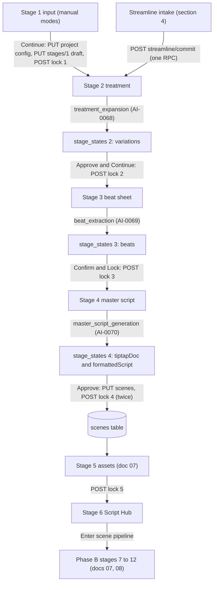
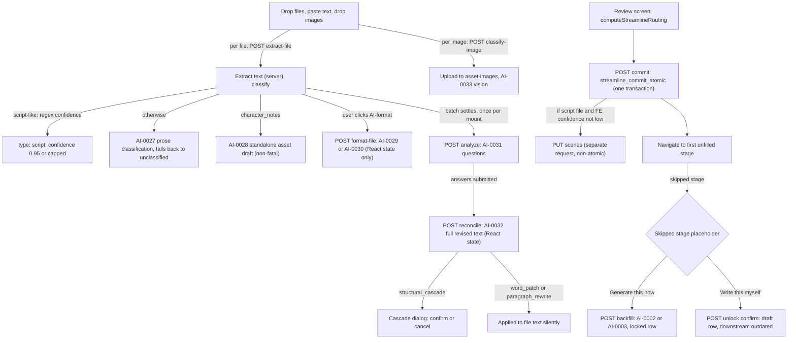

# 06. Writing and story implementation

Scope. This document describes the narrative authoring side of WizardDirector (Aiuteur) at HEAD of `main`: Stage 1 input modes and the Streamline intake, Stage 2 treatment, Stage 3 beat sheet, Stage 4 master script (TipTap editor, screenplay converter, script confidence), the Stage 6 Script Hub, scene extraction and re-approval, story context assembly, text field versions, autosave, every model call that generates or rewrites narrative text, and the manual editing paths. For each path it records what happens to user-authored text. Lock and invalidation semantics are summarized here only where they change narrative text; the full state machines live in doc 10 (versioning, locking, invalidation). Asset, shot, frame and video pipelines are out of scope (docs 07, 08). Facts only. No design recommendations.

Sources. Ledger kinds CAP, AI, STATE, INV, FACT, primarily from reporters V3 (narrative) and V4 (streamline), plus cross-references to E (AI calls), H (state and invalidation), V1 (shell and stage state), R1a and R1b (claim verification), and the merged ledger `merged2/merged.jsonl`. Reports: `V1-shell`, `V3-narrative`, `V4-streamline`, `E-ai-calls`, `H-state-invalidation`, `R1a-verification`, `R1b-verification`. Ledger kind INV is stored under the id prefix `WD-IMPL-INVALIDATE-`; both forms are the same kind.

Reading notes. The sibling document map is `00-README.md`. This document refers to sibling docs by number and topic: 01 overview, 02 capabilities, 03 workflows, 04 domain and state, 05 data model, 07 assets and continuity, 08 shots, frames and generation, 09 AI prompts and calls, 10 versioning, locking and invalidation, 11 architecture, 12 async and providers, 13 tests, 14 dead and duplicated code, 15 pressure, 16 coverage and unknowns, 17 ledger.

---

## 0. Status vocabulary and evidence format

Status tags used: REACHABLE (a UI or route path calls the code), FUNCTIONAL (the code does what its name says on reading), PERSISTED (the result is written to a table), TESTED (a test asserts the behavior), PARTIAL, DEAD (no caller), ORPHANED (no import), LEGACY (kept, deprecated, reached only by fallback), DUPLICATED, CONTRADICTED, UNKNOWN (runtime or live database needed). Rows are described by the flags they carry in the ledger (Y, N, P, U). IMPLEMENTED is not used as a summary label.

Evidence format. `WD-IMPL-<KIND>-NNNN` is a ledger id. `path:lines` is a repo path relative to the repo root. `(R1a C10)` or `(R1b C15)` refers to a verification claim. `(V3 U5)` refers to a row in a reporter section.

Corrected or contested claims are marked CONTRADICTED. Contradictions are listed in section 16, and corrections made while writing this document are listed in section 17.

---

## 1. Summary

1. Narrative artifacts (Stage 1 input, Stage 2 treatment, Stage 3 beats, Stage 4 script) live only in `stage_states.content` JSONB. Each save inserts a new row (`UNIQUE(branch_id, stage_number, version)`). They are not in `text_field_versions`. (WD-IMPL-FACT-0039, WD-IMPL-STATE-0025, `backend/src/routes/stageStates.ts:188-256`.)
2. Every PUT to `/api/projects/:id/stages/:n` inserts a row, including autosave. Stage 2 and Stage 3 autosave about 1 s after the stage loads, even with no edit. Stage 4 saves about 2 s after its editor hydrates. Opening these stages therefore creates versions. (WD-IMPL-FACT-0045, WD-IMPL-STATE-0029, WD-IMPL-STATE-0091, `src/lib/hooks/useStageState.ts:99-143`.)
3. A save over an `outdated` or `skipped` row becomes `draft`. A save over a `locked` row stays `locked` and replaces the content. (WD-IMPL-STATE-0026, WD-IMPL-STATE-0084, `backend/src/routes/stageStates.ts:211-222`.)
4. Locked Stage 2 and Stage 3 remain editable with no unlock and no downstream invalidation. (WD-IMPL-INVALIDATE-0017, WD-IMPL-INVALIDATE-0075.)
5. The Streamline commit is one Postgres transaction (`streamline_commit_atomic`). It inserts new stage versions without checking whether the stage is already locked. It has no idempotency key. A retry after server-side success duplicates stage rows, assets and resolutions. (WD-IMPL-INVALIDATE-0022, WD-IMPL-INVALIDATE-0026, WD-IMPL-CAP-0125, WD-IMPL-FACT-0356.)
6. Streamline `formatChoice` (as-is or AI-format) has no effect on what is committed. Committed content is chosen by the presence of `formattedText` or `formattedBeats`. (WD-IMPL-FACT-0053, WD-IMPL-CAP-0116, WD-IMPL-FACT-0356 R1b C19.)
7. Ask Auteur reconciliation rewrites the uploaded document text in memory with an LLM. Word-level and paragraph-level edits apply silently. Structural cascades need a confirmation dialog. (WD-IMPL-AI-0032, WD-IMPL-CAP-0123.)
8. Scene re-persist (`PUT /api/projects/:id/scenes`) matches existing rows by `slug:sceneNumber`, then by `sceneNumber` alone. Unmatched rows are hard-deleted, and the delete cascades to shots, frames, video jobs, image jobs and asset instances. Editing scene text invalidates nothing. (WD-IMPL-STATE-0028, WD-IMPL-INVALIDATE-0085, WD-IMPL-INVALIDATE-0018, WD-IMPL-FACT-0352 R1b C15.)
9. The TipTap round trip is lossy and not idempotent. Dialogue lines are merged, and the serialized text re-parses into different nodes. `formattedScript` and `scenes.script_excerpt` store the normalized form. (WD-IMPL-FACT-0038, `src/lib/utils/screenplay-converter.ts:164-232`.)
10. Two scene-heading parsers disagree (frontend `extractScenes` and backend `extractManifest`). Dependencies are joined by scene number and can attach to the wrong scene. (WD-IMPL-FACT-0041, `src/lib/services/scriptService.ts:378`, `backend/src/utils/scriptManifest.ts:111-151`.)
11. The Stage 2, 3 and 4 generation prompts receive `regeneration_guidance`, but no seeded template contains that placeholder. Guidance is dropped at interpolation. The live database content is UNKNOWN. (WD-IMPL-FACT-0040, WD-IMPL-FACT-0187 E-FACT-08, WD-IMPL-FACT-0193.)
12. `storyContextService` reads treatment keys that no writer stores, so its treatment section is always empty. Its beat section is populated. (WD-IMPL-FACT-0042, WD-IMPL-FACT-0347 R1a C10, WD-IMPL-FACT-0075 correction.)
13. Ask Auteur "established facts" reach a model prompt only through the Streamline treatment backfill, and only when a writing style capsule exists. The Stage 2 to 4 generation path does not inject them. (WD-IMPL-FACT-0043, WD-IMPL-CAP-0132, WD-IMPL-FACT-0057.)
14. The "Video for Audio" project type sends `audio-visual`. The backend accepts only `audio_visual`. Stage 1 Continue and the Streamline commit both fail for that value. (WD-IMPL-FACT-0046, WD-IMPL-FACT-0346 R1a C09.)
15. The Phase A unlock impact dialog never opens. The backend nests `downstreamStages` under `details`, and the frontend reads it at the top level, so unlock auto-confirms and applies the downstream `outdated` cascade without a prompt. (WD-IMPL-FACT-0005, WD-IMPL-FACT-0206, WD-IMPL-FACT-0340 R1a C03.)

---

## 2. Flow overview

### 2.1 Narrative pipeline (manual and generated paths)

Notes on the diagram. Each generated node is a DB-template call or a frontend-authored call (section 13). Every arrow that writes `stage_states` writes an append-only row. The approve arrow from Stage 4 is non-atomic: the scenes PUT happens before the lock. (WD-IMPL-CAP-0106, WD-IMPL-INVALIDATE-0019.)

### 2.2 Streamline intake (Stage 1 mode "streamline")

The Streamline intake keeps everything in React state until commit. The only persisted pre-commit side effects are the uploaded images (`asset-images/project/{id}/streamline-staging/`) and the LLM tracing records. (WD-IMPL-CAP-0110 through WD-IMPL-CAP-0135, V4 section 8.)

---

## 3. Storage of narrative artifacts

| Artifact | Storage and keys | Created by | AI-generated by | Manual edit | Version history | Overwritten or superseded by |
|---|---|---|---|---|---|---|
| Project config (type, rating, genres, tonal precision, length, aspect) | `projects` columns. Writing style capsule id is not written here. | Stage 1 Continue, Streamline commit | none | Stage 1 form | none (single row) | each Stage 1 Continue, each Streamline commit (COALESCE) (WD-IMPL-STATE-0013, WD-IMPL-FACT-0059, `backend/migrations/044_streamline_atomic_intake_fix.sql:65-78`) |
| Source material ("input") | `stage_states(1).content`: `ideaText`, `uploadedFiles[]` (full text), `processedInput{mode, primaryContent, contextFiles[], projectParams}`, `writingStyleCapsuleId` | Stage 1 Continue (`stageStateService.saveStageState`, then lock) | no | textarea, FileStagingArea (non-streamline modes) | stage_states rows | later Continue, Streamline commit `stage_1_draft` (WD-IMPL-CAP-0088, WD-IMPL-CAP-0089) |
| Treatment | `stage_states(2).content`: `variations[] {id, content, structuralEmphasis, estimatedRuntimeSeconds, createdAt}`, `activeVariation`, `processedInput` (copy), `langsmithTraceId`, `promptTemplateVersion` (WD-IMPL-CAP-0090) | Stage 2 mount (no variations), or Streamline commit, or Streamline backfill | `treatment_expansion` (WD-IMPL-AI-0068) | Edit Mode, Save Changes (WD-IMPL-CAP-0091) | stage_states rows | Generate New Variation, Full Regenerate, Streamline commit, backfill (WD-IMPL-CAP-0094, WD-IMPL-CAP-0093) |
| Beat sheet | `stage_states(3).content`: `beats[] {id, order, text, rationale, estimatedScreenTimeSeconds, originalTreatmentExcerpt?, isExpanded}`, `totalEstimatedRuntime`, `narrativeStructure`, `treatmentSource{content, variantId}` (snapshot of Stage 2 text at generation) (WD-IMPL-CAP-0096) | Stage 3 mount (no beats), Streamline commit, backfill | `beat_extraction` (WD-IMPL-AI-0069) | inline textarea, reorder, add, delete (WD-IMPL-CAP-0097) | stage_states rows | Regenerate All, brainstorm pick, Streamline commit, backfill (WD-IMPL-CAP-0099) |
| Master script | `stage_states(4).content`: `formattedScript` (plain text, normalized), `tiptapDoc` (canonical for the editor), `scenes[]` (in-memory copy), `syncStatus` (always `synced` in practice), `beatSheetSource{beats, stageId}`, trace ids (WD-IMPL-FACT-0039) | Stage 4 first visit with deps loaded, Streamline commit (`tiptapDoc` from script file) | `master_script_generation` (WD-IMPL-AI-0070) | TipTap editor and screenplay toolbar (WD-IMPL-CAP-0102) | stage_states rows (one per debounced save) | Regenerate (replaces whole doc), section edits, Streamline commit (WD-IMPL-CAP-0103) |
| Scenes | `scenes` table: `scene_number` (unique per branch), `slug`, `script_excerpt`, `status`, `expected_characters[]`, `expected_location`, `expected_props[]`, `dependencies_extracted_at`, `shot_list_locked_at`, `is_deferred`, `stage_locks` (`backend/migrations/003_*`, `011`, `013`, `014`, `027`) | `PUT /api/projects/:id/scenes` (Stage 4 approve, Streamline post-commit) | dependencies deterministic (manifest); LLM fallback LEGACY (WD-IMPL-AI-0023) | none in Phase A (no scene text editor) | none (rows updated in place) | every re-persist (section 8) |
| Phase A history UI | none. "Version History" and "Create Branch" in ProjectHeader are toast stubs (WD-IMPL-FACT-0016, `src/pages/ProjectView.tsx:857-859, 879-881`). | | | | | |

`GET /api/projects/:id/stages` returns the latest row per stage. No UI lists older Phase A versions (V3 section 2, WD-IMPL-STATE-0025).

---

## 4. Stage 1 input modes and the Streamline intake

### 4.1 Manual input modes (expansion, condensation, transformation, script-skip, Video for Audio)

- Mode grid: `src/components/pipeline/Stage1InputMode.tsx:80-86` (mode ids), project type options at `:92` (`audio-visual`). (WD-IMPL-CAP-0088.)
- Form state: `useStageState({stageNumber: 1, autoSave: false})` (`Stage1InputMode.tsx:140-156`). The form is not persisted until Continue. Existing `stage_states(1).content` hydrates the form on load. (WD-IMPL-CAP-0088.)
- Autosave is disabled for Stage 1 with the comment "Disabled to prevent race condition with manual lock operation" (`Stage1InputMode.tsx:143`). The UI still displays "All changes saved" (`:903-905`) while nothing is saved before Continue. (V1 cross-slice.)
- Continue gate (`canProceed`, `:175-176`): mode set, project type set, tonal precision at least 10 characters, and either files or (expansion mode and idea at least 20 characters). Validation failures reach `console.error` only (`:196-200`). (V3 section 3.)
- Input processing (`src/lib/services/inputProcessingService.ts:39-103`): for expansion, `primaryContent` is `ideaText` and every file is a context file. For other modes, the file with `isPrimary` is primary and the rest are context.
- "Script Skip" has no separate behavior. It flows through `treatment_expansion` like the other modes. The instruction text claims it parses the input directly and skips to the Master Script, which is contradicted by the flow. (WD-IMPL-FACT-0047, `src/lib/services/inputProcessingService.ts:174-175`.)
- Files (`FileStagingArea`, `src/components/pipeline/FileStagingArea.tsx:92-113`): `FileReader.readAsText` for txt, md, doc, docx and rtf. PDF resolves to an empty string, so a PDF primary file fails validation with console output only (`:105-111`). `.doc` and `.docx` are read as text, which yields binary content for docx. Limits are 10 files of 10 MB. (WD-IMPL-CAP-0089, V3 section 3, V4 section 12.)

### 4.2 Continue hops (manual modes)

1. `projectService.updateProject` writes project config (`project_type`, `content_rating`, `genre`, `tonal_precision`, `target_length_min/max` in seconds, `aspect_ratio`) through `PUT /api/projects/:id`. Validation at `backend/src/routes/projects.ts:640-730`. Config columns are overwritten on each Continue. (WD-IMPL-STATE-0013, V3 U4.)
2. `stageStateService.saveStageState(projectId, 1, {content, status: 'draft'})` inserts one `stage_states` row (version + 1). (WD-IMPL-STATE-0001.)
3. `POST /stages/1/lock` inserts a second row, `locked`, copying the content. Origin is NULL. (WD-IMPL-STATE-0002, WD-IMPL-INVALIDATE-0014.)
4. Navigation to Stage 2 (`ProjectView.handleStageComplete(1)`, `src/pages/ProjectView.tsx:446-476`).

A `'audio-visual'` project type returns 400 from step 1. The `catch` at `Stage1InputMode.tsx:292-294` logs only, and no completion call is made. For a new project, the row already exists with type `narrative`. (WD-IMPL-FACT-0346 R1a C09, WD-IMPL-FACT-0006.)

A locked Stage 1 keeps its form interactive, hides the Continue button (`:892`), and discards edits with no save path (V3 U3). Unlock and edit is handled in doc 10.

### 4.3 Streamline intake steps

Each row is one UI handler, backend route or service. The full table is V4 section 2. The rows below are the ones that determine what happens to user text.

| # | Step | Handler and route | What happens to the text | Evidence |
|---|---|---|---|---|
| 1 | Drop or choose files (up to 10 documents, 20 MB each; up to 20 images, 10 MB) | `StreamlineDropZone.tsx:154-205`; `POST /api/projects/:projectId/streamline/extract-file` (`backend/src/routes/streamline.ts:196-245`) | Server extracts text: PDF via pdf-parse, DOCX via mammoth, RTF via rtf-to-text, TXT and MD as UTF-8. Legacy `.doc` returns 400. Nothing persisted. | WD-IMPL-CAP-0111, WD-IMPL-FACT-0049 |
| 1a | Classification | `backend/src/services/streamlineClassificationService.ts:20-75` | Regex script detector (`backend/src/utils/scriptConfidence.ts:27-64`). Non-low result gives type `script` with confidence 0.95 (high) or `min(0.4 + headingScore + dialogueScore, 0.75)` (ambiguous). Otherwise AI-0027 on the first 6000 characters. LLM failure gives `unclassified` at 0. | WD-IMPL-AI-0027, WD-IMPL-FACT-0050 |
| 1b | Default format choice | `StreamlineDropZone.tsx:128` | `as-is` if confidence is at least 0.75, else `ai-format`. AI-format does not run automatically. | WD-IMPL-CAP-0116 |
| 2 | Paste text | `StreamlineDropZone.tsx:253-269` | Stored in React as `unclassified` with status success. Never sent to the server. | WD-IMPL-CAP-0112 |
| 3 | Override a file's type | `StreamlineDropZone.tsx:221-223, 389-397` | `typeOverride` beats classification (`streamlineRouting.ts:31-33`). | WD-IMPL-CAP-0113 |
| 4 | Primary file and remove | `StreamlineDropZone.tsx:207-219` | Primary flag only adds "(PRIMARY)" to the analyze prompt (`streamlineQuestionService.ts:75`). Routing ignores it. | WD-IMPL-CAP-0114 |
| 5 | Retry failed file | `StreamlineDropZone.tsx:191-194` | Toast only ("Re-select the file to retry"). No retry is performed. | WD-IMPL-CAP-0115 (P, N) |
| 6 | AI-format | `setFormatChoice` at `:246-251`; `POST .../streamline/format-file` (`streamline.ts:318-353`) | AI-0029 (treatment, 2048 tokens) or AI-0030 (beat sheet, 4096 tokens) rewrites the full text. Result is stored in `file.formattedText` or `file.formattedBeats` (React only). Runs only when no formatted result exists and type is treatment or beat sheet. | WD-IMPL-AI-0029, WD-IMPL-AI-0030, WD-IMPL-CAP-0116 |
| 7 | Reference images | `StreamlineImageReviewGrid.tsx:66-107`; `POST .../streamline/classify-image` (`streamline.ts:256-308`) | Image uploaded to `asset-images` at `project/{projectId}/streamline-staging/{ts}-{rand}{ext}` (`:276-281`). Storage object is persisted at once and has no delete path. Vision AI-0033 (`gemini-2.5-flash`, hardcoded). Failure gives a fallback guess (`Unnamed subject`, character, confidence 0). Name is replaced by a fuzzy match to character-note draft names. | WD-IMPL-AI-0033, WD-IMPL-CAP-0118, WD-IMPL-CAP-0119 |
| 8 | Edit image cards | `StreamlineImageReviewGrid.tsx:119-125, 175-208` | React only. Accept toggle and remove. | WD-IMPL-CAP-0119 |
| 9 | Ask Auteur analysis (automatic) | `StreamlineDropZone.tsx:105-116` fires `onBatchSettled`; `Stage1InputMode.tsx:319-337`; `POST .../streamline/analyze` (`streamline.ts:363-390`) | AI-0031 receives first 4000 characters per file with the PRIMARY tag. Any failure returns `[]` silently. Runs once per component mount, only after an extraction transition, and only for a project id other than `new`. Paste-only batches never trigger it. | WD-IMPL-AI-0031, WD-IMPL-FACT-0058, WD-IMPL-CAP-0120 |
| 10 | Answer questions | `AskAuteurQuestionUI.tsx:56-66`; `handleAskAuteurSubmit` (`Stage1InputMode.tsx:347-406`); `POST .../streamline/reconcile` (`streamline.ts:400-430`) | AI-0032 receives the Q and A transcript and the full untruncated text of every file. It returns the full revised text per changed file, a scope (`word_patch`, `paragraph_rewrite`, `structural_cascade`), and a one-line summary. Non-cascade documents are applied at once (`file.text = reconciledText`, `:339-345, 396`). Cascade documents wait in `pendingCascade`. Edit attribution: all `resolution_edits` are attributed to `r0` with `target_stage_number` null (`:386-394`). | WD-IMPL-AI-0032, WD-IMPL-FACT-0054, WD-IMPL-FACT-0055 |
| 11 | Decline | `handleAskAuteurDecline` (`Stage1InputMode.tsx:408-424`) | Every question becomes an `intake_resolutions` row with null answer and `ai_inferred`. No reconcile call. | WD-IMPL-CAP-0122, WD-IMPL-FACT-0057 |
| 12 | Structural cascade dialog | `StructuralCascadeConfirmDialog.tsx:22-50`; `Stage1InputMode.tsx:379-442` | Confirm applies the pending revised text to file text. Cancel keeps original text and drops that file's `resolution_edits` from the commit. Dialog triggers no backend call. Covers only `structural_cascade`. | WD-IMPL-CAP-0123 |
| 13 | Review screen | `StreamlineReviewScreen.tsx:37-116`; routing preview `computeStreamlineRouting` (`Stage1InputMode.tsx:444-445`) | Shows routing and "N edits applied from your answers". Credit estimate is fixed text, not computed (`streamlineRouting.ts:143-152`). | WD-IMPL-CAP-0124 |
| 14 | Confirm and Skip Ahead | `handleStreamlineCommit` (`Stage1InputMode.tsx:450-512`); `POST .../streamline/commit` (`streamline.ts:45-89`) | Guard: `canConfirm`, project id not `new`, no open questions, no pending cascade. `isAnalyzing` does not block the guard. Payload builds `stage_transitions`, `project_config`, `stage_1_draft`, `assets`, `resolutions`, `resolution_edits`. Single RPC. | WD-IMPL-CAP-0125, WD-IMPL-FACT-0063 |
| 15 | Post-commit scene persistence | `Stage1InputMode.tsx:487-498`; `scriptService.extractScenes` plus `persistScenes` (`scriptService.ts:623-659`); `PUT /api/projects/:id/scenes` | Runs only if a script file has FE confidence not low (no override clause). Zero scenes throws after the RPC has committed. Separate request, non-atomic. | WD-IMPL-CAP-0126, WD-IMPL-INVALIDATE-0023 |
| 16 | Navigate | `handleStreamlineComplete` (`ProjectView.tsx:487-503`); target stage (`Stage1InputMode.tsx:500-505`) | Target is 5 if stages 1 to 4 have transitions, else the first of 2, 3, 4 without one, else 2. A script route lands on 5, beat-sheet-only on 4, treatment-only on 3, notes or images only on 2. | WD-IMPL-CAP-0127, WD-IMPL-FACT-0051 |

### 4.4 Routing and transitions committed

`computeStreamlineRouting` (`src/lib/utils/streamlineRouting.ts:53-155`) chooses per stage. The first matching material of each type wins. (V4 section 4, WD-IMPL-FACT-0051.)

| Material | Stage 1 | Stage 2 | Stage 3 | Stage 4 | Lands on |
|---|---|---|---|---|---|
| Usable script (plus optional treatment or beat sheet) | locked | treatment: locked or imported; else skip | beat sheet: locked or imported; else skip | locked, content `{formattedScript: text, tiptapDoc, scenes: [], syncStatus: 'synced'}` | 5 |
| Beat sheet, no script | locked | treatment: locked or imported; else skip | locked or imported | none | 4 |
| Treatment only | locked | locked or imported | none | none | 3 |
| Notes or images only | locked | none | none | none | 2 |
| Nothing routable, or config incomplete | blocked (`canConfirm: false`) | | | | |

"Usable script" means the effective type is `script` and either the override is `script` or the FE detector is not low (`streamlineRouting.ts:35-42`). Stage 4 never gets a `skip` transition in routing (V4 section 13).

Content built per stage (V4 section 4):

- Stage 2 `{variations: [{id: 'sf-<fileId>', content: formattedText ?? text, structuralEmphasis: 'balanced', estimatedRuntimeSeconds: 0, createdAt}], activeVariation: 0}` (`streamlineRouting.ts:167-173`). `formattedText ?? text` is in `:168`.
- Stage 3 is the AI-formatted beats (`formattedBeats`) if present, else one beat holding the raw text with `narrativeStructure: 'imported_as_single_beat'` (`:175-190`).
- No `processedInput` is written for any imported stage. Later generation for those stages then falls back to hardcoded parameters or throws (sections 5 and 6).

### 4.5 Commit semantics (the RPC)

Route `backend/src/routes/streamline.ts:45-89` builds `payload = {project_id, user_id, stage_transitions, project_config?, stage_1_draft?, assets?, resolutions?, resolution_edits?}`. It calls `supabase.rpc('streamline_commit_atomic', {payload})` (`:77`). The backend client uses the service-role key, so RLS is bypassed and ownership is checked only in Node. (WD-IMPL-FACT-0063, V4 section 4.)

`streamline_commit_atomic` (`backend/migrations/044_streamline_atomic_intake_fix.sql:38-100`) runs in one plpgsql call:

1. Resolves `branch_id` from `projects.active_branch_id`. A null branch raises.
2. `SELECT ... FROM stage_states WHERE branch_id AND stage_number 1..5 FOR UPDATE`. This locks only rows that already exist. (WD-IMPL-INVALIDATE-0026, H section 1.10.)
3. If `project_config` is present, updates `projects` with COALESCE per field. `writing_style_capsule_id` is not in the update (`044:65-78`, R1a C02 WD-IMPL-FACT-0339).
4. If `stage_1_draft` is present, inserts a Stage 1 `draft` row (`origin` `COALESCE(origin, 'authored')`, content is the full Stage 1 hook content object). (`Stage1InputMode.tsx:477`, WD-IMPL-STATE-0031.)
5. Returns `streamline_commit(payload - 'project_config' - 'stage_1_draft')`. The body is in `backend/migrations/043_intake_resolutions.sql:137` through the end of the function (see section 17, correction 1). Within it:
   - `stage_transitions` run in ascending stage order, 1 to 5 only.
   - `skip`: stage must be 2, 3 or 4. Raises if the latest row is `locked`. Raises if stage n-1 is not `locked` or `skipped`. Inserts `{status: 'skipped', origin: 'skipped', content: {}}`. (`043:258-282`, WD-IMPL-INVALIDATE-0021.)
   - `locked`: raises if no row exists. For n greater than 1, stage n-1 must be `locked` or `skipped`. Inserts a copy of the latest content with status `locked`. (WD-IMPL-STATE-0030.)
   - Object form `{status, content, origin, regenerationGuidance}`: validates the status enum and origin. If locked and n greater than 1, checks stage n-1 only. Inserts the supplied content. There is no check that stage n is already locked, so existing locked content is superseded by a new version. (`043:308-327`, WD-IMPL-INVALIDATE-0022.)
   - Every inserted row has `version = latest + 1`, `created_by = user_id`, `inherited_from_stage_id = NULL`.
   - `assets[]`: inserts `project_assets` rows (`source` default `streamline_import`; the frontend sends `streamline_import` for image cards and `extracted` for note drafts, `Stage1InputMode.tsx:466-472`). No dedupe against existing assets. (WD-IMPL-FACT-0060.)
   - `resolutions[]`: inserts `intake_resolutions` rows and builds a client_id to uuid map. (`043:402`.)
   - `resolution_edits[]`: maps `resolution_client_id` through the map (unknown id raises) and inserts `intake_resolution_edits` rows (`043:436`). The `fileId` key the frontend sends is ignored.
   - Updates `projects.updated_at`. Returns `{success, project_id, branch_id, stages[], assets[], resolutions[]}`. The frontend ignores the body. (V4 section 4.)
6. Migration 044 adds a global `BEFORE INSERT` trigger on `stage_states` (`044:4-36`). Any insert with `status = 'locked'` and `stage_number > 1` raises unless stage n-1 latest is `locked` or `skipped`. This applies to every writer of `stage_states`, not only Streamline (WD-IMPL-INVALIDATE-0020).

The Node lock route validates the same prerequisite (`stageStates.ts:344-370`, WD-IMPL-INVALIDATE-0002). The lock prerequisite is therefore enforced in three layers: the Node route, the RPC body, and the trigger (H section 1.5).

### 4.6 Idempotency, retry and partial failure

| Failure | What persists | Evidence |
|---|---|---|
| RPC raises (any check) | Whole transaction rolls back. Route returns 400 with the PG message. In-memory intake state is kept, so the user can retry. | WD-IMPL-CAP-0125, V4 section 9 |
| Commit succeeds, client sees error (network drop, client-side refresh failure) | Everything from the RPC persists. Retrying the commit inserts a second Stage 1 draft and lock, new stage 2 to 5 versions, duplicate `project_assets`, and duplicate `intake_resolutions`. There is no idempotency key and no existence check. | WD-IMPL-FACT-0356 (R1b C19), WD-IMPL-INVALIDATE-0026 |
| RPC succeeds, post-commit scene persistence throws (zero scenes or PUT error) | RPC changes stay committed. `onStreamlineComplete` is not called, so the user stays on Stage 1 with an error. Pressing Confirm again re-runs the entire RPC. | WD-IMPL-INVALIDATE-0026, V4 section 9 |
| Post-commit refresh fails | Commit persists. Toast: "Streamline committed, but the pipeline view failed to refresh". | `ProjectView.tsx:499-502`, V4 section 9 |
| Concurrent commits | Commit locks existing stage rows `FOR UPDATE`. First-time commits, with no rows to lock, can collide. Behavior UNKNOWN. | V4 section 15, WD-IMPL-INVALIDATE-0009 |
| Browser refresh before commit | All intake state is lost, except uploaded images already in storage. | V4 section 8 |

Migration 044 also strips `stage_1_draft` before delegating to `streamline_commit`. The 043 insert for `stage_1_draft` (`043:220`) therefore does not run on the commit path (R1b C19).

### 4.7 What existing content is overwritten, merged or preserved on commit

- Stage rows are append-only. Every transition inserts a version. Older rows stay as history. The latest-version reads (`GET /stages` dedupe, `stageStates.ts:26-34`) make imported content supersede previously locked content for stages 2 to 4. The only overwrite guard is the skip guard: skipping over a locked stage raises and rolls back everything. (WD-IMPL-INVALIDATE-0022, V4 section 5.)
- Stage 1 always receives two new rows per commit (draft, then locked copy of it), including when Stage 1 was already locked. No lock guard on mode selection (`Stage1InputMode.tsx:573`) or on the Streamline review and confirm UI (`:659-709`). (WD-IMPL-FACT-0062, WD-IMPL-STATE-0031.)
- Project config columns are overwritten when the frontend value is non-null (COALESCE).
- `project_assets` are appended. Committing twice inserts duplicates.
- Stages 5 and Phase B: the RPC writes nothing there and marks nothing `outdated`. (WD-IMPL-INVALIDATE-0022, V4 section 5.)
- Document text is rewritten in memory by AI-0032. The rewritten text is what later gets committed. Stale `formattedText` or `formattedBeats` from AI-format overrides the reconciled text, while `intake_resolution_edits` are still written (V4 section 14 item 2, WD-IMPL-FACT-0055).
- `formatChoice` does not affect commit. Switching back to as-is after an AI-format run commits the AI-formatted text. A file defaulted to `ai-format` that was never formatted commits its raw text while the UI shows AI-format selected. (WD-IMPL-FACT-0053, V4 section 14 item 1, WD-IMPL-FACT-0356 R1b C19.)
- Character-note `assetDraft` is computed at extract time and is not re-derived from reconciled text. (V4 section 14 item 2.)
- Writing style capsule selected in Stage 1 is stored only in Stage 1 content (`writingStyleCapsuleId`). Streamline `projectConfig` omits it, and no `processedInput` is written. So Streamline projects have no capsule reference in `processedInput` (WD-IMPL-FACT-0059). The `projects.writing_style_capsule_id` column is read but never written (WD-IMPL-FACT-0339).

### 4.8 Ask Auteur session and facts ledger

- Session state (questions, pending cascade, edit summaries, resolution buffers, `askAuteurRequestedRef`) is React state, lost on unmount. The ref allows one analysis per mount. (WD-IMPL-STATE-0035, WD-IMPL-STATE-0032.)
- Questions are categorized as contradiction, vague trait, ambiguous structure or missing information, with two to four options each. Invalid categories are dropped, and invalid entity types become undefined (AI-0031, `streamlineQuestionService.ts:79-113`).
- Analyze failure is silent (no questions, no message). Reconcile failure keeps questions open, shows `streamlineError`, and allows resubmit or decline. The commit stays blocked while questions are open. (V4 section 9.)
- `intake_resolutions` is the per-branch facts ledger. Written only by the commit RPC. Read only by `ContextManager.fetchAuteurResolutions` (`contextManager.ts:512-529`). `answer_source` is `option`, `freetext`, or `ai_inferred` (decline). Category CHECK allows `conflict_resolution`, which no code produces. (V4 section 7.)
- `resolutions` are not shown in the UI after commit. `resolveConflict` (`backend/src/utils/resolveConflict.ts`) is ORPHANED (test only). (WD-IMPL-CAP-0132, V4 section 13.)

### 4.9 Skipped stages after commit

Skipped Stage 2 or 3 renders `SkippedStagePlaceholder` (`ProjectView.tsx:902-965`) with two actions. Skipped Stage 4 has no routing producer (V4 section 13), so its placeholder is reachable only from raw API use.

- **Generate this now** (stages 2 and 3). `handleGenerateFromScript` (`ProjectView.tsx:673-688`) calls `POST /api/projects/:id/streamline/backfill/:n` (`streamline.ts:99-184`). Requires a locked Stage 4 with non-empty `formattedScript`. Calls AI-0002 (treatment, temperature 0.5, 2048 tokens) or AI-0003 (beat sheet, temperature 0.4, 4096 tokens). Writes a locked row with origin `ai-generated` and `inherited_from_stage_id` = skipped row id. Output is written directly as locked, with no draft review. Downstream stages are not invalidated. (WD-IMPL-AI-0002, WD-IMPL-AI-0003, WD-IMPL-STATE-0033, WD-IMPL-CAP-0129.)
- **Write this myself**. `handleWriteMyself` (`ProjectView.tsx:654-669`) calls `POST .../stages/:n/unlock` with confirm true. Inserts a draft row with content `{}` and origin NULL. Marks every downstream stage up to 5 that is locked or outdated as `outdated`. The frontend updates only the unskipped stage's local status, so downstream `outdated` is not shown until reload. The code comment says there are no consequences, which does not match the cascade. (WD-IMPL-STATE-0034, WD-IMPL-INVALIDATE-0024, WD-IMPL-CAP-0130, V1 section 5.5 contradiction 8.)

Backfill for Stage 2 and Stage 3 uses the locked Stage 4 `formattedScript` (normalized, section 7). The AUTO-FILLED badge tooltip says the stage "won't update automatically if the script changes later" (`src/lib/utils/stageBadge.ts:63`, WD-IMPL-CAP-0131). The stage badge is derived from `origin`, which lock and unlock routes drop (WD-IMPL-INVALIDATE-0025).

---

## 5. Stage 2 treatment

### 5.1 Generation (mount, Generate New Variation, Full Regenerate)

- Trigger: mount with no variations (WD-IMPL-CAP-0090). Chain: `GET /stages/1` for `processedInput`, `GET /stages/2` for metadata, then `treatmentService.generateTreatments` (`src/lib/services/treatmentService.ts:55-101`). The request is POST `/api/llm/generate-from-template` with `templateName: 'treatment_expansion'` (WD-IMPL-AI-0068) and variables `input_mode`, `primary_content`, `context_files` (joined as `name (tag):` and content, separated by `---`), `target_length_min/max`, `project_type`, `content_rating`, `genres`, `tonal_precision`, `writing_style_context: ''`, `writing_style_capsule_id`.
- Server (`backend/src/routes/llm.ts:139-315`): loads the active template by name, validates variables (a missing variable returns 400, `:176`), assembles global context and writes the writing capsule text into `writing_style_context` (`:191-231`), interpolates (`:267`), and calls `llmClient.generate`. Default temperature 0.7 and maxOutputTokens 4096 (`backend/src/services/llm-client.ts:106, 133-138`). If context assembly throws, `writing_style_context` is set to empty and the request continues (V3 section 10).
- Parse (`treatmentService.ts:351-456`): strip fences, `JSON.parse`, read `treatments[].prose`, `content` or `text`. If parsing fails, the text is split on `/(?:TREATMENT|VARIATION)\s*[123]/i`. With fewer than three parts, one variation holds the raw text. If the JSON has no `treatments` key, one variation holds `JSON.stringify(parsed)`. (V3 section 3.)
- Output ceiling: three treatments of 800 to 1200 words can exceed 4096 output tokens. Truncated JSON falls into the text-split fallback. Whether truncation occurs in practice is UNKNOWN (V3 section 8 notes).
- Persistence: `setStageContent` triggers autosave after 1 s. The PUT inserts a `draft` row (section 11). `_styleCapsuleMetadata` is split out and inserts `style_capsule_applications` (`stageStates.ts:259-281`).
- **Generate New Variation** (`Stage2Treatment.tsx:534-547`) reruns `generateInitialTreatments`. It replaces all variations with no confirmation, including when the stage is locked (V3 U7). It re-reads the current Stage 1 `processedInput`, so it is the only Stage 2 action that picks up later Stage 1 edits (V3 section 3).
- **Full Regenerate** (dialog, guidance at least 10 characters, `Stage2Treatment.tsx:348-398`) calls `treatmentService.regenerateTreatments`. It sends the same template with `regeneration_guidance` (`treatmentService.ts:152`, E section 14 item 1). It uses Stage 2's stored `processedInput` copy, which is stale relative to later Stage 1 edits (V3 U28). It replaces all variations and resets `activeVariation` to 0 (V3 U8).
- Guidance is dropped at interpolation. Neither seed copy of `treatment_expansion` contains a `{regeneration_guidance}` placeholder (a grep of `backend/scripts/seed-templates.ts` and `backend/src/routes/seed.ts` returns no match). The live `prompt_templates` row is UNKNOWN. (WD-IMPL-FACT-0040, WD-IMPL-FACT-0187.)
- The dialog text says the guidance "will be saved as the commit message for this version". Nothing is saved. `regeneration_guidance` on stage_states is always empty from these saves (`stageStateService.ts:111-116`). CONTRADICTED (V3 section 15).

### 5.2 Edit Mode, Save Changes, Approve

- Edit Mode is a textarea (`Stage2Treatment.tsx:253-256`). **Save Changes** writes `variations[active].content` through autosave (`:400-416`) (WD-IMPL-CAP-0091).
- Unsaved edits are discarded by **Approve & Continue**, which calls `onComplete` directly with no save and no prompt (`:504-512`, V3 U5). A variation switch asks for confirmation when there are unsaved changes (`:233-235`). Generate New Variation discards them as well.
- **Approve & Continue** calls `onComplete`, which runs `handleStageComplete(2)` and locks Stage 2 (WD-IMPL-CAP-0095, `src/pages/ProjectView.tsx:446-476`). The lock copies the last saved row, so unsaved edits are not in the locked row.

### 5.3 Edit Selection (AI rewrite of a span)

- Count 1: `treatmentService.regenerateSection` posts to `/api/llm/generate` (WD-IMPL-AI-0014). The system and user prompts are authored in the frontend (`treatmentService.ts:192-245`). The user prompt holds the full treatment context, the selected text and the user guidance (default "Rewrite this section"). The reply replaces the selected character range (`Stage2Treatment.tsx:258-346`, V3 U6).
- Count 3: `treatmentService.regenerateSectionAlternatives` returns a JSON array of three alternatives (WD-IMPL-AI-0015, `treatmentService.ts:250-346`). Clicking one splices it in.
- Neither result persists until Save Changes. Guidance is part of the user prompt, not a template variable, so it is not dropped.

### 5.4 Other Stage 2 facts

- Streamline backfill (WD-IMPL-AI-0002) writes a locked Stage 2 row when Stage 2 was skipped (section 4.9).
- Stage 2 has no `processedInput` when the treatment came from Streamline (section 4.7). A Stage 2 "Generate" after a notes-only commit throws "No processed input found from Stage 1" (`Stage2Treatment.tsx:172-175`, V4 section 14 item 7).
- "Sync with Beat Sheet" never renders. `isOutdated` is never set to true (`Stage2Treatment.tsx:107, 467`). DEAD.
- `mockTreatments` is defined and never used (`Stage2Treatment.tsx:36-78`, WD-IMPL-FACT-0197). DEAD.
- Locked Stage 2 stays editable. Saves while locked keep `locked` and replace the content (WD-IMPL-INVALIDATE-0075, WD-IMPL-STATE-0026).
- Tests: no test covers `treatmentService` parsing or the Stage 2 components (V3 section 13).

---

## 6. Stage 3 beat sheet

### 6.1 Generation

- Trigger: mount with no beats (`Stage3BeatSheet.tsx:273-284`, WD-IMPL-CAP-0096). Chain: `GET /stages/2`, select `variations[activeVariation || 0]`, `beatService.generateBeats` (`beatService.ts:55-83`), then `GET /stages/3` and POST `/api/llm/generate-from-template` with `templateName: 'beat_extraction'` (WD-IMPL-AI-0069). Variables: `treatment_prose`, `selected_variant_id`, `target_length_min/max`, `genres`, `tonal_precision`, `writing_style_context: ''`, `writing_style_capsule_id`.
- Parameters come from Stage 2 `processedInput.projectParams`. If absent, they are hardcoded to `{180, 300, ['Drama'], 'Emotional and contemplative'}` (`Stage3BeatSheet.tsx:316-321`, V4 section 14 item 7).
- Parse (`beatService.ts:303-441`): JSON `beats[]`, with `beat_id` used as the id when present. Fallback: numbered lines or "Beat N" lines. Last resort: one beat holding the whole text.
- Persistence: autosave is enabled for Stage 3 (`Stage3BeatSheet.tsx:249`), so the generated beats are saved as a draft row.

### 6.2 Manual edits

- Each beat has a textarea (`onContentChange`). Drag reorder (dnd-kit) renumbers `order`. Add after inserts a beat with the placeholder "New beat - describe what happens here...". Delete is blocked below three beats. All of these write through autosave (WD-IMPL-CAP-0097, V3 U11).
- **Confirm and Lock** (`Stage3BeatSheet.tsx:502-515`) checks that every beat has at least 10 characters and that there are at least three beats. The success toast fires before the lock call, so it shows even when the lock fails (V3 section 3, WD-IMPL-CAP-0100).
- Locked Stage 3: all beat editing stays active. Autosave writes new locked rows (V3 U14, WD-IMPL-INVALIDATE-0017).

### 6.3 Brainstorm (AI-0017)

- The sparkles action calls `beatService.brainstormBeatAlternatives` (`src/lib/services/beatService.ts:183-241`) with a frontend-authored prompt to `/api/llm/generate`. The prompt contains the beat and all beats as "SURROUNDING CONTEXT", plus optional guidance, and asks for three alternatives as a JSON array of `{text}` (WD-IMPL-AI-0017).
- Picking an alternative replaces only `beat.text` (V3 U12, `Stage3BeatSheet.tsx:476-493`). Parse failure falls back to the original beat text.

### 6.4 Regenerate All

- `beatService.regenerateBeats` is called with `stageContent.treatmentSource` (the snapshot taken at first generation, not the current Stage 2 variation) and hardcoded `projectParams` (`Stage3BeatSheet.tsx:536-546`, with a TODO comment) plus `regeneration_guidance` (WD-IMPL-AI-0069 path). It replaces all beats and drops `_styleCapsuleMetadata` (V3 section 3).
- The guidance is dropped by the template (section 13, WD-IMPL-FACT-0040).
- Stage 2 edits do not propagate into Stage 3. Stage 3 regenerates only when empty. Regenerate All uses the old snapshot (V3 U15).

### 6.5 Dead, orphaned and half-wired

- `beatService.splitBeat` has no callers (WD-IMPL-AI-0026, DEAD). Its parser has no callers either.
- "Sync with Script" is DEAD (`Stage3BeatSheet.tsx:260, 621`, V3 section 12).
- `originalTreatmentExcerpt` is never populated, so "View original treatment context" never renders (practically DEAD, V3 section 3).
- Stage 3 beats are shown in the Stage 4 beat panel, which refreshes to the latest Stage 3 row when Stage 4 mounts. The script is not regenerated, and `syncStatus` is never set to out of date (V3 U16, `Stage4MasterScript.tsx:291-297`).

---

## 7. Stage 4 master script

### 7.1 Editor

- TipTap `useEditor` with StarterKit, Placeholder and the custom extensions SceneHeading, Action, Transition, DialogueLine and DialogueLineDecorations (`Stage4MasterScript.tsx:120-178`). Custom block nodes are `sceneHeading`, `action`, `transition` and `dialogueLine`, each with `content: 'text*'` and `group: 'block'` (`src/lib/tiptap-extensions/*.ts`, V3 section 7).
- `Character`, `Dialogue` and `Parenthetical` extensions exist but are not exported and not registered (ORPHANED, V3 sections 7 and 12).
- `DialogueLineDecorations` adds inline decorations (`dialogue-char`, `dialogue-paren`, `dialogue-text`) by parsing the colon and quotes on each change (`DialogueLineDecorations.ts:8-118`). It is display only.
- The screenplay toolbar (`ScreenplayToolbar.tsx`) sets the node type to sceneHeading, action, dialogueLine or transition. Shortcuts are Mod-Shift-H, D and T. On an empty line the dialogue action inserts the template `CHARACTER: "Dialogue"`. There is no Character or Parenthetical button. The toolbar does not check that a heading starts with INT or EXT (V3 section 7).
- `editable: !isStageLockedOrOutdated` is read only at editor creation (`useEditor` has no dependencies). TipTap React keeps `isEditable` across re-renders (`node_modules/@tiptap/react/src/useEditor.ts:235-242`). Whether editability follows a later status change without remount is UNKNOWN (V3 section 3).

### 7.2 Load and hydration

- On each mount, Stage 4 loads its dependencies (`Stage4MasterScript.tsx:228-306`): `GET /stages/3` (latest Stage 3 row of any status, used as `beatSheetSource`), `GET /stages/2` (for `writingStyleCapsuleId`), and `GET /api/projects/:id` (for `projectParams`: `targetLength`, `contentRating` defaulting to `PG-13`, `genres`, `tonalPrecision`, `writingStyleCapsuleId`).
- Hydration (`Stage4MasterScript.tsx:188-216`): if `tiptapDoc` is present, `editor.commands.setContent(tiptapDoc)`. Otherwise, if only `formattedScript` exists, `parseScriptToTiptapJson(formattedScript)` runs. The second branch is the legacy path (`:203-212`).
- TipTap `setContent` emits an update by default (`node_modules/@tiptap/core/src/commands/setContent.ts:51`). Hydration therefore fires `onUpdate`, which sets `formattedScript = tiptapJsonToPlainText(doc)`, recomputes `scenes`, and schedules a 2 s debounced save with status `draft` (`:145-172`). Each Stage 4 open writes one new version (WD-IMPL-STATE-0092, WD-IMPL-FACT-0213, WD-IMPL-FACT-0045).
- Whether the hydration update also fires in the non-editable state is UNKNOWN (V3 section 15).

### 7.3 Generation, regeneration and the template

- Auto-generate runs on first visit when there is no script and the dependencies are loaded (`Stage4MasterScript.tsx:354-373`). The explicit Generate action calls `scriptService.generateScript` (`src/lib/services/scriptService.ts:65-129`). It sends POST `/api/llm/generate-from-template` with `templateName: 'master_script_generation'` (WD-IMPL-AI-0070). Variables: `beat_sheet_content` (formatted as "Beat N: text", rationale and estimated screen time), target lengths, `content_rating`, `genres`, `tonal_precision`, `writing_style_context: ''`, `writing_style_capsule_id`.
- The server adds `beat_sheet_reference` for stages at or above 4 (`backend/src/routes/llm.ts:218-221`). The seeded template has no `{beat_sheet_reference}` placeholder, so the value is dropped at interpolation.
- Parse (`parseScriptResponse`, `scriptService.ts:474-548`): if the response is JSON, read `formatted_script`, `formattedScript` or `script`, and `scenes`. Otherwise use the whole text after `stripHtmlTags`, with scenes from `extractScenes`. Then `parseScriptToTiptapJson`, `setStageContent`, and editor sync. The emitted update normalizes the text and persists it (section 7.5).
- `stripHtmlTags` removes anything matching a tag pattern from the AI output (V3 U21, `scriptService.ts:487-524`).
- **Regenerate** (guidance at least 10 characters, `Stage4MasterScript.tsx:376-423`) reruns the same template with `regeneration_guidance` and replaces the entire script and `tiptapDoc`. Manual edits are lost. Earlier stage_states rows keep them, but no UI exposes those rows (V3 U19, WD-IMPL-CAP-0103).

### 7.4 Edit Selection (AI-0021, AI-0022)

- The selection text is sent with 500 characters before and after, taken through `doc.textBetween` (`Stage4MasterScript.tsx:426-489`).
- Count 1: `scriptService.regenerateSection` posts a frontend-authored prompt to `/api/llm/generate` (WD-IMPL-AI-0021). The system prompt is "screenplay editor ... rewrite only the highlighted section ... Return ONLY the rewritten section". The reply is fence-stripped and inserted with `editor.chain().deleteRange().insertContent(string)`.
- Count 3: `scriptService.regenerateSectionAlternatives` returns a JSON array (WD-IMPL-AI-0022). Clicking one inserts it.
- How `insertContent` structures a multi-line plain string inside a block node is UNKNOWN (V3 U20). A newline inside one node would later be split by `extractScenes` but not by the manifest (V3 section 3).

### 7.5 Screenplay converter and round trip

- Plain text to JSON, `parseScriptToTiptapJson` (`src/lib/utils/screenplay-converter.ts:66-157`). State machine with states IDLE, ACTION, CHARACTER and DIALOGUE. A blank line flushes dialogue.
  - `SCENE_HEADING_RE = /^(INT\.|EXT\.)/i` (`:19`) requires no whitespace after the dot. So `INT./EXT. CAR` and `EXT.HOUSE` are headings.
  - `TRANSITION_RE = /^(FADE\s+(IN|OUT)\.?|.*TO:)\s*$/i` (`:20`) does not match `FADE IN:` (a colon follows IN), so it becomes an action.
  - `CHARACTER_RE` (`:21`) with length under 60 characters makes a character line. A parenthetical after a character is a parenthetical. Following lines are dialogue, joined by a space. Anything else is action.
- JSON to plain, `tiptapJsonToPlainText` (`:164-232`). Headings and transitions are uppercased. A dialogueLine is split at its first colon into NAME, (parenthetical) and dialogue, with outer quotes removed. Parts are joined with newlines and each element is followed by a blank line, so character and dialogue are separated. Runs of three or more newlines collapse to two. The result is trimmed.
- Executed round trip (V3 section 7). Input `JOHN (V.O.)`, `(quietly)`, `I never wanted this.`, `Not like this.` on separate lines. Pass 1 produces one dialogueLine, `JOHN (V.O.): (quietly) "I never wanted this. Not like this."`. Serialized text is `JOHN (V.O.)`, blank, `(quietly)`, blank, `I never wanted this. Not like this.`. Pass 2 produces `dialogueLine "JOHN (V.O.):"`, `action "(quietly)"` and `action "I never wanted this. Not like this."`. The conversion is not idempotent (WD-IMPL-FACT-0038).
- Where re-parsing happens: rows with `formattedScript` but no `tiptapDoc` (`Stage4MasterScript.tsx:203-212`), and any consumer that parses `script_excerpt` or `formattedScript`. Stage 4 prefers `tiptapDoc`, so editor content is stable across reloads. The persisted `formattedScript` and `script_excerpt` are the lossy form (V3 section 7).
- Tests: `screenplay-converter.test.ts` (23 cases) covers single-pass parsing and round trip for headings, action and character names only. No test covers dialogue round trip or double round trip (V3 section 13).

### 7.6 Script confidence

- Frontend `src/lib/utils/scriptConfidence.ts` is parse-based (it uses `parseScriptToTiptapJson`, `:24-45`, V4 section 3). Backend `backend/src/utils/scriptConfidence.ts:27-64` is a regex mirror. The backend header says the two implement one counting rule (`:1-8`). They are DUPLICATED and can diverge. The size of divergence is UNKNOWN (WD-IMPL-FACT-0050, V4 section 15).
- Output is `high`, `ambiguous` or `low`, plus a `tiptapDoc` (frontend tests: `scriptConfidence.test.ts`, 4 cases, V3 section 13).
- Thresholds `MIN_SCENE_HEADINGS = 3` and `MIN_DIALOGUE_LINES = 1` are defined in `backend/src/config/streamlineConfig.ts:5-6` and `src/lib/utils/streamlineConfig.ts:6-7` (DUPLICATED, V1 section 3).
- Consumers: Streamline classification (high gives 0.95, ambiguous gives `min(0.4 + headingScore + dialogueScore, 0.75)`), the post-commit scene persistence gate (`Stage1InputMode.tsx:487-488`), and the Streamline routing "usable script" test (`streamlineRouting.ts:35-42`).

### 7.7 Approve Script (CAP-0106)

- Approve reads `plainText = tiptapJsonToPlainText(editor.getJSON())` (`Stage4MasterScript.tsx:641-687`) and runs `extractScenes`. Zero scenes is rejected. The empty-content check is effectively unreachable, because each scene's content includes its heading line (V3 section 3).
- The downstream-impact warning requires the DB Stage 4 row to be locked and a scene to have status `shot_list_ready`, `frames_locked` or `video_complete`. The header button that opens this path is hidden when Stage 4 is locked, so the branch is practically unreachable (V3 section 3, UNKNOWN in practice).
- `proceedWithApproval` (`Stage4MasterScript.tsx:606-626`) runs `persistScenes(tiptapDoc)` (`PUT /api/projects/:id/scenes`), then `lockStage(4)`, then `onComplete`. `handleStageComplete(4)` calls `lockStage(4)` a second time (`ProjectView.tsx:446-449`). Two locked versions are created per approval (WD-IMPL-FACT-0004).
- The two requests are not atomic. If stage 3 is neither locked nor skipped, the lock fails after the scenes have already been rewritten (V3 section 3, WD-IMPL-INVALIDATE-0019, WD-IMPL-FACT-0212).
- Pending save after approval. The reporters disagree and the code permits both outcomes.
  - V3 (U22): the debounce timer is cleared on unmount (`Stage4MasterScript.tsx:219-225`). Edits made within 2 s of approval are in `scenes` but not in `stage_states`.
  - H (INVALIDATE-0077): if the timer fires while the two awaited requests are running, its `draft` PUT lands after the lock and the guard turns it into a `locked` row with the new content (`stageStates.ts:211-222`).
  - Which happens depends on timing. Runtime UNKNOWN (WD-IMPL-INVALIDATE-0077, WD-IMPL-STATE-0092).

### 7.8 Preview scenes (CAP-0105)

- **Preview Scenes** calls `sceneService.previewScenes(plainText)` (in-memory `extractScenes`, `src/lib/services/sceneService.ts:151-175`) and opens a dialog (`Stage4MasterScript.tsx:494-538`). It also writes `content.scenes` into local state. That local value is persisted only by the next editor-triggered save.

---

## 8. Stage 6 Script Hub, scene extraction and re-approval

### 8.1 Frontend splitter (`scriptService.extractScenes`, `src/lib/services/scriptService.ts:401-469`)

- Heading test per trimmed line: `/^(INT\.|EXT\.)\s+(.+?)(?:\s*-\s*(DAY|NIGHT|CONTINUOUS|LATER|MOMENTS LATER|DAWN|DUSK|MORNING|AFTERNOON|EVENING))?$/i` (`scriptService.ts:378`). `INT./EXT.`, `I/E.`, `INT.HOUSE` (no space) and `EST.` are not headings. Lowercase `int. barn` is a heading (V3 section 6.1).
- Scene content is the heading line plus all following raw lines up to the next heading, joined with newlines and trimmed. Lines before the first heading are dropped (V3 U25, `scriptService.ts:409-447`).
- `sceneNumber` is the 1-based sequence. `slug = ${int|ext}-${sanitizedLocation}[-${timeOfDay}]-${sceneNumber}` (`:576-605`). Location sanitizing lowercases, strips characters outside `[a-z0-9\s-]` and turns spaces into hyphens. Unknown suffixes such as `(FLASHBACK)` stay in the location slug.
- `id = scene-${n}-${Date.now()}` is transient and never sent (`:175`).
- Request body: `{scenes: [{sceneNumber, slug, scriptExcerpt}], tiptapDoc}` (`:630-640`).

### 8.2 Backend `PUT /api/projects/:id/scenes` (`backend/src/routes/projects.ts:1216-1529`)

1. Ownership check. The branch is `active_branch_id`.
2. Load existing scenes on the branch: `id, scene_number, slug, status` (`:1248-1251`).
3. Build `existingSceneMap[slug:number]` and `existingByNumber[number]` (`:1259-1265`).
4. Dependencies (`:1293-1364`): with `tiptapDoc`, run `extractManifest` and join each manifest scene to the input scene with the same `sceneNumber`. Input scenes without a match get empty dependencies. If the manifest throws, the code falls through to the LLM fallback (AI-0023, LEGACY), which runs only when the dependency map is empty (V3 section 6.2, E section 1).
5. Per input scene (`:1367-1417`): primary match on `slug:number`, else fallback on `number` alone (logged "Slug mismatch"). Matched rows go to `scenesToUpdate`. Unmatched rows go to `scenesToInsert` with status `draft`.
6. Existing rows not matched are deleted with one `DELETE ... WHERE id IN (...)` (`:1420-1442`). A delete error is logged and processing continues (`:1438`).
7. Each matched row is updated: `slug`, `script_excerpt`, `expected_characters` and `expected_props` when the value is truthy (an empty array is truthy, so it overwrites), `expected_location` only when it is a non-empty string, and `dependencies_extracted_at` (`:1445-1474`). The `updated_at` trigger fires. `trg_sync_scene_lock_status` is not affected because `shot_list_locked_at` does not change (`014:32-61`).
8. Unmatched inputs are inserted (`:1478-1499`).
9. The response is `{success, sceneCount, scenes, idMapping, deletedScenesCount}`. The frontend ignores the body (`scriptService.ts:653-658`).

- No transaction. Steps 6 to 8 are separate round trips. A failure in the update step returns 500 (`:1470-1473`) and leaves the deletes applied and the later updates and inserts not applied (V3 section 6.2).
- Never written by this route: `status`, `stage_locks`, `shot_list_locked_at`, `end_state_summary`, `end_frame_id`, `end_frame_thumbnail_url`, `is_deferred`, and `scene_number` of matched rows (V3 section 6.2, H section 2.3).

### 8.3 Matching and deletion rules

| Rule | Condition | Effect | Evidence |
|---|---|---|---|
| M1 primary match | existing row with the same `slug` and `scene_number` | keeps id; updates slug, excerpt and dependencies | `projects.ts:1379` |
| M2 number fallback | no primary match; existing row with the same `scene_number` (any slug) | keeps id; updates slug and excerpt; logs "Slug mismatch" | `projects.ts:1381-1387` (R1b C15) |
| M3 insert | no match on either key | INSERT with status `draft` and dependencies | `projects.ts:1478-1499` |
| D1 delete | existing row that matched neither key | DELETE; FK cascades (8.4); error ignored | `projects.ts:1420-1438` (R1b C15, WD-IMPL-STATE-0028, WD-IMPL-INVALIDATE-0085) |
| D2 slug change alone | same number, different slug | not deleted; M2 applies | R1b C15 |
| D3 positional re-pointing | an insert or delete shifts later numbers | later scenes keep ids but receive different text (table below) | V3 section 6.3 |

Dialog text. The Stage 4 warning says deleted scenes "will be marked as `continuity_broken`" and that IDs are "preserved where possible" (`Stage4MasterScript.tsx:1232-1235`). Neither is true: the code hard-deletes (`projects.ts:1431-1434`) and nothing writes `continuity_broken` (WD-IMPL-FACT-0209, R1b C15). CONTRADICTED. The dialog does not gate the delete (R1b C15).

Scenario effects (V3 section 6.3, derived from the rules above):

| Scenario | Ids | Content | Downstream work (shots, frames, jobs, instances, locks, deferral) |
|---|---|---|---|
| Identical re-approve | all kept (M1) | same excerpt, already normalized | untouched; `updated_at` and `dependencies_extracted_at` bumped |
| Edit text inside scene k | kept | excerpt k replaced | untouched; `status` and `stage_locks` unchanged (WD-IMPL-INVALIDATE-0018) |
| Change heading of scene k | kept (M2) | slug and excerpt replaced | untouched |
| Insert a scene at k (N to N+1) | rows 1 to N keep ids by number; row N+1 is new (draft) | row k now holds the inserted text; old scene k text moves to row k+1, and so on | every row from k on keeps work built for different content; old scene N's work is attached to the text of old scene N-1 |
| Delete scene k (N to N-1) | row N is deleted (D1) | rows from k shift up by one | old scene N's shots, frames, videos and instances are cascade-deleted; scene k's work stays attached to old scene k+1's text |
| Reorder scenes | matched by number | content permuted across ids | production work stays with positions, not stories |
| Zero headings | blocked client-side ("No scenes found") | none | none |

### 8.4 Cascade on delete

Foreign keys with `ON DELETE CASCADE` to `scenes(id)`: `shots` (`006:7`), `image_generation_jobs` (`007:13`), `scene_asset_instances` (`015:15`), `video_generation_jobs` (`021:10`), `scene_asset_suggestions` (`024:6`), `transformation_events` (`030:17`), `location_match_events` (`039:88`). Through `shots(id)`: `frames` (`019:8`), `video_generation_jobs` (`021:11`), `shot_asset_assignments` (`033:11`), `image_generation_jobs` (`007:14`), `transformation_events.trigger_shot_id` (`030:20`), `location_match_events` (`039:89`). All seven `REFERENCES scenes(id)` are `ON DELETE CASCADE` (R1b C15). `text_field_versions` has no FK and is orphaned (WD-IMPL-INVALIDATE-0095).

### 8.5 Dependency manifest (`extractManifest`, `backend/src/utils/scriptManifest.ts`)

- Scenes: every `sceneHeading` node starts a scene, including any line converted to a heading with the toolbar. `intExt` is read from `/^(INT|EXT)\.?\s+/i` with default `INT`. `timeOfDay` comes from a fixed suffix list. Location is the remainder (`:111-151`).
- Characters: `dialogueLine` nodes are parsed at the first colon. The key is the base name with parentheticals removed, upper-cased (`:74-105, 157-186`). A character is also attached to a scene when an action node contains the key as a substring (`:192-208, 316-321`). `AL` matches `ALICE`.
- Props: runs of capitals of two or more letters in action nodes (`/\b([A-Z]{2,}(?:\s+[A-Z]{2,})*)\b/g`), minus an ignore set and the character keys (`:214-270`). A scene's props are those whose lowercase key appears in its action text (`:323-327`).
- The results are written to `expected_characters`, `expected_props` and `expected_location` (8.2 step 7).

### 8.6 Parser mismatch (executed by V3, not rerun here)

Input: `INT. KITCHEN - DAY`, `INT./EXT. CAR - NIGHT`, `EXT.HOUSE - DAY`, `int. barn - dawn`.

- `extractScenes` (frontend) yields 2 scenes: 1 `int-kitchen-day-1` (11 lines, absorbing CAR and HOUSE) and 2 `int-barn-dawn-2`.
- `extractManifest` (backend) yields 4 scenes: 1 KITCHEN, 2 `INT./EXT. CAR`, 3 `EXT.HOUSE` (props HOUSE), 4 barn.
- The PUT joins by `sceneNumber`, so input scene 2 (barn) receives manifest scene 2's dependencies (CAR). Dependencies can attach to the wrong scene (WD-IMPL-FACT-0041, V3 section 6.4).

Other heading parsers, all DUPLICATED and mutually inconsistent (V3 section 6.5): `scriptService.parseSceneHeading` (`scriptService.ts:375-396`); `screenplay-converter` `SCENE_HEADING_RE` (`:19`); backend `scriptConfidence.ts:17`; `scriptManifest.extractScenes` (`:111-151`); `ContentAccessCarousel.parseScriptLines` (`:204-259`, accepts `INT/EXT.` and `I/E.`, and treats any all-caps line as a character); `contextManager.fetchMasterScriptSummary` (`:555-603`) and `projects.ts:1756-1775` (duplicate summary); `sceneDependencyExtraction.parseLocationFromHeading` (`:124-141`); `sceneService.previewScenes` (`sceneService.ts:151-175`). The deprecated `tiptapToPlainText` and `plainTextToTiptap` have no callers (`screenplay-converter.ts:246-329`, DEAD).

### 8.7 Stage 6 Script Hub

- Mount calls `sceneService.fetchScenes` (`GET /api/projects/:id/scenes`, `projects.ts:1013-1132`), `projectAssetService.listAssets`, and polls `checkoutService.getBatchRenderStatus` every 10 s (`Stage6ScriptHub.tsx:115-130`). `projectId` comes from `useParams` (`:56`) (WD-IMPL-CAP-0107).
- The GET reads the `scenes` columns (`:1040-1044`) and all stage_states rows for stages 1 to 4 (`:1052-1056`). It derives `header` (first non-empty line) and `openingAction` (lines 2 to 6) (`:1060-1070`). `shots` is always an empty array. `continuityRisk` comes from `ContinuityRiskAnalyzer`. Rule 3 compares the latest `created_at` of stages 1 to 4 with `scene.updated_at`, so the load-time autosaves in section 11 can flip the risk to broken (continuity, doc 07). `priorSceneEndState` and `isDeferred` are returned.
- Displayed dependencies are filtered to names that match existing project assets, case-insensitively (`Stage6ScriptHub.tsx:463-473`). Unmatched names are hidden and shown as "None".
- Defer and restore call `PUT /scenes/:sceneId/defer|restore` (`projects.ts:1134-1214`), which toggles `scenes.is_deferred` only. "Enter Scene Pipeline" is disabled for deferred scenes (`Stage6ScriptHub.tsx:432-437`). No backend route checks `is_deferred` (V1 section 7, WD-IMPL-INVALIDATE-0012). The deferral is keyed by row id, which the positional re-parse can re-point (8.3).
- Outdated scene modal: shown when `scene.status === 'outdated'`. No code writes `outdated` or `continuity_broken` to `scenes.status` (WD-IMPL-FACT-0209, WD-IMPL-FACT-0044). DEAD.
- The read-only `ContentAccessCarousel` (`Stage6ScriptHub.tsx:528`) has a Script tab built from every scene's `scriptExcerpt`, sorted by scene number, and classified with its own `parseScriptLines`. It has no mutations (WD-IMPL-CAP-0108, V3 section 9).
- "Narrative and Style Engine" returns to Stage 5 (`Stage6ScriptHub.tsx`, V3 section 3).

---

## 9. Story context assembly

### 9.1 Keys written, by writer

| Writer | Stage | Content keys | Evidence |
|---|---|---|---|
| Stage 1 manual Continue | 1 | `ideaText`, `uploadedFiles[]`, `processedInput{mode, primaryContent, contextFiles[], projectParams{..., writingStyleCapsuleId}}` | `Stage1InputMode.tsx:122-134`, `inputProcessingService.ts:4-21, 96-101` |
| Streamline commit | 1 | `stage_1_draft` is the Stage 1 hook content object. `projectConfig` omits `writingStyleCapsuleId`. No `processedInput` is written. | `Stage1InputMode.tsx:477`, WD-IMPL-FACT-0059, V4 section 14 item 6 |
| Stage 2 manual | 2 | `variations[] {id, content, structuralEmphasis, estimatedRuntimeSeconds, createdAt}`, `activeVariation`, `processedInput` (copy), `langsmithTraceId`, `promptTemplateVersion` | `Stage2Treatment.tsx:26-33`, `treatmentService.ts:5-11` |
| Streamline commit or backfill | 2 | `variations[]` (id `sf-<fileId>` for imports), `activeVariation: 0` | `streamlineRouting.ts:167-173`, `streamlineBackfillService.ts:89-98` |
| Stage 3 manual | 3 | `beats[]`, `totalEstimatedRuntime`, `narrativeStructure`, `treatmentSource{content, variantId}` | `Stage3BeatSheet.tsx:46-57, 348-351` |
| Streamline commit | 3 | `beats[]`; `narrativeStructure` is `derived_from_streamline_intake` (AI) or `imported_as_single_beat` | V4 section 4 |
| Stage 4 | 4 | `formattedScript`, `tiptapDoc`, `scenes[]`, `syncStatus`, `beatSheetSource`, trace ids | `Stage4MasterScript.tsx:49-61` |
| Stage 5 (out of scope) | 5 | `locked_visual_style_capsule_id`, `manual_visual_tone`, `manual_tone_preset`, `style_locked_at` | H section 1.8 |

### 9.2 Keys read, by reader

| Reader | Reads | Key written? | Result |
|---|---|---|---|
| `contextManager.fetchProject` (`contextManager.ts:498-499`) | `projects.writing_style_capsule_id`, falling back to Stage 1 `processedInput.projectParams.writingStyleCapsuleId` | the projects column: never (R1a C02, WD-IMPL-FACT-0339). The Stage 1 key: manual path only. | writing capsule resolves only for manual projects |
| same | `projects.visual_style_capsule_id`, falling back to `stage1ProjectParams.visualStyleCapsuleId` | the projects column: never. The fallback key: never set (`grep` finds 0 hits in Stage 1, 2, 3 and `inputProcessingService`). | always undefined |
| `contextManager.fetchProject` project params (`:465-484`) | `projects` columns first, then the Stage 1 `processedInput.projectParams` of the latest Stage 1 row (any status) on the `is_main` branch, then defaults 180, 300, `narrative`, `PG-13` | yes | V3 section 10 |
| `contextManager.assembleGlobalContext` beat sheet (`:534-567`) | latest `status = 'locked'` Stage 3 `content.beats` | yes | populated only when Stage 3 is locked |
| same, master script summary (`:555-603`) | latest locked Stage 4 `formattedScript`: headings and the first non-all-caps line, up to 100 characters | yes | populated only when Stage 4 is locked |
| same, Ask Auteur facts (`:512-529`) | `intake_resolutions` rows for the branch | written by Streamline commit only | section 9.5 |
| `storyContextService` treatment (`:95-96`) | `content.treatmentProse` on Stage 3 | never written (`Stage3BeatSheet.tsx` saves `treatmentSource.content`) | not used |
| same (`:113-114`) | `content.treatments` and `content.selectedTreatmentId` on Stage 2 | never written (the real keys are `variations` and `activeVariation`) | `treatmentSection` is always `''` (WD-IMPL-FACT-0042, WD-IMPL-FACT-0347 R1a C10, WD-IMPL-FACT-0191) |
| `storyContextService` beats (`:82`) | `content.beats` on latest locked Stage 3 | yes | populated (WD-IMPL-FACT-0075 is CONTRADICTED on this point, R1a C10) |
| `storyContextService` shots | `(shot_id, action, dialogue, setting, camera, characters_foreground)` ordered by `shot_order` | yes | V3 section 10 |
| `streamlineBackfillService` (`:29-63`) | latest locked Stage 4 `formattedScript`; project params; `formatForInjection` only when a writing capsule exists | yes | section 9.5 |
| shot extraction (`projects.ts:1744-1765`) | latest locked Stage 3 beats and a duplicate script summary | yes | DUPLICATED (V3 section 10) |
| `frames.ts:259-265` | `stage_states.state_data` by `project_id` (columns do not exist) | never | always null (WD-IMPL-FACT-0218, R1a C01) |

### 9.3 Locked-only reads

Downstream readers (`contextManager`, `storyContextService`, shot extraction, streamline backfill) read the latest row with `status = 'locked'`. Newer draft and outdated rows are invisible to them until the stage is locked again. Frontend stage components read the latest row of any status (V3 section 4). A draft written by autosave after an unlock is therefore not visible to downstream readers.

### 9.4 `ContextManager` (`backend/src/services/contextManager.ts`)

- `assembleGlobalContext(projectId, branchId | 'main', userId)` (`:102-202`) returns `projectParams`, the writing and visual style capsules, `beatSheet`, `masterScriptSummary` and `auteurResolutions`. Any failure inside throws `ContextManagerError`.
- Production consumers:
  - `backend/src/routes/llm.ts:192-231` (`/generate-from-template`, AI-0068, AI-0069, AI-0070). It uses only `writingStyleCapsule` (to `writing_style_context`) and `beatSheet` (to `beat_sheet_reference`, stage at or above 4). If assembly throws, `writing_style_context` is set to empty and the request continues (V3 section 10).
  - `streamlineBackfillService` (AI-0002, AI-0003).
  - `projects.ts:3753-3755`, `estimateContextSize` only.
- `assembleLocalContext(sceneId)` (`:208-269`) has no production callers (DEAD). It labels the scene's own `end_state_summary` as `previousSceneEndState`.
- `prepareStageContext`, `assembleFullContext` and `formatPromptGenerationContext` have no production callers. Tests exercise `prepareStageContext` and `formatForInjection` (V4 section 7, V3 section 13).

### 9.5 Ask Auteur facts in prompts

- `formatAuteurResolutions` renders `ESTABLISHED FACTS (do not contradict):` followed by `- {subject}: {selected_answer ?? question_text}` (`contextManager.ts:415-421`). Declined questions inject the question text as a fact (WD-IMPL-FACT-0057).
- `formatForInjection` (`:381-408`) is reached from `assembleFullContext` (no callers) and from `streamlineBackfillService.backfillTreatment`, which calls it only when a writing capsule exists (`streamlineBackfillService.ts:61-63`).
- `/api/llm/generate-from-template` loads the global context but does not inject the facts (WD-IMPL-FACT-0043, `routes/llm.ts:191-225`). The Stage 2 to 4 generation prompts therefore do not carry them (V3 section 0 item 9).

### 9.6 `storyContextService` (`backend/src/services/storyContextService.ts`)

- `assembleSceneStoryContext(sceneId, branchId)` (`:52-146`) reads `scenes.script_excerpt`, all beats from the latest locked Stage 3 (formatted as `Beat N: text`), the treatment section (always empty, 9.2), and shots.
- Prompts render "(not available)" for the treatment on every call (`storyContextService.ts:306, 391`, R1a C10).
- Consumers: `sceneAssets.ts:2253-2254` (single infer, AI-0024) and `sceneAssets.ts:2315-2316` (bulk, AI-0025). Output is suggestions only. Acceptance is in doc 07.
- Tests: `backend/src/tests/storyContextService.test.ts` runs on local copies of the logic and does not import the service (V3 section 13, R1a C10).

---

## 10. Text field versions

- Scope. The `text_field_versions` table holds `shots.frame_prompt`, `shots.video_prompt`, `shots.end_frame_prompt`, and `scene_asset_instances.description_override`. Phase A narrative text is not in this table (`backend/migrations/036_text_field_versions.sql:7-9` CHECK; V3 section 2).
- Backend `textFieldVersionService` (`backend/src/services/textFieldVersionService.ts`):
  - `MAX_VERSIONS = 8`. `createVersion` checks the cap and deletes the oldest non-selected row when the count is at least 8, before the insert (`:62-104, 179-199`). Next version number, deselect all, insert selected, then write back to the source column (`:226-241`). Write-back errors are logged only.
  - `selectVersion` deselects, selects, and writes back.
  - `backfillIfNeeded` creates version 1 from the current column on first GET (`source: 'ai_generation'`).
  - Not transactional. A partial unique index on `(entity_id, field_name) WHERE is_selected` (`036:17-19`) rejects concurrent double selection.
  - RLS policy `USING (true) WITH CHECK (true)` with no `TO` clause (`036:29-34`). R1b C22 (WD-IMPL-FACT-0359). Ownership is checked only in the API layer.
  - No FK on `entity_id`, so rows are orphaned on delete (WD-IMPL-FACT-0216, WD-IMPL-INVALIDATE-0095).
- AI writers: `frames.ts:646` (end frame prompt) and `projects.ts:3872-3880` (frame and video prompts) (V3 section 11).
- UI: `VersionedTextarea` is used by Stage 8, 9 and 10 components only. Narrative stages 1 to 4 do not use it (V3 section 11).
- Client: `src/lib/services/textFieldVersionService.ts` posts to the shot field and scene asset field routes (`frames.ts:2293-2410`, `sceneAssets.ts:2108-2215`).
- Narrative version history is only the stage_states rows, which no UI lists (section 3).

---

## 11. Autosave and stage_states version creation

| Surface | Mechanism | Rows created per event | Evidence |
|---|---|---|---|
| Stage 1 manual modes | No autosave (`autoSave: false`). Nothing is saved until Continue. | Continue creates 2 rows (draft, then locked copy) and updates `projects` | `Stage1InputMode.tsx:140-156`, WD-IMPL-STATE-0001, WD-IMPL-STATE-0002 |
| Stage 2 | `useStageState` autosave, 1 s debounce per `projectId-stage` key. Fires after load (when `isLoading` turns false) and on each content change. | 1 row per PUT | `src/lib/hooks/useStageState.ts:99-143`, `src/lib/services/stageStateService.ts:230-262`, WD-IMPL-FACT-0045, WD-IMPL-STATE-0021 |
| Stage 3 | Same as Stage 2 (`Stage3BeatSheet.tsx:249`) | 1 row per PUT | same |
| Stage 4 | Hook autosave off. The editor `onUpdate` schedules a 2 s debounced `save({status: 'draft'})`. Hydration fires `onUpdate` (7.2). | 1 row per open, plus 1 row per debounced save | `Stage4MasterScript.tsx:145-172`, WD-IMPL-STATE-0092, WD-IMPL-FACT-0213 |
| Stage 6 | No narrative writes. | none | V3 section 3 |
| Unmount | Cleanup calls `cancelAutoSave`. Pending saves under 1 s are dropped. | none | `useStageState.ts:140-142`, V3 section 4 |
| Every PUT | `PUT /stages/:n` always inserts `version = latest + 1`. No equality check on content was found in `backend/src/routes/stageStates.ts`. | always 1 row | `stageStates.ts:188-256`, WD-IMPL-STATE-0025 |
| Style capsule metadata | `_styleCapsuleMetadata` is kept in React state and stripped from the request body only. Each autosave sends it again. | one `style_capsule_applications` insert per save (inferred from code) | `stageStateService.ts:104-109`, V3 section 4 |
| Concurrency | Version is read, then inserted. The `UNIQUE(branch_id, stage_number, version)` constraint makes one of two concurrent writers fail with 500. | none for the loser | WD-IMPL-INVALIDATE-0009, H section 1.10 |
| Failure | Autosave error shows toast "Auto-save failed" | none | `useStageState.ts`, V1 section 6 |
| Retention | `stage_states` rows are never updated or deleted by app code. Only branch or project delete removes them. Rows accumulate. | n/a | H section 1.2 |

Status effects of the mount autosave (inferred from code, runtime UNKNOWN):

- A locked Stage 2 or 3 that is opened stays `locked` with the loaded content. The `origin` value is set to NULL because the PUT body carries no origin (WD-IMPL-STATE-0021, WD-IMPL-FACT-0045).
- An outdated Stage 2 or 3 that is opened becomes `draft` (WD-IMPL-STATE-0084, H section 1.6).
- The guard that keeps `locked` only checks for an existing locked row (`stageStates.ts:211-222`).

---

## 12. Lock and unlock effects on narrative text

- **Lock** (`POST /stages/:n/lock`) inserts a locked copy of the latest content regardless of the latest row's status. It requires stage n-1 to be `locked` or `skipped`. It sets origin NULL (WD-IMPL-STATE-0085, WD-IMPL-INVALIDATE-0014, WD-IMPL-INVALIDATE-0025).
- **Unlock assessment** (`confirm: false`) writes nothing. It returns 409 with `details.downstreamStages`. (WD-IMPL-STATE-0004, WD-IMPL-STATE-0087.)
- **Unlock confirm** inserts a `draft` copy of stage n and an `outdated` copy of each downstream stage that is locked or outdated. Content is copied, not edited. (WD-IMPL-STATE-0005, WD-IMPL-STATE-0088, WD-IMPL-INVALIDATE-0005, WD-IMPL-INVALIDATE-0073.)
- **Unlock impact dialog never opens.** The backend nests `downstreamStages` under `details`, but `ProjectView.handlePhaseAUnlock` reads it at the top level. The else branch runs `handleConfirmPhaseAUnlock` immediately. Unlock therefore cascades to outdated with no prompt (WD-IMPL-FACT-0005, WD-IMPL-FACT-0206, WD-IMPL-FACT-0340 R1a C03, `src/pages/ProjectView.tsx:691-716`, `src/lib/services/stageStateService.ts:189-191`).
- **Outdated** narrative stages can be re-locked with `POST /lock`, which does not check the status. They cannot be unlocked directly (400). A save over an outdated row makes it `draft` (H section 1.5, WD-IMPL-STATE-0084).
- **Saves and commits do not invalidate later stages.** Saving Stage 2 or 3, locking, and the Streamline commit do not mark downstream stages outdated (WD-IMPL-INVALIDATE-0074, WD-IMPL-INVALIDATE-0022).
- **Scene text.** Re-approving Stage 4 does not change scene status or `stage_locks` on matched rows (WD-IMPL-INVALIDATE-0018).
- **Locked narrative bodies stay editable.** Stage 2 and Stage 3 bodies have no lock gate (WD-IMPL-INVALIDATE-0017, WD-IMPL-INVALIDATE-0075). Stage 4 TipTap editability is set at creation (7.1).

Full state machines are in doc 10.

---

## 13. AI calls that generate or rewrite narrative text

Prompt source key: DB means a `prompt_templates` row selected by name through `/api/llm/generate-from-template`. CODE means a literal in frontend or backend source, sent to `/api/llm/generate` or `llmClient.generate`. Every text call goes through `llmClient` (Gemini via LangChain). Default model is `gemini-1.5-flash` unless `GEMINI_MODEL` is set (`backend/src/services/llm-client.ts:106`). The constructor and `estimateCost` default to `gemini-2.5-flash-lite` (`:76, 310`). The two defaults disagree (WD-IMPL-FACT-0199, WD-IMPL-FACT-0061).

| Ledger id | Affordance (trigger) | Prompt source | Context sent | Guidance dropped? | Parse | Persistence |
|---|---|---|---|---|---|---|
| WD-IMPL-AI-0068 `treatment_expansion` | Stage 2 mount, Generate New Variation, Full Regenerate | DB. Two seed copies diverge: `backend/scripts/seed-templates.ts` contains the JSON output instruction twice, `backend/src/routes/seed.ts` contains it zero times (WD-IMPL-FACT-0193). Live row UNKNOWN. | Stage 1 `processedInput`, writing capsule text (`writing_style_context`) | Full Regenerate: yes, `regeneration_guidance` has no placeholder (WD-IMPL-FACT-0040, WD-IMPL-FACT-0187). Earlier V2 view: WD-IMPL-AI-0001. | `parseTreatmentResponse` (JSON, then split, then raw text) | `stage_states` 2 via autosave |
| WD-IMPL-AI-0014 | Stage 2 Edit Selection (count 1) | CODE, `treatmentService.ts:192-245` | full treatment, selection, guidance (default "Rewrite this section") | no (in user prompt) | raw text | local until Save Changes |
| WD-IMPL-AI-0015 | Stage 2 Edit Selection (count 3) | CODE, `treatmentService.ts:250-346` | same | no | JSON array | local until Save Changes |
| WD-IMPL-AI-0069 `beat_extraction` | Stage 3 mount, Generate, Regenerate All | DB | `treatment_prose`, `selected_variant_id`, parameters (hardcoded on Regenerate All) | yes, `regeneration_guidance` (WD-IMPL-FACT-0040) | JSON `beats[]`, numbered lines, single beat | `stage_states` 3 via autosave |
| WD-IMPL-AI-0017 | Stage 3 brainstorm | CODE, `beatService.ts:183-241` | the beat, all beats as context, optional guidance | no | JSON array, header split, fallback to original | replaces `beat.text` on pick |
| WD-IMPL-AI-0070 `master_script_generation` | Stage 4 Generate, Regenerate, first visit | DB (seed system text: "Return ONLY the formatted screenplay text", `scripts/seed-templates.ts:182`, E section 10) | `beat_sheet_content`, parameters, `beat_sheet_reference` added by server (`llm.ts:218-221`, no placeholder) | yes, `regeneration_guidance` and `beat_sheet_reference` | `parseScriptResponse` (JSON or text, `stripHtmlTags`) | editor, then `stage_states` 4 |
| WD-IMPL-AI-0021 | Stage 4 Edit Selection (count 1) | CODE, `scriptService.ts:202-270` | 500 characters before and after, selection, request | no | fence strip | `insertContent`, then autosave |
| WD-IMPL-AI-0022 | Stage 4 Edit Selection (count 3) | CODE, `scriptService.ts:275-370` | same | no | JSON array | `insertContent` on pick |
| WD-IMPL-AI-0023 | PUT scenes without `tiptapDoc` (LEGACY) | CODE, `sceneDependencyExtraction.ts:42-105` | heading and first 20 lines | no | fence strip, `JSON.parse` | `scenes.expected_*`; 15 s race, temperature 0.3, 500 tokens (E section 4) |
| WD-IMPL-AI-0002 | Streamline "Generate this now" (Stage 2) | CODE, `streamlineBackfillService.ts:57-100` | locked Stage 4 `formattedScript`, genres, rating, length; style and facts only with a writing capsule | no regeneration path | trim | locked `stage_states` 2, origin `ai-generated` |
| WD-IMPL-AI-0003 | Streamline "Generate this now" (Stage 3) | CODE, `streamlineBackfillService.ts:106-147` | locked script, length (no style or facts) | no | `extractJsonArray` | locked `stage_states` 3 |
| WD-IMPL-AI-0027 | Streamline classification of prose files | CODE, `streamlineClassificationService.ts:30-60` | first 6000 characters | no | JSON object; invalid gives unclassified | none (transient) |
| WD-IMPL-AI-0028 | Standalone asset draft from character notes | CODE, `streamlineStandaloneAssetService.ts:19-45` | first 4000 characters | no | JSON; non-fatal | `project_assets` only if committed |
| WD-IMPL-AI-0029 | Streamline AI-format, treatment | CODE, `streamlineFormattingService.ts:25-37` | full text, 2048 tokens | no | trim | React; committed as `formattedText` |
| WD-IMPL-AI-0030 | Streamline AI-format, beat sheet | CODE, `streamlineFormattingService.ts:42-70` | full text, 4096 tokens | no | `extractJsonArray` | React; committed as `formattedBeats` |
| WD-IMPL-AI-0031 | Ask Auteur question generation | CODE, `streamlineQuestionService.ts:79-113` | first 4000 characters per file, PRIMARY tag | no | JSON array; invalid categories dropped; failure gives `[]` | React; `intake_resolutions` on commit |
| WD-IMPL-AI-0032 | Ask Auteur reconciliation | CODE, `streamlineReconciliationService.ts:74-105`, 8192 tokens | Q and A transcript and full untruncated text of every file | no | JSON array with revised text, scope, summary; failure gives 500 | React file text; `intake_resolution_edits` on commit |
| WD-IMPL-AI-0033 | Reference image classification | direct `@google/generative-ai`, `gemini-2.5-flash` hardcoded (`imageAnalysisService.ts`) | image bytes | no | regex then `JSON.parse`; fallback guess | image stored in `asset-images`; description on commit |
| WD-IMPL-AI-0024 | Stage 8 "Infer from Story" (single) | CODE, `storyContextService.ts:151-277` | script excerpt, beats (locked Stage 3), treatment (always empty), shots | no | regex JSON | suggestion only |
| WD-IMPL-AI-0025 | Stage 8 bulk context update (up to 4 assets) | CODE, `storyContextService.ts:179-242, 282-345` | same | no | `results[]` | suggestions only |
| WD-IMPL-AI-0026 | `beatService.splitBeat` | CODE, `beatService.ts:246-298` | none | n/a | numbered lines | none (DEAD, no callers) |
| WD-IMPL-AI-0088 | Generic passthrough `POST /api/llm/generate`, `llm.ts:64-70` | accepts any `systemPrompt` and `userPrompt` from any authenticated client (WD-IMPL-FACT-0196) | the CODE prompts for AI-0014, 0015, 0017, 0021 and 0022 travel through this route | n/a | n/a | n/a |

Notes on the table:

- Template behavior. A missing or inactive template returns 404 with no code fallback (`llm.ts:159-164`, WD-IMPL-FACT-0194). Any authenticated user can edit or activate a template row whose `created_by` is NULL, and activation switches the live prompt for everyone (WD-IMPL-FACT-0195, WD-IMPL-FACT-0354 R1b C17, `prompt-template.ts:207, 240, 375`). Seeded rows have `created_by` NULL (`prompt-template.ts:62-75`).
- Variable handling. Missing variables return 400. Unknown variables are ignored (WD-IMPL-FACT-0187, `llm.ts:176`). The regeneration guidance key is sent by the frontend (`treatmentService.ts:152`, `beatService.ts:141`, `scriptService.ts:158`) and interpolated only where a placeholder exists.
- Timeouts and retries. The client retries three times with backoff (E section 4). Narrative generation calls have no request timeout (WD-IMPL-FACT-0186).
- Output validation. No zod or other schema validates model output (WD-IMPL-FACT-0203). Parsing relies on the fallbacks listed in the table.
- Truncation. Three treatments at 800 to 1200 words can exceed 4096 output tokens. Whether truncation happens in practice is UNKNOWN (V3 section 8).
- Persistence. None of these calls writes to the database. Persistence is always a client PUT or a commit call (V3 section 8).

---

## 14. Manual editing paths

| Surface | Action | Where the text goes | Persisted? | Evidence |
|---|---|---|---|---|
| Stage 1 form | edit idea, tone, files, genres, rating, length | form state | only on Continue | `Stage1InputMode.tsx:140-156, 268-281` |
| Stage 1 files | read files as text (`FileStagingArea`) | `content.uploadedFiles` | on Continue | `FileStagingArea.tsx:92-113` |
| Streamline documents | paste text, type override, primary, remove | React file list | no (until commit) | WD-IMPL-CAP-0112 to WD-IMPL-CAP-0114 |
| Streamline review | apply Ask Auteur answers | reconciled file text (React) | no (until commit) | WD-IMPL-AI-0032, WD-IMPL-CAP-0121 |
| Streamline cascade dialog | confirm or cancel rewritten text | React | no | WD-IMPL-CAP-0123 |
| Streamline image cards | edit name, type, description, accept | React | image already uploaded | WD-IMPL-CAP-0119 |
| Stage 2 Edit Mode | edit treatment text, Save Changes | `variations[active].content` | yes, on Save (autosave) | `Stage2Treatment.tsx:253-256, 400-416` |
| Stage 2 Edit Selection | replace a span with AI text | editor state | only with Save Changes | `Stage2Treatment.tsx:258-346` |
| Stage 2 variation switch | choose another variation | `activeVariation` | autosave | `Stage2Treatment.tsx:233-235` |
| Stage 3 beats | edit, reorder, add, delete | `beats[]` | autosave | `Stage3BeatSheet.tsx:366-446` |
| Stage 3 brainstorm pick | replace one beat's text | `beat.text` | autosave | `Stage3BeatSheet.tsx:476-493` |
| Stage 4 editor | type, format with toolbar | TipTap doc | autosave, 2 s debounce | `Stage4MasterScript.tsx:145-172`, `ScreenplayToolbar.tsx` |
| Stage 4 Edit Selection | replace a span with AI text | TipTap doc | autosave | `Stage4MasterScript.tsx:426-489` |
| Stage 4 Preview Scenes | none (view) | local `content.scenes` | only with next save | `Stage4MasterScript.tsx:494-538` |
| Stage 4 Approve | persist scenes, lock | `scenes` table, locked row | yes | `Stage4MasterScript.tsx:606-626` |
| Stage 6 defer or restore | toggle scene | `scenes.is_deferred` | yes | `projects.ts:1134-1214` |
| Stage 6 scene text | none (read only) | n/a | n/a | V3 section 3 |

Text edits happen only in these surfaces. There is no narrative version history UI (section 10), no diff or merge UI, and no confirmation before an AI replacement except the Streamline cascade dialog and the Stage 2 variation switch confirmation (V3 section 5).

---

## 15. Where user-authored text is preserved, transformed, replaced, regenerated, overwritten, parsed or normalized

One row per path. "Path" names the trigger. Outcome words: Preserved (stored as entered), Transformed (changed by a deterministic step), Replaced (new text overwrites the span or field), Regenerated (new text from a model replaces it), Overwritten (a new version or column supersedes it), Parsed (structure derived from it), Normalized (rewritten to canonical form), Dropped, Discarded, Deleted, Merged, Reassigned, Not propagated, Injected (placed into a model prompt).

| # | Path (trigger) | User-authored text | Outcome | Evidence |
|---|---|---|---|---|
| T01 | Stage 1 Continue, manual mode | idea, tone, files | Preserved in `stage_states(1).content` and `processedInput` | WD-IMPL-CAP-0088, `Stage1InputMode.tsx:268-281` |
| T02 | Stage 1 file read, PDF | PDF file | Transformed to empty string; validation fails | WD-IMPL-CAP-0089, `FileStagingArea.tsx:105-111` |
| T03 | Stage 1 file read, docx or doc | Word file | Transformed to binary text (downstream effect UNKNOWN) | V3 U2, V4 section 12 |
| T04 | Stage 1 edits while locked | form values | Discarded (no save path) | V3 U3, `Stage1InputMode.tsx:140-143, 892` |
| T05 | Stage 1 Continue, config fields | tone, genres, rating, length | Overwritten in `projects` columns | V3 U4, `projects.ts:683-730` |
| T06 | Streamline extract, text | document text | Transformed (extracted); held in React only | WD-IMPL-CAP-0111, V4 section 8 |
| T07 | Streamline paste | pasted text | Preserved in React; never classified server-side | WD-IMPL-CAP-0112 |
| T08 | Streamline AI-format treatment | document text | Regenerated into `formattedText`, used for commit | WD-IMPL-AI-0029, `streamlineRouting.ts:168` |
| T09 | Streamline AI-format beat sheet | document text | Regenerated into `formattedBeats`, parsed to beats | WD-IMPL-AI-0030, `streamlineRouting.ts:176-180` |
| T10 | Streamline "as-is" chosen after AI-format | AI text | Committed as AI text (presence check, formatChoice ignored) | WD-IMPL-FACT-0053, WD-IMPL-FACT-0356 R1b C19 |
| T11 | Streamline AI-format never run (default ai-format) | raw text | Committed as raw text while UI shows AI-format | V4 section 14 item 1 |
| T12 | Ask Auteur answers, non-cascade reconcile | document text | Regenerated (full revised text), applied at once | WD-IMPL-AI-0032, `Stage1InputMode.tsx:339-345, 396` |
| T13 | Ask Auteur answers, structural cascade | document text | Regenerated; applied only on confirm, dropped on cancel | WD-IMPL-CAP-0123, `Stage1InputMode.tsx:379-442` |
| T14 | Ask Auteur reconcile, word or paragraph scope | document text | Regenerated silently; only a summary count is shown | V4 section 6, `StreamlineReviewScreen.tsx:82-94` |
| T15 | Reconcile after AI-format ran | formatted text | Overwritten at commit: stale `formattedText` used; resolution edits still written | V4 section 14 item 2, WD-IMPL-FACT-0055 |
| T16 | Reconcile with unknown file name | model output | Dropped (name match failed) | V4 section 3 (AI-06) |
| T17 | Asset draft from character notes | note text | Parsed at extract; not re-derived after reconcile | V4 section 14 item 2, WD-IMPL-AI-0028 |
| T18 | Image card name | model guess | Normalized by fuzzy match to character-note draft names | V4 section 2 row 7, `StreamlineImageReviewGrid.tsx:25-48` |
| T19 | Decline Ask Auteur questions | questions | Stored as resolutions with null answer; question text injected as fact | WD-IMPL-CAP-0122, WD-IMPL-FACT-0057 |
| T20 | Streamline commit, stages 2 to 4 | committed content | Overwritten: new latest version; prior locked content not checked | WD-IMPL-INVALIDATE-0022, WD-IMPL-STATE-0030 |
| T21 | Streamline commit, Stage 1 | draft and lock rows | Overwritten (new versions); allowed on a locked Stage 1 | WD-IMPL-FACT-0062, V4 section 5 |
| T22 | Streamline commit, `assets` | asset names, descriptions | Appended; duplicates on repeat commit | WD-IMPL-FACT-0060, WD-IMPL-FACT-0356 |
| T23 | Streamline commit, `resolutions` | Q and A text | Preserved in `intake_resolutions` (append only) | V4 section 7 |
| T24 | Stage 2 Edit Mode, unsaved | treatment text | Discarded on Approve, Generate New Variation, or variation switch (confirm only for switch) | V3 U5, `Stage2Treatment.tsx:233-235, 504-512` |
| T25 | Stage 2 Edit Selection | selected span | Replaced by AI text (offset splice), unsaved until Save Changes | V3 U6, `Stage2Treatment.tsx:299-301, 335-337` |
| T26 | Stage 2 Generate New Variation | all variations including saved edits | Regenerated and replaced, no confirmation, also when locked | V3 U7, `Stage2Treatment.tsx:534-547` |
| T27 | Stage 2 Full Regenerate | all variations | Regenerated; guidance dropped by template; `activeVariation` reset to 0 | V3 U8, WD-IMPL-FACT-0040 |
| T28 | Stage 2 autosave on a locked row | locked content | Overwritten; the new row stays `locked` | V3 U9, `stageStates.ts:211-222` |
| T29 | Stage 2 after Stage 1 edit, Full Regenerate | Stage 1 config | Not picked up (stored processedInput used); Generate New Variation does pick up | V3 U28 |
| T30 | Stage 2 or 3 generated by backfill | locked Stage 4 script | Regenerated from the script as locked row, no draft review | WD-IMPL-AI-0002, WD-IMPL-AI-0003, V4 section 14 item 9 |
| T31 | Stage 3 beat text edit | beat text | Preserved via autosave; new row per save | V3 U11 |
| T32 | Stage 3 reorder, add, delete | beat order | Renumbered (`order` recomputed); delete blocked below 3 | V3 U11, `Stage3BeatSheet.tsx:366-446` |
| T33 | Stage 3 brainstorm pick | beat text | Replaced (`beat.text` only) | V3 U12, WD-IMPL-AI-0017 |
| T34 | Stage 3 Regenerate All | all beats | Regenerated from stale `treatmentSource`, hardcoded parameters, guidance dropped | V3 U13, WD-IMPL-FACT-0040 |
| T35 | Stage 2 edit after Stage 3 exists | Stage 2 text | Not propagated (Stage 3 regenerates only when empty) | V3 U15, `Stage3BeatSheet.tsx:273-284` |
| T36 | Stage 3 edit after Stage 4 exists | beat text | Not propagated to script; beat panel refreshes only | V3 U16, `Stage4MasterScript.tsx:291-297` |
| T37 | Stage 3 edit on a locked row | beat text | Overwritten into a new locked row, no downstream invalidation | V3 U14, WD-IMPL-INVALIDATE-0017 |
| T38 | Stage 4 editor update (typing, AI insert, hydration) | script text | Normalized into `formattedScript` (uppercased headings, merged dialogue, blank lines) | V3 U17, `screenplay-converter.ts:164-232`, WD-IMPL-FACT-0038 |
| T39 | Stage 4 plain-text import (legacy rows, Streamline) | script text | Parsed into nodes: dialogue joined by spaces, `FADE IN:` as action, `INT.` and `EXT.` headings case-insensitive | V3 U18, `screenplay-converter.ts:19-157` |
| T40 | Stage 4 AI output | model text | Transformed: fences stripped, HTML tags stripped | V3 U21, `scriptService.ts:487-524` |
| T41 | Stage 4 Regenerate | whole script | Regenerated; manual edits replaced (earlier rows keep them, no UI) | V3 U19, `Stage4MasterScript.tsx:376-423` |
| T42 | Stage 4 Edit Selection | selected span | Replaced; structure of multi-line insert UNKNOWN | V3 U20, `Stage4MasterScript.tsx:426-489` |
| T43 | Stage 4 edits within 2 s of approve | script text | Either lost from `stage_states` (timer cleared on unmount) or written as a locked row (timer fires after lock); timing dependent | V3 U22, WD-IMPL-INVALIDATE-0077 |
| T44 | Stage 4 open | script text | Re-saved as a new draft version after normalization | WD-IMPL-STATE-0092, WD-IMPL-FACT-0213 |
| T45 | Stage 4 Approve, scene excerpts | script text | Normalized excerpt slice written to `scenes.script_excerpt` (overwritten) | V3 U23, `projects.ts:1444-1474` |
| T46 | Lines before the first scene heading (`FADE IN:`, title) | script text | Dropped from all scenes | V3 U25, `scriptService.ts:409-447` |
| T47 | Text under unrecognized headings (`INT./EXT.`, `I/E`, `EXT.HOUSE`) | script text | Merged into the previous scene's excerpt (frontend), or split into a separate scene (backend) | V3 U26, section 8.6 |
| T48 | Scene re-persist, matched scene | slug, excerpt | Overwritten; row id kept | `projects.ts:1445-1474` |
| T49 | Scene re-persist, unmatched scene | scene row and downstream work | Deleted with cascades; error ignored | WD-IMPL-STATE-0028, WD-IMPL-INVALIDATE-0085, R1b C15 |
| T50 | Scene re-persist after insert or delete | work attached to scenes | Reassigned by number to different text | V3 section 6.3 |
| T51 | Scene dependencies on re-persist | expected characters, props, location | Overwritten (location only if non-empty) | V3 U27, `projects.ts:1452-1463` |
| T52 | Scene text edit (re-approval) | scene text | No invalidation of status, stage locks or shots | WD-IMPL-INVALIDATE-0018 |
| T53 | Stage 6 header and opening action | scene excerpt | Parsed at GET (first line, lines 2 to 6); not stored | V3 section 3, `projects.ts:1060-1070` |
| T54 | Stage 6 dependency display | extracted names | Filtered to names matching project assets | V3 section 3, `Stage6ScriptHub.tsx:463-473` |
| T55 | Shot or asset prompt edits (versioned fields) | prompt text | Versioned in `text_field_versions` (cap 8); selection writes back | V3 section 11, WD-IMPL-INVALIDATE-0095 |
| T56 | Ask Auteur facts in prompts | answers | Injected only into AI-0002 with a writing capsule | WD-IMPL-FACT-0043, WD-IMPL-CAP-0132 |
| T57 | Story context treatment | Stage 2 treatment text | Never read (keys missing); empty placeholder in prompts | WD-IMPL-FACT-0042, WD-IMPL-FACT-0347 |
| T58 | Story context beats | beat text | Injected into Stage 8 infer prompts (locked Stage 3 only) | V3 section 9, WD-IMPL-FACT-0075 correction |
| T59 | Stage 2 to 4 generation prompts | regeneration guidance | Dropped at interpolation (no placeholder) | WD-IMPL-FACT-0040, WD-IMPL-FACT-0187 |
| T60 | Stage 2 to 4 generation prompts | Stage 1 input and beats | Injected (Stage 1 input, treatment, beats, formatted beat sheet) | WD-IMPL-AI-0068, WD-IMPL-AI-0069, WD-IMPL-AI-0070 |

The outcome words describe what happens to the text. They are not status tags. A row can be both Overwritten and Not propagated, for example T35 and T20.

---

## 16. Contradictions and unknowns

Contradictions (CONTRADICTED, with the evidence that decides them):

1. Stage 2 Full Regenerate dialog says guidance "will be saved as the commit message for this version". Nothing is saved (`stageStateService.ts:111-116`). (V3 section 15.)
2. Stage 4 warning says deleted scenes become `continuity_broken` and IDs are preserved where possible. Code hard-deletes (`projects.ts:1431-1434`). (WD-IMPL-STATE-0028, R1b C15.)
3. "Script Skip" instructions say the input is parsed directly and the flow skips to Master Script. The flow is `treatment_expansion` (WD-IMPL-FACT-0047).
4. `'audio-visual'` (frontend) vs `'audio_visual'` (backend validator and DB CHECK) (WD-IMPL-FACT-0346, R1a C09, `migrations/001_initial_schema.sql:13`).
5. Story context treatment: keys `treatmentProse`, `treatments` and `selectedTreatmentId` are read but never written (WD-IMPL-FACT-0042). The V6 claim that beat keys also mismatch is CONTRADICTED by R1a (WD-IMPL-FACT-0075).
6. Streamline comment at `streamline.ts:36-44` says the commit uses the `streamline_commit` RPC. The code calls `streamline_commit_atomic` (V4 contradictions).
7. Streamline routing comment (`streamlineRouting.ts:44-51`) says the AI-format choice only decides routing. Routing picks formatted text regardless of `formatChoice` (V4 section 14 item 1).
8. `StreamlineDropZone` comment (`:41-42`) describes a per-file choice that has no effect on committed content (V4 contradictions).
9. `backend/src/services/contextManager.ts` header claims it manages Local Context (Phase B). `assembleLocalContext` has no production callers (V3 section 15).
10. Phase A unlock comment "un-skip without the impact-assessment dialog" is consistent with the code, but the regular unlock path described as having a dialog cannot display it (WD-IMPL-FACT-0005).
11. `handleWriteMyself` comment implies no consequences, but the backend cascades downstream `outdated` (V1 contradiction 8, WD-IMPL-INVALIDATE-0024).
12. The `stageBadge` documentation says OUTDATED shows an origin subtext. No writer sets origin on outdated rows (V4 contradictions, WD-IMPL-INVALIDATE-0025).
13. Stage 4 approve double lock, `lockStage(4)` called by `proceedWithApproval` and again by `handleStageComplete(4)` (WD-IMPL-FACT-0004). Stage 5 does the same (V1 section 5.5).

Unknowns (need a live database or a runtime run):

1. Live `prompt_templates` content for `treatment_expansion`, `beat_extraction` and `master_script_generation`. Which seed copy is live decides whether `{regeneration_guidance}` is present and whether the JSON output instruction is present (WD-IMPL-FACT-0193). Settle with a read-only query on `prompt_templates` (name, version, `is_active`, `created_by`, placeholder presence).
2. Whether the Stage 2 treatment hits the 4096 output-token ceiling in practice (section 13 notes).
3. Whether TipTap's hydration `setContent` emits an update in the non-editable state (V3 section 15).
4. Whether `editable` follows a later status change without remount (section 7.1).
5. Structure of a multi-line AI insert inside a TipTap block node (T42).
6. Which of the two post-approval outcomes in T43 happens in practice.
7. Whether load-time autosave rewrites locked and outdated rows as described in section 11 (runtime network trace).
8. Whether Streamline commit is reachable on a locked project (WD-IMPL-FACT-0223, H section 1.4 note).
9. Behavior of concurrent first-time Streamline commits with no rows to lock (V4 section 15).
10. Whether the `sceneDependencyExtraction` LLM fallback is ever reached. Both in-repo callers send `tiptapDoc` (V3 section 6.2, E section 1, LEGACY).
11. Divergence between the frontend and backend script-confidence detectors (WD-IMPL-FACT-0050).
12. Whether the executed V3 examples (sections 7.5 and 8.6) still match current behavior. V3 ran them on its own copies of the converter, scriptService and manifest code, and they were not repeated here.
13. Whether the Streamline AI-0032 reconcile output is truncated at 8192 tokens for long documents (V4 section 3, not tested).

---

## 17. Corrections made while synthesizing

Each correction below was checked against the cited source. Other reporter claims that were spot-checked held (about 17 claims read against source: `stageStates.ts:205-225` save guard, both seed files for `regeneration_guidance` and `beat_sheet_reference`, `llm.ts:218-221`, `projects.ts:1378-1442` match and delete logic, `useStageState.ts:99-143`, `Stage1InputMode.tsx:143`, `Stage4MasterScript.tsx:606-626`, `storyContextService.ts:92-127`, `scriptService.ts:376-378`, `screenplay-converter.ts:19-21`, `llm-client.ts:76, 106, 310`, `044` trigger body, `Stage2Treatment.tsx:504-512`, `Stage3BeatSheet.tsx:536-546`, `Stage1InputMode.tsx:487-498`, `streamlineBackfillService.ts:57-63`, `projects.ts:684`, `001:13`, `stageStateService.ts:230-262`, and the absence of a content equality check in `stageStates.ts`).

1. **streamline_commit body range.** H (section 1.2 and transition A8) cites `backend/migrations/043_intake_resolutions.sql:137-340`. The function continues past line 340. Its inserts are at `043:339` (stage_states), `370` (project_assets), `402` (intake_resolutions) and `436` (intake_resolution_edits). The file has 463 lines. The corrected range is `043:137` to about `460` (V4 section 4 already has `137-460`). The H transition descriptions still hold.
2. **Scene table writers.** V3 section 0 item 1 says scenes are "written only by `PUT /api/projects/:id/scenes`". That is true for the content columns (`slug`, `script_excerpt`, `scene_number` on insert, dependencies). Other writers exist: stage-lock and shot-list routes write `stage_locks` and `shot_list_locked_at` (`sceneStageLocks.ts`, `projects.ts:2968-2977`), the status trigger writes `status` (`014`), and video completion writes `status = 'video_complete'` (`videoGenerationService.ts:516-537`). Evidence: H section 2.2 (S5, S6), V1 section 7 (P1), WD-IMPL-STATE-0099, WD-IMPL-STATE-0104.
3. **Reachability of `projectId === 'new'`.** V3 section 2 says the Stage 1 `projectId === 'new'` path is "unreachable via router". R1b C21 shows it is reachable by typed URL, because `/projects/:projectId` matches `new` (`src/App.tsx:101-110`). It is not reachable from any UI link. The Index.tsx and Dashboard handler paths are the unreachable ones (WD-IMPL-FACT-0010, WD-IMPL-FACT-0011, WD-IMPL-FACT-0358).
4. **Duplicate lock on Stage 5.** V1 section 5.5 and H section 1.7 show Stage 5 also locks itself before `onComplete` (`Stage5Assets.tsx:777-782`). V3 does not cover the Stage 5 lock. Recorded in section 16, contradiction 13.

---

## 18. Evidence confidence and weakest areas

1. **Live prompt content.** The prompt text here is seed text plus the frontend and backend code. The live `prompt_templates` rows are not in the repo. Statements about what the model is actually sent for the three DB templates carry UNKNOWN for the live row (section 13).
2. **Post-approval timing and mount autosave.** Both are code-derived. The reporters disagree on the post-approval pending save (T43, section 7.7), and the mount autosave outcomes in section 11 are inferred, with no runtime trace.
3. **Executed examples.** The TipTap round trip, the scene heading mismatch and the dependency join (sections 7.5 and 8.6) were executed by V3 with esbuild in a sandbox. This document cites those results but did not rerun them.

