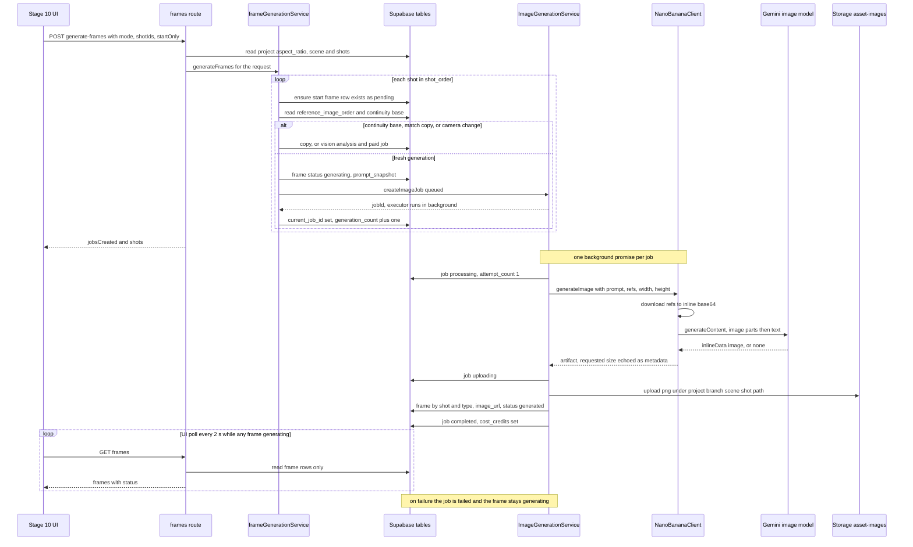
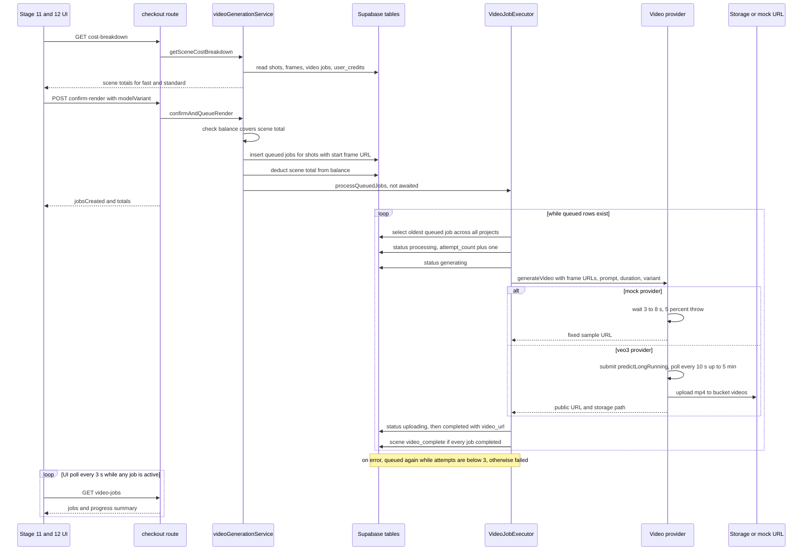

# 08. Shots, frames and generation

Scope. This document describes what the WizardDirector (Aiuteur) codebase does at HEAD for the per-scene production chain: the shot list (Stage 7), location and continuity fields on shots, shot-asset assignments (Stage 9 panels), Stage 9 prompt segmentation and its persisted outputs, the Stage 10 frame model and image generation lifecycle, the Stage 11 checkout and cost model, the Stage 11 and 12 video generation lifecycle, and the Stage 12 review UI. It records what each piece is, how it is reached, what it persists, and what it does not do. It contains no recommendations. Evidence is ledger ids in brackets (`WD-IMPL-*`) and repo paths with line numbers from the repository root.

Sources. Ledger kinds: CAP, STATE, INV, FACT, ENTITY, ROUTE, PROV, AI, TABLE, DEAD, TEST, PRESSURE, plus the R1a, R1b and K corrections. Reports: V7 (frame-chain and location parts), V8 (shots), V9 (prompts and frames), V10 (checkout and video), E (AI calls, image and video providers), I (async and infrastructure), H (state and invalidation), R1a and R1b (verification of wave-1 claims). R2 appears only through its ledger correction on `WD-IMPL-AI-0084`, which this document does not cite.

Reading notes. Document map: `00-README.md`. Sibling documents: `01` overview, `02` capabilities, `03` workflows, `04` domain and state, `05` data model, `06` writing, `07` assets and continuity (location identity, coverage, continuity base ranking, asset image jobs), `09` AI and prompts, `10` versioning, locking and invalidation, `11` architecture, `12` async and providers, `13` tests, `14` dead and duplicated code, `15` pressure points, `16` coverage and unknowns, `17` ledger.

## 0. Conventions

- Status tags use the corpus vocabulary: IMPLEMENTED, REACHABLE, FUNCTIONAL, PERSISTED, TESTED, PARTIAL, MOCK-ONLY, DEAD, ORPHANED, LEGACY, DUPLICATED, CONTRADICTED, UNKNOWN.
- Section 13 uses the assignment labels FULLY WIRED, PARTIAL, MOCKED, DEAD and UNKNOWN. FULLY WIRED means the code path is complete and reachable, with runtime behaviour UNKNOWN. MOCKED is MOCK-ONLY.
- "Static" means read from source and migrations only. No report executed a server, database, provider or migration. Runtime behaviour is UNKNOWN unless stated.
- Terms: Stages 1 to 12, scenes, shots, frames (start and end), `image_generation_jobs`, video jobs (`video_generation_jobs`), shot-asset assignments, scene asset instances, location views, continuity base, frame links.

## 1. Shot data model

### 1.1 `shots` core columns

The table has no single CREATE statement. Columns accumulate from migrations.

| Column | Definition (migration) | Written by | Notes and evidence |
|---|---|---|---|
| `id` | UUID PK (006) | extract, split, merge | FK target of frames, video jobs, image jobs, assignments, transformation events, location match events [WD-IMPL-ENTITY-0028] |
| `scene_id` | UUID NOT NULL FK scenes ON DELETE CASCADE (006) | extract, split, merge | [WD-IMPL-INVALIDATE-0084] |
| `shot_id` | TEXT NOT NULL, UNIQUE(scene_id, shot_id) (006) | extract (`generateShotId`), split (`{orig}-{n}`), merge (`{first}-M`) | Display label such as `1A`. The only lineage-like naming. `shotExtractionService.ts:105-114` [WD-IMPL-FACT-0102], [WD-IMPL-ENTITY-0031] |
| `duration` | INTEGER NOT NULL DEFAULT 8 (006) | extract, PUT, split, merge | Seconds. No CHECK. [WD-IMPL-FACT-0092] |
| `dialogue`, `action`, `setting`, `camera` | TEXT (006) | extract, PUT, split, merge | `setting` feeds the location resolver [WD-IMPL-FACT-0095] |
| `characters_foreground`, `characters_background` | TEXT[] DEFAULT '{}' (006) | extract (LLM prominence), PUT | `off-screen` maps to background |
| `continuity_flags` | TEXT[] (006) | extract, split, merge, PUT | Not shown or edited in Stage 7. Regex-matched in continuity logic (section 6.4). |
| `beat_reference` | TEXT (006) | extract; split sets null; merge copies first | Read-only in UI |
| `shot_order` | INTEGER NOT NULL DEFAULT 0, index (scene_id, shot_order) (012) | extract, reorder, split and merge shifts | No uniqueness; gaps after delete [WD-IMPL-STATE-0068] |
| `created_at`, `updated_at` | trigger `shots_updated_at` (006) | trigger | |

### 1.2 Camera and framing metadata

- `camera_distance`, `camera_height`, `camera_movement` TEXT (038). Populated only by extraction: LLM value when in enum, else `parseCameraMetadata` fallback (`promptGenerationService.ts:169-227`, default medium, eye_level, static). PUT accepts them, no UI sends them, split and merge leave them null [WD-IMPL-FACT-0101].
- `camera_direction_id` UUID FK `location_views` ON DELETE SET NULL (038) [WD-IMPL-ENTITY-0023].
- `camera` (free text, `SHOT_TYPE - ANGLE - MOVEMENT`) is not parsed back into the structured fields on edit (V8 section 3).
- No CHECK constraints on shot camera columns. CHECKs exist only on `location_views` (V8 section 1).

### 1.3 Location identity columns (039)

`location_asset_id` FK `project_assets` ON DELETE SET NULL; `location_match_confidence` NUMERIC(4,3) 0 to 1; `location_match_source` CHECK in `manual`, `resolver_exact`, `resolver_alias`, `resolver_fuzzy`, `stage7_inferred`, `legacy_backfill`, `camera_direction_parent`; `location_match_notes`; `end_frame_reference_image_order` JSONB (039:69-74, comment says no migration created it) [WD-IMPL-TABLE-0018]. Resolution rules are in `07`. For shots: manual links are sticky, resolver writes overwrite non-manual links, and an unmatched non-manual re-resolution writes null [WD-IMPL-FACT-0081], [WD-IMPL-INVALIDATE-0048].

### 1.4 Lineage, split and merge

- No lineage column exists (no `parent_shot_id`, `split_from`, or equivalent) [WD-IMPL-FACT-0099].
- Split and merge lineage is only the `shot_id` naming: split `{orig}-1..N`, merge `{first}-M` [WD-IMPL-FACT-0092], [WD-IMPL-FACT-0093].
- Split and merge do not carry `camera_direction_id`, structured camera fields, or manual location assignments [WD-IMPL-CAP-0219], V7 section 3.5.
- `transformation_flags` JSONB (030:135) is written as a JSON string scalar by extraction (`projects.ts:1928`) and never read [WD-IMPL-FACT-0100], [WD-IMPL-DEAD-0029]. See section 16 for the attribution correction.

### 1.5 Continuity and end-frame columns

| Column (migration) | Purpose | Written by | Evidence |
|---|---|---|---|
| `requires_end_frame` BOOLEAN DEFAULT TRUE (018) | Whether an end frame is generated | generate-prompts heuristic; PUT prompts (Stage 9 and 10 toggle) | [WD-IMPL-ENTITY-0037] |
| `ai_recommends_end_frame` BOOLEAN (029) | Stored heuristic value | generate-prompts only (`projects.ts:3851`) | V9 section 1 |
| `end_frame_prompt` TEXT (028) | End-frame prompt | generate-end-frame-prompt, PUT (no UI caller), field versions, regenerate with correction or prompt | [WD-IMPL-CAP-0256] |
| `start_continuity` TEXT DEFAULT 'none', CHECK none, match, camera_change (031) | Start-frame mode | generate-prompts (overwrites), PUT prompts, batch link, add-frame-as-reference | [WD-IMPL-STATE-0056] |
| `ai_start_continuity` (031) | Deterministic suggestion | generate-prompts | [WD-IMPL-STATE-0056] |
| `continuity_frame_prompt` TEXT (031) | Recomposition prompt | camera-change generation, generate-continuity-prompt; cleared when set to none | [WD-IMPL-STATE-0061], [WD-IMPL-STATE-0073] |
| `reference_image_order` JSONB (028) | Persisted start-frame references | generate-prompts, reference PUT, upload usage=reference, camera-change URL refresh | [WD-IMPL-STATE-0060] |
| `end_frame_reference_image_order` JSONB (039) | Persisted end-frame references | generate-prompts (null when no assignments), upload, reference PUT | [WD-IMPL-STATE-0060] |
| `selected_continuity_base_frame_id` FK frames ON DELETE SET NULL (040) | Base frame for reuse or edit | continuity-base route | [WD-IMPL-STATE-0057] |
| `frame_prompt`, `video_prompt` TEXT (018) | Start-frame image prompt and video prompt | generate-prompts, PUT prompts, field versions, regenerate with correction or prompt | [WD-IMPL-FACT-0106] |
| `compatible_models` TEXT[] DEFAULT '{Veo3}' (018) | Heuristic model list | generate-prompts; no UI renders it | V9 section 1 |
| `prompts_generated_at` (018) | Generation timestamp | generate-prompts | [WD-IMPL-FACT-0106] |

There is no image prompt column distinct from `frame_prompt`. `PromptSet.systemPrompt` exists in the frontend type and is never populated [WD-IMPL-DEAD-0035].

### 1.6 Lock fields on `scenes`

- `status` CHECK: draft, shot_list_ready, frames_locked, video_complete, outdated, continuity_broken (003, 014). `frames_locked`, `outdated`, `continuity_broken` have no writer [WD-IMPL-FACT-0209].
- `shot_list_locked_at` TIMESTAMPTZ (014) [WD-IMPL-ENTITY-0030].
- `stage_locks` JSONB DEFAULT '{}' is defined only in `backend/quickies-sql/add_stage_locks.sql:1`, whose comment says it ran on prod. No numbered migration creates it [WD-IMPL-FACT-0210]. Live presence UNKNOWN (section 15).

### 1.7 API shape

- `transformShotForClient` (`projects.ts:190-223`) returns camelCase core fields, snake_case camera and location fields, and `locationState`. It omits `shot_order`, `transformation_flags`, prompts, end-frame flags and continuity fields [WD-IMPL-ROUTE-0118].
- `GET` shots uses `select('*')` (`projects.ts:1559`), so raw `transformation_flags` is in the payload [WD-IMPL-FACT-0100].
- `Shot.transformationFlags` is declared in `src/types/scene.ts:73` and never populated [WD-IMPL-DEAD-0029].

## 2. Shot extraction (Stage 7)

### 2.1 Trigger and route

- Trigger: `Stage7ShotList` mount effect (`src/components/pipeline/Stage7ShotList.tsx:157-206`) fetches shots and, when there are zero, calls extract [WD-IMPL-CAP-0222]. Other reporters cite different ranges for the same effect (165-185, 170-178). The condition is the same.
- Route: `POST /api/projects/:id/scenes/:sceneId/shots/extract` (`projects.ts:1711-1977`) [WD-IMPL-ROUTE-0118].
- Empty result: the UI throws "Shot extraction returned no shots" and its Retry button calls `window.location.reload()` (`Stage7ShotList.tsx:880-883`, V8 section 2.1).
- Route context (`projects.ts:1716-1830`): scene `script_excerpt` and `expected_location`; previous scene `end_state_summary`; latest locked Stage 3 beats, numbered; latest locked Stage 4 `formattedScript` headings with the first line of each (100 characters); scene location from `resolveShotLocation`, with existing direction views passed when applied at 0.72 or more.

### 2.2 Model call

- `ShotExtractionService.extractShots` (`shotExtractionService.ts:195-441`) [WD-IMPL-AI-0071]. Provider: LangChain Gemini via `llmClient.generate`. Model `request.model || GEMINI_MODEL || 'gemini-1.5-flash'` (`llm-client.ts:106`). Temperature 0.3, maxTokens 4096. Actual model depends on `GEMINI_MODEL`, not read [WD-IMPL-FACT-0199].
- LLM client retries RATE_LIMIT, 5xx and network errors, 3 retries, backoff 1 s, 2 s, 4 s, capped at 10 s [WD-IMPL-FACT-0105].
- The first call is raced against 20 s (`SHOT_EXTRACTION_TIMEOUT_MS`). On timeout the result is `{shots:[], newDirections:[]}`. The request continues and its result is discarded [WD-IMPL-FACT-0186], [WD-IMPL-FACT-0202]. RATE_LIMIT is rethrown and the route returns 429.
- System prompt, quoted: "SHOT BREAKDOWN RULES: 1. Each shot must be EXACTLY 8 seconds (or explicitly justified if different, use 4-6s for complex action). 2. Each shot must be ATOMIC (one primary action or dialogue exchange). 3. Camera specs must be technically precise with THREE components: SHOT_TYPE - ANGLE - MOVEMENT ... 4. Character prominence must be explicit: use foreground, background, or off-screen." Other blocks: global context, previous end state, camera direction context or creation, blocking and body-language requirements, structured camera metadata (EWS, WS, FS map to wide; MS to medium; MCU, CU, ECU to close), continuity, transformation detection (instant, within_shot, gradual), output `{new_directions, shots}` with "OUTPUT: Return ONLY a valid JSON object with this exact structure (no markdown, no extra text)" [WD-IMPL-AI-0071].
- Parse retry on failure: one call with a short system prompt ("You extract a shot list from screenplay text. Return ONLY valid JSON") outside the 20 s race. A second failure returns an empty result [WD-IMPL-AI-0072].

### 2.3 Parse, validation and thresholds

- Parse: strip fences, `JSON.parse`. No repair step and no schema validation [E section 5].
- `validateShot`: `action`, `setting`, `camera` non-empty; `duration` a number in [1, 30] when present. Invalid shots are dropped silently [WD-IMPL-FACT-0103].
- IDs regenerated by surviving index (`1A` to `1Z`, `1AA`, `1AB`). LLM `shot_order` ignored [WD-IMPL-FACT-0102]. Duration default 8.

Lock-gate thresholds (`backend/src/services/shotValidationService.ts:41-193`, called only by the lock route) [WD-IMPL-FACT-0091]:

| Check | Severity | Rule |
|---|---|---|
| Zero shots | ERROR | Returns immediately |
| Duplicate `shot_id` | ERROR | Count above 1 |
| Empty action, setting or camera | ERROR | After trim |
| Duration | ERROR | Below 1 ("API limit") or above 30 ("quality threshold") |
| Duration | WARNING | Below 4 or above 12 |
| Foreground name not in `expected_characters` | WARNING | Only when `expected_characters` is non-null; Levenshtein suggestion below 3. Background not checked. |
| Total duration | WARNING | Below shots times 4, or above shots times 15 |
| Location | WARNING | Added by route when any shot is unresolved, ambiguous or mismatched (`projects.ts:173-188, 2930-2939`) |

Errors return 400 with `canForce:false`. Warnings without `force=true` return 409 with `canForce:true`. The client duplicates the thresholds (`Stage7ShotList.tsx:549-622`) without the character check, so character warnings appear only through the server 409 (V8 section 5).

### 2.4 Persistence

Route persistence (`projects.ts:1832-1969`): insert `location_views` rows for new directions with `source:'stage7_inferred'` (`view_type` `establishing` when the name says so, else `direction`; `camera_distance:'wide'`; first direction becomes primary) [WD-IMPL-CAP-0218]; insert shots with `shot_order = index` and `camera_direction_id` mapped by name; write one `location_match_events` row per shot [WD-IMPL-TABLE-0020]. Not transactional. Zero shots returns success with no insert.

### 2.5 Re-extraction

- Neither UI nor route deletes shots before extraction. The route does not check for existing shots [WD-IMPL-FACT-0160], [WD-IMPL-FACT-0221]. A second run would insert `1A` again and violate `UNIQUE(scene_id, shot_id)`, giving 500 "Failed to persist shots". Inferred from schema, not runtime-verified (V8 C6).
- The UI calls extract only when a scene has zero shots, and the last shot cannot be deleted (section 3.4). Re-extraction is therefore not reachable from the UI for a scene with shots. It is reachable through a direct API call.
- Stage 4 and 6 scene re-persist (`PUT /:id/scenes`, `projects.ts:1216-1529`) keeps matched scene ids and leaves shots, prompts, frames, assignments and locks untouched, with no staleness signal. Unmatched scenes are hard-deleted and their shots cascade [WD-IMPL-FACT-0352], [WD-IMPL-STATE-0028]. R1b correction: deletion requires a miss on both slug and number, then number only (`projects.ts:1379-1387, 1420`).

## 3. Editing, split, merge, delete and reorder

### 3.1 Field edits

Editable in UI: duration, action, dialogue, foreground and background characters, setting, camera, linked location (select, clear, accept candidate). Not editable in UI: `continuity_flags`, camera distance, height and movement, `camera_direction_id`, `shot_id`, `shot_order` [WD-IMPL-CAP-0223].

Chain: `handleShotUpdate` (`Stage7ShotList.tsx:289-306`) with a `pendingUpdates` map, flushed after 800 ms by `shotService.updateShot` (`shotService.ts:51-67`) to `PUT /:id/scenes/:sceneId/shots/:shotId` (`projects.ts:2399-2512`). Backend whitelist: duration, dialogue, action, characters, setting, camera, continuity_flags, beat_reference, camera_distance, camera_height, camera_movement, camera_direction_id. Other keys return 400. No value validation.

If `setting` or `camera_direction_id` is present and the link is not manual, the resolver runs and overwrites four location fields and writes a match event [WD-IMPL-FACT-0081]. PUT does not touch prompts, frames, jobs, assignments, `stage_locks` or scene status [WD-IMPL-STATE-0067]. Shot text has no version history.

### 3.2 Split

`POST .../shots/:shotId/split` (`projects.ts:2515-2654`), `shotSplitService.ts` [WD-IMPL-CAP-0224].

- Count is 3 only when `splitCount === 3`, else 2. The UI never sends `splitCount` or guidance [WD-IMPL-FACT-0104].
- LLM: "You are a shot segmentation specialist..." with the original JSON. Temperature 0.3, maxTokens 2048 (3072 for three). No timeout and no parse retry. Parse failure gives 422 (route maps parse or split errors to 422). [WD-IMPL-AI-0073]
- Each new shot gets `duration = original.duration`, so total scene duration grows [WD-IMPL-FACT-0092]. `beat_reference` null. Camera structured fields and transformation flags are not carried.
- Order: read original and assignments, call LLM, delete original (cascades frames, jobs, transformation events with that trigger shot, match events, assignments), shift later shots, insert new rows with location resolution, clone saved assignments to each new shot (errors logged), then fire-and-forget `invalidateStage9AndDownstream` [WD-IMPL-INVALIDATE-0054]. Not transactional: a failure after the delete loses the original.

### 3.3 Merge

`POST .../shots/:shotId/merge` (`projects.ts:2657-2788`), `shotMergeService.ts` [WD-IMPL-CAP-0225].

- Body direction `next` or `previous`. Neighbour is `shot_order ± 1` exactly, so an order gap from a delete returns 400 even when the UI shows a neighbour [WD-IMPL-FACT-0095].
- LLM: "You are a shot consolidation specialist..." with duration stated as the sum. Temperature 0.3, maxTokens 2048 [WD-IMPL-AI-0074].
- Result: `shot_id {first}-M`, `duration = a + b` (two 8-second shots give 16, above the 12 second warning), `beat_reference` from first. No assignment cloning and no stage invalidation, unlike split [WD-IMPL-INVALIDATE-0057].

### 3.4 Delete

`DELETE .../shots/:shotId` (`projects.ts:2791-2840`) [WD-IMPL-CAP-0226]. If count is 1 or less, returns 409 `{code:'LAST_SHOT', suggestion:'defer_scene'}` [WD-IMPL-FACT-0094]. Otherwise deletes the row and cascades frames, jobs, transformation events, match events and assignments [WD-IMPL-INVALIDATE-0056]. No `shot_order` compaction and no stage invalidation. UI offers "Defer scene" from the last-shot dialog (`Stage7ShotList.tsx:452-485`) [WD-IMPL-CAP-0227].

### 3.5 Reorder and manual add

- `PUT .../shots/reorder` (`projects.ts:1980-2040`) and `shotService.reorderShots` have no caller in `src/` [WD-IMPL-DEAD-0027]. ORPHANED.
- No route creates a single shot and Stage 7 renders no add control [WD-IMPL-FACT-0096].

### 3.6 Downstream effect summary

| Action | Frames and jobs | Assignments | Stage 9 to 12 locks |
|---|---|---|---|
| Extract | none | none | none |
| Field PUT, location PUT, camera-direction PUT | none | none | none |
| Split | cascade delete of originals | cloned to new rows | set to outdated [WD-IMPL-INVALIDATE-0054] |
| Merge | cascade delete of two rows | none | none [WD-IMPL-INVALIDATE-0057] |
| Delete | cascade delete | cascade delete | none |

## 4. Shot lock and unlock

### 4.1 Representations and trigger

Two Stage 7 lock representations exist: `scenes.shot_list_locked_at` with trigger-synced `scenes.status`, and `scenes.stage_locks['7']`. They are not joined by key and both are written on lock [WD-IMPL-INVALIDATE-0086].

Trigger `trg_sync_scene_lock_status` (014:31-63): null to non-null sets status `shot_list_ready`; non-null to null sets `draft` only when the old status was `shot_list_ready`. It raises nothing and touches no shot, frame or assignment [WD-IMPL-STATE-0066], [WD-IMPL-FACT-0342].

### 4.2 Lock path (UI)

1. Flush pending PUTs, wait 150 ms, run local validation (`Stage7ShotList.tsx:736-791`).
2. `POST .../shots/lock` (`projects.ts:2845-3017`): idempotent when already locked (`:2888-2900`), server validation, update of `shot_list_locked_at` and `stage_locks['7']` guarded by `.is('shot_list_locked_at', null)` (`:2991`). The `stage_locks` value is read-modify-write without version guard. Forced-lock audit is commented out (`:2980-2984`) [WD-IMPL-CAP-0228].
3. `POST .../stage-locks/7/lock` (`sceneStageLocks.ts:56-141`), best effort, errors swallowed.
4. `onComplete()` runs `handleSceneStageComplete` (`ProjectView.tsx:589-614`), which calls the stage-locks lock a third time, then navigates to Stage 8.

### 4.3 Enforcement by layer

| Layer | Enforced | Evidence |
|---|---|---|
| Frontend | `canEdit = !isSceneLocked && isEditable` disables inputs, split, merge, delete, location controls; footer hidden when locked or outdated | `Stage7ShotList.tsx:624`, `:1501` |
| Trigger | Status sync only | [WD-IMPL-STATE-0066] |
| Shot mutation routes | None. PUT, split, merge, delete, reorder, camera-direction, location and assignment routes do not read the lock. | [WD-IMPL-INVALIDATE-0055], [WD-IMPL-INVALIDATE-0083], R1a C05 |
| Stage 8 | `stage-locks/8/lock` requires `stage_locks['7'].status === 'locked'` (`sceneStageLocks.ts:93-105`) | V8 section 6 |
| Advanced buttons | Navigate to Stage 8 without locking (`Stage7ShotList.tsx:955-965, 1392-1403`) | V8 section 6 |
| Tests | Lock and unlock tests return 401 without auth. All DB-backed cases are `it.skip`. | [WD-IMPL-TEST-0035] |

Direct API calls to listed routes mutate shots of a locked scene [WD-IMPL-INVALIDATE-0055].

### 4.4 Unlock

1. `POST stage-locks/7/unlock` without confirm (`sceneStageLocks.ts:145-242`) returns 409 with `downstreamStages`, `framesAffected`, `videosAffected`, `estimatedCost`. The estimate is `framesAffected*0.05 + videosAffected*2.50`, a hard-coded constant [WD-IMPL-FACT-0222]. `videosAffected` queries table `videos`, which no migration creates, so it is always 0 [WD-IMPL-FACT-0208], [WD-IMPL-INVALIDATE-0081]. The Phase B dialog opens from this response, since `sceneStageLockService` unwraps `details` [WD-IMPL-STATE-0094] (H section 1.4 contrasts this with the broken Phase A path [WD-IMPL-FACT-0206]).
2. Confirm (`sceneStageLocks.ts:244-286`): stage 7 becomes draft, each locked or outdated downstream stage becomes outdated, `shot_list_locked_at` is nulled. No frame, video, prompt or assignment changes [WD-IMPL-STATE-0064], [WD-IMPL-INVALIDATE-0058].
3. The UI then calls legacy `POST .../shots/unlock` (`projects.ts:3020-3185`). It returns 400 "Shot list is not locked" because step 2 already nulled the timestamp. The UI swallows the error (`Stage7ShotList.tsx:814-818`). The legacy invalidation branch is unreachable from the UI [WD-IMPL-DEAD-0030].

Legacy branch, if reached: sets `frames.status='invalidated'` (not in the frames CHECK [WD-IMPL-FACT-0207]), writes `videos` (no table [WD-IMPL-FACT-0208]), inserts `invalidation_logs` (no table [WD-IMPL-FACT-0215]). Errors are not checked, so none of these writes have an effect.

### 4.5 Relock

`stage-locks/7/relock` (`sceneStageLocks.ts:290-375`) requires status exactly `outdated` and sets it to locked [WD-IMPL-CAP-0230]. Whether stage 7 can become outdated: V8 found no reachable producer [WD-IMPL-DEAD-0031]. K recorded a CONTRADICTED correction, citing `sceneStageLocks.ts:245-249` for stage 7 outdated when stages 1 to 6 are unlocked. That route rejects stages below 7 (`sceneStageLocks.ts:152`, `stage < 7` returns 400), so the correction's premise does not hold. This document treats stage 7 relock as unreachable through this route family (section 16).

## 5. Shot-asset assignments

### 5.1 Table and routes

`shot_asset_assignments` (033): `shot_id` FK CASCADE, `scene_asset_instance_id` FK CASCADE, `presence_type` CHECK `throughout`, `enters`, `exits`, `passes_through` (default `throughout`), UNIQUE(shot_id, instance) [WD-IMPL-ENTITY-0029].

Routes (`backend/src/routes/shotAssignments.ts`, mounted at `server.ts:57`, prefix `/:projectId/scenes/:sceneId/shot-assignments`). Ownership check `verifyProjectOwnership` (`:36-72`) checks project, scene and branch. It does not verify that assignment, shot or instance ids belong to the scene [WD-IMPL-INVALIDATE-0059] [WD-IMPL-ROUTE-0119].

| Method and path | Service | Invalidates 9 to 12 | Status |
|---|---|---|---|
| GET `` | `getAssignmentsForScene` | no | REACHABLE |
| GET `/shots/:shotId` | `getAssignmentsForShot` | no | ORPHANED [WD-IMPL-DEAD-0028] |
| POST `` | upsert on (shot_id, instance), zod body | yes | REACHABLE |
| PUT `/:assignmentId` | `updateAssignment` | yes | REACHABLE |
| DELETE `/:assignmentId` (`:195`) | `deleteAssignment` (`shotAssetAssignmentService.ts:173-179`) | yes | REACHABLE, also captures `/all` |
| DELETE `/all` (`:223`) | `deleteAllForScene` | yes | SHADOWED, section 5.4 |
| POST `/auto-populate` | `autoPopulate` | no | REACHABLE |
| GET `/has-assignments` | `hasAssignments` | no | REACHABLE |

`invalidateStage9AndDownstream` (`shotAssetAssignmentService.ts:318-344`) sets stage 9 to 12 entries that are `locked` to `{status:'outdated'}` and drops `locked_at`. It touches no frames, prompts or assignments [WD-IMPL-STATE-0065]. Tests cover service behaviour only [WD-IMPL-TEST-0036].

### 5.2 Auto-populate

`autoPopulate` (`shotAssetAssignmentService.ts:183-241`) inserts `throughout` rows for every shot and instance pair that is missing [WD-IMPL-CAP-0232]. Hook `useShotAssetAutoPopulate` (`:23-63`) runs once per mount when `hasAssignments` is false. Callers are Stage 8 (`Stage8VisualDefinition.tsx:302-311`) and Stage 9 (`Stage9PromptSegmentation.tsx:150-159`). Instances added later get no assignments unless added through the AssetDrawer checklist (`AssetDrawer.tsx:114-171`).

### 5.3 Stage 9 surfaces

- `ShotAssetPanel` (`Stage9PromptSegmentation.tsx:726-736`): presence select (PUT), remove with confirm (DELETE), add popover of unassigned instances (POST, `throughout`), passes-through warning with "Split Shot", banner for `match` with `enters` [WD-IMPL-CAP-0233], [WD-IMPL-CAP-0234], [WD-IMPL-CAP-0235], [WD-IMPL-CAP-0236]. Errors are only logged. `onShotSplit` is not passed, so prompt cards keep a deleted shot id after split [V8 section 8].
- `ShotAssetTimeline` (`Stage9PromptSegmentation.tsx:538-545`): click cycles null, throughout, enters, exits, passes_through, null [WD-IMPL-CAP-0237].
- `shotAssetMatcher` confidences: character foreground 1.0, background 0.7, dialogue mention 0.4; location setting 0.9, description 0.5; prop action 0.8, dialogue 0.5. All tested [WD-IMPL-CAP-0239].

### 5.4 Bulk template route shadowing

`BulkPresenceTemplates` (`Stage9/BulkPresenceTemplates.tsx`, rendered at `Stage9PromptSegmentation.tsx:503-511`) offers `all-throughout`, `match-characters` and `locations-throughout`. Apply first calls `deleteAllForScene` (client `shotAssetAssignmentService.ts:143-146`, caller `BulkPresenceTemplates.tsx:131`), then creates the assignments.

Step one cannot reach its handler. The single-delete route is registered at `shotAssignments.ts:195`, before the bulk route at `:223`. Express runs the first match, so `DELETE /all` is captured as `assignmentId = 'all'`. The service runs `.delete().eq('id', 'all')` on a UUID column (`shot_asset_assignments.id UUID`, 033:10). PostgreSQL rejects the value and the route returns 500 (`:213-215`). Creation never runs and the error is logged only [WD-IMPL-ROUTE-0120], [WD-IMPL-FACT-0343], [WD-IMPL-CAP-0238] (functional N, persisted N). The PostgREST error text was not observed (V8 C1). `buildTemplateAssignments` is tested as pure logic.

### 5.5 How assignments feed generation

- Assignments are loaded into a map of shot to `{scene_asset_instance_id, presence_type}` at prompt generation (`projects.ts:3808-3838`). A failed load falls back to all assets [WD-IMPL-FACT-0097].
- Non-location assets are kept only when assigned to the shot. A shot with no assignments falls back to all non-location assets [WD-IMPL-FACT-0098]. Location assets are kept only when they match `shot.location_asset_id`, regardless of assignments (`promptGenerationService.ts:344-363`).
- Manifests (`:612-663`): `throughout` gives start and end, `enters` end only, `exits` start only, `passes_through` neither (video only). Locations give both.
- Video prompt notes (`:969-997`): "X enters the frame during this shot.", "X exits the frame during this shot.", "Briefly during this shot, X (desc) passes through the scene."
- Asset merge migrates assignments with specificity enters, exits, passes_through (3) over throughout (1) (`projectAssets.ts:731-870`, V5).

## 6. Prompt segmentation outputs and assembly (Stage 9)

### 6.1 Persisted outputs

Generate-prompts writes per shot: `frame_prompt`, `video_prompt`, `requires_end_frame`, `ai_recommends_end_frame`, `compatible_models`, `reference_image_order`, `end_frame_reference_image_order`, `ai_start_continuity`, `start_continuity`, `prompts_generated_at`, `updated_at` [WD-IMPL-FACT-0106], [WD-IMPL-ENTITY-0037]. It also writes `text_field_versions` rows for `frame_prompt` and `video_prompt` with `source: ai_generation` [WD-IMPL-ENTITY-0035]. Readers: Stage 9 and 10 UI, frame generation, end-frame prompt generation, and the Stage 11 snapshot (`video_prompt_snapshot`).

### 6.2 UI to route chain

| UI action | Route | Backend effect | Evidence |
|---|---|---|---|
| Mount | `GET .../prompts` (`projects.ts:3190-3280`) | Reads shots by `shot_order`; `requiresEndFrame ?? true` | [WD-IMPL-ROUTE-0121] |
| Generate All or per-shot regenerate | `POST .../generate-prompts` (`projects.ts:3573-3958`), `shotIds` optional | Two LLM calls per shot; overwrites columns; no lock check | [WD-IMPL-CAP-0240], [WD-IMPL-CAP-0241] |
| Frame or video text edit | `PUT .../shots/:shotId/prompts` (`projects.ts:3459-3570`), 500 ms debounce | Plain UPDATE, no version row. Server limits 1500 (frame), 1000 (video); UI 1000 and 800. | [WD-IMPL-CAP-0242], [WD-IMPL-FACT-0115] |
| Version Save and arrows | `POST .../field-versions/:fieldName` and `.../select` (`frames.ts:2339-2408`) | Insert or select version, write back to `shots` | [WD-IMPL-CAP-0245] |
| End Frame switch, continuity select | PUT prompts | `requires_end_frame`, `start_continuity` (`none` nulls `continuity_frame_prompt`) | [WD-IMPL-CAP-0243], [WD-IMPL-CAP-0244] |
| Lock and Proceed | `lockStage(9)` then `onComplete()` | Gate is frontend only; disabled when prompts missing or edits pending | [WD-IMPL-CAP-0247], [WD-IMPL-FACT-0113] |

Two persistence paths write the same field: debounced PUT (no version) and version Save (versioned). After a debounced PUT the selected version and the column differ [V9 section 2]. Stage 9 editing is not disabled by lock state [WD-IMPL-FACT-0114].

### 6.3 generate-prompts inputs

The route (`projects.ts:3573-3838`) reads, in order: project (`visual_style_capsule_id`, `active_branch_id`); scene on active branch; shots by `shot_order` (400 when none); scene asset instances with `project_assets` (`effective_description = effective_description || description_override || project_assets.description`); completed angle variants for characters; `location_views` for locations (unordered, unlike the continuity loader, V7 section 5.4); style capsule; shots as `ShotData` with camera and location fields; transformation events; assignment map (section 5.5).

Style capsule: `getCapsuleById(project.visual_style_capsule_id)` (`:3739-3750`). No app code writes `projects.visual_style_capsule_id` [WD-IMPL-FACT-0339], [WD-IMPL-ENTITY-0038]. Stage 5 stores its style in `stage_states.content.locked_visual_style_capsule_id` (`Stage5Assets.tsx:227`). Unless the column is set outside the app, the style context is "No visual style capsule applied." (`promptGenerationService.ts:762`). UNKNOWN at runtime.

Not gathered: script text, beat sheet, master script, previous prompts or frames, writing style. "Previous shot" means the previous element of the same request array.

### 6.4 Per-shot assembly

`generateBulkPromptSets` (`promptGenerationService.ts:1048-1121`) runs sequentially per shot:

1. `determineContinuityLink(shot, previousShot)` (`:1014-1045`): no previous gives `none`; `continuity_flags` matching `/cut|jump|transition|time.?skip|new.?scene|later/i` gives `none`; different setting gives `none`; equal shot type and angle gives `match`; otherwise `camera_change`.
2. `generatePromptSet` (`:883-966`): scope assets (`:344-363`); enrich with angle match (`:370-439`; character angle by camera, location view by direction, alias, height and distance scores); transformation overrides; `buildAssetContext` (`:673-756`, CHARACTERS, LOCATIONS, PROPS); `buildStyleContext` (`:761-786`); reference manifest (section 8.3).
3. LLM call 1, `generateFramePrompt` (`:1128-1190`), then LLM call 2, `generateVideoPrompt` (`:1200-1260`). The second takes `framePrompt` but does not use it [WD-IMPL-DEAD-0035].
4. Heuristics. `determineRequiresEndFrame` (`:793-824`): any transforming asset gives true; static close-up without dialogue gives false; otherwise true for dolly, track, pan, zoom, crane, steadicam, dialogue, or duration above 8. `determineCompatibleModels` (`:829-847`): Veo3 always; Runway Gen-3 when frame prompt is 500 characters or fewer and no dialogue; Kling when duration is 10 or less.
5. Per-shot try and catch. One failure does not stop the others.

Manifest sort is location 0, character 1, prop 2 (`promptGenerationService.ts:472`). The docstring at `:462` says characters, locations, props. The code and its test (`promptGeneration.test.ts:206`, locations first) disagree with the docstring [WD-IMPL-FACT-0122] (CONTRADICTED in docstring).

### 6.5 Prompt templates and model call

Prompts are inline template literals, not `prompt_templates` rows [WD-IMPL-FACT-0107], [WD-IMPL-DEAD-0034]. Ledger: frame prompt [WD-IMPL-AI-0006]; end frame [WD-IMPL-AI-0007]; continuity recomposition [WD-IMPL-AI-0008]; video [WD-IMPL-AI-0009]; correction [WD-IMPL-AI-0078]; reuse and edit [WD-IMPL-AI-0054].

Excerpts (verbatim from source):

- Frame system (`:1135-1171`): "You are a visual prompt engineer for AI image generation (starting frames for Veo 3.1 video pipeline). YOUR TASK: Generate a single dense paragraph describing a FROZEN VISUAL SNAPSHOT ... STRUCTURE your output following this 5-part formula IN ORDER: 1. CAMERA POSITION & FRAMING ..." Ends with "max 1200 characters". Forbids "Image #N" text.
- Video system (`:1207-1225`): "You are a video prompt engineer for Veo 3.1 frame-to-video generation. THE STARTING FRAME ALREADY ENCODES ALL VISUAL TRUTH ..." Four parts, "max 500 characters".
- End frame (`:1307-1331`): end frame of a shot, same camera position, same characters, only poses changed. Includes `START FRAME (the "before" state)`.
- Correction (`:1445`): "You are editing an image generation prompt. Apply the user's correction surgically - change only what they asked for, keep everything else identical. Return ONLY the revised prompt, no explanation."

`callLLM` (`:1456-1475`): temperature 0.7, maxTokens 1024, raced against 30 s (`:143`). Timer not cleared, request not aborted [WD-IMPL-FACT-0186]. Model: text path (section 13). Output cleanup `cleanPromptOutput` (`:1480-1508`) strips fences, unwraps `prompt`, `framePrompt` or `videoPrompt` keys, strips quotes, truncates with `...`. No schema validation [E section 5].

### 6.6 Persistence and versions

Each successful shot gets one UPDATE of the section 6.1 columns (`projects.ts:3840-3891`). Column errors are not checked. Version rows are written with `source: ai_generation`. Version failures are logged only [WD-IMPL-STATE-0071]. The response returns 200 with `generated`, `failed` and `errors[]`; `RATE_LIMIT` gives 429.

Versions (`textFieldVersionService.ts`): cap `MAX_VERSIONS = 8` per entity and field; oldest non-selected row deleted before insert (`:181-202`); creation is several non-atomic statements [WD-IMPL-STATE-0072]. Lazy backfill of version 1 on first list when the field is non-empty (`frames.ts:2296-2333`).

### 6.7 What regenerate overwrites and preserves

| Item | Regenerate of one or more shots | Evidence |
|---|---|---|
| `frame_prompt`, `video_prompt` | Overwritten. Prior text survives only as a version row, if one exists. | [WD-IMPL-STATE-0071] |
| `requires_end_frame` | Overwritten by heuristic. User toggle lost. | [WD-IMPL-INVALIDATE-0065] |
| `reference_image_order`, `end_frame_reference_image_order` | Overwritten. User replacements and uploads lost. End order set to null when no assignments. | [WD-IMPL-STATE-0060] |
| `start_continuity`, `ai_start_continuity` | Overwritten. User choice lost. | [WD-IMPL-STATE-0071] |
| `end_frame_prompt`, `continuity_frame_prompt` | Preserved. Regenerate keeps `continuity_frame_prompt` even when new mode is none; PUT clears it. | V9 section 3.6 |
| `selected_continuity_base_frame_id`, frames, `frame_links`, assignments | Preserved | [WD-IMPL-INVALIDATE-0088] |

Single-shot regenerate (`shotIds=[uuid]`): the shots array has length 1, so the previous shot is null, the mode is forced to `none`, and no continuity context reaches the frame prompt LLM (`promptGenerationService.ts:1085-1091`, `projects.ts:3856`) [WD-IMPL-INVALIDATE-0068]. Subset regenerate of non-contiguous shots has the same effect.

Prompt edits do not invalidate frames or videos. `prompt_snapshot` keeps the prompt used [WD-IMPL-STATE-0070].

## 7. Frame model

### 7.1 `frames` table

Migration 019, extended by 040 [WD-IMPL-ENTITY-0033]:

- `shot_id` FK CASCADE (019:8). `frame_type` CHECK `start`, `end`. `UNIQUE(shot_id, frame_type)` (019:48).
- `status` CHECK `pending`, `generating`, `generated`, `approved`, `rejected`, default `pending` (019:12-19). No `invalidated` value [WD-IMPL-FACT-0207].
- `image_url`, `storage_path`, `generated_at`, `approved_at`, `prompt_snapshot`, `generation_count`, `total_cost_credits` NUMERIC(10,4), `inpaint_count`, `last_inpaint_mask_path`, `previous_frame_id` FK SET NULL, `current_job_id` FK image_generation_jobs SET NULL (019:25).
- 040 adds `generated_from_frame_id` FK SET NULL, `continuity_base_role` CHECK (`reuse_match`, `reuse_edit`, `camera_change_ref`, `match_copy`, `manual`), `promoted_to_view_id` FK location_views [WD-IMPL-STATE-0059], [WD-IMPL-TABLE-0021].
- Two FK paths now connect frames and shots. Embeds must use `shots!frames_shot_id_fkey`, guarded by a static test [WD-IMPL-TEST-0043].

### 7.2 Generations and selection

A generation is a completed `image_generation_jobs` row with the same shot, a `job_type` of `start_frame` or `end_frame`, and `status = 'completed'` (`frames.ts:1282-1288`). Jobs are not linked by frame id [WD-IMPL-ENTITY-0034]. The selected generation is `frames.current_job_id`. The carousel appears only when `generation_count > 1` and more than one completed job exists [WD-IMPL-CAP-0260].

`image_generation_jobs` (007, 026-34 CHECK): `status` (queued, processing, generating, uploading, completed, failed), `failure_stage` (generating, uploading, persisting), attempt and retry counters, `error_code`, `error_message`, `prompt`, `width`, `height`, `storage_path`, `public_url`, `cost_credits`, `estimated_cost`, `provider_metadata`, `idempotency_key` [WD-IMPL-TABLE-0024].

### 7.3 `frame_links`

Migrations 034 and 035: `source_frame_id`, `target_frame_id` (both CASCADE), `link_type` CHECK `match` or `reference`, `UNIQUE(target_frame_id)` [WD-IMPL-ENTITY-0036]. Only `match` links propagate. Reference links are consumed only by the camera-change path (`frameGenerationService.ts:404-428, 1130-1172`). Created by copy-frame (`frames.ts:2099-2103`), batch-link-copy (`:1949-1953`), add-frame-as-reference (`:1033-1043`). Deleted by the DELETE route (`:2253-2284`) and by implicit deletes (section 8.8) [WD-IMPL-STATE-0058].

### 7.4 `text_field_versions`

Migration 036: `entity_type` (`shot`, `scene_asset_instance`), `entity_id` (no FK), `field_name` (`frame_prompt`, `video_prompt`, `end_frame_prompt`, `description_override`), `content`, `is_selected`, `source` (`user_save`, `ai_generation`), `version_number`. Cap 8. Rows are orphaned on shot delete [WD-IMPL-ENTITY-0035], [WD-IMPL-FACT-0216]. RLS is one policy `FOR ALL USING (true) WITH CHECK (true)` with no `TO` clause, which applies to anon. The file comment says authenticated only [WD-IMPL-FACT-0359]. The backend bypasses RLS.

### 7.5 Frame status transitions

| # | Transition | Trigger and effect | Evidence |
|---|---|---|---|
| F1 | pending to generating | `startFrameGeneration` sets status, prompt snapshot, lineage, count, `current_job_id` | `frameGenerationService.ts:845-934`, status at `:871-875` [WD-IMPL-STATE-0069] |
| F2 | generating to pending | `createImageJob` throws; request returns 500 | `:926-931` |
| F3 | generating to generated | Executor success for start or end job, keyed by shot and type | `ImageGenerationService.ts:516-536` [WD-IMPL-STATE-0112] |
| F4 | generating to generated | `GET .../frames/:id/status` sees completed job; cost added on every call | `frameGenerationService.ts:1397-1427`, `frames.ts:484-513` [WD-IMPL-FACT-0219] (no UI caller) |
| F5 | generating to rejected | Same route sees failed job | `:1430-1437` (no UI caller) |
| F6 | generating (unchanged) | Executor failure; frame not updated | `ImageGenerationService.ts:549-583` [WD-IMPL-INVALIDATE-0090] |
| F7 | generated, rejected or approved to generating | Regenerate deletes incoming links, then propagates immediately | `frames.ts:365-418` (`:393`, `:408`) |
| F8 | generated to approved | PUT approve, no precondition, no UI caller | `frames.ts:297-329` [WD-IMPL-INVALIDATE-0092], [WD-IMPL-FACT-0109] |
| F9 | generated or approved to rejected | PUT reject, no UI caller | `frames.ts:331-359` |
| F10 | any to generated | Select generation clears `approved_at` | `frames.ts:1315-1400` [WD-IMPL-INVALIDATE-0064] |

FramePanel shows `generated` and `approved` as "Ready" (`FramePanel.tsx:119-125`). `areAllFramesApproved` (`frameGenerationService.ts:1520-1538`) accepts `generated` or `approved` [WD-IMPL-INVALIDATE-0060]. Stage 11 counts any start or end frame not `approved` as unapproved (`videoGenerationService.ts:179-192`), so UI-produced `generated` frames appear in that warning [V10 section 3.4].

## 8. Image generation lifecycle

### 8.1 Entry points

| Entry (UI) | Route | Service and evidence |
|---|---|---|
| Control "Generate start Frame" or "end Frame" | `POST .../generate-frames`, `{mode:'control', shotIds, startOnly}` | `Stage10FrameGeneration.tsx:807-809`, `:360`; end button disabled until start is generated or approved (`:1326`) [WD-IMPL-CAP-0248] |
| Quick "Generate All" or "Generate Remaining" | same route, `{mode:'quick', startOnly:false}` (`FrameGrid.tsx:144-161`) | [WD-IMPL-CAP-0249] |
| Regenerate | `POST .../frames/:frameId/regenerate` (`frames.ts:365-418`) to `regenerateFrame` (`frameGenerationService.ts:982-1245`) | [WD-IMPL-CAP-0251] |
| Regenerate with correction | `POST .../regenerate-with-correction` (`frames.ts:708-794`), LLM correction then regenerate | [WD-IMPL-CAP-0252] |
| Generate with edited prompt | `POST .../regenerate-with-prompt` (`frames.ts:800-871`) | [WD-IMPL-CAP-0253] |
| Inpaint | `POST .../inpaint` (`frames.ts:424-478`) to `inpaintFrame` (`frameGenerationService.ts:1250-1324`) | [WD-IMPL-CAP-0254] |
| Upload | `POST .../shots/:shotId/upload-frame-image` (`frames.ts:1063-1244`) | [WD-IMPL-CAP-0255] |
| Select or delete generation | `PUT .../select-generation` (`frames.ts:1315-1400`), `DELETE .../generations/:jobId` (`:1406-1492`) | [WD-IMPL-CAP-0258], [WD-IMPL-CAP-0259] |
| Match, reference and Link All | `copy-frame` (`frames.ts:1969-2142`), `add-frame-as-reference` (`:936-1057`), `batch-link-copy` (`:1814-1963`) | [WD-IMPL-CAP-0208], [WD-IMPL-CAP-0209], [WD-IMPL-CAP-0210] |
| Approve, reject, status | `frames.ts:297-359`, `:484-513` | No UI caller [WD-IMPL-FACT-0109], [WD-IMPL-STATE-0116] |

### 8.2 Start-frame branches in `generateFrames`

`generateFrames` (`frameGenerationService.ts:311-495`) runs sequentially over shots in `shot_order`:

1. Skip shots with no `frame_prompt`.
2. Build references (`fetchShotReferenceImageContext`, `:626-709`, section 8.3).
3. `ensureFrame(start)` inserts a pending row if missing.
4. If the start status is `pending` or `rejected`, exactly one branch runs:
   - (a) Valid continuity base: reuse or edit prompt (`buildReuseEditPrompt`, `:542-554`), paid job, lineage `reuse_match` or `reuse_edit`.
   - (b) `start_continuity === 'match'` and `previousEndFrameId`: copy the previous end image into the start frame, status `generated`, role `match_copy`, no job, no cost.
   - (c) `camera_change` and `previousEndFrameId`: take the reference link source or previous end image and run `generateWithCameraChangeAnalysis` (`:720-840`): vision analysis (`imageAnalysisService.analyzeReferenceFrame`), continuity LLM prompt saved to `continuity_frame_prompt`, paid job with `[prevEnd identity, ...shot refs]`, role `camera_change_ref`.
   - (d) Otherwise `startFrameGeneration` with `shot.frame_prompt`.
5. End frame, when not (control and startOnly) and `requires_end_frame`: prompt is `end_frame_prompt`, or `frame_prompt + ' [End of shot - showing action completion]'` (`:466-468`, `:1195-1197`). References come from `resolveEndFrameReferenceImages` (`:562-621`). A non-empty `end_frame_reference_image_order` is used verbatim. Otherwise a within-shot transformation post-image swap runs by asset name. The start image is prepended only if the start row already has an image, which a fresh Quick run usually does not.

`previousEndFrameId` is assigned only in the `else if (shot.requires_end_frame)` branch (`frameGenerationService.ts:490`). A Control start-only request never reaches it, so branches (b) and (c) run only in Quick bulk runs and in `regenerateFrame` [WD-IMPL-STATE-0076]. When a shot has `requires_end_frame` false, `previousEndFrameId` keeps the earlier shot's end id, so the next shot links to a non-adjacent end frame [WD-IMPL-FACT-0112]. Branch (d) does not clear an earlier `generated_from_frame_id` (`:876-881`) [V7 section 7.2].

### 8.3 Reference selection and ordering

- Source: `shots.reference_image_order` (start) and `end_frame_reference_image_order` (end), written by generate-prompts from the manifest. Entry shape: `label` ("Image #N"), `assetName`, `url`, `type`, `role` (identity or style), `referenceRole`, `reason`, `source` [WD-IMPL-STATE-0060].
- Start references map to `{url, role}`. Role is `style` only when `providerRole` or `role` says style. Otherwise identity [V9 section 5].
- Continuity base is prepended as identity when `selected_continuity_base_frame_id` points to a generated or approved frame with an image. Role is `reuse_match` when the shot and base share a camera direction, else `reuse_edit`. A base that is missing, rejected or pending is ignored and the selection is kept (`:626-709`) [WD-IMPL-CAP-0206], [WD-IMPL-STATE-0057].
- Executor order: `referenceImageUrls` are prepended to `referenceImages` (`ImageGenerationService.ts:335-345`). The client places image parts before the text part (`NanoBananaClient.ts:118-130`).
- Upload with `usage=reference` appends `{label:'User Upload', ..., type:'user_upload'}` with no role, so it is sent as identity [V9 section 6].
- Snapshot: URLs are copied at Stage 9 generation. Changes to asset images, angle variants or location views are not reflected until prompts are regenerated [WD-IMPL-FACT-0085], V9 section 11.
- Preview versus generation: the continuity preview recomputes references from current state. Its instruction outputs are not consumed by any generation path [WD-IMPL-DEAD-0025].

### 8.4 Job creation and status transitions

`startFrameGeneration` (`frameGenerationService.ts:845-934`) sets the frame to `generating`, then calls `createImageJob` with `jobType`, prompt, width and height from `FRAME_DIMENSIONS[aspectRatio]`, `idempotencyKey = 'frame-<id>-<Date.now()>'`, and references. On success it sets `current_job_id` and increments `generation_count`. On throw it resets the frame to `pending` and rethrows, so earlier shots' jobs keep running.

`createImageJob` (`ImageGenerationService.ts:109-187`): the idempotency lookup never matches because the key includes a timestamp [WD-IMPL-STATE-0115]. Inserts a `queued` job with `estimated_cost`, calls `executeJobInBackground` without await, and returns `{jobId, status:'queued'}`. The job is an in-process promise with a logging catch [WD-IMPL-STATE-0109], [WD-IMPL-FACT-0110].

`executeJobInBackground` (`ImageGenerationService.ts:298-582`):

1. `processing`, with `attempt_count = 1` hard-set (`:303`).
2. Style context from `style_capsules`, only when `visualStyleCapsuleId` is set. Frame jobs never set it (section 8.9).
3. Prepend reference URLs.
4. `generating`, then `provider.generateImage({prompt, width, height, visualStyleContext, referenceImages})` (`:353-357`).
5. `uploading`, then upload to bucket `asset-images` at `project_<p>/branch_<b>/scene_<s>/shot_<shot>/<jobType>_<ts>_<rand>.png` (`buildStoragePath`, `:605-626`).
6. For start and end jobs: `UPDATE frames SET image_url, storage_path, status='generated', generated_at WHERE shot_id AND frame_type` (`:516-536`). The update is keyed by shot and type, not by `current_job_id`, so a stale job that finishes last overwrites the image [WD-IMPL-INVALIDATE-0067].
7. `completed` with `cost_credits = actualCost || estimatedCost` and `provider_metadata`.

Failure (`:549-583`): `failed` with `error_code`, `error_message`, `failure_stage` (`uploading` or `generating` by status; anything earlier is labelled `persisting`, a mislabel [I section 3.3]). The frame is not updated (F6). Angle variant rows are updated when applicable.

### 8.5 Provider request shape

Provider: `NanoBananaClient.generateImage` (`backend/src/services/image-generation/NanoBananaClient.ts:29-169`). It is the only wired image provider [WD-IMPL-PROV-0006], [WD-IMPL-PROV-0017].

- Each reference URL is downloaded with `fetch` and converted to base64 `inlineData`. A failed download is skipped silently.
- Prompt wrapper by reference role. Identity and style mixed: "Maintain the characters/subjects from the FIRST N identity reference image(s) ... Apply the visual style ... from the remaining M style reference image(s) ... Subject: <prompt>". Identity only: "Maintain the characters/subjects from the FIRST {n} identity reference image(s) - preserve their exact appearance, features, clothing, and distinguishing details." Single style reference: "Generate an image that matches the visual style, color palette, mood, and aesthetic shown in the provided reference image. ... Subject:". Text only: unchanged [WD-IMPL-AI-0010], [WD-IMPL-FACT-0027].
- SDK call (`@google/generative-ai` 0.24.1): `new GoogleGenerativeAI(GOOGLE_AI_API_KEY).getGenerativeModel({model:'gemini-2.5-flash-image'}).generateContent({contents:[{role:'user', parts:[...imageParts, {text: prompt}]}]})` (`:118-130`).
- Not sent: `generationConfig`, aspect ratio, width, height, negative prompt, seed [WD-IMPL-FACT-0188], [WD-IMPL-FACT-0111].
- Response: first `candidates[0].content.parts[].inlineData` is the artifact. None gives a PERMANENT error [E section 5]. Returned width and height echo the request (`:159-160`), so they are metadata only.
- Cost estimate `0.01 * (w*h)/(512*512)`, about 0.0352 for 1280x720 (`:230-235`). Gemini returns no billed cost (`:163`).
- Retries: RATE_LIMIT, TEMPORARY and network, up to 3 retries, backoff 1 s, 2 s, 4 s, capped at 10 s (`:17-18`, `:241-269`) [WD-IMPL-FACT-0183]. No request timeout [WD-IMPL-FACT-0186].
- Construction: `ImageGenerationService` builds the client in its constructor (`:68-70`), and services are instantiated at module load (`frameGenerationService.ts:129-133, 1600`; `routes/images.ts:6`; `routes/assets.ts:8`; `routes/projectAssets.ts:20`). A missing key therefore fails at boot. Correction in section 16 [WD-IMPL-FACT-0198].

### 8.6 Polling

- Stage 10 refetches `GET .../frames` every 2000 ms while `calculateProgress(shots).generatingFrames > 0` (`Stage10FrameGeneration.tsx:252-259`). No ceiling [WD-IMPL-CAP-0250].
- `GET .../frames` (`frames.ts:71-221`) reads frame rows only. It does not consult the job table, so a failed job is never reflected [WD-IMPL-STATE-0116].
- The only route that reads job status into frames is `GET .../frames/:id/status` (F4, F5). Its wrapper `frameService.pollFrameStatus` (`frameService.ts:569-587`) is called only by `pollUntilComplete` (`:593-631`), which has zero callers. That helper would mark the frame complete on any error [WD-IMPL-FACT-0108].

### 8.7 Failed-job stuck state

1. The executor marks the job `failed` and leaves the frame `generating` (F6).
2. Stage 10 keeps polling every 2 s. Generation controls stay disabled with "Generating..." (`FramePanel.tsx:684-688`) [V9 section 5].
3. Nothing moves the frame to `rejected` unless a client calls `GET .../status`. No UI does [WD-IMPL-INVALIDATE-0090], [WD-IMPL-FACT-0219].

Exits from `generating`: upload variant (`frames.ts:1063-1244`); carousel select when two completed jobs exist; a direct call to `GET .../status`. Regenerate is reachable only by API for a frame in `generating`, because the UI disables it.

Server restart: rows in `queued`, `processing`, `generating` or `uploading` stay there, and the frame stays `generating`. No sweeper, cron or startup recovery exists [WD-IMPL-FACT-0110], [WD-IMPL-PRESSURE-0008]. Racing regenerations: each completion writes by shot and type, so the last finisher wins regardless of `current_job_id` [V9 section 9].

### 8.8 Other frame actions

| Action | Effects | Evidence |
|---|---|---|
| Plain regenerate | Order: (1) valid base reuse or edit job; (2) `match` copy of previous shot end frame with zero-cost job; (3) throws without `frame_prompt`; (4) `camera_change` analysis job; (5) generic job with end-prompt fallback, persisted references, transformation swap, optional user reference as style. Deletes incoming links (`:393`). Propagates match links before the new image exists, so targets receive the pre-regeneration image (`:408`). | [WD-IMPL-INVALIDATE-0089], [WD-IMPL-INVALIDATE-0066] |
| Regenerate with correction | LLM `applyFramePromptCorrection` (AI-0078) writes text to `shots.frame_prompt` or `end_frame_prompt` with no version row. Does not delete links or propagate. For match, base and camera-change starts the corrected text is ignored, because those branches rebuild from other inputs. | [WD-IMPL-CAP-0252], V9 section 6 |
| Generate with edited prompt | As correction without LLM; no backend length check | [WD-IMPL-CAP-0253] |
| Upload | Multer memory, 5 MB, PNG, JPEG, WebP (`frames.ts:15-29`). `variant`: deletes incoming links, upserts `generated`, `prompt_snapshot '[User upload]'`, zero-cost completed job, sets `current_job_id`, propagates. `reference`: appends to reference arrays. Storage `asset-images/.../frames/uploads/`. | [WD-IMPL-CAP-0255] |
| Select generation | Deletes incoming links, sets `current_job_id`, `image_url`, `prompt_snapshot`, `generated`, clears `approved_at`. `storage_path` not updated. Job looked up by id and status only. Propagates after the update. | [WD-IMPL-CAP-0258], [WD-IMPL-INVALIDATE-0064] |
| Delete generation | Guards: not current, at least two completed jobs of the type. Calls storage `remove` on bucket `frames` (`frames.ts:1465`), a bucket uploads never use. Deletes job row. | [WD-IMPL-CAP-0259], [WD-IMPL-INVALIDATE-0063] |
| Generate end-frame prompt (AI-0007) | 400 without `frame_prompt`; scene assets not scoped by assignment; writes `end_frame_prompt` and an `ai_generation` version (`frames.ts:519-658`) | [WD-IMPL-CAP-0256] |
| Save end prompt (`PUT .../end-frame-prompt`) | No client call site | ORPHANED [WD-IMPL-DEAD-0032] |
| Stage 10 prompt edits | Version Save only. Unsaved edits are lost on shot change (`Stage10FrameGeneration.tsx:617-623`). | [WD-IMPL-CAP-0257] |
| Unlink (sidebar) | PUT `startContinuity: 'none'` per shot. Clears `continuity_frame_prompt`, keeps links. | [WD-IMPL-CAP-0263] |

Frame-scoped routes check project ownership only, not that `frameId` belongs to the project or scene [V9 section 6], [WD-IMPL-ROUTE-0122].

### 8.9 Aspect ratio and mask

Aspect ratio:

- `projects.aspect_ratio` TEXT NOT NULL DEFAULT '16:9' CHECK in (`16:9`, `9:16`) (022) [WD-IMPL-ENTITY-0038].
- `FRAME_DIMENSIONS` maps 16:9 to 1280x720 and 9:16 to 720x1280 (`frameGenerationService.ts:126-127`). Stored on the job and used for estimates and metadata only [WD-IMPL-FACT-0111].
- Not sent to the model. No prompt text states the ratio and no resize step exists (grep for `sharp`, `jimp`, `resize` in the image path returns nothing) [R1b C12, WD-IMPL-FACT-0188]. Output ratio is whatever the model returns. UNKNOWN until images are inspected.
- The UI renders frames in `aspect-video` boxes regardless of project ratio (`FramePanel.tsx:270, 341, 564, 571`).

Mask:

- Inpaint (`inpaintFrame`, `frameGenerationService.ts:1258-1310`) uploads the mask PNG to `asset-images/project_<p>/inpaint-masks/` (`storeMask`, `:1329-1358`) and writes `frames.last_inpaint_mask_path` (`:1312`).
- Job prompt is the user text plus "[Inpainting: Apply changes only to masked regions]" (`:1291`), with the current frame image as the only reference (`:1304`).
- The mask is never sent. `NanoBananaClient.inpaintImage` (text-only, TODO for upload, `NanoBananaClient.ts:171-228`) is the only mask-aware method and has zero callers [WD-IMPL-PROV-0007], [WD-IMPL-DEAD-0043]. Status: PARTIAL [WD-IMPL-FACT-0189], R1b C12 [WD-IMPL-FACT-0349].
- Job-creation failure does not revert frame status (V9 section 6).

### 8.10 Frame generation sequence



## 9. Blocking and previs support

Verdict: no blocking or previs capability exists. The feature is absent. Type-only literals are ORPHANED.

Evidence:

- Schema: grep for `blocking`, `previs` and `previz` over `backend/migrations` returns no matches [WD-IMPL-FACT-0099].
- Backend types: `blocking_composition_reference`, `blocking_start_frame`, `blocking_end_frame` in a union at `promptGenerationService.ts:101-109` and `continuityCompositionService.ts:23-25, 75, 85`. The normalizer `toAssetType` (`continuityCompositionService.ts:183-189`) passes `blocking` through when a persisted string carries it. No code writes such values.
- Frontend types: `src/types/scene.ts:273`, `src/types/locationContinuity.ts:26-28, 151, 161`.
- Display only: `src/components/pipeline/Stage9/ContinuityPreviewPanel.tsx:36-38` labels the roles "Blocking reference", "Blocking start frame" and "Blocking end frame". No data source produces them.
- Prose only: the extraction prompt asks for "character positions and blocking" inside the `action` text (`shotExtractionService.ts:230, 270`).
- Unrelated: `Stage10FrameGeneration.tsx:972` "Blocking Lock & Proceed" names the gate that blocks the proceed action. The image-generation test title "without blocking" concerns async behaviour.

No blocking, previs, storyboard or shot-planning artifact exists in Stages 7 to 12. Frames are image generations from prompts and references.

## 10. Checkout, cost and credits

### 10.1 Routes

Mounted at `server.ts:63` under `/api/projects` with `authenticateUser` (`backend/src/routes/checkout.ts`). The only tenant check is `projects.user_id`, because the backend uses the service-role client.

| Route | Check | Caller | Status |
|---|---|---|---|
| GET `.../cost-breakdown` (`:12-53`) | project, scene on active branch | Stage 11 query, 30 s stale | REACHABLE [WD-IMPL-ROUTE-0123] |
| GET `/credit-balance` (`:59-84`) | project | none | ORPHANED client [WD-IMPL-ROUTE-0124] |
| POST `.../confirm-render` (`:91-142`), `modelVariant` default `veo_3_1_fast` | project, scene | Stage 11 confirm | REACHABLE [WD-IMPL-ROUTE-0125] |
| GET `.../video-jobs` (`:148-202`) | project, scene | Stage 12; carousel for other scenes | REACHABLE [WD-IMPL-ROUTE-0126] |
| GET `.../video-jobs/:jobId` (`:208-237`), GET `.../render-status` (`:243-266`) | job and scene not bound | none | ORPHANED [WD-IMPL-ROUTE-0127], [WD-IMPL-ROUTE-0128] |
| GET `/batch-render-status` (`:272-295`) | project | Stage 6 every 10 s | REACHABLE [WD-IMPL-ROUTE-0129] |
| POST `.../video-jobs/:jobId/retry` (`:301-324`) | job not bound to project | Stage 12 retry | REACHABLE [WD-IMPL-ROUTE-0130] |

### 10.2 Cost formula (verbatim)

`backend/src/services/videoGenerationService.ts:5-7`:

```
// Pricing constants ($/second)
export const VEO_31_FAST_RATE = 0.15;
export const VEO_31_STANDARD_RATE = 0.40;
```

`:195-198`, per shot:

```
const imageCost = parseFloat(startFrame?.total_cost_credits || 0) +
    parseFloat(endFrame?.total_cost_credits || 0);
const videoCostFast = this.calculateVideoCost(shot.duration, 'veo_3_1_fast');
const videoCostStandard = this.calculateVideoCost(shot.duration, 'veo_3_1_standard');
```

`:221-222`, per scene:

```
const sceneTotalCostFast = shotDetails.reduce((sum, s) => sum + s.imageCost + s.videoCostFast, 0);
const sceneTotalCostStandard = shotDetails.reduce((sum, s) => sum + s.imageCost + s.videoCostStandard, 0);
```

`calculateVideoCost` (`:101-104`) returns `parseFloat((durationSeconds * rate).toFixed(4))`. In one line: scene total equals the sum over shots of (start frame `total_cost_credits`, plus end frame `total_cost_credits` when an end-frame row exists regardless of `requires_end_frame`, plus `shots.duration` times the rate), with rate 0.15 or 0.40 [WD-IMPL-FACT-0123].

Consequences of the formula:

- `shots.duration` is unclamped. Veo bills 4, 6 or 8 seconds (`Veo3Provider.ts:23, 208-222`) [WD-IMPL-FACT-0127].
- The image term is effectively 0 for AI-generated frames. The only writer of `frames.total_cost_credits` is `onJobCompleted` (`frameGenerationService.ts:1422`), reached only through `GET .../frames/:id/status`, which has no UI caller. Zero-cost copy and upload rows add nothing [WD-IMPL-FACT-0120] (I, verified). Stage 10 `getSceneFrameCosts` (`:1472-1515`) falls back to job costs for display, so Stage 10 and Stage 11 can disagree. This extends V10, which recorded the column as staying at 0 without naming the single writer.
- Units: image cost is an estimate in "credits" and video cost is a rate in dollars. Both are summed and shown as `$` [WD-IMPL-FACT-0123]. Intent UNKNOWN.
- Rates appear in six places (`videoGenerationService.ts:6-7`, `MockVideoProvider.ts:44`, `Veo3Provider.ts:157-160`, `checkoutService.ts:243`, the Stage 11 copy at `Stage11Confirmation.tsx:288, 306`, and migration 021 comments) [WD-IMPL-FACT-0124].
- `projectRunningTotal` (`:263-268`) sums `actual_cost` for completed jobs and `estimated_cost` otherwise, across the project. Display only [WD-IMPL-CAP-0272].

### 10.3 Confirm and charge sequence

`confirmAndQueueRender` (`videoGenerationService.ts:318-408`) [WD-IMPL-FACT-0129], [WD-IMPL-FACT-0125]:

1. Re-runs the breakdown. `totalCost` is the scene total for the chosen variant, including skipped shots and frame terms.
2. `hasSufficientCredits(totalCost)`, else "Insufficient credits" (500).
3. For each shot, skip when `!shot.startFrameUrl` (`:344-348`). The comment says "approved start frame", but only URL presence is checked [CONTRADICTED, V10 section 12]. Frame status is not checked.
4. Insert queued rows (`:354-386`) with snapshots of URLs and prompts. `end_frame_url` is set whenever an end-frame row has an image, even when `requires_end_frame` is false. No duplicate check.
5. `deductCredits(totalCost)` (`:394`), after the insert. If deduction throws, queued rows stay uncharged and the executor is not triggered.
6. `triggerJobProcessing()` (`:414-423`) starts the executor without await.

Not checked: stage locks for stages 7 to 11, existing jobs, frame approval [WD-IMPL-CAP-0271]. The Stage 11 UI says "No further edits are possible after confirmation" (`Stage11Confirmation.tsx:367`), but nothing enforces it, and the sidebar button stays enabled while locked [V10 sections 3.6, 12].

On success the UI invalidates video jobs and calls `handleSceneStageComplete`, which locks stage 11 best effort and moves to stage 12 [WD-IMPL-STATE-0081].

### 10.4 What is and is not charged

| Item | Charged | Evidence |
|---|---|---|
| Scene total, once per confirm | Yes | [WD-IMPL-FACT-0125] |
| Shots with no start frame URL | Yes, included in the total with no job | [WD-IMPL-FACT-0351] |
| Second confirm on the same scene | Yes, full total again plus a second job set | [WD-IMPL-FACT-0126] |
| Frame image generation | No separate charge. No `user_credits` access in that path. | V10 section 4 |
| Automatic and manual video retries | No | [WD-IMPL-FACT-0131]; V10 section 5.4 |
| Failed jobs, skipped shots, Veo clamp, actual versus estimated | Never refunded or reconciled | [WD-IMPL-FACT-0128] |

`addCredits` (`userCreditsService.ts:126-150`) has no caller. No top-up or payment path exists [WD-IMPL-DEAD-0039].

`user_credits` (020): `balance NUMERIC(12,4) DEFAULT 100.00`, `low_credit_threshold DEFAULT 10.00`, one row per user, RLS for own rows [WD-IMPL-TABLE-0025]. `ensureUserCredits` (`userCreditsService.ts:20-21, 28-73`) creates the row on any balance read, so every Stage 11 load provisions credits [WD-IMPL-STATE-0114], [WD-IMPL-CAP-0284]. `deductCredits` (`:92-121`) reads, checks, and writes `balance - amount` with no transaction or ledger [WD-IMPL-INVALIDATE-0105].

## 11. Video generation lifecycle

### 11.1 `video_generation_jobs` (021)

- FKs project, branch, scene and shot CASCADE. `start_frame_id` NOT NULL and `end_frame_id` reference `frames` with NO ACTION [WD-IMPL-TABLE-0026].
- `model_variant` CHECK `veo_3_1_fast`, `veo_3_1_standard`. `status` CHECK `queued`, `processing`, `generating`, `uploading`, `completed`, `failed`, default `queued`.
- Snapshots at queue time: `start_frame_url`, `end_frame_url`, `video_prompt_snapshot`, `frame_prompt_snapshot`. Later edits do not change queued or completed jobs [WD-IMPL-INVALIDATE-0072].
- `duration_seconds`, `estimated_cost NUMERIC(10,4) NOT NULL`, `actual_cost`, `video_url`, `storage_path`, `error_code`, `error_message`, `attempt_count DEFAULT 0`, `max_retries DEFAULT 3`, `provider_job_id`, `provider_metadata`, timestamps. No uniqueness on shot or scene.

### 11.2 Executor

`VideoJobExecutor` (`backend/src/services/video-generation/VideoJobExecutor.ts`) [WD-IMPL-STATE-0111]:

- Singleton. Provider fixed at construction through `createVideoProvider()`.
- In-memory `isProcessing` flag. A trigger during a run is a no-op, but the running loop keeps selecting queued rows until none remain.
- `fetchNextQueuedJob` (`:62-76`): oldest queued row across all users and projects, serial, 500 ms gap.
- `pollIntervalMs = 5000` (`:16`) is unused. No timer and no startup hook exist. The header says it "Polls video_generation_jobs table" [CONTRADICTED] [WD-IMPL-DEAD-0040].
- `processJob` (`:81-172`): `processing` (sets `processing_started_at`, `attempt_count` plus one), `generating`, read live `projects.aspect_ratio`, `provider.generateVideo({startFrameUrl, endFrameUrl, prompt: video_prompt_snapshot, durationSeconds, modelVariant, aspectRatio})`, `uploading` with provider ids (set after the provider already uploaded), `completed` with URL, storage path and actual cost, then `checkAndUpdateSceneStatus`.
- `frame_prompt_snapshot` is stored and never sent.

### 11.3 Retries

Catch branch (`:144-171`): if `attempt_count + 1 < max_retries` (3), the row returns to `queued` with `error_message`. Otherwise it becomes `failed` with `error_code` (default `GENERATION_FAILED`). Three automatic attempts in total [WD-IMPL-FACT-0131]. `VideoProviderError.retryable` is ignored, so PERMANENT errors such as safety filtering are retried too, and each Veo3 retry is a billable call.

Manual retry (`retryJob`, `videoGenerationService.ts:563-597`): requires `failed`, sets `queued`, clears error, URL, provider and timing fields. It does not reset `attempt_count`, so the retried job has one attempt [WD-IMPL-INVALIDATE-0103], [WD-IMPL-STATE-0078]. No credit check, no charge. Triggers the executor.

### 11.4 Scene status

`checkAndUpdateSceneStatus` (`videoGenerationService.ts:516-537`) reads every job for the scene, including history. If all are `completed`, `scenes.status = 'video_complete'`. Otherwise it only logs. Never reset. A failed historical row therefore blocks `video_complete` until a retry succeeds [WD-IMPL-INVALIDATE-0102], [WD-IMPL-STATE-0080].

### 11.5 Provider selection and mock

`createVideoProvider.ts:15-33`: `process.env.VIDEO_PROVIDER || 'mock'`. `veo3` selects Veo. Anything else selects the mock. Cached per process [WD-IMPL-PROV-0012]. `VIDEO_PROVIDER`, `GOOGLE_CLOUD_PROJECT`, `GOOGLE_CLOUD_LOCATION` and `GOOGLE_APPLICATION_CREDENTIALS` are absent from `backend/env.example` and `backend/.env` (names only) [WD-IMPL-FACT-0139]. Production value UNKNOWN.

`MockVideoProvider` [WD-IMPL-PROV-0014], [WD-IMPL-AI-0067], MOCKED, the default:

- Delay `3000 + Math.random() * 5000` ms (`MockVideoProvider.ts:18-20`).
- `Math.random() < 0.05` throws "Mock generation failure: simulated provider error" (`:23-25`).
- Returns `https://storage.googleapis.com/gtv-videos-bucket/sample/ForBiggerBlazes.mp4` for every job (`:10`, `:31`). Frames, prompt and aspect ratio are ignored. Nothing is stored.

### 11.6 Veo 3.1 provider

`Veo3Provider` (`backend/src/services/video-generation/Veo3Provider.ts`) [WD-IMPL-PROV-0013], [WD-IMPL-PROV-0018]. PARTIAL: complete code, env-gated, not default, no automated test. The manual script `backend/src/tests/veo3-test.ts` is excluded from jest by `testMatch` [V10 section 6].

- Auth: `GoogleAuth`, scope `cloud-platform`, ADC. Token fetched once and reused through polling.
- Models: `veo_3_1_fast` maps to `veo-3.1-fast-generate-001`; `veo_3_1_standard` to `veo-3.1-generate-001` (`:17-20`).
- Submit to `https://{location}-aiplatform.googleapis.com/v1/projects/{project}/locations/{location}/publishers/google/models/{model}:predictLongRunning` (`:107-116`). Location defaults to `us-central1`.
- Body (`:70-104`): `instances` with `prompt`, `image` (start frame bytes) and `lastFrame` (end frame bytes); `parameters` with `durationSeconds` clamped to 4, 6 or 8, `sampleCount: 1`, `generateAudio: true`, `aspectRatio`, `personGeneration: 'allow_adult'`, `resizeMode: 'pad'`. Veo is the only path that receives the end frame.
- Submit errors: 429 gives RATE_LIMIT; 401 or 403 gives AUTH_ERROR; otherwise TEMPORARY.
- Poll every 10 s for up to 5 minutes (`:26-28`, `:224-302`) via `:fetchPredictOperation`. Errors and safety-filtered output give PERMANENT. Timeout gives TEMPORARY. Submit and GCS download have no timeout [WD-IMPL-FACT-0140].
- Result (`:308-358`): base64 bytes or a `gcsUri` download, uploaded to bucket `videos` at `${projectId}/${timestamp}.mp4` (`:335-355`). `projectId` is the GCP project, so all app projects share one folder.
- Returned `storagePath` is `videos/${projectId}/${Date.now()}.mp4` (`:145`), built with a second timestamp and a different prefix, so the stored `storage_path` does not match the uploaded key [WD-IMPL-FACT-0132], [WD-IMPL-FACT-0190] (CONTRADICTED).
- `actualCost = clampedDuration * (0.15 or 0.40)`.

### 11.7 Storage

- Bucket `videos` has no creator in the repo. `scripts/setup-storage-buckets.ts:38` creates `style-capsule-images` and `setup-asset-images-bucket.ts:6` creates `asset-images` [WD-IMPL-TABLE-0027], [WD-IMPL-FACT-0236]. Existence UNKNOWN.
- Mock clips are external URLs. Frame images are in `asset-images`.

### 11.8 Restart and refresh

- Browser refresh: job state is in the database. Stage 12 refetches on mount and resumes polling [WD-IMPL-CAP-0286].
- API restart: rows in `processing`, `generating` or `uploading` stay there with no recovery. Retry refuses non-failed rows, and the scene never reaches `video_complete` [WD-IMPL-INVALIDATE-0104], [WD-IMPL-PRESSURE-0009].
- Queued rows wait until any user's next confirm or retry starts the loop [WD-IMPL-STATE-0111].
- Veo operation names are stored only after the provider returns, so a restart during polling loses the operation [V10 section 5.5].
- Two API instances can select the same queued row (`VideoJobExecutor.ts:62-76`, update by id only), causing a duplicate call and cost [I section 3.4]. Instance count UNKNOWN.

### 11.9 Video generation sequence



## 12. Stage 12 review UI and export

- Data: `useQuery(['video-jobs'])` over `GET video-jobs`, refetching every 3000 ms while any job is queued, processing, generating or uploading (`Stage12VideoGeneration.tsx:56-68`) [WD-IMPL-CAP-0273].
- Empty state "No Video Jobs" with Back to Confirmation (`:209-225`). Header progress and ETA from completed and processing timestamps (`utils.ts:89-105`).
- `VideoPlayer`: two `<video>` elements. The active one plays the current job URL and the other preloads the next completed job, swapping on `ended` (`:68-131, 198-228`). This is sequential playback of separate MP4 files [WD-IMPL-CAP-0274]. Failed jobs show the error and "Retry Job" [WD-IMPL-CAP-0277]. Controls: skip by job index (including non-playable jobs), Play Scene, mute, fullscreen [WD-IMPL-CAP-0276].
- `TimelineBar`: segment widths from DB `duration_seconds`, not media duration. Click or drag seeks [WD-IMPL-CAP-0275].
- `ShotListPanel`: one card per job. The label `Shot {index+1}` is the job index, so re-confirmed scenes show duplicate labels [V10 section 7]. Complete Scene waits until all jobs are completed or failed, then locks stage 12 and returns to Script Hub [WD-IMPL-CAP-0279].
- Export is a placeholder. `ExportSection.tsx:30-38` renders four disabled buttons (Download MP4, YouTube, Google Drive, CapCut) with "Soon" badges. No handler, route or service exists [WD-IMPL-CAP-0281]. The only file access is the raw `video_url`.
- "Unsatisfied with results?" maps issue types to stages (visual-continuity to 8, timing to 7, dialogue-audio to 9, narrative-structure to 7). The typed description is discarded. `ProjectView.handleReturnToStage` only sets the stage, with no unlock or invalidation [WD-IMPL-CAP-0280], [WD-IMPL-INVALIDATE-0071]. The modal says current jobs are preserved, which holds only because nothing changes them. `IssueResolutionSection` duplicates it and is not imported [WD-IMPL-DEAD-0036].
- Script Hub (stage 6) polls batch status every 10 s. The "Review Video" entry appears only for `complete`. `rendering` shows a badge. `partial` and `failed` show nothing [WD-IMPL-CAP-0282].
- No editing, stitching, separate audio or voice. Grep for `ffmpeg`, `stitch`, `concat`, `elevenlabs`, `tts`, `voiceover`, `lip.sync` returns nothing [WD-IMPL-FACT-0136].
- Tests: none for checkout, credits, video jobs, providers, Stage 11 or Stage 12 [WD-IMPL-TEST-0046].

## 13. Provider differences and completeness

| Path | Classification | Proof | Ledger |
|---|---|---|---|
| Text LLM, Gemini via LangChain (shot extraction, prompt text, continuity text, correction) | FULLY WIRED. Model from `GEMINI_MODEL`, literal fallbacks `gemini-1.5-flash` (`llm-client.ts:106`) and `gemini-2.5-flash-lite` (`:76`). Runtime UNKNOWN. | `llm-client.ts:104-207` | [WD-IMPL-PROV-0005], [WD-IMPL-PROV-0024] |
| Image generation, NanoBanana, `gemini-2.5-flash-image` | FULLY WIRED. Size, aspect ratio and mask not sent. | `NanoBananaClient.ts:29-169` | [WD-IMPL-PROV-0006], [WD-IMPL-PROV-0025], [WD-IMPL-FACT-0188] |
| Image `inpaintImage` method | DEAD, zero callers | `NanoBananaClient.ts:171-228` | [WD-IMPL-PROV-0007], [WD-IMPL-DEAD-0043] |
| Background post-processing (Rembg placeholder) | MOCKED, no-op | `ImageGenerationService.ts:96-103` | [WD-IMPL-PROV-0008], [WD-IMPL-DEAD-0051] |
| Style capsule for frame jobs | PARTIAL. Code exists; capsule id never supplied to frame jobs. | `frameGenerationService.ts:777`, `ImageGenerationService.ts:309-310` | [WD-IMPL-PROV-0009], [WD-IMPL-FACT-0117] |
| Vision analysis, `gemini-2.5-flash`, camera-change reference | FULLY WIRED, no retry | `imageAnalysisService.ts:122-156` | [WD-IMPL-PROV-0026] |
| Video, mock (default when `VIDEO_PROVIDER` unset) | MOCKED | `createVideoProvider.ts:18`, `MockVideoProvider.ts` | [WD-IMPL-PROV-0014], [WD-IMPL-PROV-0028] |
| Video, Veo 3.1 on Vertex with ADC | PARTIAL. Env-gated, not default, untested in jest, bucket not created by repo. Runtime UNKNOWN. | `Veo3Provider.ts` | [WD-IMPL-PROV-0013], [WD-IMPL-PROV-0027], [WD-IMPL-AI-0080] |
| Video executor (in process, serial, single instance) | FULLY WIRED, single process only | `VideoJobExecutor.ts` | [WD-IMPL-STATE-0111], [WD-IMPL-PRESSURE-0009] |
| Audio | None. Only Veo `generateAudio: true`. | `Veo3Provider.ts:99` | [WD-IMPL-FACT-0204] |
| LangSmith tracing | PARTIAL. Explicit callbacks throw and are caught, so none attach. `langsmith_trace_id` never written. Env tracer may be active. UNKNOWN at runtime. | `llm-client.ts:154-161`, `:179` | [WD-IMPL-PROV-0020], [WD-IMPL-FACT-0353] |
| OpenAI, Anthropic and other vendor keys | DEAD, config names only. Landing copy claims them. | `Landing.tsx:32` | [WD-IMPL-PROV-0021] |
| Frontend `imageService.ts` | DEAD, no importers | `src/lib/services/imageService.ts` | [WD-IMPL-DEAD-0045] |
| Frame poll helper `pollUntilComplete` | DEAD, zero callers | `frameService.ts:593-631` | [WD-IMPL-STATE-0116] |
| Image cost in real billing | UNKNOWN. Gemini returns no billed cost. | `NanoBananaClient.ts:163` | [WD-IMPL-FACT-0200] |

Tests in this area: frame reference context (8 cases) [WD-IMPL-TEST-0041]; pure prompt helpers [WD-IMPL-TEST-0040]; image-generation integration test that does not cover frame jobs [WD-IMPL-TEST-0042]; static embed guard [WD-IMPL-TEST-0043]; text field version contract only [WD-IMPL-TEST-0044]. No test covers generate-prompts, Stage 9 or 10 components, or frame routes [V9 section 12].

## 14. Contradictions

1. Manifest sort: docstring (`promptGenerationService.ts:462`) says characters, locations, props; code (`:472`) and test (`promptGeneration.test.ts:206`) say locations, characters, props [WD-IMPL-FACT-0122].
2. Shot-asset bulk templates: UI and service expect DELETE `/all` to run; route order makes it unreachable (`shotAssignments.ts:195` before `:223`) [WD-IMPL-ROUTE-0120].
3. Stage 10 approval gate: the generate-frames comment requires approval before end frames; the code and gate accept `generated` [WD-IMPL-INVALIDATE-0060].
4. Frame cost: Stage 11 reads `frames.total_cost_credits`, which only an unused route increments, while Stage 10 display falls back to job sums [WD-IMPL-FACT-0120].
5. Checkout skip rule: comment says approved start frame, code checks URL only [V10 section 12].
6. Stage 11 "no further edits" warning versus no enforcement [V10 section 12].
7. Executor header "Polls ... table" versus no timer [WD-IMPL-DEAD-0040].
8. Veo returned `storagePath` versus uploaded object key [WD-IMPL-FACT-0132].
9. Continuity-prompt help text in Stage 9 says the continuity prompt is used for camera change generation; generation builds a fresh prompt and generate-prompts never writes it [V7 section 8].
10. Frame status `invalidated` written by shot-list unlock, not allowed by the frames CHECK [WD-IMPL-FACT-0207].
11. Style capsule: Stage 9 reads `projects.visual_style_capsule_id` (no writer) while Stage 5 stores the style in stage content [WD-IMPL-FACT-0339].
12. Stage 10 frame delete path: `frames.ts:1465` removes from bucket `frames`, while uploads go to `asset-images` [V9 section 14].

## 15. Unknowns

- Whether `GEMINI_MODEL` and `VIDEO_PROVIDER` are set in production, and their values. Settle: deployment secret names and values, read-only.
- Whether bucket `videos` exists, and whether Veo model ids and the `fetchPredictOperation` contract are accepted today. Settle: storage listing and one run of `veo3-test.ts` with credentials.
- Whether `projects.visual_style_capsule_id` is ever non-null in real data. Settle: read-only query.
- Whether the Stage 7 extraction 500 on re-run occurs. Settle: one call on a scene with shots, in a disposable database.
- Whether `stage_states` queries in `frames.ts` (`state_data`, `project_id`) error in production (V9 section 14). The style id is `undefined` either way.
- Stored image dimensions versus the requested 16:9 or 9:16. Settle: inspect stored images.
- Whether `video_generation_jobs` rows can be duplicated by two API instances. Settle: instance count and concurrent confirm.
- Whether `scenes.stage_locks` and `videos` or `invalidation_logs` exist in the live database. Settle: schema introspection, read-only.
- Whether `frames.status` writes of `invalidated` fail at runtime. Settle: one call to shot-list unlock on a frames-locked scene.
- Whether Gemini image output and billing match the estimate. Settle: provider usage data.
- Exact PostgREST error text for `id = 'all'` and for `stage_states` unknown columns. Settle: executed request on a disposable database.

## 16. Corrections made while synthesizing

1. `WD-IMPL-DEAD-0031` (V8) carries the K correction, which says stage 7 can be outdated through a stage 1 to 6 unlock at `sceneStageLocks.ts:245-249`. Checked against the code: the unlock route rejects stages below 7 (`sceneStageLocks.ts:152`), so the premise fails. V8's statement stands: no reachable writer sets stage 7 to outdated, and the stage 7 relock path is unreachable through this route family. Confidence high on the code path. Not adopted: K's correction.
2. `WD-IMPL-FACT-0198` (E) states that image and vision clients throw at construction. Adopted the I correction: module-scope construction (`frameGenerationService.ts:129-133, 1600`, `ImageGenerationService.ts:68-70`, `routes/images.ts:6`) makes a missing `GOOGLE_AI_API_KEY` a boot failure. Confirmed by reading the constructor chain.
3. `WD-IMPL-CAP-0192` attribution for `transformation_flags` (V6, "Stage 3 and 7") is corrected by R1b to Stage 7 only. Applied in section 1.4.
4. Stage 7 `Shot extraction` mount effect line range: V8 cites 157-206, R1b cites 170-178, H cites 165-185. Same condition in all three. Recorded as a range discrepancy, not a fact conflict.
5. Extension of V10: `frames.total_cost_credits` has a single writer, `frameGenerationService.ts:1422`, reached only through the unused status route. Section 10.2 states the consequence for Stage 11.
6. Spot checks run against the repo for this document, all confirmed as reported: shadowed bulk route (`shotAssignments.ts:195, 223`); `previousEndFrameId` assignment (`frameGenerationService.ts:490`); bucket `frames` remove (`frames.ts:1465`); docstring versus sort order (`promptGenerationService.ts:462, 472`); Veo storage path (`Veo3Provider.ts:145, 335`); unused `pollIntervalMs` (`VideoJobExecutor.ts:16`); mock failure rate (`MockVideoProvider.ts:23-25`); cost constants (`videoGenerationService.ts:5-7`); skip rule (`:344`); Stage 11 warning (`Stage11Confirmation.tsx:367`); trigger body (014); credit defaults (`userCreditsService.ts:20-21`); the Stage 7 unlock route bounds (`sceneStageLocks.ts:152`); no migration hits for blocking, previs or previz.
7. Grep for `approveFrame`, `rejectFrame` and `saveEndFramePrompt` in `src` returns only their definitions in `src/lib/services/frameService.ts`. No component calls them, which confirms the ORPHANED and no-UI-caller statements in sections 7.5 and 8.1. The same grep pattern was not applied to every frame route, so UI reachability of the other routes rests on the V9 and V10 reports.
