# 10. Versioning, locking, and invalidation

Scope. This document describes the state machines, lock systems, versioning mechanisms, invalidation and cascade rules, and artifact survival behaviour of the WizardDirector (Aiuteur) codebase at the state of branch `main` (latest commit `baaa5ab`). It covers: the Phase A `stage_states` machine (stages 1 to 5, plus the Stage 6 Script Hub, which has no lock of its own); the Phase B per-scene stage locks (stages 7 to 12) held in `scenes.stage_locks`; the scene shot-list lock (`scenes.shot_list_locked_at`); project assets (Stage 5, project-level) and scene asset instances (Stage 8); frames and image generation jobs; video generation jobs; scene render status; and the Streamline intake commit. It states what the code does.

Sources. Ledger kinds: STATE (120), INV (108), DEAD, FACT, TABLE, ROUTE, CAP, PROV, PRESSURE (merged2/merged.jsonl). Reports: H-state-invalidation (primary, read in full), R1a-verification and R1b-verification (verdict tables and per-claim sections), K-dead-dup, C-database (migration grep for constraints and foreign keys), V1-shell, V3-narrative, V5-project-assets, V6-scene-assets, V7-continuity-locations, V8-shots, V9-prompts-frames, V10-video-checkout, I-infra-async (STATE-0109 to STATE-0120 only). Repo spot checks are listed in the final section.

Reading notes. Document map and siblings: 02-FUNCTIONAL-CAPABILITIES.md (capabilities), 03-USER-WORKFLOWS.md (workflows), 08-SHOTS-FRAMES-AND-GENERATION.md (shot, frame, and generation detail; this document links there rather than repeating prompt or generation logic), and 17-IMPLEMENTATION-LEDGER.md (ledger index). Other siblings named in the brief (04 domain and state, 05 data model, 07 assets and continuity, 09 AI and prompts, 11 architecture, 12 async and providers, 13 tests, 14 dead and duplicate code, 15 pressure, 16 coverage and unknowns) are referenced by number where a topic lives there.

---

## 0. Conventions and identifiers

### 0.1 Identifier mapping

- `WD-IMPL-STATE-NNNN` is the merged-ledger id for kind STATE. These are the state-machine and lock-behaviour facts.
- `WD-IMPL-INVALIDATE-NNNN` is the merged-ledger id for kind INV (the brief's "WD-IMPL-INVALIDATE" family). Its ledger kind is `INV`, so the id prefix is `INVALIDATE`. There are 108 such entries. Each carries `trigger`, `precondition`, `side_effects`, `invalidates`, `preserves`, `persistence`, and `ui_signal` fields, which are the fields used in section 5.
- `lid` values (for example `H-INV-17`, `V8-INV-02`) are reporter-local aliases. They are cited in parentheses after the merged id.
- Duplicates: where two merged entries describe the same rule, both ids are cited (for example `0005 / 0073`). Duplicate labels from the ledger (`DUPLICATED`) are kept as recorded.
- Ledger labels are reproduced verbatim. Labels that are not in the status vocabulary (`DEAD-BRANCH`, `DEAD-READ`, `STALE-RISK`, `DUPLICATED-DERIVATION`) are shown as recorded and are mapped to DEAD or DUPLICATED in the text.

### 0.2 Flags and status tags

- Flags shown as `R:Y F:Y P:Y T:N` are the ledger flags reachable, functional, persisted, tested (Y, N, P for partial, U for unknown).
- Status tags follow the corpus vocabulary: IMPLEMENTED, REACHABLE, FUNCTIONAL, PERSISTED, TESTED, PARTIAL, MOCK-ONLY, DEAD, ORPHANED, LEGACY, DUPLICATED, CONTRADICTED, UNKNOWN.
- Evidence basis: `[V]` means this writer re-read the cited repo lines. `[H]`, `[R1a]`, `[R1b]`, `[K]`, `[V8]` and so on mean the claim is taken from that report and was not independently re-read here. `[CD]` means code-derived (read in code, not run). Runtime behaviour is UNKNOWN unless stated.

---

## 1. Project-level `stage_states` machine (Phase A, stages 1 to 5)

### 1.1 Schema and constraints

| Item | Fact | Status | Evidence |
|---|---|---|---|
| Table | `stage_states`: one row per (branch, stage, version). Columns include `stage_number`, `version`, `status`, `origin`, `content`, `regeneration_guidance`, `inherited_from_stage_id`. | IMPLEMENTED | [V] `backend/migrations/001_initial_schema.sql:51-80` |
| Stage range | `stage_number` CHECK 1 to 12 | IMPLEMENTED | [V] 001:54 |
| Uniqueness | UNIQUE(branch_id, stage_number, version) | IMPLEMENTED | [V] 001:77 |
| Status CHECK | Initially `draft, locked, invalidated, outdated`; `skipped` added later | IMPLEMENTED | [V] 001:58; `skipped` per [H] 041:26-32 |
| `invalidated` | Accepted by CHECK and by the PUT `validStatuses` list, but no code writes it to `stage_states`. Only type unions and read filters mention it. | DEAD | [V] `backend/src/routes/stageStates.ts:150`; `src/lib/services/stageStateService.ts:3`; `sceneStageLocks.ts:212,218` (filters on frames) |
| Origin | `origin` CHECK `skipped, imported, ai-generated, authored` or NULL | IMPLEMENTED | [H] 041:35-43 |
| Update or delete in app code | None. Every change is an INSERT with version+1. Only branch or project cascade removes rows. | IMPLEMENTED | [V] grep of writers (section 1.2); STATE-0025; [H] 1.2 |
| Lineage pointer | `inherited_from_stage_id` is a self-FK with NO ACTION (no cascade) | IMPLEMENTED | [V] 001:61 |
| Branch cascade | `branch_id` ON DELETE CASCADE | IMPLEMENTED | [V] 001:53 |
| Capsule log cascade | `style_capsule_applications.stage_state_id` ON DELETE CASCADE | IMPLEMENTED | [V] 004:53 |
| Lock prerequisite trigger | `trg_streamline_stage_lock_prerequisite` BEFORE INSERT: RAISE when status is `locked`, stage > 1, and the latest stage n-1 row is neither locked nor skipped | IMPLEMENTED | [V] `backend/migrations/044_streamline_atomic_intake_fix.sql:4-36` (RAISE at 21-24); INV-0002, INV-0020 |

### 1.2 Writers of `stage_states` (complete inventory)

| Writer | Location | Mechanism | Ledger |
|---|---|---|---|
| PUT `/api/projects/:id/stages/:n` | `stageStates.ts:120-294` | INSERT version+1; status from request, default draft | STATE-0001, STATE-0083 |
| POST `.../stages/:n/lock` | `stageStates.ts:297-412` | INSERT locked copy of latest content | STATE-0002, STATE-0085 |
| POST `.../stages/:n/skip` | `stageStates.ts:416-519` | INSERT skipped, content `{}`. Reachable only through the commit RPC in practice; no UI caller of the wrapper. | STATE-0003, STATE-0086, DEAD-0003, ROUTE-0030 |
| POST `.../stages/:n/unlock` (confirm=true) | `stageStates.ts:523-667` | INSERT draft for n; INSERT outdated copy for each downstream latest locked or outdated | STATE-0005, STATE-0088 |
| `streamline_commit` SQL, via `streamline_commit_atomic` | `043_intake_resolutions.sql:137-340`; `044_streamline_atomic_intake_fix.sql:38-85` | INSERT per transition; Stage 1 draft insert in the wrapper | STATE-0089, STATE-0030, STATE-0031 |
| POST `/streamline/backfill/:n` | `streamline.ts:99-176` | INSERT locked, origin ai-generated, inherited_from = skipped row | STATE-0033, STATE-0090 (`[H]` says the body was not re-read) |
| Client save (autosave) | `stageStateService.ts:89-141` (default status draft at :113) | PUT | STATE-0021, STATE-0091 |
| Stage 4 debounced save | `Stage4MasterScript.tsx:145-168` | PUT status draft | STATE-0029, STATE-0092 |
| Stage 4 load (TipTap `setContent`) | `Stage4MasterScript.tsx:186-211`; `node_modules/@tiptap/core` 3.15.3 `setContent.ts:51` (emitUpdate defaults true) | triggers onUpdate, which schedules the debounced PUT | STATE-0029 |

### 1.3 Transition table (Phase A)

Legend. Pre is precondition, Side is side effect, Pers is persistence, UI is UI signal.

| # | Transition | Trigger and preconditions | Side effects and persistence | Ledger and evidence | Status |
|---|---|---|---|---|---|
| A1 | none to draft; draft to draft | PUT `/stages/:n`. Project owned, active branch set, stage 1 to 12, content is an object. | INSERT version latest+1; status = requested or draft; origin = request or NULL; `inherited_from` = prior row; `projects.updated_at` bumped; capsule log insert when metadata present (failure ignored). | STATE-0001; [V] stageStates.ts:120-294 | IMPLEMENTED |
| A2 | outdated or skipped to draft | Any PUT with no status (or draft) while latest is outdated or skipped. No extra precondition. | Guard at stageStates.ts:211-222 checks only `existingState.status === 'locked'`. Outdated and skipped rows are demoted to draft. | STATE-0084, STATE-0026, INV-0001 notes; [V] 211-222 | IMPLEMENTED (defect: outdated erased) |
| A3 | locked to locked (content replaced) | PUT with draft while latest is locked | New locked row with the submitted content. Status is forced to locked; content is still replaced. | STATE-0083; INV-0001; [V] 211-222 | IMPLEMENTED |
| A4 | any to locked (copy) | POST `/stages/:n/lock`. Stage 1, or latest n-1 status in {locked, skipped} (route check 344-370; DB trigger 044 for any INSERT with status locked). Current status of n is not checked. | INSERT locked; content and regeneration_guidance copied from latest row regardless of its status; origin NULL; no `projects.updated_at` bump. | STATE-0002, STATE-0085, INV-0002, INV-0020; [V] 044:4-36 | IMPLEMENTED |
| A5 | draft, outdated, or locked to skipped | POST `/stages/:n/skip`, n in {2,3,4}. Latest n-1 in {locked, skipped}; latest n not locked. | INSERT skipped, origin skipped, content `{}`; `projects.updated_at` bumped; no downstream effect. | STATE-0086, INV-0003, ROUTE-0030; migration 043:258-282 | REACHABLE only via commit RPC; REST route ORPHANED (CAP-0133) |
| A6 | locked or skipped, assessment (no write) | POST unlock, confirm=false. Stage 1 to 5; latest locked or skipped. | No write. 409 with `details.downstreamStages` = stages n+1..5 whose latest is locked or outdated. Outdated target gives 400. | STATE-0087, INV-0004; [V] stageStates.ts:523-607, 564-566 | FUNCTIONAL on server; UI never displays it (section 1.5) |
| A7 | locked or skipped to draft; downstream locked or outdated to outdated | POST unlock, confirm=true. As A6. | INSERT draft for n (content copied, origin NULL, inherited_from = prior row); INSERT outdated copy for each downstream stage in the A6 list (content copied). Downstream inserts not error-checked. `projects.updated_at` bumped. Skipped downstream rows untouched. Phase B untouched. | STATE-0005, STATE-0088, INV-0005 (`[V1]`), INV-0073 (`[H]`); [V] stageStates.ts:609-667 | IMPLEMENTED |
| A8 | any to skipped, locked, draft, or outdated (commit) | POST `/streamline/commit`, which calls `streamline_commit_atomic`, then `streamline_commit`. Stage keys 1 to 5 ascending. Skip only for 2 to 4, not over a locked latest. Locked needs an existing version and predecessor locked or skipped. Object form accepts any status; object+locked checks predecessor only. | INSERT per transition, append-only. No downstream outdating. FOR UPDATE on stage 1 to 5 rows serialises commits (043:189-192). Does not block plain PUT inserts. | STATE-0089, STATE-0030, INV-0022, INV-0076 (`[H]`); 043:137-340 | IMPLEMENTED; FUNCTIONAL status UNKNOWN for locked-project entry (section 4.8) |
| A9 | skipped to draft | POST unlock confirm on a skipped stage ("Write this myself") | INSERT draft with content `{}`, origin NULL. Frontend sets local status active. | STATE-0034, INV-0024 (`[V4]`); ProjectView.tsx:649-669 | IMPLEMENTED |
| A10 | skipped to locked | POST `/streamline/backfill/:n` ("Generate this now") | INSERT locked, origin ai-generated, inherited_from = skipped row. | STATE-0033, STATE-0090 | PARTIAL (route body not re-read in H) |

Derived frontend statuses (not persisted): `pending`, `active`, plus local `outdated`. Derivation: ProjectView.tsx:44-76, 311-363 (STATE-0017, DUPLICATED with ENTITY-0001). Navigation guard: ProjectView.tsx:365-389 (STATE-0018). Local outdating on unlock: ProjectView.tsx:718-747 (sets downstream locked to outdated in local state only, STATE-0005).

### 1.4 Behavioural rules of the Phase A machine

- Only `locked` is guarded on save. A save over `locked` keeps `locked` and replaces content (A3). Save over `outdated` or `skipped` produces `draft` (A2). `[V]` 211-222 re-read in this pass. STATE-0083 and INV-0001 cover the guard. STATE-0084 describes the outdated and skipped erasure and carries a CONTRADICTED label in the ledger; the code path it describes is unconditional at stageStates.ts:211-222, so the label is kept as recorded and the behaviour is treated as present.
- Locked stage n above 1 requires latest n-1 to be locked or skipped. Enforced twice: route check (344-370) and DB trigger (044:4-36). `[V]`. INV-0002, INV-0020, PRESSURE-0002 (three enforcement layers with different error messages).
- An outdated predecessor blocks lock of its successor, because outdated is neither locked nor skipped (stageStates.ts:355-359). `[H]` 1.5, `[CD]`.
- An outdated stage can be re-locked by POST `/lock` with no status check (STATE-0085). This is the only Phase A relock path. There is no Phase A equivalent of the Phase B relock route.
- An outdated stage cannot be unlocked directly (A6 gives 400). It must be re-locked first (INV-0004, label CONTRADICTED as recorded; route behaviour `[V]` 564-566).
- Stage 1 has autosave disabled (Stage1InputMode.tsx:143, comment "Disabled to prevent race condition with manual lock operation", `[H]`). Stage 4 writes on load through its own debounced save (section 1.6).
- Stage 2 and Stage 3 bodies are not gated by lock state (INV-0017, INV-0075, `[V3]`). Stage 2 uses the lock flag only at Stage2Treatment.tsx:90 and 437 (`[H]`).

### 1.5 Phase A unlock impact dialog never opens (defect, confirmed)

- Backend 409 body: `{ error, details: { stage, downstreamStages, message }, requiresConfirmation: true }` (stageStates.ts:568-580, `[H]`).
- `stageStateService.unlockStage` returns `response.json()` on 409 unchanged (`src/lib/services/stageStateService.ts:189-191`, `[V]`).
- `ProjectView.handlePhaseAUnlock` tests `result.downstreamStages` at top level (`src/pages/ProjectView.tsx:691-716`, `[V]`). It is undefined, so the else branch runs: `setPhaseAUnlockImpact(null)` and `handleConfirmPhaseAUnlock(stageNumber)`, which calls unlock with confirm=true (ProjectView.tsx:718-747).
- Result: a Phase A unlock cascades to outdated with no dialog. Verdict: R1a C03 CONFIRMED. Ledger: CAP-0026 (CONTRADICTED, DEAD), FACT-0005 (DEAD, CONTRADICTED), DEAD-0007 (DEAD), STATE-0004 (CONTRADICTED), STATE-0087, INV-0005 and INV-0073 (cascade is the effective behaviour).
- Contrast: Phase B. `sceneStageLockService` unwraps `result.details` and the hook opens the dialog (STATE-0094, `[V1]`). The Phase B dialog works, but its frames count is live and its videos count is always 0 (section 9, B2).

### 1.6 Load-time and mount-time writes

- `useStageState` autosave effect (`src/lib/hooks/useStageState.ts:99-143`) fires when content changes with `isLoading` false. Load sets content and `isLoading=false` in the same tick (useStageState.ts:40-84, per STATE-0091 evidence, not re-read in this pass), so the effect fires once after load and PUTs the loaded content with status draft and origin NULL (stageStateService.ts:113). `[CD]`, runtime UNKNOWN.
- Enabled for Stage 2 (Stage2Treatment.tsx:99), Stage 3 (Stage3BeatSheet.tsx:249), and Stage 5 (Stage5Assets.tsx:106). Disabled for Stage 1. Stage 4 uses its own debounce with autosave off (Stage4MasterScript.tsx:89).
- Consequence: opening a locked Stage 2, 3, or 5 writes a new row. A locked row stays locked (A3). An outdated row becomes draft (A2). Ledger: STATE-0021, STATE-0026, STATE-0091, INV-0001. This is the only path that erases outdated on open, and it is unconditional in code.
- Stage 4 open: TipTap `setContent` emits update by default, so each Stage 4 open writes one new version (STATE-0029, STATE-0092, FACT-08 in `[H]`).

### 1.7 Stage 4 approve and Stage 5 finalize sequencing

- Stage 4 approve (`Stage4MasterScript.tsx:606-626`, `[V]`): `scriptService.persistScenes(...)` then `stageStateService.lockStage(projectId, 4)`. Two requests, not atomic. The debounced save timer is cleared only on a new keystroke (158-160) or unmount (221-226), not on approve. A pending timer after the lock issues PUT draft, which the guard turns into a locked row with the new content (A3). The lock copies the latest persisted row, which can be older than the editor content. Ledger: INV-0019 (`[V3]`) and INV-0077 (`[H]`), both DUPLICATED; STATE-0092 (CONTRADICTED as recorded). Timing-dependent; the code permits both outcomes. Runtime UNKNOWN.
- Stage 5 finalize: `projectAssetService.lockAllAssets` then `stageStateService.lockStage(projectId, 5)` (Stage5Assets.tsx:777-779, `[H]`). Sequential, no rollback. If the second call fails, project assets are locked and stage 5 stays draft (`[CD]`).
- Stage 1 Streamline commit overwrites Phase A content with no lock check (INV-0076, `[H]`).

### 1.8 Phase A style lock (Stage 5 content keys)

- Style lock content lives in `stage_states` stage 5 content keys `locked_visual_style_capsule_id`, `manual_visual_tone`, `manual_tone_preset`, `style_locked_at` (STATE-0041). Every asset route reads the latest stage 5 row for the branch (projectAssets.ts:78, 305, 1174, 1484, 2578).
- Change Style handlers (Stage5Assets.tsx:262-312) call `projectAssetService.markStyleOutdated` or `clearAllImages`, then `setContent` with the style keys null. `setContent` is the `useStageState` setter, so autosave runs (A2/A3). The handlers do NOT call `stageStateService.unlockStage`. The stage 5 row stays `locked` and only its content changes (INV-0098, `[H]` FACT-06; STATE-0023).
- The status stays `locked` after the style change. Whether this is intentional is UNKNOWN (`[H]` section 12; no unlock call found).

### 1.9 Derived current stage (Phase A)

- `GET /api/projects` (list) deduplicates to latest row per stage (projects.ts:296-330). `currentStage` = highest draft, else min(highest locked + 1, 5). Stage badges come from latest rows and ignore skipped (STATE-0022, `[V1]`, label DUPLICATED and CONTRADICTED as recorded).
- `GET /api/projects/:id` uses ALL rows with no dedupe (projects.ts:508-521). Every stage that was ever saved has a draft row in history, so the value is effectively the highest stage ever saved (`[H]` 1.9, FACT-12). Consumer of this field in `src` is UNKNOWN.

### 1.10 Concurrency

- Read-then-insert version computation with UNIQUE(branch_id, stage_number, version) (001:77). One of two concurrent writers succeeds; the other gets 500 (stageStates.ts:188-256, INV-0009, `[V1]` label none, functional P).
- `streamline_commit` serialises only commits (FOR UPDATE on existing stage 1 to 5 rows, 043:189-192). It does not block plain PUT inserts from other transactions (`[H]` 1.10).

### 1.11 Phase A state diagram

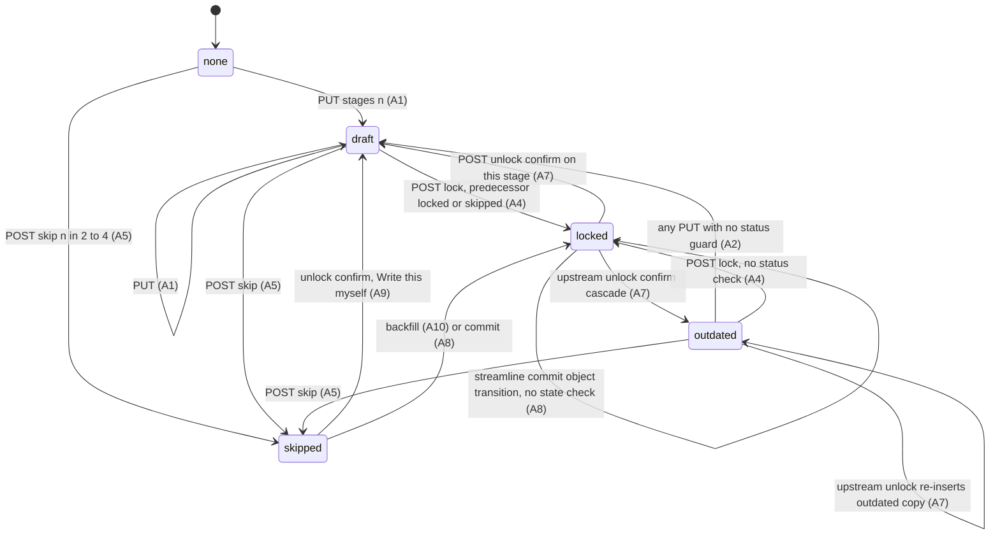

Note on the diagram: the `invalidated` status is accepted by the CHECK constraint but has no writer (DEAD, section 1.1), so it is not drawn as a reachable state.

---

## 2. Scene-level stage locks (Phase B, `scenes.stage_locks` and `shot_list_locked_at`)

### 2.1 Storage

- `scenes.stage_locks` JSONB default `'{}'` is defined ONLY in `backend/quickies-sql/add_stage_locks.sql:1`. Its own comment reads "Ran successfully on prod." No numbered migration 001 to 044 creates it (grep of all migration SQL, `[V]`; FACT-05, C-database). A database built from numbered migrations lacks this column. Verdict: R1a C04 CONFIRMED on repo DDL; live-database existence UNDETERMINABLE-STATICALLY.
- The backfill in that script sets key `'7'` from `shot_list_locked_at` only.
- Entry shape: `{status: draft | locked | outdated, locked_at?}`. Keys are strings `'7'` to `'12'`. An absent key is read as draft.
- `scenes.shot_list_locked_at` added in migration 014. Trigger `trg_sync_scene_lock_status` BEFORE UPDATE (014:31-62, `[V]`).
- `scenes.status` CHECK values (014:19-27, `[H]`): draft, shot_list_ready, frames_locked, video_complete, outdated, continuity_broken.
- UNIQUE(branch_id, scene_number) at 003:34 (`[H]`).

### 2.2 Writers and transitions

| # | Transition | Trigger and preconditions | Side effects | Ledger and evidence | Status |
|---|---|---|---|---|---|
| S1 | draft or outdated to locked (stage n) | POST `/scenes/:s/stage-locks/:n/lock`, n in 7 to 12. Project owned; scene on active branch. For n > 7, `stage_locks[n-1].status === 'locked'` (outdated blocks). Current status of n NOT checked. | Writes locked and `locked_at`. n = 7 also sets `shot_list_locked_at = now`, which fires the trigger (scenes.status becomes shot_list_ready). No shot validation. | STATE-0006, STATE-0093, INV-0006 (`[V1]`); [V] sceneStageLocks.ts:56-141 (predecessor check 92-105, write 107-131) | FUNCTIONAL |
| S2 | assessment (no write) | POST `.../unlock` confirm=false. Scene stage locked or outdated. Draft or missing gives 400. | Returns 409 with `details {stage, downstreamStages (locked or outdated > n), framesAffected, videosAffected, estimatedCost, message}`. `framesAffected` counts frames with status != invalidated. `videosAffected` queries table `videos`, which does not exist, so it is always 0. | STATE-0007, STATE-0094, INV-0081 (`[H]`); [V] sceneStageLocks.ts:145-242 (frames query 209-212, videos query 215-219, cost 224, stage range 152-153) | FUNCTIONAL for frames; videos count always 0 (section 9, B2) |
| S3 | locked or outdated to draft (stage n); downstream locked to outdated | POST `.../unlock` confirm=true. As S2. | `stage_locks[n] = {status: 'draft'}`; each downstream locked or outdated becomes `{status: 'outdated'}` (locked_at dropped). n = 7 also sets `shot_list_locked_at = null` (trigger reverts status to draft only if it was shot_list_ready). No frame, video, or prompt change. | STATE-0008, INV-0005 (scene half), INV-0078 (`[H]`); [V] sceneStageLocks.ts:244-286 (writes at 246-248; updateData 251-261; shot_list null 257-258) | FUNCTIONAL |
| S4 | outdated to locked (stage n), no content change | POST `.../relock`. Status must be exactly `outdated`; n = 7 or `stage_locks[n-1]` locked. | Writes locked and new `locked_at`. n = 7 sets `shot_list_locked_at = now` without shot validation. | STATE-0009, STATE-0095, INV-0007 (`[V1]`); [V] sceneStageLocks.ts:290-375 (status check 327; predecessor 332) | FUNCTIONAL; stage 7 relock unreachable (section 2.4) |
| S5 | draft to locked (stage 7) via shot list | POST `/api/projects/:id/scenes/:s/shots/lock`. Project owned; active branch. Idempotent if `shot_list_locked_at` already set (returns success, no write, projects.ts:2888-2900). Shot validation errors give 400 (no force); warnings give 409 unless force. | Writes `shot_list_locked_at = now`, `stage_locks['7'] = locked` (projects.ts:2968-2977), `updated_at`. The UPDATE is guarded by `.is('shot_list_locked_at', null)` (projects.ts:2991). `stage_locks` is a read-modify-write from an earlier SELECT with no guard (INV-0086, INV-0010). Trigger sets status shot_list_ready. | STATE-0096, STATE-0063, INV-0079 (`[H]`) | FUNCTIONAL, race-guarded for shot-list lock only |
| S6 | locked or outdated to draft (stage 7); locked or outdated 8 to 12 to outdated | POST `/api/projects/:id/scenes/:s/shots/unlock`. Requires `shot_list_locked_at` non-null (400 otherwise, projects.ts:3050-3052). If scene.status is frames_locked or video_complete, 409 unless confirm (projects.ts:3056-3073). | Attempts `frames.status = 'invalidated'` and `videos.status = 'invalidated'`, both no-ops (section 9, B1, B2). Attempts `invalidation_logs` insert (table absent, B3). `stage_locks['7'] = draft`; 8 to 12 locked or outdated become outdated (projects.ts:3143-3150; loop starts at 8). `shot_list_locked_at = null`. | STATE-0097, INV-0080 (`[H]`), INV-0058 (`[V8]`); [V] projects.ts:3020-3180 | DEAD from the UI: stage-locks unlock runs first and clears `shot_list_locked_at`, so this route returns 400 and the UI swallows it (DEAD-0030, `[V8]` 6) |
| S7 | locked (stages 9 to 12) to outdated | Any successful shot-assignment create, update, delete, bulk delete, or shot split | `invalidateStage9AndDownstream` reads scene `stage_locks` and sets each locked entry for 9 to 12 to `{status: 'outdated'}` (drops `locked_at`); updates `updated_at`. Fire-and-forget: the route does not await it (shotAssetAssignmentService.ts:318-344; callers shotAssignments.ts:147, 180, 208, 236; projects.ts:2637). Merge and single delete do not call it. | STATE-0011, STATE-0065, STATE-0098, INV-0082 (`[H]`), INV-0054 (`[V8]`); [V] service 318 and callers | FUNCTIONAL (fire-and-forget) |
| S8 | scenes.status follows shot_list_locked_at | DB trigger on any UPDATE that changes shot_list_locked_at null-ness | See 2.3 | STATE-0066, STATE-0099, INV-0106 (`[H]`) | FUNCTIONAL |

The UI callers of S1 to S4 are as follows (`[H]` 2.2, `[V8]` 6):

- Stage 7 lock: `shotService.lockShotList` (shots/lock), then best-effort `lockStageViaHook(7)` (stage-locks/7/lock) (Stage7ShotList.tsx:697-712). Stage 7 is therefore written by the shot-list route and then again by the generic route. A third call comes from ProjectView (below).
- Scene complete: `ProjectView.handleSceneStageComplete` calls the stage-locks lock for the current sceneStage (ProjectView.tsx:589-600, 589-614 in `[V8]`).
- Stage 11 confirm success locks 11 (best-effort). Stage 12 Complete Scene locks 12 (STATE-0081; ProjectView.tsx:589-615).

### 2.3 `scenes.status` (scene render and lock status)

- Writers found by grep (`[H]` 2.3, `[V]` migration 014): DEFAULT and INSERT `'draft'` (003 default; PUT /scenes insert at projects.ts:1413), the trigger (014:31-62), and `video_complete` (videoGenerationService.ts:516-537).
- Trigger (014:31-50, `[V]`): a lock (null to non-null) sets `shot_list_ready` unconditionally. An unlock (non-null to null) sets `draft` only when OLD.status = `shot_list_ready`; otherwise status is left (so `video_complete` survives shots/unlock).
- Because the lock branch is unconditional, a relock of a scene whose status is `video_complete` overwrites that status with `shot_list_ready` (CODE-DERIVED from 014:31-50 together with the relock route setting `shot_list_locked_at` at sceneStageLocks.ts:351-352; not stated in H, STATE-0099, or any ledger entry; see section 10).
- `frames_locked`, `outdated`, `continuity_broken`: allowed by CHECK and read by UI labels, but no backend or frontend writer found (FACT-04, DEAD). The Stage 6 "outdated" modal is therefore DEAD (CAP-0109, `[V3]`).

### 2.4 Stage 7 outdated producer (K correction assessed)

- K claims DEAD-0031 CONTRADICTED: "sceneStageLocks.ts:187-193 collects downstream stages ... and :245-249 sets every such stage to outdated. Stage 7 is included when a stage 1-6 is unlocked. Relock route :327 accepts outdated. The relock path is therefore reachable." (K-dead-dup, line 60.)
- Verified in this pass: the writer at sceneStageLocks.ts:245-249 exists and is generic (`for (const ds of downstreamStages) stageLocks[String(ds)] = { status: 'outdated' }`, line 248).
- Not adopted: the premise that stage 1 to 6 can be unlocked is false. The unlock route rejects any stage outside 7 to 12 with 400 (sceneStageLocks.ts:152-153, `if (isNaN(stage) || stage < 7 || stage > 12)`). The downstream list is built as `stage + 1 .. 12` (sceneStageLocks.ts:187-193), so its minimum member is 8. The shots/unlock route loops from 8 (projects.ts:3145). `invalidateStage9AndDownstream` covers 9 to 12 only. V8 reached the same conclusion (`[V8]` 6: "no code path sets stage 7 to outdated").
- Verdict used in this document: the stage 7 `outdated` value has a code-level writer (the generic loop), but no reachable path writes it to stage 7. The relock route at sceneStageLocks.ts:327 is therefore reachable only for stages 8 to 12. DEAD-0031 stands as DEAD (UI relock button for stage 7 effectively unreachable, CAP-0230).

### 2.5 Relationship between Phase A and Phase B

- Scene stage routes (stage-locks, shots/lock, shots/unlock) do not read `stage_states` (`[H]` 2.4, `[V8]`). The Phase B gate on Phase A is UI-only: ProjectView renders Phase B only after Phase A, and a `reachedPhaseB` localStorage flag keeps the Script Hub button visible (ProjectView.tsx:108, 202-221; STATE-0019). UNKNOWN whether any other server path enforces it.
- Phase A unlock never touches scenes or `stage_locks` (A7 writes `stage_states` only). STATE-0005; the absence of code is verified (`[H]` 2.4).
- Phase A stage 4 persist (PUT /scenes) can delete scenes whose `stage_locks` and shots are locked (INV-0085; section 5).

### 2.6 Phase B state diagram

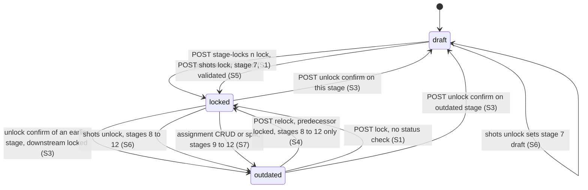

Note: stage 7 cannot reach `outdated` on a reachable path (section 2.4), so no `outdated` arrow is drawn for stage 7.

---

## 3. Shot-list lock: enforcement matrix (frontend, DB trigger, route)

The shot-list lock is `scenes.shot_list_locked_at` (migration 014) mirrored into `scenes.stage_locks['7']`. The only DB-level effect of the lock is the status sync in the trigger (014:31-62, `[V]`). The trigger raises nothing and blocks no write (R1a C05, CONFIRMED). The backend uses the service-role key, so RLS policies do not apply to backend calls (INV-0059, `[H]`).

Legend: GATE means the layer blocks the operation when the scene is locked. NONE means no check. "Route" column is the backend route check.

| Operation (route) | Frontend | DB trigger 014 | Route check | Effect when locked | Ledger and evidence |
|---|---|---|---|---|---|
| Shot content PUT (`PUT .../shots/:id`, projects.ts:2399-2512) | GATE: `canEdit = !isSceneLocked && isEditable` disables inputs (Stage7ShotList.tsx:624) | none | NONE (INV-0083, INV-0055) | Mutation proceeds; `shots` row updated | INV-0083, INV-0055, STATE-0067 |
| Shot prompt PUT and field-version create or select (projects.ts:3459-3570; frames.ts:2339-2408) | Stage 9 and 10 controls only | none | NONE | Prompt columns overwritten; no frame or video is flagged | INV-0087, STATE-0070, `[V9]` 11 |
| Shot extraction (`POST .../shots/extract`, projects.ts:1711-1975) | Auto-run on Stage 7 mount only when zero shots (Stage7ShotList.tsx:165-185) | none | NONE; no duplicate check (`[V8]` 3, insert would hit UNIQUE(scene_id, shot_id) and return 500) | Inserts new shots; existing shots untouched | INV-0083 (scope), `[V8]` 3 |
| Split (`POST .../shots/:id/split`, projects.ts:2515-2640) | GATE via canEdit | none | NONE; calls `invalidateStage9AndDownstream` (projects.ts:2637), fire-and-forget | Original shot deleted (cascades), new shots inserted, order shifts; stages 9 to 12 marked outdated | INV-0054, INV-0082, STATE-0065 |
| Merge (`POST .../shots/:id/merge`, projects.ts:2657-2788) | GATE via canEdit | none | NONE; no invalidation call | Two rows deleted (cascades); lower row kept; stages 9 to 12 unchanged | INV-0057, INV-0084, STATE-0068 |
| Single delete (`DELETE .../shots/:id`, projects.ts:2791-2840) | GATE via canEdit; no confirmation (`[V8]` 3) | none | NONE; `count <= 1` gives 409 LAST_SHOT | Shot row deleted (cascades frames, jobs, events, assignments); stages 9 to 12 unchanged | INV-0056, INV-0084, INV-0057 |
| Shot-asset assignment create, update, delete, bulk delete (shotAssignments.ts:129-245) | Stage 9 panel; no lock check in Stage 9 (`[V8]` 6) | none | NONE | Assignment row changes; on success stages 9 to 12 marked outdated (fire-and-forget) | INV-0059, INV-0082, STATE-0098 |
| `DELETE .../shot-assignments/all` (bulk) | UI caller fails at its first step | none | SHADOWED: registered after `DELETE .../shot-assignments/:assignmentId`, so the single-delete handler catches the path with `assignmentId = 'all'` (R1a C06, CONFIRMED; ROUTE-0120) | Bulk route never runs; its invalidation never runs | R1a C06; `[V8]` 4 |
| Camera-direction PUT (projects.ts:2180-2313) | GATE via canEdit | none | Manual-location conflict returns 409 (INV-0048, INV-0049) | Location link moved; manual conflicts blocked; not a lock check | INV-0048, INV-0049 |
| Resolve-locations (projects.ts:2223-2240) | Stage 7 | none | `preserveManual` default true (STATE-0054) | Manual assignments kept; non-manual re-resolved | INV-0048, STATE-0054 |
| Shot-list lock (`POST .../shots/lock`, projects.ts:2845-3017) | Stage 7 validation (`validateShotsLocally`, Stage7ShotList.tsx:549-622) | sets status shot_list_ready | Route: validation errors give 400; warnings give 409 unless force; idempotent if already locked (projects.ts:2888-2900); UPDATE guarded by `shot_list_locked_at IS NULL` (2991). Location warnings never block (INV-0053). | Sets `shot_list_locked_at`, `stage_locks['7']` | STATE-0096, STATE-0063, INV-0079 |
| Shot-list unlock (`POST .../shots/unlock`, projects.ts:3020-3180) | Called after stage-locks unlock, so it returns 400 and the UI swallows it | sets status draft only if was shot_list_ready | Requires non-null `shot_list_locked_at` (400); 409 unless confirm when status frames_locked or video_complete | Intended: frames and videos invalidated (both no-ops); stage_locks cascade | STATE-0097, INV-0080, DEAD-0030 |
| Stage 7 lock (`POST .../stage-locks/7/lock`, sceneStageLocks.ts:56-141) | Called after shots/lock, and again by ProjectView | sets status shot_list_ready | Predecessor rule does not apply to 7; no shot validation (INV-0079) | Sets stage 7 locked and `shot_list_locked_at` | INV-0079, STATE-0093, `[V8]` 6 |
| Stage 7 unlock (`POST .../stage-locks/7/unlock`, sceneStageLocks.ts:145-286) | UI calls it first (with confirm) | status draft only if was shot_list_ready | Stage range 7 to 12 (152-153); impact dialog works | Stage 7 draft, `shot_list_locked_at` null, downstream outdated | INV-0078, STATE-0008 |
| Stage 7 relock (`POST .../stage-locks/7/relock`, sceneStageLocks.ts:290-375) | Relock button only when stage 7 is outdated (not reachable, section 2.4) | status shot_list_ready on relock | Status must be exactly outdated; no shot validation (STATE-0095) | Stage 7 locked and `shot_list_locked_at` set | STATE-0095, CAP-0230, DEAD-0031 |
| Scene re-persist (`PUT /api/projects/:id/scenes`, projects.ts:1217-1529) | Stage 4 approve and streamline sync | none | NONE on lock state; deletes unmatched scenes regardless (INV-0085) | Matched rows keep `shot_list_locked_at`, `status`, `stage_locks`; unmatched scenes deleted with cascades | INV-0085, STATE-0028 |
| Stage 8 "Proceed" gatekeeper | Client-side checks only: images present, no unconfirmed events (Stage8VisualDefinition.tsx:713-736) | n/a | Scene stage-lock route for stage 8 has the predecessor check only | Proceed blocked on client only | INV-0043, `[V6]` 14 |

Matrix summary.

- Enforced on the server: shot-list lock validation (shots/lock) and the shot-list unlock precondition (shots/unlock requires non-null `shot_list_locked_at`), and the stage-range and predecessor checks of the generic stage-locks routes.
- Enforced only in the frontend: shot content, prompt, split, merge, delete, and assignment edits while locked (INV-0055, INV-0083).
- Not enforced anywhere: a locked Stage 7 list can be mutated through any shot route; Stage 9 has no lock check.

---

## 4. Asset lock, frame statuses, video job statuses, and streamline commit state

### 4.1 Project assets (Stage 5, project-level) flags

| Flag or field | Set by | Cleared by | Gates | Ledger and evidence | Status |
|---|---|---|---|---|---|
| `locked` (boolean) | Lock-all: true on all non-deferred active assets after gate passes (projectAssets.ts:1675-1755, update 1729 `[V]`). POST `/assets/:id/lock` sets true if `image_key_url` set (1527-1585, update 1565 `[V]`). Stage 8 create-with-project-asset inserts `locked: true` (sceneAssets.ts:885-935, insert 933 `[H]`). | No route writes false (grep `[V]`: only `locked: true` writers in projectAssets.ts; insert paths at 127, 351, 1052, 1187, 1962 write `locked: false` on creation). | PUT text (projectAssets.ts:586-592 `[V]`; deferred and asset_type-only edits allowed), DELETE (702-705 `[V]`), split (1017 `[V]`), sync (2084 `[V]`). Merge reads locked assets at 768 `[V]` (rejection path not re-read). Image generation, upload, and clear-all have no lock check (R1b C20, CONFIRMED). | STATE-0036, STATE-0105, INV-0097 (label CONTRADICTED as recorded; blocking verified above), FACT-09, R1b C20 | FUNCTIONAL (blocks text, delete, sync, split); no clearing route |
| `deferred` (boolean) | Defer and restore routes | n/a | Excluded from the Stage 5 gate and from lock-all (projectAssets.ts:1704, 1724, STATE-0037) | STATE-0037, INV-0093 (no propagation) | FUNCTIONAL |
| `style_outdated` (boolean) | mark-style-outdated sets true on all assets with `image_key_url` (projectAssets.ts:1587-1618, update 1607 `[V]`) | Successful master_asset job for that asset (ImageGenerationService.ts:406-410 `[H]`); clear-all sets false (projectAssets.ts:1651 `[H]`) | None. The only reader is the badge at Stage5Assets.tsx:1153 (INV-0098, STATE-0039) | STATE-0039, STATE-0023, INV-0098 | FUNCTIONAL (advisory only) |
| `image_key_url` | Any new image, select, upload, sync, or clear | Clear-all sets null (projectAssets.ts:1651 `[H]`) | Lock POST requires non-null | STATE-0038, INV-0029 | FUNCTIONAL |
| `overridden_fields` (text array) | User edits to a linked asset | n/a | Informational only. Sync force-overwrites the named fields (projectAssets.ts:2157-2221, STATE-0040). Migration comment says overrides are not overwritten during sync; the code overwrites them. | STATE-0040, INV-0033 (CONTRADICTED as recorded) | FUNCTIONAL, contradicted by its migration comment |
| `visual_style_capsule_id` (asset snapshot) | Snapshot at clone or extract | Not updated by a Stage 5 style change (INV-0028) | Regeneration uses the stored id, falling back to the Stage 5 manual tone (projectAssets.ts:1244-1260, `[V5]`) | INV-0028, STATE-0023 | PARTIAL (sync can overwrite the id, projectAssets.ts:2209-2216) |

Project asset state diagram (lock). Status `locked` is one-way in code.

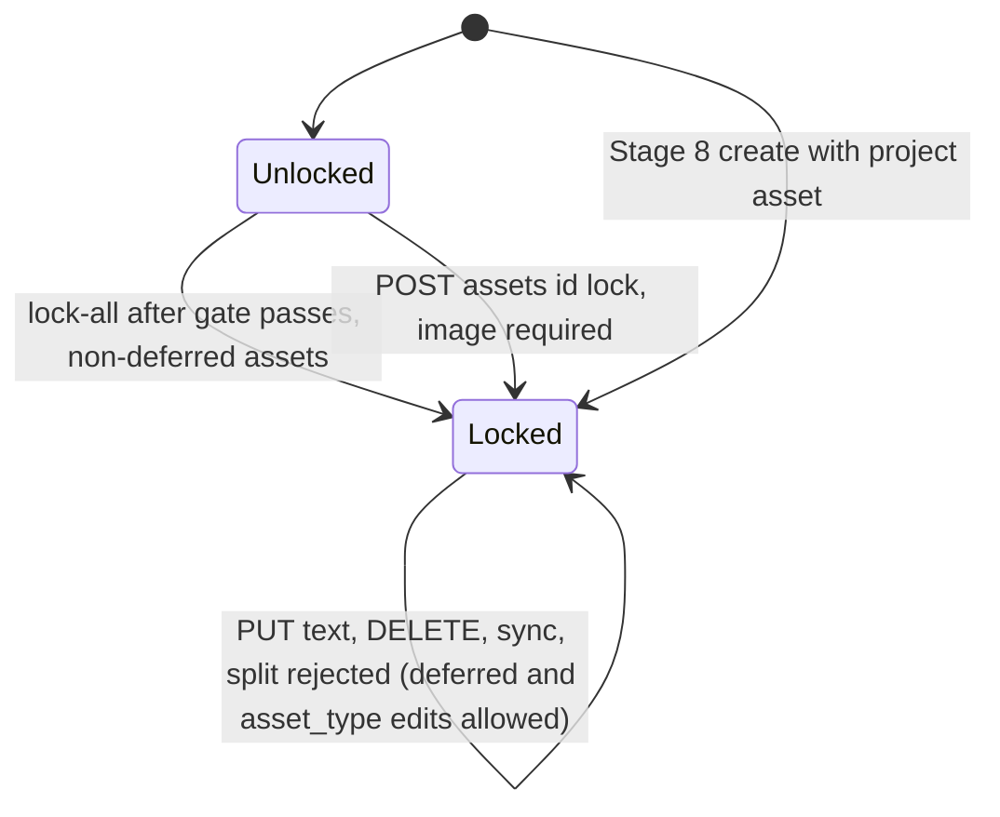

Project asset state diagram (style_outdated).

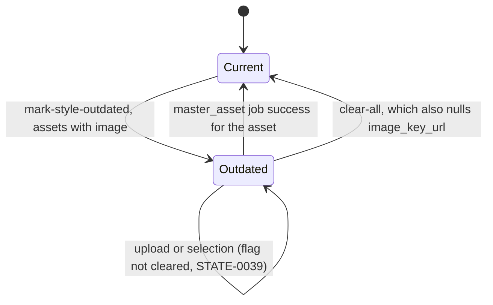

### 4.2 Scene asset instances (Stage 8) state

| Item | Behaviour | Ledger and evidence | Status |
|---|---|---|---|
| `status_tags` containing `locked` | Lock Asset appends the string `locked`. It disables several editor controls client side. Backend routes do not check it. Carried forward and included in image prompts. | STATE-0049 (CONTRADICTED as recorded), `[H]` 3.5; VisualStateEditorPanel.tsx:311-324, 433 | FUNCTIONAL (client only) |
| `modification_count` and `last_modified_field` | Trigger increments `modification_count` on every UPDATE; `last_modified_field` set only for four columns (017:22-47 `[H]`). Not a human audit trail. | STATE-0051 | FUNCTIONAL |
| `use_master_as_is` | Enabling sets true, `image_key_url` to master URL, and inserts a `master_copy` attempt. Disabling only clears the flag (UI branch unreachable). Upload and select-master-reference clear the flag. | STATE-0047, ROUTE-0085 (ORPHANED: no render site for the checkbox, FACT-0072) | PARTIAL |
| `selected_master_reference_*` triple | Set only by select-master-reference. Read as default generation reference. FK SET NULL on instance delete (022:59-68 `[H]`). No check that URL is in the chain. | STATE-0048 | FUNCTIONAL |
| Transformation event `confirmed` | Unconfirmed events are created manually. Confirm sets `confirmed = true` and `confirmed_at`. The update path never writes `confirmed`. No un-confirm route. Confirmed events stay editable by PUT. Only confirmed events affect resolution, inheritance, and the reference chain (transformationEventService.ts:117-125, 275-299, 302-312 `[H]`). | STATE-0050, STATE-0107, INV-0100, INV-0041 | FUNCTIONAL; one-way in the UI and in code |
| Transformation post-state | Inherited as the prior instance's final state at inheritance time (copied, not referenced) | INV-0044 | FUNCTIONAL |

### 4.3 Attempts, text versions, and selection semantics

| Family | Table and selection rule | Cap and deletion | Ledger and evidence |
|---|---|---|---|
| Scene asset generation attempts | `scene_asset_generation_attempts`. `is_selected` partial unique per instance (022:43-45). FK instance CASCADE (022:11), job SET NULL (022:22). | Cap 8. Deletes oldest non-selected row and storage object (sceneAssetAttemptsService.ts:8, 161-188 `[H]`). Count check not transactional (INV-0039). | STATE-0046, INV-0039, INV-0096 |
| Project asset generation attempts | `project_asset_generation_attempts`. `is_selected` partial unique per asset (023:51). FK asset CASCADE (023:25). | Cap 4. Deletes oldest non-selected row and storage object (projectAssetAttemptsService.ts:9, 168-200). `enforceAttemptCap` runs before insert, so the total can briefly be 4 after insert (INV-0034 notes). | STATE-0038, INV-0034, INV-0096 |
| Text field versions | `text_field_versions` (036). Fields: `frame_prompt`, `video_prompt`, `end_frame_prompt` (shot), `description_override` (scene asset instance). `is_selected` per entity and field. `entity_id` has no FK. Partial unique WHERE clause not inspected (UNKNOWN, STATE-0072). RLS policy "Users can manage text field versions" FOR ALL USING (true) WITH CHECK (true), no TO clause (036:30, R1b C22 CONFIRMED). | Cap 8. Deletes oldest non-selected row before insert; no storage (textFieldVersionService.ts:9, 179-199). Create is non-atomic (cap check, next number, deselect, insert, write-back). | STATE-0072, INV-0040, INV-0095, INV-0096, `[V9]` 11 |
| Frame generations (image jobs) | `image_generation_jobs`: one row per generation job. `frames.current_job_id` (SET NULL on job delete, 019:25) selects the displayed generation. `frames.generation_count` is decremented on delete. | Delete route for a generation requires the job not be current and at least 2 completed jobs of that type (frames.ts:1436-1470, INV-0063). No automatic pruning. | STATE-0075, INV-0063, F11 |
| Video jobs | One row per (shot, render) inserted by confirm-render. Never deleted by code. | None. Manual retry resets status only (STATE-0078). | STATE-0077, STATE-0078, INV-0101 |

Selection semantics (all families). Exactly one selected row per owner. Select, upload, generation completion, use-master, and backfill deselect the old row, select the new row, and copy its URL to the mirror column (`image_key_url` or `frame` URL). Deselect and select are separate statements, so a mid-step failure can leave zero selected (STATE-0046). The select route writes `image_key_url` in a separate statement from the attempt update, so the two can diverge (STATE-0106, `[H]` 3.2).

Selection diagram (attempts).

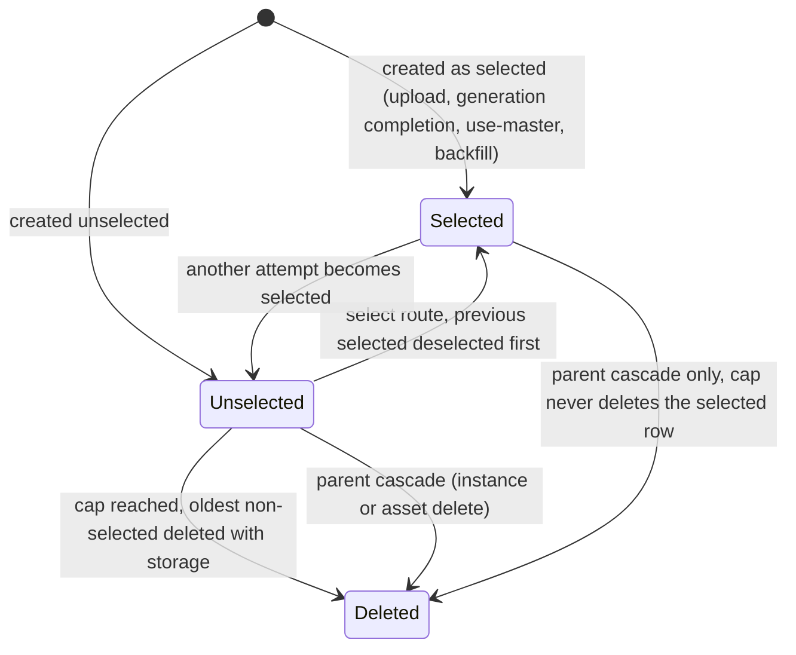

### 4.4 Frame status machine (`frames.status`)

`frames.status` CHECK: pending, generating, generated, approved, rejected (019:12-19, `[V]`). The value `invalidated` is NOT in the CHECK (section 9, B1). `frames` has one row per (shot, frame_type) (UNIQUE(shot_id, frame_type), 019:48, `[V]`).

| # | From to To | Trigger and preconditions | Side effects | Ledger and evidence | Status |
|---|---|---|---|---|---|
| F1 | pending to generating | `startFrameGeneration` (regenerate, generate-frames, others). Frame row exists. | `prompt_snapshot` set on job (ImageGenerationService.ts:277). Frame status generating (frameGenerationService.ts:871-875). | STATE-0069, INV-0067 | FUNCTIONAL |
| F2 | generating to pending | `createImageJob` throws | Frame status pending (frameGenerationService.ts:926-931) | STATE-0069 | FUNCTIONAL |
| F3 | generating to generated | ImageGenerationService success for job type start_frame or end_frame; `shotId` present | UPDATE frames WHERE shot_id AND frame_type (not by `current_job_id`); sets `image_url`, `storage_path`, `generated_at` (ImageGenerationService.ts:521-536). No check that the job is still current, so a stale job that completes last wins. | INV-0067 (flag functional P), STATE-0100; `[H]` F3 | FUNCTIONAL |
| F4 | generating to generated | GET `/frames/:id/status` sees a completed job (current_job_id non-null) | `onJobCompleted` sets generated and ADDS job cost to `total_cost_credits` on every call (no idempotence guard) (frameGenerationService.ts:1365-1427). The UI does not call this route (section 4.5). | `[H]` F4, FACT-14 | PARTIAL (not reached from UI) |
| F5 | generating to rejected | GET `/frames/:id/status` sees a failed job | `onJobFailed` sets rejected (frameGenerationService.ts:1430-1437) | INV-0090, STATE-0069 | DEAD from UI (`pollUntilComplete` has no caller, frameService.ts:593-629) |
| F6 | generating (stays) | Image job failure | Job row failed. Frame NOT updated. Frame stays generating unless F5 runs. | INV-0090, STATE-0112, R1b C13 CONFIRMED | FUNCTIONAL but terminal state stuck |
| F7 | generated, rejected, or approved to generating | Regenerate route. No status guard found. | frame_links WHERE target = frame DELETED (frames.ts:393). `startFrameGeneration`. `propagateFrameLinks(frameId)` runs right after the job is queued (frames.ts:408). | INV-0089, INV-0066, STATE-0101 | FUNCTIONAL; propagation timing CONTRADICTED as recorded |
| F8 | generated, or any, to approved | PUT `.../approve`. Project owned. | UPDATE status approved, `approved_at = now`. No check of image_url, current status, or scene (frames.ts:297-320; frameGenerationService.ts:939-953). | INV-0092 | FUNCTIONAL, no precondition |
| F9 | generated, approved, or rejected to rejected | PUT `.../reject`. Project owned. | UPDATE status rejected (frames.ts:331-356; frameGenerationService.ts:958-972) | INV-0092 | FUNCTIONAL |
| F10 | any to generated (select another job) | PUT select-generation; job completed | frame_links WHERE target deleted (frames.ts:1350). `image_url`, `prompt_snapshot` = job prompt, status generated, `approved_at` null. Then `propagateFrameLinks` runs after the update (frames.ts:1340-1372). | INV-0091, INV-0064, STATE-0074 | FUNCTIONAL (ordering correct, unlike F7) |
| F11 | generated to generated (delete generation) | DELETE `generations/:jobId`. Job not current; at least 2 completed jobs of that type. | Storage removed; image job row deleted; `generation_count` decremented (frames.ts:1436-1470) | INV-0063 | FUNCTIONAL; guard checks current id, not ownership |
| F12 | generated to generated (upload variant) | Upload | frame_links for target deleted (STATE-0074). Preconditions not re-read. | STATE-0074, wave-1 only | PARTIAL |

Frame state diagram.

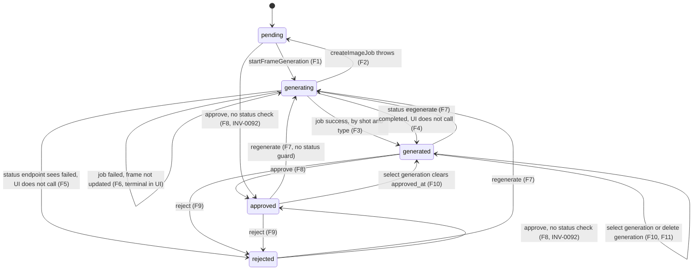

### 4.5 Image generation job lifecycle (`image_generation_jobs`)

- Lifecycle: queued, processing, generating, uploading, completed, or failed with `failure_stage` generating, uploading, or persisting (STATE-0075, `[H]` ImageGenerationService.ts:109-187, 298-582). Jobs stuck after a process restart have no sweeper (STATE-0075, STATE-0109).
- Failure before generating is mislabelled `persisting` in some paths (STATE-0109, PARTIAL, I-infra-async).
- Client pollers (Stage 5 and others) use a fixed cadence with a cap; the UI reports a timeout while the server job continues (STATE-0117, PRESSURE). Stage 10 polls GET frames every 2 s while any frame is generating (STATE-0118, `[H]` 4.3).
- Frame status for start and end frame jobs has an unreachable reconciliation path (STATE-0112, CONTRADICTED, DEAD).

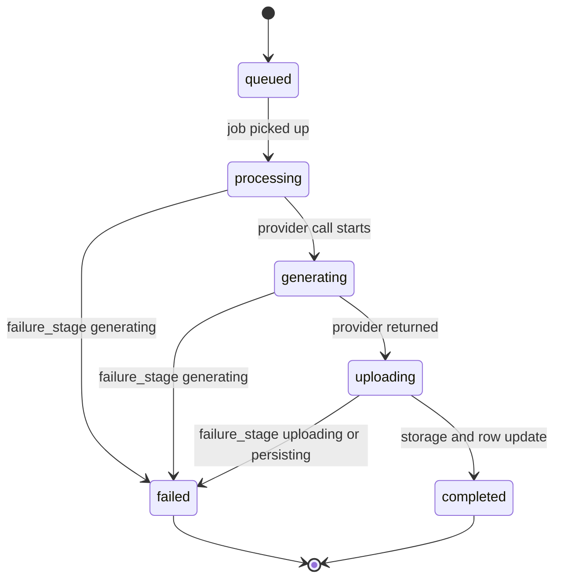

### 4.6 Video job statuses (`video_generation_jobs`)

`status` CHECK: queued, processing, generating, uploading, completed, failed (021:20-27, `[V]`). Defaults: `attempt_count` 0, `max_retries` 3 (021:57-58, `[V]`). FKs: project, branch, scene, shot CASCADE (021:8-11). `start_frame_id` and `end_frame_id` are NO ACTION (021:30-31), so a frame referenced by a video job cannot be deleted directly.

| # | Transition | Trigger | Side effects | Ledger and evidence | Status |
|---|---|---|---|---|---|
| V1 | queued to processing | Executor picks the oldest queued job (`fetchNextQueuedJob` selects `status = 'queued'`, VideoJobExecutor.ts:62-72 `[V]`) | `updateJobStatus('processing')` sets `processing_started_at`. In-memory `isProcessing` flag prevents a concurrent loop in one process (VideoJobExecutor.ts:33). | STATE-0077, STATE-0111 (DEAD as a multi-process guarantee) | FUNCTIONAL in one process |
| V2 | attempt_count increment | VideoJobExecutor.ts:90-95 writes `job.attempt_count + 1` from the pickup snapshot | n/a | INV-0103 (`[V]` arithmetic) | FUNCTIONAL |
| V3 | processing, generating, uploading, completed | Provider call (VideoJobExecutor.ts:96-137). Completed writes `completed_at`, `video_url`, `storage_path`, `actual_cost`, provider ids. Then `checkAndUpdateSceneStatus`. | Scene status sync (section 4.7) | STATE-0077, STATE-0080 | FUNCTIONAL (Veo3 path unexercised, STATE-0110) |
| V4 | any active to queued (retry) | Throw and `attemptCount < max_retries` (VideoJobExecutor.ts:146-160 `[V]`) | `error_message` and `attempt_count` set; status queued | STATE-0077 | FUNCTIONAL |
| V5 | any active to failed | Throw and `attemptCount >= max_retries` (VideoJobExecutor.ts:161-171 `[V]`) | `updateJobStatus` failed with `error_code`, `error_message`; `checkAndUpdateSceneStatus` | STATE-0077, INV-0102 | FUNCTIONAL |
| V6 | failed to queued (manual retry) | POST `video-jobs/:id/retry`; `retryJob` requires status failed (videoGenerationService.ts:563-597 `[V]`) | Nulls error, URL, storage, provider, processing and completed fields. `attempt_count` NOT reset. Triggers processing. | STATE-0078, STATE-0103, INV-0103 | FUNCTIONAL |
| V7 | processing, generating, or uploading (no exit) | Process crash or restart | No sweep found. Only `queued` is selected. The jobs stay in an active state indefinitely. | INV-0104 (no recovery path, flag functional N), STATE-0102 | FUNCTIONAL absence of recovery; runtime UNKNOWN |

Attempt arithmetic (verified by re-reading VideoJobExecutor.ts:86-95 and 146-171 and videoGenerationService.ts:563-597):

1. Job created with `attempt_count = 0`. Pickup 1 writes 1. Failure computes `attemptCount = 0 + 1 = 1`, which is less than 3, so the job returns to queued with `attempt_count = 1`.
2. Pickup 2 writes 2. Failure computes 2, which is less than 3, so queued again with `attempt_count = 2`.
3. Pickup 3 writes 3. Failure computes 3, which is not less than 3, so the job becomes failed with `attempt_count = 3`.
4. Manual retry sets queued and keeps `attempt_count = 3`.
5. Next pickup writes 4. Failure computes 4, which is not less than 3, so the job fails after one attempt.

This is CODE-DERIVED from the arithmetic; runtime is UNKNOWN (INV-0103 label CONTRADICTED as recorded; `[H]` FACT-15).

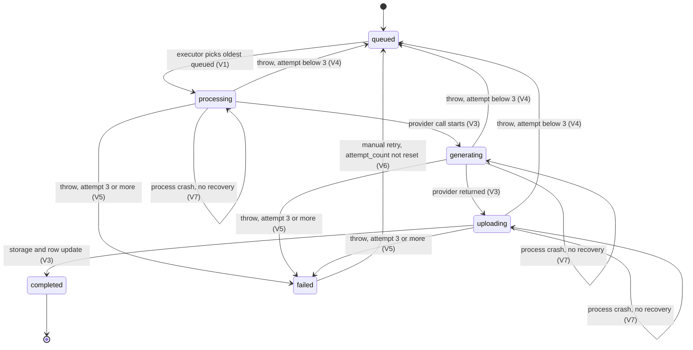

### 4.7 Scene render status (`scenes.status`)

Derivation and writers are in section 2.3. The render-status aggregation (for the UI) is computed over all historical jobs of the scene: all completed gives complete; all failed gives failed; any active gives rendering; some completed and some failed gives partial; otherwise pending (FACT-0137 in the ledger, DUPLICATED with `[V10]`). `checkAndUpdateSceneStatus` loads every video job for the scene with no filter (videoGenerationService.ts:428-440) and sets `video_complete` only when all are completed (516-537). Because re-render appends jobs and never removes earlier ones (INV-0101), a scene with any historical failed job cannot reach `video_complete` until that job completes by retry (INV-0102, STATE-0104, label CONTRADICTED as recorded; `[H]` FACT-15). `video_complete` is never reverted by code (STATE-0080).

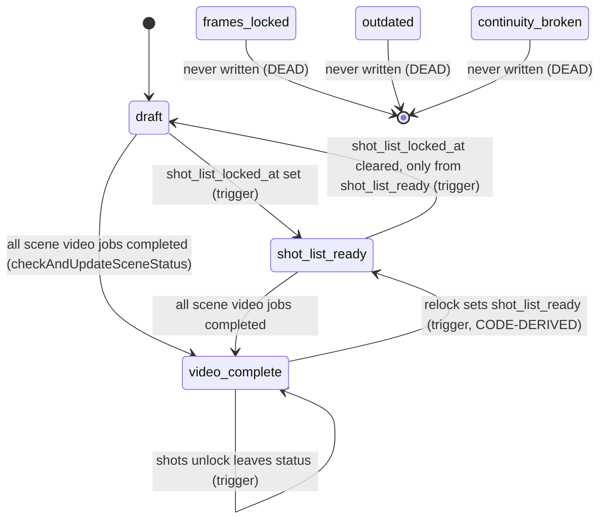

### 4.8 Streamline intake commit state

The Streamline intake (Stage 1) holds its intake state in React only. Nothing is persisted before commit except staged images in storage (STATE-0032, per ledger citing Stage1InputMode.tsx:300-317 and streamline.ts:276-281). Commit is one RPC (`streamline_commit_atomic`), followed by client-side scene and asset calls.

- Ask Auteur lifecycle: idle, then analyzing on first batch settle, then questions shown (which block confirm), then submit (reconciling), then pendingCascade dialog, then review. Decline goes straight to review. Opens at most once per mount (STATE-0035, Stage1InputMode.tsx:306-442). Reconcile error keeps questions open (INV-0027).
- Commit semantics: append-only transitions per stage key (A8). Stage 1 receives two versions per commit: a draft inserted by the wrapper and a locked copy from the `'1': 'locked'` transition. Every commit adds two Stage 1 versions, even when stage 1 was already locked (STATE-0031, per ledger citing 044:81-96). Object transitions have no check of the existing lock state (STATE-0089, INV-0076).
- Routing emits only: 1 locked; 2 and 3 skip or locked-imported; 4 locked-imported. Never stage 5 (STATE-0030, per ledger citing src/lib/utils/streamlineRouting.ts:95-120). `formatChoice` is never sent; content is chosen by presence of `formattedText` or `formattedBeats`, so "as-is" after an AI-format run still commits AI text (R1b C19, CONFIRMED).
- No idempotency key. A retry after server-side success duplicates stage, asset, and resolution rows (INV-0026, R1b C19, CONFIRMED).
- Skip guards: a commit with a skip on stage 2 to 4 that is not valid raises and rolls back the whole commit (INV-0021, STATE-0086). The skip rule itself is in 1.3 (A5).
- Post-commit scene sync: after a usable script, the client calls PUT `/scenes`, which deletes unmatched scenes (INV-0023, cross-slice; section 5 INV-0085).
- Stage 1 unmount (stage navigation, reload) discards the intake state and orphans staged storage objects (STATE-0032, DEAD-0014).
- Reachability of the commit from a locked project is UNKNOWN (`[H]` FACT-18, H-INV-04).

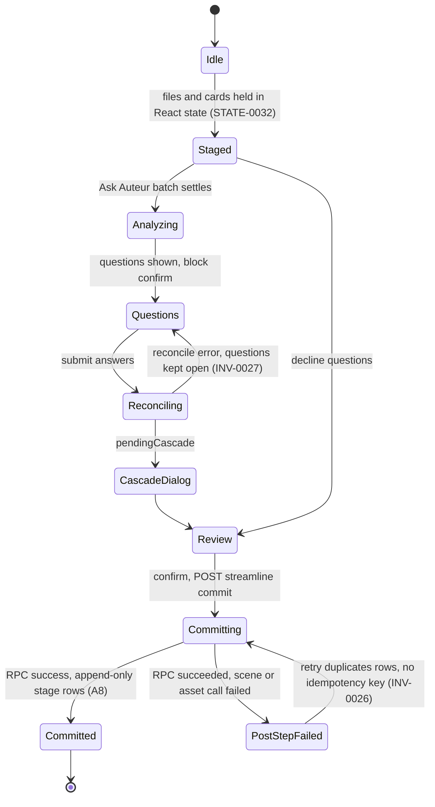

---

## 5. Invalidation, outdated, and cascade rules

Format. Each rule has TRIGGER, PRECONDITION, SIDE EFFECT, INVALIDATES, PRESERVES, PERSISTENCE, UI SIGNAL, and EVIDENCE. Every `WD-IMPL-INVALIDATE-NNNN` entry from reporter H (36 entries, 0073 to 0108) and from V1, V3, V4, V5, V6, V7, V8, V9, V10 (non-H, 72 entries) is listed in section 5.2. V2 has one entry (0016), also listed. None is dropped. Duplicates cite both ids.

Path abbreviations. `rt/` is backend/src/routes/. `sv/` is backend/src/services/. `mg/` is backend/migrations/. `pl/` is src/components/pipeline/. `pg/` is src/pages/. `lb/` is src/lib/. `tests/` is backend/src/tests/.

Verification status of entries. Entries cite the ledger evidence field. Where that field is blank (V5 entries 0028 to 0035 and STATE-0036 to 0044), the evidence is taken from the reporter's own section cited in the entry. The flags are the ledger flags.

### 5.1 Explicit application-level rules (R1 to R10)

| Rule | Trigger | Marks or changes | Does not touch | Ledger and evidence |
|---|---|---|---|---|
| R1 Phase A unlock confirm | POST stage unlock confirm, stages 1 to 5 | Downstream locked or outdated stages become outdated (new stage_states rows) | Skipped downstream; Phase B; any artifact | INV-0005, INV-0073; `rt/stageStates.ts:609-667` `[H]` |
| R2 Scene stage unlock confirm | POST stage-locks unlock confirm, stages 7 to 12 | Downstream locked or outdated become outdated; the unlocked stage becomes draft | Frames, videos, prompts, shots | INV-0078, STATE-0008; `rt/sceneStageLocks.ts:244-286` `[V]` |
| R3 Shot-list unlock | POST shots/unlock confirm | Stages 8 to 12 locked or outdated become outdated; 7 becomes draft; `shot_list_locked_at` null; intended frame and video `invalidated` writes are no-ops | Rows are not deleted | INV-0080, STATE-0097, DEAD-0030; `rt/projects.ts:3020-3180` `[V]` |
| R4 Shot assignment CRUD and split | Success of assignment routes and split | Stages 9 to 12 locked become outdated | Stages 7 and 8; assignments; frames | INV-0082, INV-0054, STATE-0098; `sv/shotAssetAssignmentService.ts:318-344` `[V]` |
| R5 Stage 2 and 3 edits, Phase A save over locked, streamline object commit | Any write | Nothing | Everything | INV-0017, INV-0074, INV-0076; `rt/stageStates.ts:211-222` `[V]` |
| R6 Style change (Stage 5) | mark-style-outdated | `project_assets.style_outdated = true` on assets with image; clear-all nulls images | Stage 5 row stays locked; scene instances | INV-0098; `rt/projectAssets.ts:1587-1618` `[V]` |
| R7 Phase A unlock, display | ProjectView local state on unlock | Local `outdated` display only | Database | INV-0005; `pg/ProjectView.tsx:718-747` `[V]` |
| R8 Global-library version drift (project assets) | GET `/assets/version-sync-status` | Reports project assets whose `source_version` is below the global asset version (advisory, computed) | Nothing persisted; no stage marked | CAP-0151, ROUTE-0035 (ledger); `rt/projectAssets.ts:431-508`, comparison at 490 `[V]`. Not in the INV ledger; added here. |
| R9 Scene continuity risk | Every GET scenes | Computed risky or broken badges from prior-scene status and timestamps | Nothing persisted | INV-0050, INV-0018; `sv/continuityRiskAnalyzer.ts:59-126` |
| R10 Scene `outdated` warning (dead) | Stage 6 modal on scene status outdated | None. No writer of `scenes.status` outdated exists. | n/a | CAP-0109, FACT-0044 (DEAD, CONTRADICTED as recorded) |

No rule deletes frames, prompts, videos, or assets. Deletion happens only through FK cascades (section 5.3) or explicit DELETE statements (section 8).

### 5.2 Entries (WD-IMPL-INVALIDATE)

- **WD-IMPL-INVALIDATE-0001** (V1-INV-01) Locked stage cannot regress to draft via save. `R:Y F:Y P:Y T:N`. TRIGGER: PUT stage save with status draft. PRECONDITION: latest locked. SIDE EFFECT: new locked row with replaced content. INVALIDATES: none. PRESERVES: locked status. PERSISTENCE: stage_states. UI SIGNAL: none. EVIDENCE: `rt/stageStates.ts:211-222`. NOTE: only the draft case is guarded; outdated can still be overwritten to draft.
- **WD-IMPL-INVALIDATE-0002** (V1-INV-02) Phase A lock predecessor rule. `R:Y F:Y P:Y T:Y`. TRIGGER: lock, or any insert with status locked. PRECONDITION: stage > 1. SIDE EFFECT: RAISE exception, rollback. INVALIDATES: none. PRESERVES: stage order. PERSISTENCE: DB. UI SIGNAL: lock error. EVIDENCE: `rt/stageStates.ts:344-370`; `mg/044:1-36`; `tests/streamlineSkip.test.ts:119-150`. Duplicate of 0020.
- **WD-IMPL-INVALIDATE-0003** (V1-INV-03) Skip eligibility. `R:P F:Y P:Y T:Y`. TRIGGER: skip request. PRECONDITION: stages 2 to 4 only; predecessor locked or skipped; current not locked. SIDE EFFECT: none on rejection. INVALIDATES: none. PRESERVES: locked content. PERSISTENCE: none on reject. UI SIGNAL: 400. EVIDENCE: `rt/stageStates.ts:416-484`; `tests/streamlineSkip.test.ts:31-117`. Stage 5 never skipped. Duplicate of 0021.
- **WD-IMPL-INVALIDATE-0004** (V1-INV-04) Phase A unlock eligibility. `R:Y F:Y P:Y T:N`, label CONTRADICTED (as recorded). TRIGGER: unlock request. PRECONDITION: stages 1 to 5; latest locked or skipped; outdated and draft rejected with 400. SIDE EFFECT: none. INVALIDATES: none. PRESERVES: all. PERSISTENCE: none. UI SIGNAL: failed-to-unlock toast. EVIDENCE: `rt/stageStates.ts:564-566`. NOTE: makes outdated Phase A stages un-editable; no relock route in stage_states except POST lock (A4).
- **WD-IMPL-INVALIDATE-0005** (V1-INV-05) Unlock cascades downstream to outdated (Phase A and scene). `R:Y F:Y P:Y T:N`. TRIGGER: confirmed unlock. PRECONDITION: unlock eligibility. SIDE EFFECT: outdated rows or lock entries. INVALIDATES: downstream locked or outdated. PRESERVES: content (copied). PERSISTENCE: stage_states (Phase A) or scenes.stage_locks (Phase B). UI SIGNAL: outdated badges (Phase A: local state). EVIDENCE: `rt/stageStates.ts:609-661`; `rt/sceneStageLocks.ts:244-260`. NOTE: Phase A cascade is one insert per row, not transactional. Duplicates: 0073, 0078, 0088, 0024.
- **WD-IMPL-INVALIDATE-0006** (V1-INV-06) Scene stage lock predecessor rule. `R:Y F:Y P:Y T:N`. TRIGGER: scene lock, n > 7. PRECONDITION: `stage_locks[n-1]` locked (outdated rejected). SIDE EFFECT: none on reject. INVALIDATES: none. PRESERVES: existing locks. PERSISTENCE: none. UI SIGNAL: console error only. EVIDENCE: `rt/sceneStageLocks.ts:92-105`. NOTE: front end does not check; shell ignores lock failures.
- **WD-IMPL-INVALIDATE-0007** (V1-INV-07) Relock only from outdated. `R:Y F:Y P:Y T:N`. TRIGGER: relock. PRECONDITION: status exactly outdated. SIDE EFFECT: none on reject. INVALIDATES: none. PRESERVES: all. PERSISTENCE: none. UI SIGNAL: 400. EVIDENCE: `rt/sceneStageLocks.ts:326-339`.
- **WD-IMPL-INVALIDATE-0008** (V1-INV-08) Stage 7 `shot_list_locked_at` mirrors `stage_locks['7']`. `R:Y F:Y P:Y T:N`, label DUPLICATED. TRIGGER: stage 7 lock or unlock. PRECONDITION: n = 7. SIDE EFFECT: trigger on scenes. INVALIDATES: none. PRESERVES: none. PERSISTENCE: scenes. UI SIGNAL: scene status. EVIDENCE: `rt/sceneStageLocks.ts:117-119, 257-259`; `mg/014:29-61`. Two sources of truth for stage 7. Duplicates: STATE-0010, STATE-0063.
- **WD-IMPL-INVALIDATE-0009** (V1-INV-09) Version uniqueness and read-then-insert race. `R:Y F:P P:Y T:N`. TRIGGER: concurrent stage writes. PRECONDITION: none. SIDE EFFECT: loser returns 500. INVALIDATES: none. PRESERVES: version ordering. PERSISTENCE: stage_states. UI SIGNAL: error toast. EVIDENCE: `mg/001:51-78`; `rt/stageStates.ts:189-254`. Near-simultaneous autosave and lock can fail one.
- **WD-IMPL-INVALIDATE-0010** (V1-INV-10) `scenes.stage_locks` is a read-modify-write JSON map with no version guard. `R:Y F:Y P:Y T:N`. TRIGGER: any stage_locks write. PRECONDITION: none. SIDE EFFECT: possible lost update. INVALIDATES: none guaranteed. PRESERVES: none guaranteed. PERSISTENCE: scenes. UI SIGNAL: none. EVIDENCE: `rt/sceneStageLocks.ts:79-130, 169-270`; `rt/projects.ts:2955-2985, 3138-3165`; `sv/shotAssetAssignmentService.ts:318-344`. Race window not tested. Duplicate of 0086.
- **WD-IMPL-INVALIDATE-0011** (V1-INV-11) Project ownership check on every slice route. `R:Y F:Y P:N T:N`. TRIGGER: any slice request. PRECONDITION: authenticated. SIDE EFFECT: 404. INVALIDATES: none. PRESERVES: tenancy. PERSISTENCE: none. UI SIGNAL: 404. EVIDENCE: `rt/stageStates.ts:13-18, 165-170`; `rt/sceneStageLocks.ts:24-30, 67-72`; `rt/projects.ts:259-1010, 3961-4004`. Scene is matched to project only through `active_branch_id`.
- **WD-IMPL-INVALIDATE-0012** (V1-INV-12) Deferred scenes not enforced by backend. `R:Y F:N P:Y T:N`, label PARTIAL. TRIGGER: any scene route. PRECONDITION: deferred scene. SIDE EFFECT: none. INVALIDATES: none. PRESERVES: none. PERSISTENCE: none. UI SIGNAL: disabled button only. EVIDENCE: `rt/projects.ts:1135-1214`; `pl/Stage6ScriptHub.tsx:432-437`.
- **WD-IMPL-INVALIDATE-0013** (V1-INV-13) UI gating not enforced by URL or routes. `R:Y F:Y P:Y T:N`. TRIGGER: URL navigation. PRECONDITION: none. SIDE EFFECT: none until a write action. INVALIDATES: none. PRESERVES: none. PERSISTENCE: URL and localStorage. UI SIGNAL: stage renders. EVIDENCE: `pg/ProjectView.tsx:236-308, 365-389, 444`. E2E tests rely on `?stage=7` and `?stage=8` deep links.
- **WD-IMPL-INVALIDATE-0014** (V1-INV-14) Lock and unlock writes origin NULL. `R:Y F:Y P:Y T:N`. TRIGGER: lock, unlock, save without origin. PRECONDITION: none. SIDE EFFECT: origin cleared on new row. INVALIDATES: provenance badge. PRESERVES: content. PERSISTENCE: stage_states. UI SIGNAL: badge loss. EVIDENCE: `rt/stageStates.ts:380-392, 609-655`; `lb/utils/stageBadge.ts:29-70`. Duplicate of 0025.
- **WD-IMPL-INVALIDATE-0015** (V1-INV-15) Lock route does not bump `projects.updated_at`. `R:Y F:Y P:Y T:N`. TRIGGER: stage lock. PRECONDITION: none. SIDE EFFECT: none. INVALIDATES: project list recency. PRESERVES: none. PERSISTENCE: none. UI SIGNAL: dashboard order. EVIDENCE: `rt/stageStates.ts:289-293, 297-407, 509-512, 657-661`.
- **WD-IMPL-INVALIDATE-0016** (V2-INV-01) Presets are read-only for users. `R:Y F:Y P:Y T:N`. TRIGGER: PUT or DELETE on a capsule. PRECONDITION: `is_preset` true. SIDE EFFECT: 403. INVALIDATES: none. PRESERVES: preset content. PERSISTENCE: style_capsules. UI SIGNAL: read-only dialog; Duplicate button. EVIDENCE: `rt/styleCapsules.ts:178-180, 236-238`; `pg/StyleCapsuleLibrary.tsx:572-628`. Favorite can still be toggled on a preset (FACT-07, V2).
- **WD-IMPL-INVALIDATE-0017** (V3-INV-01) Locked Stage 2 and 3 remain editable with no downstream invalidation. `R:Y F:Y P:Y T:N`. TRIGGER: edit in locked Stage 2 or 3. PRECONDITION: latest row locked. SIDE EFFECT: new locked row. INVALIDATES: none. PRESERVES: locked status. PERSISTENCE: stage_states. UI SIGNAL: none (header still reads LOCKED-IN). EVIDENCE: `pl/Stage3BeatSheet.tsx:733`; `pl/Stage2Treatment.tsx:518-549`; `rt/stageStates.ts:211-222`; `pg/ProjectView.tsx:727-734`. Only the V2 unlock flow marks downstream outdated. Duplicate of 0075.
- **WD-IMPL-INVALIDATE-0018** (V3-INV-02) Editing scene script text invalidates nothing. `R:Y F:Y P:Y T:N`. TRIGGER: PUT scenes with changed `scriptExcerpt` for a matched row. PRECONDITION: row matched. SIDE EFFECT: `script_excerpt`, slug, `updated_at`. INVALIDATES: none in DB. PRESERVES: status, stage_locks, shots. PERSISTENCE: scenes. UI SIGNAL: Stage 6 continuity risk badges (timestamp rule). EVIDENCE: `rt/projects.ts:1445-1474`; `mg/014:32-61`; `sv/continuityRiskAnalyzer.ts:59-84`.
- **WD-IMPL-INVALIDATE-0019** (V3-INV-03) Stage 4 approve is non-atomic across scenes persist and stage lock. `R:Y F:P P:Y T:N`, label DUPLICATED. TRIGGER: Approve Script. PRECONDITION: editor non-empty. SIDE EFFECT: scenes rewritten; stage_states(4) locked written after persist. INVALIDATES: downstream scene work by re-pointing. PRESERVES: nothing guaranteed. PERSISTENCE: scenes, stage_states. UI SIGNAL: error toast after partial writes. EVIDENCE: `pl/Stage4MasterScript.tsx:606-626`; `pg/ProjectView.tsx:446-449`; `rt/stageStates.ts:345-369`. Duplicate of 0077.
- **WD-IMPL-INVALIDATE-0020** (V4-INV-01) Global DB trigger: locked stage n > 1 requires n-1 locked or skipped. `R:Y F:U P:Y T:N`, label DUPLICATED. TRIGGER: any INSERT into stage_states with status locked. PRECONDITION: stage_number > 1. SIDE EFFECT: raises exception; rolls back enclosing transaction. INVALIDATES: n/a. PRESERVES: n/a. PERSISTENCE: DB trigger. UI SIGNAL: error text "streamline_commit: cannot lock stage". EVIDENCE: `mg/044:1-36`; `rt/stageStates.ts:344-370`. Applies to all stage_states writers. Duplicate of 0002.
- **WD-IMPL-INVALIDATE-0021** (V4-INV-02) Skip guards. `R:Y F:U P:Y T:P`, label DUPLICATED. TRIGGER: skip transition. PRECONDITION: see 0003. SIDE EFFECT: RAISE, full rollback, 400. INVALIDATES: n/a. PRESERVES: existing locked content. PERSISTENCE: n/a. UI SIGNAL: streamline error text. EVIDENCE: `mg/043:258-282`; `rt/stageStates.ts:421-484`; `tests/streamlineSkip.test.ts`. A commit with a script whose stage 2 or 3 is already locked and has no matching file fails as a whole. Duplicate of 0003.
- **WD-IMPL-INVALIDATE-0022** (V4-INV-03) Content-bearing commit supersedes existing locked content; no downstream invalidation. `R:Y F:U P:Y T:N`. TRIGGER: commit with object transition. PRECONDITION: previous stage locked or skipped. SIDE EFFECT: new version becomes latest. INVALIDATES: nothing. PRESERVES: older versions; stage 5 and later untouched (stale relative to new content). PERSISTENCE: stage_states. UI SIGNAL: IMPORTED badge. EVIDENCE: `mg/043:308-346`. Contrast with unlock, which cascades outdated. Duplicate of 0074 and 0076.
- **WD-IMPL-INVALIDATE-0023** (V4-INV-04) Post-commit scene sync deletes scenes removed from the script. `R:Y F:U P:Y T:N`. TRIGGER: commit with a usable script (front-end confidence not low). PRECONDITION: RPC succeeded. SIDE EFFECT: scenes inserted, updated, deleted; dependency columns from extract manifest. INVALIDATES: deleted scenes and their dependents, through FK cascades (CASC-03; V4 recorded this as UNKNOWN, resolved here by the migration grep). PRESERVES: matched scene ids. PERSISTENCE: scenes. UI SIGNAL: error if zero scenes. EVIDENCE: `pl/Stage1InputMode.tsx:487-498`; `rt/projects.ts:1247-1268, 1419-1440`.
- **WD-IMPL-INVALIDATE-0024** (V4-INV-05) Unskip cascades outdated to downstream stages. `R:Y F:Y P:Y T:N`. TRIGGER: "Write this myself" on a skipped stage. PRECONDITION: stage skipped. SIDE EFFECT: outdated rows inserted with origin dropped. INVALIDATES: downstream locked or outdated Phase A stages. PRESERVES: content of outdated rows (copied); skipped rows; Phase B. PERSISTENCE: stage_states. UI SIGNAL: none until reload. EVIDENCE: `rt/stageStates.ts:568-655`; `pg/ProjectView.tsx:649-662`. Code comment says there is no real content to lose and skips the impact dialog; downstream is still marked outdated. Duplicate of 0005.
- **WD-IMPL-INVALIDATE-0025** (V4-INV-06) `origin` provenance dropped on lock and unlock. `R:Y F:Y P:Y T:N`, label CONTRADICTED (as recorded). TRIGGER: lock or unlock via stageStates routes. PRECONDITION: none. SIDE EFFECT: origin NULL on new row. INVALIDATES: provenance. PRESERVES: content. PERSISTENCE: stage_states.origin. UI SIGNAL: badge disappears. EVIDENCE: `rt/stageStates.ts:380-391, 610-653`; `lb/utils/stageBadge.ts:29-41`. Duplicate of 0014.
- **WD-IMPL-INVALIDATE-0026** (V4-INV-07) Atomicity boundary and retry duplication. `R:Y F:P P:Y T:N`. TRIGGER: commit retry after post-RPC failure. PRECONDITION: RPC succeeded earlier. SIDE EFFECT: duplicate rows. INVALIDATES: n/a. PRESERVES: n/a. PERSISTENCE: DB. UI SIGNAL: streamline error message. EVIDENCE: `pl/Stage1InputMode.tsx:474-511`; `mg/043:358-425`. No idempotency key or dedupe (R1b C19, CONFIRMED).
- **WD-IMPL-INVALIDATE-0027** (V4-INV-08) Cascade cancel drops audit edits; reconcile failure keeps questions open. `R:Y F:Y P:P T:N`. TRIGGER: cascade cancel or reconcile error. PRECONDITION: none. SIDE EFFECT: edit list filtered. INVALIDATES: cascade edits. PRESERVES: original document text; resolutions (set before reconcile is called). PERSISTENCE: React state until commit. UI SIGNAL: dialog closes or error text. EVIDENCE: `pl/Stage1InputMode.tsx:371, 399-405, 431-442`.
- **WD-IMPL-INVALIDATE-0028** (V5-INV-01) Style change does not propagate to `project_assets.visual_style_capsule_id`. `R:Y F:P P:Y T:N`. TRIGGER: locking a new style. PRECONDITION: assets exist with stored capsule id. SIDE EFFECT: regeneration uses old style; new style applies only to new assets or those whose capsule is null. INVALIDATES: none. PRESERVES: asset capsule ids. PERSISTENCE: `project_assets.visual_style_capsule_id` vs stage_states. UI SIGNAL: none. EVIDENCE: no ledger evidence; V5 cites `rt/projectAssets.ts:1244-1260` (generate-image fallback) and `2209-2216` (sync overwrite). NOTE: if the asset capsule is null and Stage 5 is capsule-based, `createImageJob` throws.
- **WD-IMPL-INVALIDATE-0029** (V5-INV-02) Clear All Images preserves attempts. `R:Y F:Y P:Y T:N`. TRIGGER: Clear All Images confirm. PRECONDITION: branch assets with `image_key_url`. SIDE EFFECT: carousel still shows selected attempt; storage kept. INVALIDATES: `image_key_url` for all branch assets. PRESERVES: attempts, storage objects, angle variants, location view images. PERSISTENCE: project_assets. UI SIGNAL: card images removed. EVIDENCE: no ledger evidence; V5 section 9 (`reports/V5-project-assets.md` lines 203-214). NOTE: selected attempt cannot be deleted; reselect is possible but `image_key_url` stays null until select.
- **WD-IMPL-INVALIDATE-0030** (V5-INV-03) Merge cascades and FK nulling on absorbed assets. `R:Y F:Y P:Y T:P`. TRIGGER: merge confirm. PRECONDITION: unlocked assets. SIDE EFFECT: `camera_direction_id` on shots SET NULL via location_views cascade. INVALIDATES: absorbed attempts, variants, views, location links. PRESERVES: survivor's data; storage objects of absorbed assets remain. PERSISTENCE: FK rules in 008, 023, 025, 038, 039. UI SIGNAL: toast with counts. EVIDENCE: no ledger evidence; V5 merge section. NOTE: absorbed images are dropped from the DB while storage objects remain; MergeDialog warns about lost images.
- **WD-IMPL-INVALIDATE-0031** (V5-INV-04) Deleting a location view deletes the image object in the shared asset-images bucket. `R:Y F:P P:Y T:N`. TRIGGER: delete view. PRECONDITION: `image_key_url` non-null. SIDE EFFECT: frame image storage object removed while the frames row still references it. INVALIDATES: frame image URL. PRESERVES: frame row. PERSISTENCE: storage bucket asset-images. UI SIGNAL: none beyond toast. EVIDENCE: `rt/projectAssets.ts:3157-3162` (path parsing, per ledger note); `sv/image-generation/ImageGenerationService.ts:378-384`. NOTE: runtime impact UNKNOWN. Duplicate of 0108.
- **WD-IMPL-INVALIDATE-0032** (V5-INV-05) Edit and regenerate results become the selected master image before Accept. `R:Y F:Y P:Y T:N`. TRIGGER: any edit action success. PRECONDITION: asset exists. SIDE EFFECT: gate and card image change; previous selected attempt deselected; cap may delete the oldest non-selected attempt. INVALIDATES: previous selected attempt flag. PRESERVES: description unless Accept. PERSISTENCE: attempts and project_assets. UI SIGNAL: card image changes on refresh. EVIDENCE: no ledger evidence; V5 section 9. NOTE: Accept only saves the description and selects the matching attempt if different.
- **WD-IMPL-INVALIDATE-0033** (V5-INV-06) Global sync overwrites project edits to linked fields. `R:Y F:Y P:Y T:N`, label CONTRADICTED (as recorded). TRIGGER: user sync action. PRECONDITION: linked, not locked. SIDE EFFECT: project edits lost; localized image replaces project image without an attempt row. INVALIDATES: project description and image. PRESERVES: non-synced override names. PERSISTENCE: project_assets. UI SIGNAL: toast "Updated from global library". EVIDENCE: no ledger evidence; `rt/projectAssets.ts:2157-2221` (per STATE-0040). Contradicts the migration 009 comment that overridden fields are not overwritten.
- **WD-IMPL-INVALIDATE-0034** (V5-INV-07) Attempt cap of 4 deletes oldest non-selected attempt. `R:Y F:Y P:Y T:N`. TRIGGER: createAttempt path through `enforceAttemptCap`. PRECONDITION: asset has 4 or more attempts. SIDE EFFECT: storage object deleted; carousel entry gone. INVALIDATES: oldest non-selected attempt. PRESERVES: selected attempt. PERSISTENCE: project_asset_generation_attempts and storage. UI SIGNAL: carousel count changes. EVIDENCE: no ledger evidence; `sv/projectAssetAttemptsService.ts:170-197` (per notes). The cap check runs before insert.
- **WD-IMPL-INVALIDATE-0035** (V5-INV-08) Master image change does not invalidate angle variants or location views. `R:Y F:Y P:Y T:N`. TRIGGER: image or description write. PRECONDITION: none. SIDE EFFECT: none. INVALIDATES: nothing. PRESERVES: all variant and view rows; stale angle and view images stay in use by frame prompts. PERSISTENCE: n/a. UI SIGNAL: none. EVIDENCE: `rt/projects.ts:3653-3659` (live joins read current `image_key_url`, per ledger note).
- **WD-IMPL-INVALIDATE-0036** (V6-INV-01) Inheritance flows only from scene N-1 by `scene_number`; reset when the prior carry_forward is false. `R:Y F:Y P:Y T:N`, label CONTRADICTED (as recorded; relevance prompt is non-linear on the AI path only). TRIGGER: inherit route, or auto-populate on a scene with zero instances. PRECONDITION: scene_number > 1 and N-1 exists; scene 1 bootstrap. SIDE EFFECT: instances inserted with `inherited_from` set. INVALIDATES: none in N-1. PRESERVES: prior instance untouched. PERSISTENCE: scene_asset_instances. UI SIGNAL: Prior Scene badge; tag prompt. EVIDENCE: `sv/assetInheritanceService.ts:51-82, 92-157, 229-286`; `rt/sceneAssets.ts:315-325`.
- **WD-IMPL-INVALIDATE-0037** (V6-INV-02) Inheritance and populate copy values at creation; no later propagation. `R:Y F:Y P:Y T:N`. TRIGGER: project asset edit; prior instance edit; scene text re-extraction. PRECONDITION: none. SIDE EFFECT: none. INVALIDATES: none. PRESERVES: copied values. PERSISTENCE: scene_asset_instances. UI SIGNAL: none. EVIDENCE: `sv/assetInheritanceService.ts:257-282`; `rt/sceneAssets.ts:1506-1518`; `sv/image-generation/ImageGenerationService.ts:241`. The reference chain is read live, so prior scene edits show there.
- **WD-IMPL-INVALIDATE-0038** (V6-INV-03) Project asset description edits do not propagate into `effective_description`. `R:Y F:Y P:Y T:N`. TRIGGER: project asset description change. PRECONDITION: none. SIDE EFFECT: none. INVALIDATES: none (stale). PRESERVES: `effective_description`. PERSISTENCE: scene_asset_instances.effective_description. UI SIGNAL: none. EVIDENCE: `rt/sceneAssets.ts:619-625`; `mg/015:34`. No staleness flag exists.
- **WD-IMPL-INVALIDATE-0039** (V6-INV-04) Generation attempt cap of 8 per instance. `R:Y F:Y P:Y T:N`. TRIGGER: any new attempt. PRECONDITION: count at or above 8. SIDE EFFECT: row and storage object deleted. INVALIDATES: oldest non-selected attempt. PRESERVES: selected attempt. PERSISTENCE: scene_asset_generation_attempts. UI SIGNAL: carousel contents change. EVIDENCE: `sv/sceneAssetAttemptsService.ts:8, 161-188`; `sv/image-generation/ImageGenerationService.ts:456`; `rt/sceneAssets.ts:1305-1308, 1704-1705`. Count check is not transactional, so concurrent generates can exceed the cap.
- **WD-IMPL-INVALIDATE-0040** (V6-INV-05) Description version cap 8 and write-back. `R:Y F:Y P:Y T:Y`. TRIGGER: create, select, or first list call. PRECONDITION: content non-null for backfill. SIDE EFFECT: write-back to `scene_asset_instances.description_override`. INVALIDATES: `effective_description` is not updated by write-back. PRESERVES: selected version. PERSISTENCE: text_field_versions. UI SIGNAL: version counter. EVIDENCE: `sv/textFieldVersionService.ts:9, 62-104, 145-176, 181-202, 226-241`; `tests/textFieldVersionService.test.ts:76-140`. The test replicates constants rather than importing the service.
- **WD-IMPL-INVALIDATE-0041** (V6-INV-06) Only confirmed transformation events affect resolution; unconfirmed events are ignored. `R:Y F:Y P:Y T:Y`. TRIGGER: any read for resolution. PRECONDITION: none. SIDE EFFECT: none. INVALIDATES: none. PRESERVES: unconfirmed rows. PERSISTENCE: transformation_events.confirmed. UI SIGNAL: yellow versus green cards. EVIDENCE: `sv/transformationEventService.ts:117-125`; `tests/transformationEvents.test.ts:320-350`; `rt/sceneAssets.ts:1560-1570, 2066-2079`.
- **WD-IMPL-INVALIDATE-0042** (V6-INV-07) Deleting a scene or instance cascades to dependent rows. `R:Y F:Y P:Y T:N`. TRIGGER: DELETE of instance, shot, scene, or project asset. PRECONDITION: none. SIDE EFFECT: dependent rows removed. INVALIDATES: transformation events and assignments. PRESERVES: others. PERSISTENCE: DB FKs. UI SIGNAL: lists refetch. EVIDENCE: `mg/015:15-16`; `mg/022:11`; `mg/030:14-20, 26`; `mg/033:12`. Scene re-extraction deletes unmatched scenes (cross-slice). See CASC-03, CASC-06, CASC-07.
- **WD-IMPL-INVALIDATE-0043** (V6-INV-08) Proceed requires images on all instances and no unresolved transformations (client only). `R:Y F:P P:N T:N`. TRIGGER: Proceed click. PRECONDITION: data loaded. SIDE EFFECT: toast error or onComplete. INVALIDATES: none. PRESERVES: none. PERSISTENCE: none. UI SIGNAL: error toast. EVIDENCE: `pl/Stage8VisualDefinition.tsx:713-736`; `rt/sceneStageLocks.ts:98-115`. Transformation counts come from a React Query key the local list does not invalidate.
- **WD-IMPL-INVALIDATE-0044** (V6-INV-09) Transformation post state is inherited as the prior instance's final state. `R:Y F:Y P:Y T:N`. TRIGGER: inherit or relevance context build. PRECONDITION: prior instance has confirmed events. SIDE EFFECT: inherited description, tags, and image. INVALIDATES: none. PRESERVES: source event. PERSISTENCE: copied into instance at inherit time. UI SIGNAL: Prior Scene badge. EVIDENCE: `sv/transformationEventService.ts:528-557`; `sv/assetInheritanceService.ts:127-142`; `sv/sceneAssetRelevanceService.ts:79-99`. Inheritance order uses only the prior scene.
- **WD-IMPL-INVALIDATE-0045** (V6-INV-10) AI detect batch on instance creation has no rollback on partial failure. `R:Y F:P P:Y T:N`. TRIGGER: Detect with AI. PRECONDITION: some relevant asset already in scene. SIDE EFFECT: partial instances written, toast error. INVALIDATES: none. PRESERVES: existing instances. PERSISTENCE: scene_asset_instances. UI SIGNAL: AI detection failed toast. EVIDENCE: `pl/Stage8VisualDefinition.tsx:509-537`; `rt/sceneAssets.ts:245-249`. `Promise.all` does not roll back.
- **WD-IMPL-INVALIDATE-0046** (V7-INV-01) At most one link per target frame. `R:Y F:Y P:Y T:Y`. TRIGGER: copy-frame, batch-link-copy, add-frame-as-reference. PRECONDITION: target frame exists or is created. SIDE EFFECT: prior link on the target deleted. INVALIDATES: prior match or reference link on the target. PRESERVES: links on other targets. PERSISTENCE: frame_links unique constraint (`mg/035:49-59`). UI SIGNAL: single continuity badge per frame. EVIDENCE: `mg/035:49-59`; `rt/frames.ts:1033-1043, 2098-2103`. Migration 034 restricted link_type to match; 035 recreates the CHECK.
- **WD-IMPL-INVALIDATE-0047** (V7-INV-02) Continuity base must be a top-8 candidate; reference-images guard. `R:Y F:Y P:Y T:Y`. TRIGGER: PUT continuity-base select; PUT reference-images start. PRECONDITION: candidate from listCandidates (same branch; start frames approved or generated). SIDE EFFECT: 400 when invalid. INVALIDATES: selected base cleared when its entry is removed from the reference payload. PRESERVES: selection survives a location change until the user acts. PERSISTENCE: shots columns. UI SIGNAL: 400 toast. EVIDENCE: `rt/frames.ts:1638-1654, 1536-1550`. Generation does not recheck location or status.
- **WD-IMPL-INVALIDATE-0048** (V7-INV-03) Manual location assignments are not auto-overwritten. `R:Y F:Y P:Y T:Y`. TRIGGER: PUT shot setting or camera_direction_id; resolve-locations; PUT camera-direction. PRECONDITION: `location_match_source` = manual. SIDE EFFECT: 409 on conflicting direction. INVALIDATES: none. PRESERVES: manual location and manual clear. PERSISTENCE: shots. UI SIGNAL: Stage 7 "Manual choice retained" note. EVIDENCE: `rt/projects.ts:2451-2475, 2223-2240, 2268-2278`. Generic PUT shot does not check that camera_direction_id belongs to the branch (`rt/projects.ts:2421-2426`).
- **WD-IMPL-INVALIDATE-0049** (V7-INV-04) Camera direction assignment moves the shot to the direction's location. `R:Y F:Y P:Y T:Y`. TRIGGER: PUT camera-direction with cameraDirectionId. PRECONDITION: view_type direction; parent location in branch. SIDE EFFECT: `location_asset_id`, confidence, source, notes set. INVALIDATES: prior automatic location link. PRESERVES: location when already the same; manual conflicts return 409. PERSISTENCE: shots. UI SIGNAL: coverage panel recomputed; Direction badge. EVIDENCE: `rt/projects.ts:2280-2287`. A generic PUT shot with camera_direction_id does not perform this move.
- **WD-IMPL-INVALIDATE-0050** (V7-INV-05) Scene continuity risk rules (computed). `R:Y F:Y P:N T:Y`. TRIGGER: every GET scenes. PRECONDITION: scenes and stage_states of the active branch. SIDE EFFECT: none. INVALIDATES: nothing persisted. PRESERVES: nothing persisted. PERSISTENCE: computed. UI SIGNAL: Stage 6 chips safe, risky, broken. EVIDENCE: `sv/continuityRiskAnalyzer.ts:59-126`. Rules 2 and 3 are reachable only once the prior scene is video_complete, which only videoGenerationService sets.
- **WD-IMPL-INVALIDATE-0051** (V7-INV-06) Coverage groups shots by canonical location only. `R:Y F:Y P:N T:Y`, label DEAD-BRANCH (maps to DEAD). TRIGGER: GET location-coverage. PRECONDITION: location resolved from persisted `location_asset_id`. SIDE EFFECT: none. INVALIDATES: none. PRESERVES: none. PERSISTENCE: computed. UI SIGNAL: Stage 8 unresolved shots list. EVIDENCE: `sv/locationCoverageService.ts:246-256, 303-304`. The `direction_location_mismatch` branch is unreachable.
- **WD-IMPL-INVALIDATE-0052** (V7-INV-07) One continuity-typed reference entry per column. `R:Y F:Y P:Y T:Y`. TRIGGER: add-frame-as-reference; chain-from-end-frame (dead); copy-frame to start. PRECONDITION: existing reference array. SIDE EFFECT: prior continuity entry removed from start or end column. INVALIDATES: prior continuity reference. PRESERVES: other entries and continuity_base_frame entries. PERSISTENCE: shots JSONB. UI SIGNAL: Refs list shows Continuity label. EVIDENCE: `rt/frames.ts:994-1004, 2105-2114, 877-930`. Type-based match also removes a manually uploaded reference of type continuity.
- **WD-IMPL-INVALIDATE-0053** (V7-INV-08) Location warnings never block shot list lock. `R:Y F:Y P:N T:N`. TRIGGER: POST shots/lock. PRECONDITION: no shot-list validation errors. SIDE EFFECT: 409 unless force. INVALIDATES: none. PRESERVES: lock proceeds with force. PERSISTENCE: none. UI SIGNAL: warning list in the lock dialog (exact UI UNKNOWN). EVIDENCE: `rt/projects.ts:2930-2959`. Stage 10 strict continuity validation is a separate blocking check.
- **WD-IMPL-INVALIDATE-0054** (V8-INV-01) Split invalidates stages 9 to 12; merge does not. `R:Y F:P P:Y T:N`, label CONTRADICTED (as recorded). TRIGGER: split route success. PRECONDITION: `invalidateStage9AndDownstream` reads scene stage_locks. SIDE EFFECT: locked stages 9 to 12 marked outdated (fire-and-forget; errors only logged). INVALIDATES: stage 9 to 12 lock status only. PRESERVES: frames of the original shot (already cascade-deleted by the shot delete, see 0056). PERSISTENCE: scenes.stage_locks. UI SIGNAL: outdated header on next load. EVIDENCE: `rt/projects.ts:2636-2639, 2657-2788, 2791-2840`. Duplicate of 0082.
- **WD-IMPL-INVALIDATE-0055** (V8-INV-02) Stage 7 lock does not gate backend shot mutation routes. `R:Y F:Y P:N T:N`. TRIGGER: any shot mutation while the scene is locked. PRECONDITION: `shot_list_locked_at` not null. SIDE EFFECT: mutation proceeds. INVALIDATES: none. PRESERVES: everything. PERSISTENCE: n/a. UI SIGNAL: disabled controls only (`canEdit`); Stage 9 has no lock check. EVIDENCE: `pl/Stage7ShotList.tsx:624`; `rt/projects.ts:2399-2512, 2514-2840, 2180-2313`; `rt/shotAssignments.ts:129-245`. Only the lock and unlock routes read the lock fields. Duplicate of 0083.
- **WD-IMPL-INVALIDATE-0056** (V8-INV-03) Shot row delete cascades to frames, jobs, transformation events, and assignments. `R:Y F:Y P:Y T:N`. TRIGGER: DELETE on a shot row. PRECONDITION: row exists. SIDE EFFECT: cascade delete of frames, video jobs, image jobs, transformation events where trigger_shot_id, shot asset assignments, location match events; completion_shot_id set null. INVALIDATES: all shot-scoped generated artifacts. PRESERVES: scene, other shots, location views. PERSISTENCE: table-level cascades. UI SIGNAL: none; no confirmation; shot disappears. EVIDENCE: `mg/019:8`; `mg/021:11`; `mg/007:14`; `mg/030:20-26`; `mg/033:11`; `mg/039:89`; `mg/038:28-30`. Split and merge delete original rows. Approved or generated frames are removed with no warning. Duplicate of 0084. See CASC-04.
- **WD-IMPL-INVALIDATE-0057** (V8-INV-04) Merge and single delete leave stage 9 to 12 locks unchanged. `R:Y F:N P:Y T:N`, label CONTRADICTED (as recorded). TRIGGER: merge or delete success. PRECONDITION: scene has stages 9 to 12 locked. SIDE EFFECT: none to stage_locks. INVALIDATES: nothing. PRESERVES: stage locks as they are. PERSISTENCE: n/a. UI SIGNAL: stage 9 onward still shows locked. EVIDENCE: `rt/projects.ts:2657-2788, 2791-2840`; `sv/shotAssetAssignmentService.ts:318-344`. Absence of a call, verified by reading both routes. Intent UNKNOWN; the split route comment implies the rule applies to split only.
- **WD-IMPL-INVALIDATE-0058** (V8-INV-05) Unlock cascade does not delete artifacts and does not reach stage 7. `R:Y F:P P:Y T:P`. TRIGGER: confirmed unlock. PRECONDITION: stage not draft. SIDE EFFECT: downstream outdated only. INVALIDATES: lock status of stages above the unlocked stage. PRESERVES: all artifacts. PERSISTENCE: scenes.stage_locks. UI SIGNAL: downstream headers show outdated. EVIDENCE: `rt/sceneStageLocks.ts:183-257`; `rt/projects.ts:3142-3150`; `tests/shotLocking4_5_task_11.test.ts:95-109`. The impact-required test is `it.skip`. The legacy path writes `invalidated`, which the frames CHECK rejects. Duplicate of 0080.
- **WD-IMPL-INVALIDATE-0059** (V8-INV-06) Assignment routes do not scope target IDs to the path scene. `R:Y F:Y P:Y T:N`. TRIGGER: any assignment route call. PRECONDITION: authenticated owner of the project in the path; scene exists on some branch. SIDE EFFECT: row mutation of any assignment id. INVALIDATES: stages 9 to 12 of the path scene (not the target scene). PRESERVES: other rows. PERSISTENCE: shot_asset_assignments. UI SIGNAL: none. EVIDENCE: `rt/shotAssignments.ts:36-75, 162-217`; `sv/shotAssetAssignmentService.ts:160-180`; `config/supabase.ts:1-15`. The service-role key bypasses RLS, so RLS on shot_asset_assignments does not apply to backend calls.
- **WD-IMPL-INVALIDATE-0060** (V9-INV-01) Stage 10 approval gate accepts generated or approved. `R:Y F:Y P:N T:N`. TRIGGER: GET frames route and "Lock and Proceed" render. PRECONDITION: shots with frames. SIDE EFFECT: none. INVALIDATES: none. PRESERVES: none. PERSISTENCE: derived. UI SIGNAL: Lock and Proceed enabled or disabled. EVIDENCE: `sv/frameGenerationService.ts:1520-1538`; `pl/Stage10FrameGeneration.tsx:1697`. Contradicts the doc comment at `sv/frameGenerationService.ts:307-309`.
- **WD-IMPL-INVALIDATE-0061** (V9-INV-02) Stage 9 "Lock and Proceed" prerequisites. `R:Y F:Y P:N T:N`. TRIGGER: render. PRECONDITION: promptSets loaded. SIDE EFFECT: none. INVALIDATES: none. PRESERVES: none. PERSISTENCE: derived. UI SIGNAL: warning that some shots are missing prompts. EVIDENCE: `pl/Stage9PromptSegmentation.tsx:359, 965`. Frontend only.
- **WD-IMPL-INVALIDATE-0062** (V9-INV-03) End frame generation requires start ready. `R:Y F:Y P:N T:N`. TRIGGER: button render and generate-frames. PRECONDITION: start frame row. SIDE EFFECT: none. INVALIDATES: none. PRESERVES: none. PERSISTENCE: derived. UI SIGNAL: "Start frame must be ready" message. EVIDENCE: `pl/Stage10FrameGeneration.tsx:1326-1328`; `rt/frames.ts:227-291`. Server-side guard absent.
- **WD-IMPL-INVALIDATE-0063** (V9-INV-04) Delete generation guards. `R:Y F:Y P:Y T:N`. TRIGGER: DELETE generations/:jobId. PRECONDITION: frame `current_job_id` known. SIDE EFFECT: job removed. INVALIDATES: `generation_count` decremented. PRESERVES: current job. PERSISTENCE: image_generation_jobs. UI SIGNAL: delete button hidden for the current generation. EVIDENCE: `rt/frames.ts:1434-1450`. Guard checks the current id, not job ownership.
- **WD-IMPL-INVALIDATE-0064** (V9-INV-05) Select generation clears approval. `R:Y F:Y P:Y T:N`. TRIGGER: PUT select-generation. PRECONDITION: job status completed. SIDE EFFECT: `propagateFrameLinks` runs. INVALIDATES: `approved_at`. PRESERVES: older jobs. PERSISTENCE: frames (`prompt_snapshot` set to the job prompt). UI SIGNAL: Selected badge. EVIDENCE: `rt/frames.ts:1353-1365`. Stage 11 checkout lists generated frames as unapproved too. Duplicate of 0091.
- **WD-IMPL-INVALIDATE-0065** (V9-INV-06) `requires_end_frame` heuristic. `R:Y F:Y P:Y T:N`. TRIGGER: generatePromptSet. PRECONDITION: shot data. SIDE EFFECT: `requires_end_frame` and `ai_recommends_end_frame` written. INVALIDATES: user toggle on regeneration. PRESERVES: none. PERSISTENCE: shots. UI SIGNAL: AI End Frame badge. EVIDENCE: `sv/promptGenerationService.ts:793-824`. A user toggle overrides until the next generation.
- **WD-IMPL-INVALIDATE-0066** (V9-INV-07) Match link propagation reads the current source image. `R:Y F:P P:Y T:N`. TRIGGER: route calls after a mutation. PRECONDITION: match links with a source image. SIDE EFFECT: target frame image replaced; target `prompt_snapshot` set to auto-propagated text. INVALIDATES: target image. PRESERVES: links. PERSISTENCE: frames. UI SIGNAL: Link badge. EVIDENCE: `sv/frameGenerationService.ts:1545-1596`. Triggered by regenerate, inpaint, upload variant, and select-generation; not triggered when a background job completes. Runs before async jobs finish. Duplicate of 0089.
- **WD-IMPL-INVALIDATE-0067** (V9-INV-08) Job completion writes the frame by shot and type. `R:Y F:P P:Y T:N`. TRIGGER: job success for start_frame or end_frame. PRECONDITION: shotId present. SIDE EFFECT: frames `image_url` set and status generated. INVALIDATES: prior image. PRESERVES: none. PERSISTENCE: frames. UI SIGNAL: Ready status. EVIDENCE: `sv/image-generation/ImageGenerationService.ts:516-536`. Concurrent regenerations: the last completion wins regardless of `current_job_id`.
- **WD-IMPL-INVALIDATE-0068** (V9-INV-09) Single-shot prompt regeneration forces `start_continuity` to none. `R:Y F:Y P:Y T:N`. TRIGGER: generate-prompts with shotIds. PRECONDITION: shotIds. SIDE EFFECT: `start_continuity` none. INVALIDATES: user continuity choice. PRESERVES: none. PERSISTENCE: shots. UI SIGNAL: continuity select resets. EVIDENCE: `sv/promptGenerationService.ts:1084-1091`; `rt/projects.ts:3856`. Subset regeneration of non-contiguous shots has the same effect.
- **WD-IMPL-INVALIDATE-0069** (V10-INV-01) No invalidation of video jobs on upstream change. `R:N F:N P:N T:N`. TRIGGER: n/a. PRECONDITION: n/a. SIDE EFFECT: none. INVALIDATES: nothing. PRESERVES: all video jobs and snapshots. PERSISTENCE: n/a. UI SIGNAL: none; Script Hub may still show Review Ready. EVIDENCE: grep of video_generation_jobs writers (checkout.ts, videoGenerationService.ts, VideoJobExecutor.ts, mg/021). Stage-lock outdated markers are the only staleness signal. Duplicate of 0099.
- **WD-IMPL-INVALIDATE-0070** (V10-INV-02) Unlock impact counts videos from a nonexistent table. `R:Y F:N P:N T:N`, label CONTRADICTED (as recorded). TRIGGER: POST stage-locks unlock; shot-list unlock. PRECONDITION: stage locked. SIDE EFFECT: failed silent update on `videos`. INVALIDATES: nothing in video_generation_jobs. PRESERVES: video jobs. PERSISTENCE: none for videos. UI SIGNAL: UnlockWarningDialog shows 0 videos. EVIDENCE: `rt/sceneStageLocks.ts:214-224`; `rt/projects.ts:3076-3118`. Duplicates: 0080, 0081; TABLE-0028, TABLE-0057.
- **WD-IMPL-INVALIDATE-0071** (V10-INV-03) Return to a stage from Stage 12 does not unlock or invalidate. `R:Y F:Y P:N T:N`. TRIGGER: UnsatisfiedDropdown confirm. PRECONDITION: allComplete. SIDE EFFECT: navigation only. INVALIDATES: nothing. PRESERVES: jobs and locks. PERSISTENCE: none. UI SIGNAL: target stage, likely with LockedStageHeader. EVIDENCE: `pg/ProjectView.tsx:758-762`; `pl/Stage12/UnsatisfiedDropdown.tsx:40-48`.
- **WD-IMPL-INVALIDATE-0072** (V10-INV-04) Prompt and frame URL snapshot at queue time. `R:Y F:Y P:Y T:N`. TRIGGER: confirm-render. PRECONDITION: n/a. SIDE EFFECT: none. INVALIDATES: none. PRESERVES: snapshot values (`*_snapshot`, `*_url` on video jobs). PERSISTENCE: video_generation_jobs. UI SIGNAL: none. EVIDENCE: `sv/videoGenerationService.ts:354-369`; `sv/video-generation/VideoJobExecutor.ts:110-117`.
- **WD-IMPL-INVALIDATE-0073** (H-INV-01) Phase A unlock marks locked or outdated downstream stages outdated. `R:P F:Y P:Y T:N`. TRIGGER: POST stage unlock confirm true. PRECONDITION: stage latest locked or skipped. SIDE EFFECT: outdated copies inserted. INVALIDATES: downstream Phase A stage status. PRESERVES: content; skipped rows; Phase B. PERSISTENCE: stage_states. UI SIGNAL: OUTDATED badge downstream (after reload or local state). EVIDENCE: `rt/stageStates.ts:609-667, 630-660`. Phase B locks are not touched. Duplicates: 0005, STATE-0088.
- **WD-IMPL-INVALIDATE-0074** (H-INV-02) Phase A save, lock, and commit never invalidate downstream stages. `R:Y F:Y P:Y T:U`, label DUPLICATED. TRIGGER: any Phase A write other than unlock. PRECONDITION: none beyond route checks. SIDE EFFECT: one row inserted. INVALIDATES: nothing. PRESERVES: all downstream rows. PERSISTENCE: stage_states. UI SIGNAL: no outdated badge appears. EVIDENCE: `rt/stageStates.ts:120-294, 297-412, 416-519`; `mg/043:308-327`. Stage 1 config PUT (`rt/projects.ts:640-807`) also does not touch stage_states. Duplicates: 0022, 0076.
- **WD-IMPL-INVALIDATE-0075** (H-INV-03) Locked Stage 2 and 3 bodies remain editable with no unlock. `R:Y F:Y P:Y T:N`. TRIGGER: user edits in a locked Stage 2 or 3. PRECONDITION: stage locked. SIDE EFFECT: autosave PUT draft becomes a locked row with new content. INVALIDATES: nothing downstream. PRESERVES: locked status. PERSISTENCE: stage_states. UI SIGNAL: header shows locked; body editable. EVIDENCE: `pl/Stage2Treatment.tsx:90, 437-450`; `pl/Stage3BeatSheet.tsx:239, 589-606, 728-736`; `rt/stageStates.ts:211-222`. Duplicate of 0017.
- **WD-IMPL-INVALIDATE-0076** (H-INV-04) Streamline commit replaces stage content with no lock or downstream check. `R:P F:Y P:Y T:U`. TRIGGER: Streamline confirm with stage_transitions object for stages 1 to 5. PRECONDITION: object for stages 1 to 5; a locked object requires predecessor locked or skipped. SIDE EFFECT: new version per object transition; Stage 1 draft row. INVALIDATES: nothing. PRESERVES: prior versions; stage 5 and later artifacts are not touched and become stale relative to new content. PERSISTENCE: stage_states. UI SIGNAL: navigation to target stage; PhaseTimeline badges. EVIDENCE: `mg/043:308-327, 284-307`; `mg/044:38-85`. Reachability from a locked project is UNKNOWN (H FACT-18). Duplicates: 0022, 0074.
- **WD-IMPL-INVALIDATE-0077** (H-INV-05) Stage 4 approve is non-atomic, and a pending save can rewrite the locked stage. `R:Y F:P P:Y T:N`. TRIGGER: Approve Script within 2 s of an edit. PRECONDITION: editor non-empty. SIDE EFFECT: matched scene rows updated, unmatched deleted; stage 4 locked row; possible later draft PUT with locked status. INVALIDATES: downstream scene work by re-pointing (see 0085). PRESERVES: nothing guaranteed. PERSISTENCE: scenes; stage_states. UI SIGNAL: toast with scene count. EVIDENCE: `pl/Stage4MasterScript.tsx:145-168, 606-626, 158-160, 221-226`; `rt/stageStates.ts:211-222`. Timing-dependent; no test. The lock copies the latest persisted row, which can be older than the editor content. Duplicates: 0019, STATE-0092.
- **WD-IMPL-INVALIDATE-0078** (H-INV-06) Scene unlock (Phase B) cascades to outdated only and deletes nothing. `R:Y F:Y P:Y T:N`. TRIGGER: stage-locks unlock confirm. PRECONDITION: stage locked or outdated. SIDE EFFECT: stage_locks update; `updated_at`. INVALIDATES: stage_locks entries for downstream locked or outdated. PRESERVES: all artifacts. PERSISTENCE: scenes.stage_locks. UI SIGNAL: outdated downstream badge. EVIDENCE: `rt/sceneStageLocks.ts:244-286`. The dialog counts frames (live) and videos (always 0). The test file asserts only 401 and skipped placeholders. Duplicates: 0005, STATE-0094.
- **WD-IMPL-INVALIDATE-0079** (H-INV-07) Stage 7 validation gate exists only on shots/lock; the generic stage-lock route has none. `R:Y F:Y P:Y T:U`. TRIGGER: POST stage-locks/7/lock. PRECONDITION: none for stage 7. SIDE EFFECT: `stage_locks['7']` locked; `shot_list_locked_at` set. INVALIDATES: nothing. PRESERVES: shots that fail validation stay unlocked only when called through shots/lock. PERSISTENCE: scenes. UI SIGNAL: Stage 7 lock state. EVIDENCE: `rt/projects.ts:2930-2959`; `rt/sceneStageLocks.ts:56-141`; `pl/Stage7ShotList.tsx:697-712`; `pg/ProjectView.tsx:589-600`. The generic route is reachable directly; the shipped UI calls it only after validation succeeds.
- **WD-IMPL-INVALIDATE-0080** (H-INV-08) Downstream artifact invalidation in shots/unlock silently fails. `R:P F:N P:N T:N`, label CONTRADICTED (as recorded). TRIGGER: shots/unlock confirm when scene status is frames_locked or video_complete. PRECONDITION: that status. SIDE EFFECT: none effective on frames or videos; `invalidation_logs` insert attempted. INVALIDATES: intended frames and videos; effective none. PRESERVES: all frames and videos. PERSISTENCE: none for the intended effect. UI SIGNAL: invalidated counts in the response (frame count is live; video count is always 0). EVIDENCE: `rt/projects.ts:3094-3118`; `mg/019:12-19`; `rt/projects.ts:3076-3079`. Duplicates: 0058, 0070.
- **WD-IMPL-INVALIDATE-0081** (H-INV-09) Scene unlock impact counts videos from a missing table. `R:Y F:N P:N T:N`, label CONTRADICTED (as recorded). TRIGGER: stage-locks unlock with confirm false. PRECONDITION: stage locked or outdated. SIDE EFFECT: none. INVALIDATES: none. PRESERVES: all. PERSISTENCE: none. UI SIGNAL: dialog shows 0 videos. EVIDENCE: `rt/sceneStageLocks.ts:209-219`; `rt/projects.ts:3076-3079`. The storage bucket named "videos" (Veo3Provider.ts:338-354) is a different API. Duplicate of 0070.
- **WD-IMPL-INVALIDATE-0082** (H-INV-10) Assignment changes and split mark stages 9 to 12 outdated; merge and delete do not. `R:Y F:Y P:Y T:Y`. TRIGGER: assignment routes success; split success. PRECONDITION: stage_locks 9 to 12 locked. SIDE EFFECT: stage_locks update. INVALIDATES: stage 9 to 12 lock status. PRESERVES: artifacts. PERSISTENCE: scenes.stage_locks. UI SIGNAL: outdated on next load. EVIDENCE: `sv/shotAssetAssignmentService.ts:318-344`; `rt/shotAssignments.ts:147-236`; `rt/projects.ts:2637, 2657-2788, 2833`; `tests/shotAssetAssignment.test.ts:330-392`. The helper is fire-and-forget. Duplicates: 0054, 0057.
- **WD-IMPL-INVALIDATE-0083** (H-INV-11) Shot mutation routes are not gated by the Stage 7 shot-list lock. `R:Y F:Y P:Y T:N`. TRIGGER: any shot mutation request. PRECONDITION: authenticated owner. SIDE EFFECT: mutation proceeds. INVALIDATES: none. PRESERVES: everything. PERSISTENCE: shots. UI SIGNAL: disabled editor controls while locked (UI only). EVIDENCE: `rt/projects.ts:2399-2512, 2180-2313, 2514-2840`; `rt/shotAssignments.ts:129-245`; `pl/Stage7ShotList.tsx:624`. Duplicate of 0055.
- **WD-IMPL-INVALIDATE-0084** (H-INV-12) Shot row delete cascades to frames, jobs, transformation events, and assignments. `R:Y F:Y P:Y T:U`. TRIGGER: DELETE shot; merge deletes two shot rows. PRECONDITION: row exists. SIDE EFFECT: cascade deletes listed rows. INVALIDATES: all shot-scoped generated artifacts. PRESERVES: scene, other shots, location views, stage_locks. PERSISTENCE: DB rows. UI SIGNAL: shot removed from list. EVIDENCE: `mg/019:8; mg/021:11; mg/007:14; mg/030:20-26; mg/033:11; mg/039:89`; `rt/projects.ts:2791-2840`; `mg/012:1-15`. Video files in storage are not removed by the cascade. Duplicate of 0056.
- **WD-IMPL-INVALIDATE-0085** (H-INV-13) PUT /scenes re-persist deletes unmatched scenes and their dependents; delete errors are ignored. `R:Y F:Y P:Y T:N`. TRIGGER: PUT /api/projects/:id/scenes. PRECONDITION: scenes array present; `active_branch_id`. SIDE EFFECT: DELETE unmatched scenes; UPDATE matched; INSERT new scenes as draft. INVALIDATES: all dependents of deleted scenes. PRESERVES: dependents of matched scenes stay attached to the matched id; matched scene's id, status, stage_locks, shot_list_locked_at, is_deferred. PERSISTENCE: scenes. UI SIGNAL: toast with scene count. EVIDENCE: `rt/projects.ts:1217-1529, 1378-1442, 1419-1445`; `mg/003:34, 006:7, 015:15, 021:10, 030:17, 024:6`. Matching is positional (slug and number, then number only); renumbering can attach old dependents to a different scene. The delete error is logged and processing continues (V3). `sceneIdStability.test.ts` was not found. Duplicates: STATE-0028, 0023.
- **WD-IMPL-INVALIDATE-0086** (H-INV-14) `stage_locks` and `shot_list_locked_at` are read-modify-write with no version guard. `R:Y F:Y P:Y T:N`. TRIGGER: any stage_locks write. PRECONDITION: none. SIDE EFFECT: possible overwrite of another writer's entry. INVALIDATES: possibly a concurrent outdated mark. PRESERVES: possibly nothing guaranteed. PERSISTENCE: scenes.stage_locks. UI SIGNAL: stale lock badge until reload. EVIDENCE: `rt/sceneStageLocks.ts:79-130, 169-270`; `rt/projects.ts:2955-2985, 3138-3165`; `sv/shotAssetAssignmentService.ts:318-344`. No runtime concurrency test. Duplicate of 0010.
- **WD-IMPL-INVALIDATE-0087** (H-INV-15) Shot content and prompt edits invalidate no frames, videos, or links. `R:Y F:Y P:Y T:U`. TRIGGER: PUT shot; PUT prompts; version select write-back. PRECONDITION: shot in scene. SIDE EFFECT: shots row `updated_at` and column values. INVALIDATES: nothing. PRESERVES: frames, frame_links, video jobs, `prompt_snapshot` values. PERSISTENCE: shots. UI SIGNAL: Saving indicator; "Unsaved changes" footer. EVIDENCE: `rt/projects.ts:2399-2512, 3459-3570`; `sv/textFieldVersionService.ts:226-241`; `rt/frames.ts:664-702`. Duplicate of STATE-0067 and STATE-0070.
- **WD-IMPL-INVALIDATE-0088** (H-INV-16) Generate-prompts overwrites prompt and reference columns but preserves frames and links. `R:Y F:Y P:Y T:U`. TRIGGER: POST generate-prompts (scene or shotIds). PRECONDITION: shot in scene. SIDE EFFECT: prompt columns overwritten; text_field_versions INSERT; `start_continuity` none for single-shot regeneration. INVALIDATES: user reference replacements and end reference overrides when assignments are absent. PRESERVES: frames, frame_links, shot_asset_assignments, selected continuity base (column not written). PERSISTENCE: shots; text_field_versions. UI SIGNAL: Stage 9 "Generated" timestamp; Edited badge cleared on reload. EVIDENCE: `rt/projects.ts:3840-3863`; `sv/promptGenerationService.ts:1048-1121, 1084-1091, 793-824`. Wave-1 detail, not re-read in H. Duplicate of STATE-0071.
- **WD-IMPL-INVALIDATE-0089** (H-INV-17) Frame regenerate deletes incoming links and propagates the pre-regeneration image. `R:Y F:Y P:Y T:N`, label CONTRADICTED (as recorded). TRIGGER: regenerate route success. PRECONDITION: frame exists; source image URL may be null (propagation then skipped). SIDE EFFECT: target frame images overwritten with the old source image; target `prompt_snapshot` set. INVALIDATES: match target's current image. PRESERVES: outgoing links (incoming links are deleted). PERSISTENCE: frames; frame_links. UI SIGNAL: target frames show the old image until a manual change. EVIDENCE: `rt/frames.ts:365-410, 393, 408`; `sv/frameGenerationService.ts:1545-1572`; `sv/image-generation/ImageGenerationService.ts:178, 298`. Code-derived from the non-awaited background job call; runtime not executed. Duplicate of 0066.
- **WD-IMPL-INVALIDATE-0090** (H-INV-18) Frame job failure leaves the frame in generating with no UI-driven recovery. `R:P F:N P:Y T:N`, label CONTRADICTED (as recorded). TRIGGER: image job failure. PRECONDITION: frame has a current job. SIDE EFFECT: none to frame. INVALIDATES: none. PRESERVES: frame status generating. PERSISTENCE: frames. UI SIGNAL: generating spinner persists; 2 s refetch indefinitely. EVIDENCE: `sv/image-generation/ImageGenerationService.ts:560-585`; `sv/frameGenerationService.ts:1365-1386, 1430-1437`; `rt/frames.ts:480-512`; `lb/services/frameService.ts:569-629, 670-710`; `pl/Stage10FrameGeneration.tsx:252-258`. `pollUntilComplete` has no caller in src.
- **WD-IMPL-INVALIDATE-0091** (H-INV-19) Select generation clears approval, breaks incoming links, then propagates after the update. `R:Y F:Y P:Y T:U`. TRIGGER: select generation in FramePanel. PRECONDITION: job completed and belongs to the frame. SIDE EFFECT: frame update; target image overwrite through propagation. INVALIDATES: approval; incoming link. PRESERVES: older jobs. PERSISTENCE: frames; frame_links. UI SIGNAL: FramePanel badge; confirm dialog for match targets. EVIDENCE: `rt/frames.ts:1340-1372, 1350, 1372`. Ordering is correct here, unlike 0089. Duplicate of 0064.
- **WD-IMPL-INVALIDATE-0092** (H-INV-20) Frame approve has no precondition on image, status, or scene. `R:Y F:Y P:Y T:N`. TRIGGER: approve or reject action. PRECONDITION: project owned by user. SIDE EFFECT: frames status and `approved_at`. INVALIDATES: prior status. PRESERVES: `image_url` and `prompt_snapshot`. PERSISTENCE: frames. UI SIGNAL: Approved or Rejected badge. EVIDENCE: `rt/frames.ts:297-320, 331-356`; `sv/frameGenerationService.ts:939-977`. Only the project ownership check runs before approveFrame.
- **WD-IMPL-INVALIDATE-0093** (H-INV-21) Asset and extraction edits do not propagate into scene instances. `R:Y F:Y P:Y T:U`. TRIGGER: project asset edit; global sync; prior instance edit. PRECONDITION: none. SIDE EFFECT: none to instances. INVALIDATES: nothing; copies go stale. PRESERVES: copied values. PERSISTENCE: scene_asset_instances. UI SIGNAL: values differ from the project asset until manual change. EVIDENCE: `rt/sceneAssets.ts:619-631`; `mg/015:34`; `sv/assetInheritanceService.ts:257-282`; `rt/sceneAssets.ts:1506-1518`. Wave-1 detail for global sync and inheritance.
- **WD-IMPL-INVALIDATE-0094** (H-INV-22) Project asset and scene instance deletes cascade to attempts, assignments, and transformation events. `R:Y F:Y P:Y T:U`. TRIGGER: DELETE project asset; DELETE scene instance. PRECONDITION: row exists. SIDE EFFECT: cascade deletes; set nulls. INVALIDATES: assignments and transformation events of the instance; shot location references (set null). PRESERVES: shots; other instances. PERSISTENCE: DB rows. UI SIGNAL: asset removed. EVIDENCE: `mg/015:15-16; mg/022:11; mg/023:25; mg/025:11; mg/038:13; mg/033:12; mg/030:14; mg/039:30; mg/024:7`; `rt/projectAssets.ts:673-730`; `rt/sceneAssets.ts:692`. Storage is removed only by the attempt cap, DELETE generation, and some explicit routes. See CASC-06 and CASC-07.
- **WD-IMPL-INVALIDATE-0095** (H-INV-23) `text_field_versions` has no FK and is orphaned on delete. `R:P F:Y P:Y T:P`. TRIGGER: shot or scene instance deletion. PRECONDITION: version rows exist. SIDE EFFECT: none (orphaned). INVALIDATES: none. PRESERVES: orphan rows. PERSISTENCE: text_field_versions. UI SIGNAL: none. EVIDENCE: `mg/036`; `sv/textFieldVersionService.ts:9-242`; `tests/textFieldVersionService.test.ts:76-140`. No orphan cleanup path found. Whether RLS applies depends on the role used (UNKNOWN from code alone). Entity_id is polymorphic and not foreign-keyed (FACT-11).
- **WD-IMPL-INVALIDATE-0096** (H-INV-24) Attempt and version caps delete the oldest non-selected entry. `R:Y F:Y P:Y T:P`. TRIGGER: any insert that would exceed the cap. PRECONDITION: count at or above cap. SIDE EFFECT: row delete; storage removal for attempts. INVALIDATES: oldest non-selected version or attempt. PRESERVES: selected row. PERSISTENCE: attempt and version tables. UI SIGNAL: carousel or arrows lose the oldest item. EVIDENCE: `sv/sceneAssetAttemptsService.ts:8, 161-188`; `sv/projectAssetAttemptsService.ts:9, 168-200`; `sv/textFieldVersionService.ts:9, 179-199`; `tests/textFieldVersionService.test.ts:76-140`. The selected row is never deleted by the cap. The cap-deletion path is not tested (test checks the constant only).
- **WD-IMPL-INVALIDATE-0097** (H-INV-25) `project_assets.locked` has no clearing route and blocks text, delete, merge, and split. `R:Y F:P P:Y T:U`, label CONTRADICTED (as recorded). TRIGGER: lock-all; POST lock; Stage 8 create-with-project-asset. PRECONDITION: lock POST needs an image; lock-all needs the gate. SIDE EFFECT: flag set. INVALIDATES: nothing. PRESERVES: image, attempts, angle variants, location views. PERSISTENCE: project_assets.locked. UI SIGNAL: LockedStageHeader and disabled card actions. EVIDENCE: `rt/projectAssets.ts:1527-1585, 1675-1755`; `rt/sceneAssets.ts:933`. Blocking verified in this pass at `rt/projectAssets.ts:586, 702, 1017, 2084` (text PUT, DELETE, split, sync). The label is kept as recorded. The clone insert default false is not a clearing write.
- **WD-IMPL-INVALIDATE-0098** (H-INV-26) Style change does not unlock stage 5 or regenerate asset images; `style_outdated` is advisory. `R:Y F:Y P:Y T:N`. TRIGGER: Change Style, then Mark Outdated or Clear All Images. PRECONDITION: Stage 5 style locked. SIDE EFFECT: `style_outdated` true, or `image_key_url` null; client local state cleared. INVALIDATES: nothing in the DB beyond the flag or image. PRESERVES: asset descriptions, capsule ids, scene instance images, attempts. PERSISTENCE: project_assets; stage_states content via autosave. UI SIGNAL: Style Outdated badge; toast. EVIDENCE: `rt/projectAssets.ts:1587-1618, 1631-1665`; `sv/image-generation/ImageGenerationService.ts:406-410`; `pl/Stage5Assets.tsx:262-312, 1153`. The only reader of `style_outdated` is the badge at Stage5Assets.tsx:1153.
- **WD-IMPL-INVALIDATE-0099** (H-INV-27) Video jobs are not invalidated by upstream change; they keep queue-time snapshots. `R:Y F:Y P:Y T:N`. TRIGGER: any upstream change. PRECONDITION: none. SIDE EFFECT: none. INVALIDATES: nothing. PRESERVES: all jobs and snapshots. PERSISTENCE: video_generation_jobs. UI SIGNAL: Stage 12 shows old renders. EVIDENCE: `sv/videoGenerationService.ts:354-369, 428-440`; `sv/video-generation/VideoJobExecutor.ts:110-117`. Duplicate of 0069.
- **WD-IMPL-INVALIDATE-0100** (H-INV-28) Transformation confirm is irreversible; confirmed events remain editable. `R:Y F:Y P:Y T:Y`. TRIGGER: PUT on a transformation event. PRECONDITION: event exists. SIDE EFFECT: event fields updated. INVALIDATES: nothing. PRESERVES: inherited copies. PERSISTENCE: transformation_events. UI SIGNAL: Confirmed label stays. EVIDENCE: `sv/transformationEventService.ts:275-299, 528-557`; `rt/sceneAssets.ts:1796-1869`.
- **WD-IMPL-INVALIDATE-0101** (H-INV-29) Video render confirm does not check or remove earlier jobs for the scene. `R:Y F:Y P:Y T:N`. TRIGGER: POST confirm-render. PRECONDITION: credits sufficient. SIDE EFFECT: additional queued jobs. INVALIDATES: nothing. PRESERVES: earlier jobs. PERSISTENCE: video_generation_jobs. UI SIGNAL: render status counts grow. EVIDENCE: `sv/videoGenerationService.ts:318-400, 428-440`. No duplicate-render guard in the service path read.
- **WD-IMPL-INVALIDATE-0102** (H-INV-30) Scene `video_complete` is unreachable while any historical job for the scene is failed. `R:Y F:P P:Y T:U`, label CONTRADICTED (as recorded). TRIGGER: any job completion or final failure. PRECONDITION: at least one historical failed job. SIDE EFFECT: none. INVALIDATES: `video_complete` not set. PRESERVES: status. PERSISTENCE: scenes.status. UI SIGNAL: scene does not show Video complete. EVIDENCE: `sv/videoGenerationService.ts:428-440, 516-537`. Runtime UNKNOWN. Duplicate of STATE-0104.
- **WD-IMPL-INVALIDATE-0103** (H-INV-31) Video retry gets one attempt after the retry budget is exhausted. `R:Y F:Y P:Y T:U`, label CONTRADICTED (as recorded). TRIGGER: manual retry after failure. PRECONDITION: status failed. SIDE EFFECT: status queued. INVALIDATES: none. PRESERVES: `attempt_count` (not reset). PERSISTENCE: video_generation_jobs. UI SIGNAL: toast; the job fails again quickly. EVIDENCE: `sv/videoGenerationService.ts:563-597`; `sv/video-generation/VideoJobExecutor.ts:150-171`; `mg/021:57-58`. Arithmetic verified in section 4.6. Duplicate of STATE-0103.
- **WD-IMPL-INVALIDATE-0104** (H-INV-32) Video jobs stuck in active states after a process restart have no recovery path. `R:Y F:N P:Y T:N`. TRIGGER: process restart or crash mid-job. PRECONDITION: job in an active state. SIDE EFFECT: none. INVALIDATES: nothing. PRESERVES: active status. PERSISTENCE: video_generation_jobs. UI SIGNAL: rendering status stays active; polling continues. EVIDENCE: `sv/video-generation/VideoJobExecutor.ts:28-56, 62-72`; `sv/videoGenerationService.ts:462-510`. `isProcessing` is in memory only.
- **WD-IMPL-INVALIDATE-0105** (H-INV-33) Credits deducted after job insertion without a transaction or ledger. `R:Y F:P P:Y T:U`. TRIGGER: POST confirm-render. PRECONDITION: credit check passed. SIDE EFFECT: balance reduced after insert. INVALIDATES: none. PRESERVES: jobs. PERSISTENCE: video_generation_jobs; user_credits. UI SIGNAL: next Stage 11 load shows balance. EVIDENCE: `sv/videoGenerationService.ts:326-400`; `sv/userCreditsService.ts:92-121`. Ledger and refund absence from grep. `addCredits` has no caller (R1b C14, DEAD-0039).
- **WD-IMPL-INVALIDATE-0106** (H-INV-34) Scene status trigger reverts only from shot_list_ready. `R:Y F:Y P:Y T:U`. TRIGGER: shots/unlock or unlock trigger. PRECONDITION: status video_complete or frames_locked. SIDE EFFECT: none to status. INVALIDATES: none. PRESERVES: video_complete status. PERSISTENCE: scenes.status. UI SIGNAL: Script Hub status label. EVIDENCE: `mg/014:31-50`; `rt/projects.ts:3138-3150`. Status and stage_locks can disagree (code-derived). Section 2.3 adds the relock overwrite.
- **WD-IMPL-INVALIDATE-0107** (H-INV-35) Project delete cascades DB rows only; storage objects are not removed. `R:Y F:Y P:Y T:N`. TRIGGER: DELETE project. PRECONDITION: owner. SIDE EFFECT: project and children removed. INVALIDATES: all children (DB). PRESERVES: storage objects. PERSISTENCE: projects and children. UI SIGNAL: toast "Project deleted". EVIDENCE: `rt/projects.ts:3961-4004`; `mg/001:23-51`; `mg/007:11`. Storage cleanup elsewhere was not searched exhaustively.
- **WD-IMPL-INVALIDATE-0108** (H-INV-36) Location view delete also removes the image object in shared storage (wave-1 claim). `R:Y F:U P:Y T:U`, label PARTIAL. TRIGGER: DELETE location view. PRECONDITION: `image_key_url` non-null for storage removal. SIDE EFFECT: storage object removed; DB SET NULL on shots. INVALIDATES: frame image URL reference. PRESERVES: frame rows. PERSISTENCE: storage; location_views. UI SIGNAL: view removed. EVIDENCE: `rt/projectAssets.ts:3128-3190`; `mg/038:108`; `mg/040:42`. FK SET NULL re-verified by migration grep; storage removal wave-1 only. Duplicate of 0031.

### 5.3 FK cascades that delete artifacts

These rules have no merged-ledger entry of their own. They are taken from the migration grep in this pass (`grep -n "ON DELETE\|REFERENCES" migrations/*.sql`), and the ledger entries that describe them are cited.

| ID | Parent deleted (via) | Child rows removed (ON DELETE CASCADE unless noted) | Set NULL or NO ACTION | Ledger | Status |
|---|---|---|---|---|---|
| CASC-01 | project (project delete route, `rt/projects.ts:3961-4004`; also auth.users delete) | branches (001:31); through branches: stage_states (001:53), scenes (003:7), project_assets (008:50), image_generation_jobs (007:12), video_generation_jobs (021:9), intake resolutions (043:21); through projects: image jobs (007:11), video jobs (021:8), project_assets (008:49) | none on this path | INV-0107, STATE-0014, H-INV-35 | FUNCTIONAL; storage objects not removed |
| CASC-02 | branch (no route; only via project delete) | stage_states (001:53), scenes (003:7), project_assets (008:50), video and image jobs, intake resolutions (043:21) | none | `[H]` 6.3 | FUNCTIONAL (cascade only) |
| CASC-03 | scene (scene delete, PUT /scenes unmatched, and cascade from branch) | shots (006:7); scene_asset_instances (015:15); image_generation_jobs (007:13); video_generation_jobs (021:10); transformation_events (030:17); scene_asset_suggestions (024:6); location_match_events (039:88) | shots.camera_direction_id SET NULL on location_views delete (038:108), not on scene delete | INV-0085, INV-0023, INV-0042 | FUNCTIONAL; this is the mechanism behind "re-approve deletes work" |
| CASC-04 | shot (single delete, merge, split original) | frames (019:8); image_generation_jobs (007:14); video_generation_jobs (021:11); transformation_events trigger_shot_id (030:20); shot_asset_assignments (033:11); location_match_events (039:89). completion_shot_id SET NULL (030:26). | frames.previous_frame_id SET NULL (019:32); frames.current_job_id SET NULL (019:25) for job delete | INV-0056, INV-0084 | FUNCTIONAL; no confirmation in UI |
| CASC-05 | frame (regenerate, select, upload, delete paths) | frame_links source and target (034:7-8); no artifact row deleted | video_generation_jobs.start_frame_id and end_frame_id NO ACTION (021:30-31): a referenced frame cannot be deleted by itself. generated_from_frame_id and selected_continuity_base_frame_id SET NULL (040:24, 39, 79). | INV-0046, STATE-0074 | FUNCTIONAL |
| CASC-06 | scene_asset_instance (instance delete, scene delete, project asset delete) | scene_asset_generation_attempts (022:11); shot_asset_assignments (033:12); transformation_events (030:14). inherited_from_instance_id SET NULL (015:27). selected_master_reference_* SET NULL (022:68). text_field_versions NOT deleted (no FK; orphaned, INV-0095). | attempts.image_generation_job_id SET NULL (022:22) | INV-0094, INV-0042, STATE-0048 | FUNCTIONAL |
| CASC-07 | project_asset (project asset delete, merge) | scene_asset_instances (015:16); project_asset_generation_attempts (023:25); asset_angle_variants (025:11); location_views (038:13). Through instances: CASC-06. | shots.location_asset_id SET NULL (039:30); location_match_events.result_location_asset_id SET NULL (039:93); scene_asset_suggestions.asset_id SET NULL (024:7) | INV-0094, INV-0030, STATE-0042 | FUNCTIONAL |
| CASC-08 | image_generation_job (job delete; cascade from shot, scene, project) | None outbound. frames.current_job_id SET NULL (019:25); scene attempts SET NULL (022:22). | asset_angle_variants.image_generation_job_id is NO ACTION (025:15): a referenced job cannot be deleted while a variant points at it; a shot delete cascading to such a job may fail (CODE-DERIVED, runtime UNKNOWN). image_generation_jobs.visual_style_capsule_id NO ACTION (007:54). | H section 12 (UNKNOWN); INV-0108 | UNKNOWN (runtime) |
| CASC-09 | video_generation_job | None. Video jobs are not deleted by any route (grep); they go only with project, branch, scene, or shot cascades. | none | STATE-0077, INV-0069 | FUNCTIONAL (append-only) |
| CASC-10 | stage_states row | style_capsule_applications (004:53) | stage_states.inherited_from_stage_id NO ACTION (001:61); style_capsule_applications.style_capsule_id NO ACTION (004:54) | STATE-0005, STATE-0021 | FUNCTIONAL |
| CASC-11 | location_view | none outbound | shots.camera_direction_id SET NULL (038:108); frames image storage object removed by route (wave-1) | INV-0108, INV-0031 | PARTIAL |
| CASC-12 | style_capsule | none outbound | project_assets.visual_style_capsule_id SET NULL (008:64); global_assets.visual_style_capsule_id SET NULL (008:22). projects.writing_style_capsule_id and projects.visual_style_capsule_id NO ACTION (004:62-63). style_capsule_applications.style_capsule_id NO ACTION (004:54). image_generation_jobs.visual_style_capsule_id NO ACTION (007:54). | INV-0016, R1a C02 | FUNCTIONAL (NO ACTION blocks deletion while referenced; the projects columns are never written, R1a C02) |
| CASC-13 | auth.users | projects (001:7) and through them all project rows (CASC-01); style_capsule owned rows (004:13, 25); global_assets (008:12); user_credits (020:8) | none | n/a | FUNCTIONAL |

Notes. The complete FK inventory was taken from `grep -n "ON DELETE" backend/migrations/*.sql` and `grep -n "REFERENCES" ... | grep -v "ON DELETE"`. Migration line numbers are as printed by that grep. A line without an ON DELETE clause is NO ACTION in PostgreSQL (the default).

---

## 6. Versioning mechanisms

| Mechanism | What is versioned | Creation | Current or selected | Pruning | Evidence |
|---|---|---|---|---|---|
| `stage_states` (Phase A) | Whole stage content, status, origin, regeneration guidance, per branch and stage | INSERT version+1 on every write (A1 to A10) | Latest = max(version) per (branch, stage) | Never pruned; deleted only with branch or project | 001:51-80, 001:77; `rt/stageStates.ts:120-667`; STATE-0025 |
| `scenes.stage_locks` (Phase B) | Per-stage lock state | Overwrite | Current key | None (no history) | STATE-0010, STATE-0063; no version column |
| `scenes.shot_list_locked_at` | Timestamp of shot-list lock | Set or null | Current value | None | 014:9; STATE-0066 |
| `text_field_versions` | Fields `frame_prompt`, `video_prompt`, `end_frame_prompt` (shot) and `description_override` (scene asset instance) | `createVersion` on save, select, and AI generation | `is_selected = true` (partial unique index, WHERE not inspected); write-back to the source column (`shots.<field>` or `scene_asset_instances.description_override`) | Cap 8: delete oldest non-selected before insert; no storage; no FK | 036; `sv/textFieldVersionService.ts:9, 62-110, 179-199, 226-241`; STATE-0072; INV-0040, INV-0096 |
| `scene_asset_generation_attempts` | Images per scene asset instance | Enforce cap, then INSERT on generation, upload, use-master, backfill | `is_selected` partial unique per instance (022:43-45); mirrored to `image_key_url` | Cap 8: delete oldest non-selected row and storage object | 022; `sv/sceneAssetAttemptsService.ts:8, 79-115, 161-188`; STATE-0046 |
| `project_asset_generation_attempts` | Images per project asset | Same pattern | `is_selected` partial unique per asset (023:51); mirrored to `project_assets.image_key_url` | Cap 4: delete oldest non-selected row and storage object | 023; `sv/projectAssetAttemptsService.ts:9, 168-200`; STATE-0038 |
| `image_generation_jobs` | Each generation job (prompt, status, storage path, cost) | Every job creation | `frames.current_job_id` picks the displayed job | Delete route (frames.ts:1436-1470) with a completed-count guard; otherwise retained | 007; `sv/image-generation/ImageGenerationService.ts:109-187, 298-582`; INV-0063 |
| `asset_angle_variants` | One row per (asset, angle) | Upsert pending; job start generating; completion completed; failure failed | Completed rows are used by frame prompts | None | 025; STATE-0043; INV-0035 |
| `location_views` | Per-direction views with `source` (established or stage7_inferred) and `is_primary` | Insert, update | `is_primary` by application convention only (partial index, no unique) | Delete route | 038:30; STATE-0044 |
| `frames` | One row per (shot, frame_type); no history table | In-place update | `status` field; image pointed to by `current_job_id` | None | 019:48; section 4.4 |
| `frames.prompt_snapshot` and video job snapshot columns | Prompt and frame URL at job queue time | Set at job start or queue | Not updated by later edits | None | `sv/image-generation/ImageGenerationService.ts:277` (per H F1); INV-0072, STATE-0070 |
| `frame_links` | Link rows per target | Copy, batch, or add-as-reference, after deleting the target's prior link | Match links are reactive; reference links are one-shot | Cascades with frames | 034, 035:49-59; STATE-0058 |
| `video_generation_jobs` | One row per (shot, render) | Confirm-render inserts per shot | All rows used for scene status | None; retry resets status only | 021; `sv/videoGenerationService.ts:428-440`; STATE-0077 |
| `shots.frame_prompt` and other prompt columns | Current prompt text | In-place update | Current column | History only through `text_field_versions` | `rt/projects.ts:3459-3570` |
| `shots.reference_image_order` and `end_frame_reference_image_order` | JSON reference arrays | Generate-prompts and reference PUT replace wholesale | Current | None | STATE-0060 |
| `shots.shot_order` | Integer per scene | Split, merge, delete shift or leave gaps | Current | No uniqueness constraint | STATE-0068 |
| `projects.updated_at` | Timestamp | Triggers and explicit writes; some routes skip it | n/a | n/a | INV-0015 |

Selection semantics are summarised in section 4.3 (exactly one selected row per owner; select is non-atomic; the cap never deletes the selected row).

---

## 7. Dependency matrix (artifacts by upstream edits)

Source: H section 8, with the corrections listed in section 10. Codes: I = marked outdated or flag changed; D = row deleted (cascade or explicit); C = content or column overwritten or nulled; X = attempted but ineffective; U = unchanged; D/U = deleted only when the scene is unmatched.

Column key. c1 Phase A unlock confirm (stages 1 to 5). c2 Phase A save, lock, or streamline commit. c3 Scene stage unlock confirm. c4 Shot-list unlock (shots/unlock). c5 Shot assignment CRUD or split. c6 Shot merge or single delete. c7 Shot PUT or prompt PUT. c8 Generate prompts. c9 Frame regenerate, select, approve, or reject. c10 Project asset edit, delete, or style change. c11 Scene asset instance edit, attempt select, or generate. c12 PUT /scenes re-persist (Stage 4 approve, streamline scene sync). c13 Project delete.

| Artifact | c1 | c2 | c3 | c4 | c5 | c6 | c7 | c8 | c9 | c10 | c11 | c12 | c13 |
|---|---|---|---|---|---|---|---|---|---|---|---|---|---|
| r1 Phase A stage content (stage_states 2 to 5) | I | C | U | U | U | U | U | U | U | C | U | U | D |
| r2 Stage 1 config (projects columns) | U | C | U | U | U | U | U | U | U | U | U | U | D |
| r3 scenes.status | U | U | U | C | U | U | U | U | U | U | U | D/U | D |
| r4 scenes.stage_locks | U | U | I | I | I | U | U | U | U | U | U | U | D |
| r5 scenes.shot_list_locked_at | U | U | C* | C | U | U | U | U | U | U | U | U | D |
| r6 shots rows | U | U | U | U | C | D | C | C | U | U | U | D/U | D |
| r7 shot prompt text and reference arrays | U | U | U | U | U | U | C | C | U* | U | U | D/U | D |
| r8 frames rows | U | U | U | X | U | D | U | U | C | U | U | D/U | D |
| r9 frame_links | U | U | U | U | U | D | U | U | D/C | U | U | D/U | D |
| r10 project_assets (image_key_url, locked, style_outdated) | U | I** | U | U | U | U | U | U | U | C/D | U | U | D |
| r11 scene_asset_instances (effective_description, image_key_url, status_tags) | U | U | U | U | U | U | U | U | U | U | C | D/U | D |
| r12 shot_asset_assignments | U | U | U | U | C | D | U | U | U | D | U | D/U | D |
| r13 transformation_events | U | U | U | U | U | D | U | U | U | D | U | D/U | D |
| r14 video_generation_jobs | U | U | U | U | U | D | U | U | U | U | U | D/U | D |
| r15 text_field_versions | U | U | U | U | U | X | U | I | U | U | I | X | X |
| r16 attempts (scene and project) | U | U | U | U | U | U | U | U | U | D | I | D | D |

Footnotes to the matrix.

- `C*` on r5 c3: the stage 7 unlock nulls `shot_list_locked_at` (sceneStageLocks.ts:257-258). H coded this U with a note; recorded here as C* for stage 7 only.
- `U*` on r7 c9: select-generation writes the frame's `prompt_snapshot`, not the shot column (H coded C; H's own note says frame, not shot).
- `I**` on r10 c2: lock-all and POST lock set `locked = true` (H coded I). Stage 8 create also sets it (FACT-09).
- r10 c11 is recorded U. H's row has 12 cells and omits this column; no project asset change is made by instance edits.
- r16 c6 is recorded U. Attempts have no FK to shots (022:11 references instances), so shot deletion does not cascade to attempts.
- X cells: r5 c4 is not X but C (H coded C). r8 c4 is X because the frames CHECK rejects `invalidated` (section 9, B1).

---

## 8. What survives each regenerate or edit action

| Action | Creates or replaces | Preserves | Deletes | Marks outdated | Evidence |
|---|---|---|---|---|---|
| Shot extraction (`POST /shots/extract`) | INSERTs new shot rows (projects.ts:1943) | All existing shots, assignments, frames; no delete in the route | Nothing | Nothing | `rt/projects.ts:1711-1975`; auto-run only on zero shots (Stage7ShotList.tsx:165-185); V8 section 3 |
| Prompt generation (`POST generate-prompts`) | Overwrites `frame_prompt`, `video_prompt`, `requires_end_frame`, compatible models, reference order columns, end reference order (set null), `start_continuity`, `prompts_generated_at`; INSERTs text_field_versions | Frames, frame_links, shot_asset_assignments, selected continuity base column, `continuity_frame_prompt` (wave-1, partially verified) | Nothing; user reference replacements lost when assignments are absent | Nothing | `rt/projects.ts:3840-3863`; `sv/promptGenerationService.ts:1048-1121` (INV-0088, STATE-0071) |
| Frame regenerate (`POST frames/:id/regenerate`) | New image job; frame status generating; `prompt_snapshot` | Prior job rows and images; `generated_from_frame_id` lineage (not cleared, STATE-0059); outgoing match links | Incoming frame_links to this frame | Nothing downstream; outgoing match targets receive the pre-regeneration image (INV-0089) | `rt/frames.ts:365-410`; `sv/frameGenerationService.ts:1545-1572` |
| Frame select-generation | Sets `current_job_id`, `image_url`, `prompt_snapshot`, status generated, `approved_at` null | Older jobs | Incoming frame_links | Propagation runs after the update (correct order) | `rt/frames.ts:1340-1372` (INV-0091) |
| Asset extraction (`POST assets/extract`, extract-confirm) | INSERTs project_assets rows (locked false) | Existing assets (no dedupe against names, FACT-16) | Nothing | Nothing | `rt/projectAssets.ts:44-383` (FACT-16) |
| Scene asset population or inheritance | INSERTs instances for scene N from N-1 (inherit) or from project assets (populate) | Existing instances (populate runs only at zero instances) | Nothing | Nothing; values copied at creation | `sv/assetInheritanceService.ts:51-82, 229-286` (INV-0036, INV-0037) |
| Treatment, beat, or script regeneration (LLM) | LLM routes are stateless (`llm.ts` has no DB access). The result is returned and persisted only by client PUT (A1). | Phase A lock status when latest row is locked (guard A3); content replaced | Stage 4 persistence deletes unmatched scenes (c12) | Phase A downstream not touched by save or lock | `rt/llm.ts` (no supabase references, `[H]`); `lb/services/stageStateService.ts:89-141` |
| Stage 4 approve, or streamline scene sync (`PUT /scenes`) | Matched rows updated; unmatched scenes inserted as draft | Matched scene id, status, stage_locks, shot_list_locked_at, is_deferred | Unmatched scenes and their cascades (CASC-03) | Nothing | `rt/projects.ts:1217-1529` (INV-0085, STATE-0028) |
| Phase A unlock confirm | Draft row for the stage; outdated copies downstream | Content; skipped rows; Phase B | Nothing | Downstream locked or outdated (INV-0005, INV-0073) | `rt/stageStates.ts:609-667` |
| Scene stage unlock confirm (7 to 12) | None | All artifacts, frames, videos, prompts | Nothing | Downstream locked or outdated (INV-0078) | `rt/sceneStageLocks.ts:244-286` |
| Shot-list unlock (`shots/unlock`) | None on the UI path (returns 400 after stage-locks unlock) | Everything (intended frame and video invalidation is a no-op) | Nothing | Stages 8 to 12 (route only; unreachable from UI, DEAD-0030) | `rt/projects.ts:3020-3180` (INV-0080) |
| Shot split | Two or more new shot rows; order shifts | Shot-asset assignments cloned to new shots (V8 section 3) | Original shot row and its frames, jobs, events (CASC-04) | Stages 9 to 12 locked become outdated (fire-and-forget) | `rt/projects.ts:2515-2640`; INV-0054 |
| Shot merge or single delete | Merged row (merge) | Other shots; stage locks | Two rows (merge) or one row (delete) and cascades (CASC-04) | Nothing (INV-0057) | `rt/projects.ts:2657-2840` |
| Video confirm-render | One queued job per shot; credits deducted after insert | Earlier jobs (no supersede) | Nothing | Nothing (INV-0099, INV-0101) | `sv/videoGenerationService.ts:318-400` |
| Style change (Stage 5), mark outdated | `style_outdated = true` on imaged assets | Images, attempts, capsule ids | Nothing | Stage 5 row stays locked (INV-0098) | `rt/projectAssets.ts:1587-1618` |
| Style change (Stage 5), clear all | `image_key_url` null on branch assets | Attempts (selected attempt remains selected), storage objects | Nothing | Nothing | `rt/projectAssets.ts:1631-1665` (INV-0029) |

---

## 9. Broken, dead, and no-op invalidation paths (with verdicts)

Verdict key. CONFIRMED means the claim was re-verified by reading repo code or DDL in this pass, or was confirmed by R1a or R1b. CODE-DERIVED means read in code but not run. UNKNOWN means runtime is needed.

| ID | Path | Symptom | Evidence | Verdict | Ledger |
|---|---|---|---|---|---|
| B1 | `shots/unlock` writes `frames.status = 'invalidated'` (projects.ts:3103-3109) | CHECK constraint on frames.status allows only pending, generating, generated, approved, rejected (019:12-19). The update's error is not destructured, so the write fails silently. No later migration alters the constraint (R1a C04 cross-slice note; grep of ALTER TABLE frames shows 019 and 040, and 040 touches continuity columns only). | `mg/019:12-19`; `rt/projects.ts:3103-3109` | CONFIRMED (static DDL) | INV-0080, INV-0058, STATE-0097, DEAD-0030; H FACT-02; V9 section 11 |
| B2 | `videos` table referenced but never created | Scene unlock count is always 0 (`sceneStageLocks.ts:209-219`). shots/unlock count and update reference the same table (`projects.ts:3076-3079, 3113-3118`). Writes fail silently. Veo3Provider's `videos` is a storage bucket (Veo3Provider.ts:338-354), a different API. | `rt/sceneStageLocks.ts:209-219`; `rt/projects.ts:3076-3118` | CONFIRMED on repo DDL (R1a C04). Live database existence UNDETERMINABLE-STATICALLY. | INV-0081, INV-0070; TABLE-0028, TABLE-0057 |
| B3 | `invalidation_logs` table referenced but never created | Insert is wrapped in try/catch, but supabase-js returns an error object instead of throwing, so the failure is silent. | `rt/projects.ts:3120-3131` | CONFIRMED on repo DDL (R1a C04). Live existence UNDETERMINABLE-STATICALLY. | TABLE-0058; INV-0080; H FACT-10 |
| B4 | Phase A unlock impact dialog never opens | 409 body is read at the wrong key. The else branch auto-confirms the unlock, which cascades outdated with no prompt. | `src/lib/services/stageStateService.ts:189-191`; `src/pages/ProjectView.tsx:691-716` | CONFIRMED (R1a C03; re-read in this pass) | CAP-0026, FACT-0005, DEAD-0007, STATE-0004, STATE-0087 |
| B5 | Legacy shots/unlock invalidation branch unreachable from the UI | UI calls stage-locks unlock first, which nulls `shot_list_locked_at` (sceneStageLocks.ts:257-258). shots/unlock then returns 400 "Shot list is not locked" (projects.ts:3050-3052); the UI swallows it. | `rt/sceneStageLocks.ts:257-258`; `rt/projects.ts:3050-3052`; V8 section 6 | CONFIRMED (both lines re-read in this pass; ordering from V8) | DEAD-0030 (LEGACY, DEAD), STATE-0097 |
| B6 | Stage 7 relock path has no reachable producer of outdated | K (DEAD-0031) says CONTRADICTED because the writer at sceneStageLocks.ts:245-249 includes stage 7 when a stage 1 to 6 is unlocked. That premise is false: the unlock route rejects stages below 7 (sceneStageLocks.ts:152-153), and downstream entries are always greater than the unlocked stage. | `rt/sceneStageLocks.ts:152-153, 187-193, 245-249` | DISAGREES WITH K. DEAD stands (section 2.4). V8 concurs. | DEAD-0031 (K correction), CAP-0230 |
| B7 | Scene status values `frames_locked`, `outdated`, `continuity_broken` never written | Stage 6 "outdated" modal and Stage 4 "continuity_broken" warning text describe behaviour that does not exist. Stage 4 copy is contradicted by the hard delete at projects.ts:1431. | Grep (FACT-04); `rt/projects.ts:1431` | CONFIRMED (grep). R1b C15: PARTIALLY CONFIRMED (delete needs a miss on both matching rules; dialog copy CONTRADICTED). | FACT-04, CAP-0109, FACT-0044, STATE-0066 |
| B8 | Scene re-persist hard-deletes unmatched scenes | Delete and cascade are real. The delete needs a miss on both slug:number and number-only fallback (projects.ts:1379-1387, 1420). A delete error is logged and processing continues. | `rt/projects.ts:1217-1529`; R1b C15 | PARTIALLY CONFIRMED (R1b C15) | STATE-0028 (CONTRADICTED as recorded), INV-0085 |
| B9 | Frame job failure leaves frame in generating | Only the GET status route sets rejected, and the UI does not call it. Stage 10 polls every 2 s while any frame is generating. | `rt/frames.ts:480-512`; `lb/services/frameService.ts:569-629`; `pl/Stage10FrameGeneration.tsx:252-258` | CONFIRMED (R1b C13) | INV-0090, STATE-0112 (CONTRADICTED, DEAD), STATE-0069 |
| B10 | Stage 7 shot-list lock not enforced by routes | No shot mutation route checks `shot_list_locked_at`. The trigger changes status only. | R1a C05 | CONFIRMED (R1a C05) | INV-0055, INV-0083 |
| B11 | Bulk assignment delete never runs | `DELETE .../shot-assignments/all` is shadowed by `DELETE .../:assignmentId`. Its invalidation of stages 9 to 12 never runs from the bulk route. | R1a C06; `rt/shotAssignments.ts` | CONFIRMED (R1a C06) | ROUTE-0120 (V8) |
| B12 | Video jobs stuck in active states after restart | No sweep. Executor selects only `queued`. | `sv/video-generation/VideoJobExecutor.ts:62-72` (queued filter at :66) | CODE-DERIVED absence (grep). Runtime UNKNOWN. | INV-0104, STATE-0102, STATE-0111 |
| B13 | Video manual retry gets one attempt | Retry keeps `attempt_count` at 3, so the next failure computes 4 and fails at once. | `sv/videoGenerationService.ts:563-597`; `sv/video-generation/VideoJobExecutor.ts:146-171` | CODE-DERIVED (arithmetic, section 4.6). Runtime UNKNOWN. | INV-0103, STATE-0103 |
| B14 | Scene never reaches video_complete while any historical job failed | `checkAndUpdateSceneStatus` reads every job for the scene. | `sv/videoGenerationService.ts:428-440, 516-537` | CODE-DERIVED. Runtime UNKNOWN. | INV-0102, STATE-0104 |
| B15 | No refund path; top-up method has no caller | `addCredits` has zero callers. Deduction runs after insert. | R1b C14; DEAD-0039 | CONFIRMED (R1b C14) | INV-0105, STATE-0079 |
| B16 | Confirm-render charges full scene total and duplicates jobs | Charge is scene-wide including shots without start frames. Re-confirm inserts duplicate jobs and charges again. | R1b C14 | CONFIRMED (R1b C14) | INV-0101, STATE-0108 |
| B17 | `stage_locks` absent from numbered migrations | Only `backend/quickies-sql/add_stage_locks.sql` creates it. A database built from numbered migrations lacks the column, and all Phase B lock routes fail on it. Migration runner calls an undefined `exec` RPC and splits on ';' (R1a C08 CONFIRMED). | `backend/quickies-sql/add_stage_locks.sql:1`; R1a C04, C08 | CONFIRMED on repo DDL. Live DB state UNKNOWN. | FACT-05, ENTITY-0030, STATE-0093 |
| B18 | Idempotency key dedupe never matches on internal paths | Internal callers append `Date.now()`. | I-infra-async, STATE-0115 | DEAD (ledger) | STATE-0115 |
| B19 | Stage 1 commit retry duplicates rows | No idempotency key. A retry after server-side success duplicates stage, asset, and resolution rows. | R1b C19 | CONFIRMED (R1b C19) | INV-0026 |
| B20 | Stage 5 style change does not unlock or regenerate | Advisory flag and cleared images only. Stage 5 row stays locked. | `rt/projectAssets.ts:1587-1665` | CONFIRMED (grep and V5) | INV-0098, STATE-0023 |
| B21 | text_field_versions RLS open to all roles | Single policy FOR ALL USING (true) WITH CHECK (true), no TO clause (applies to PUBLIC, including anon). No owner column. | `mg/036:30`; R1b C22 | CONFIRMED (R1b C22) | INV-0095 |
| B22 | Phase A unlock cascade is not transactional | Downstream inserts are per row and their errors are not checked. Partial failure leaves a partial cascade. | `rt/stageStates.ts:630-660` (H 1.3 A7) | CODE-DERIVED | INV-0005 (notes), STATE-0088 |
| B23 | Stage 4 approve timing race | Pending debounced save after lock rewrites locked content. | `pl/Stage4MasterScript.tsx:145-168, 606-626` | CODE-DERIVED; timing UNKNOWN | INV-0077, STATE-0092 |
| B24 | Frame propagation copies pre-regeneration image | Propagation is called before the async job completes. | `rt/frames.ts:408`; `sv/image-generation/ImageGenerationService.ts:178` | CODE-DERIVED; runtime UNKNOWN | INV-0089, INV-0066 |

Summary of no-op invalidation writes. B1 (frames) and B2 and B3 (videos, invalidation_logs) are the three invalidation writes in the shots/unlock and stage-locks unlock paths that cannot take effect on the repo schema. The stage-locks unlock path writes stage_locks correctly and is the only effective unlock cascade for Phase B.

---

## 10. Machine index, shot-list diagram, and remaining notes

### 10.1 Machine index

| Machine | Section | Diagram |
|---|---|---|
| Phase A stage_states | 1 | 1.11 |
| Phase B scene stage locks | 2 | 2.6 |
| Shot-list lock (shot_list_locked_at plus scenes.status) | 3 | 10.2 |
| Project asset lock and style_outdated | 4.1 | 4.1 (two diagrams) |
| Scene asset attempts and selection | 4.3 | 4.3 |
| frames.status | 4.4 | 4.4 |
| image_generation_jobs | 4.5 | 4.5 |
| video_generation_jobs | 4.6 | 4.6 |
| scenes.status (render) | 4.7 | 4.7 |
| Streamline intake commit | 4.8 | 4.8 |

### 10.2 Shot-list lock

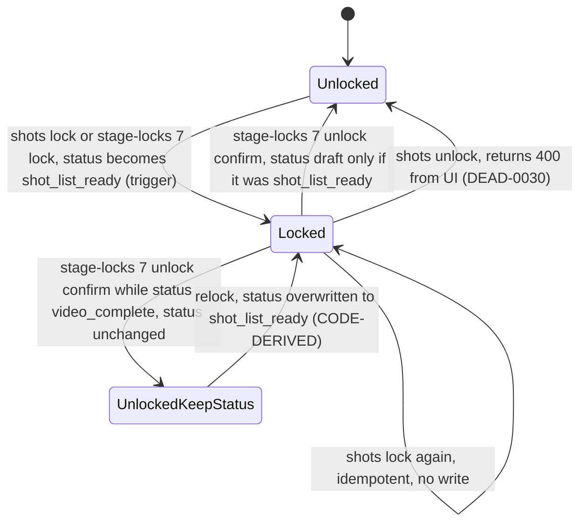

### 10.3 Notes on the diagrams

- Diagrams show code-level transitions. Where a transition is UNKNOWN or unreachable it is annotated.
- Stage 7 `outdated` is not drawn as reachable (section 2.4).
- `invalidated` for `stage_states` and `frames.status` is not drawn as reachable (sections 1.1 and 4.4, B1).

---

## Corrections made while synthesizing

1. K DEAD-0031 (CONTRADICTED, "Stage 7 is included when a stage 1-6 is unlocked") is not adopted as stated. The generic writer at `rt/sceneStageLocks.ts:245-249` exists, but the unlock route rejects stages below 7 (`sceneStageLocks.ts:152-153`) and downstream entries are always greater than the unlocked stage (`:187-193`). No reachable path writes `outdated` to stage 7; the stage 7 relock route is DEAD. V8 section 6 reaches the same conclusion. Section 2.4.
2. H section 6.3 cites `(008:22,64)` for `project_assets.visual_style_capsule_id` and `writing_style_capsule_id`. Migration 008:22 is the `global_assets` column and 008:64 is the `project_assets` column. The `projects` capsule columns (004:62-63) are NO ACTION, not SET NULL.
3. H section 8 row r5 c9 codes shot prompt text as C for frame select-generation. H's own note says the path writes the frame's `prompt_snapshot`, not the shot column. Recorded U* (section 7).
4. H section 8 row r4 c3 and c4 (scenes.shot_list_locked_at) codes c3 as U. The stage 7 unlock nulls the column, so c3 is recorded C* for stage 7.
5. H section 8 row r8 (project_assets) has 12 cells, not 13. The missing cell is recorded as U (section 7 footnote).
6. H section 8 row r13 (attempts) codes shot delete as D through "instance/shot where FK". Attempts have no shot FK (022:11 references instances). Recorded U for shot delete (section 7).
7. V4-INV-04 (WD-IMPL-INVALIDATE-0023) recorded dependent cascade as UNKNOWN. The migration grep resolves it: scene deletes CASCADE to shots (006:7), instances (015:15), jobs (007:13, 021:10), transformation events (030:17), suggestions (024:6), location match events (039:88). CASC-03.
8. H FACT-13 says six read sites (`frames.ts:262, 385, 449, 767, 845`). Five line numbers are listed, and R1a C01 counts five routes. Recorded as five.
9. H FACT-15 and INV-0103 arithmetic is re-derived from the code (section 4.6). Confirmed.
10. INV-0097 and STATE-0105 (labelled CONTRADICTED) describe blocking that is verified in this pass at projectAssets.ts:586, 702, 1017, 2084. The label is kept as recorded; the blocking behaviour is treated as present.
11. STATE-0036 had blank evidence in the ledger. Its blocking claim is verified here at the same four lines as item 10.
12. Added a derived behaviour not present in H or the ledger: a relock of a scene whose status is `video_complete` overwrites the status to `shot_list_ready` (trigger 014:31-50, relock sets `shot_list_locked_at` at sceneStageLocks.ts:351-352). CODE-DERIVED. Sections 2.3 and 10.2.
13. Added rules not in the INV ledger: R8 (global-library version drift, projectAssets.ts:431-508) and section 5.3 (CASC-01 to CASC-13).
14. Ledger label DUPLICATED-DERIVATION, DEAD-READ, DEAD-BRANCH, and STALE-RISK are not vocabulary terms. They are shown as recorded and mapped in the text (section 0.1).
15. Ledger corrections outside this document's topics are honoured by reference and do not change any state, lock, or invalidation fact here: CAP-0192 (R1b: only Stage 7 shot extraction writes `transformation_flags`), FACT-0075 (R1a-FACT-10: beat keys match; treatment keys do not), AI-0084 (R2: no isolation sentence is added to the transformation post-image prompt), FACT-0198 (I: missing `GOOGLE_AI_API_KEY` is a boot failure).
16. Label retained: STATE-0084 (save over outdated becomes draft) is labelled CONTRADICTED in the ledger. The code path at stageStates.ts:211-222 was re-read and is unconditional. The label is kept.

## Coverage and limits of this pass

- Read in full: `reports/H-state-invalidation.md` (all sections), `reports/R1a-verification.md` (verdict table and section headings), `reports/R1b-verification.md` (verdict table), `reports/R1-claims-to-verify.md`.
- Read through the merged ledger plus targeted greps and section reads: V1, V3, V5, V6, V7, V8, V9, V10 (STATE, INV, DEAD, FACT, TABLE, ROUTE, CAP entries and state-term lines of each report). I-infra-async: STATE-0109 to STATE-0120 only. K-dead-dup: DEAD and duplicate ledger entries plus K lines 60 and 383. C-database: migration grep (ON DELETE, REFERENCES, CHECK, RLS policies, ALTER TABLE frames) rather than report prose.
- Not read line by line in this pass: the prose of V1, V3, V5, V6, V7, V9, V10, I, J, K, L, E, R2, and the C report text. Facts from those reports are cited by ledger id, which carries its own evidence.
- Repo spot checks performed in this pass (19 claims): stage_states constraints (001:51-80); frames CHECK (019:12-19); video_generation_jobs CHECK and retry defaults (021:20-27, 57-58); Phase A save guard (stageStates.ts:211-222); Phase A dialog wiring (ProjectView.tsx:691-716, stageStateService.ts:189-191); lock trigger RAISE (044:11-26); scene unlock stage range and downstream loop (sceneStageLocks.ts:152-153, 187-193, 245-249); scene lock predecessor (sceneStageLocks.ts:92-105); shots/unlock writes and unchecked errors (projects.ts:3094-3131); shots/unlock stage loop (projects.ts:3145); trigger body (014:31-50); `videos` and `invalidation_logs` absence (migrations and quickies grep); project asset locked gates (projectAssets.ts:586, 702, 1017, 2084); Stage 4 approve order (Stage4MasterScript.tsx:606-626); video attempt arithmetic (VideoJobExecutor.ts:86-95, 146-171; videoGenerationService.ts:563-597); queued-only selection (VideoJobExecutor.ts:66); version-sync comparison (projectAssets.ts:490); invalidateStage9AndDownstream callers (grep); FK ON DELETE inventory (grep of all migrations).

## Runtime UNKNOWN items

- Whether load-time autosave demotes a live locked or outdated row (STATE-0021, STATE-0091).
- Whether `videos`, `invalidation_logs`, and `scenes.stage_locks` exist in the live database (B2, B3, B17).
- Whether a stage 4 approve race rewrites locked content (INV-0077).
- Whether a frame match target receives the pre-regeneration image in practice (INV-0089, B24).
- Whether an asset angle variant NO ACTION reference blocks shot deletion (CASC-08).
- Whether any Phase B route enforces Phase A completion on the server (section 2.5).
- Whether `project_assets.locked` can be cleared by any path not in the repo (none found).
- The `text_field_versions` partial unique index WHERE clause (STATE-0072).
- Whether the Streamline commit is reachable for a locked project (FACT-18, INV-0076).
- Whether `scenes.status` `outdated` or `frames_locked` exist in production rows written by earlier code (H section 12).
