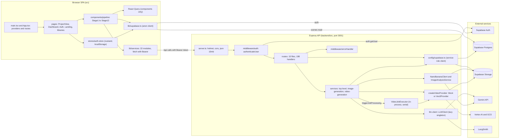

# 11. Application architecture (runtime as built at HEAD)

**Scope.** Static reconstruction of how the WizardDirector (Aiuteur) repository at HEAD runs: the browser SPA, the Express API, Supabase persistence, the provider layer, configuration, build and dev setup, module dependencies, and three representative request lifecycles. Nothing was executed (no server, database, provider call, migration, or Supabase CLI). Environment files were read by variable name only; no value was printed. Statements describe code as it is. Product behavior is in 01 and 02, async job state machines and retry detail in 12, the data model in 05, and versioning, locking, and invalidation rules in 10.

**Sources.** Ledger kinds FACT, PROV, ROUTE, STATE, PRESSURE, TABLE, AI, and DEAD from `merged2/merged.jsonl`, cited by WD-IMPL id. Reports: I-infra-async (primary), V1-shell, E-ai-calls, C-database (sections 1, 4, and 5 read), L-pressure (module sizes), V10-video-checkout, R1a-verification, R1b-verification, and R2-ai-canonical (call counts). Corrections made while synthesizing are listed in section 11.

**Reading notes.** Document map: 00-README.md. Sibling documents: 01-SYSTEM-OVERVIEW.md, 02-FUNCTIONAL-CAPABILITIES.md, 03-USER-WORKFLOWS.md, 06-WRITING-AND-STORY-IMPLEMENTATION.md, 08-SHOTS-FRAMES-AND-GENERATION.md, 12-ASYNC-RELIABILITY-AND-PROVIDERS.md, 17-IMPLEMENTATION-LEDGER.md. Other topics: 04 (domain and state), 05 (data model), 07 (assets and continuity), 09 (AI and prompts), 10 (versioning, locking, invalidation), 13 (tests), 14 (dead and duplicate code), 15 (pressure), 16 (coverage and unknowns).

**Conventions.**
- `[WD-IMPL-...]` is a final ledger id. The I report uses local ids (`H-FACT-04`, `H-ROUTE-06`); Appendix A maps all of them.
- Paths are repo-relative. `path:line` or `path:start-end`.
- Status words follow the corpus vocabulary. "Static" means read from source or from `node_modules` source.
- Ownership verdicts in section 3.8: Y = explicit check on the path project and every sub-resource is bound through the check chain; P = path project checked but sub-resource IDs in the path or body are not bound to it; N = no check on the affected route.

---

## 1. Topology at a glance

### 1.1 Processes and external systems

| Component | Where it runs | Status | Evidence |
|---|---|---|---|
| Browser SPA (React 18.3.1, Vite 5.4.19) | Static bundle from `vite build`. Dev server on port 8080, host `::` | REACHABLE. Production hosting and `/api` routing UNKNOWN (no config in repo) | `vite.config.ts:9-11`, [WD-IMPL-FACT-0224], [WD-IMPL-FACT-0238] |
| Express 4.22.1 API (Node, ESM) | `backend/src/server.ts`. Listens on `PORT`, default 3001, unless `NODE_ENV=test` | REACHABLE | `backend/src/server.ts:28`, `:95-99`; `backend/fly.toml` `internal_port = 3001` |
| Supabase Auth | Browser (supabase-js: sign-up, sign-in, session) and API (`auth.getUser` on every authenticated request) | REACHABLE | `src/lib/stores/auth-store.ts:28-124`; `backend/src/middleware/auth.ts:27`; [WD-IMPL-FACT-0225] |
| Supabase Postgres | API only, through PostgREST with the service-role key. One browser table read (`scenes`) | REACHABLE | `backend/src/config/supabase.ts:17-22`; `src/hooks/useSceneInfo.ts:25-29`; [WD-IMPL-FACT-0226] |
| Supabase Storage | API only. Four bucket names referenced (section 4.2) | PARTIAL (two buckets have no creator in repo) | [WD-IMPL-FACT-0236], [WD-IMPL-TABLE-0027] |
| Gemini API | Text through LangChain `ChatGoogleGenerativeAI`. Image and vision through `@google/generative-ai` | REACHABLE (code). Runtime UNKNOWN | [WD-IMPL-PROV-0024], [WD-IMPL-PROV-0025], [WD-IMPL-PROV-0026] |
| Vertex AI (Veo 3.1) and GCS | Only when `VIDEO_PROVIDER=veo3`. ADC auth | PARTIAL (env-gated, untested) | [WD-IMPL-PROV-0027] |
| LangSmith | Env-driven LangChain tracer only. Explicit callback path is dead | PARTIAL | [WD-IMPL-PROV-0030], [WD-IMPL-FACT-0353] |
| Fly.io | Hosts the API only. Config in repo | REACHABLE (config). Deployed state UNKNOWN | [WD-IMPL-FACT-0238] |

Searches over `src`, `backend/src`, and `backend/migrations` found no WebSocket, SSE, Supabase Realtime (`.channel`, `subscribe`, `postgres_changes`), Web Worker, service worker, inbound webhook, cron, or `pg_cron` (I section 1.1). The backend has no `process.on` handler, no `SIGTERM` handler, and no `unhandledRejection` handler (grep over `backend/src`, zero matches). All background work runs inside the API process (sections 9 and 12).

### 1.2 Component diagram

Section 8 holds the mermaid component diagram of frontend, backend, and external modules.

---

## 2. Frontend structure

### 2.1 Entry and provider stack

- Entry. `src/main.tsx` renders `<App />` into `#root` without `React.StrictMode`, and imports `index.css` and `styles/screenplay.css` (V1 section 1, `src/main.tsx:1-6`).
- Provider stack, outermost first (`src/App.tsx:74-106`): `ThemeProvider` (next-themes, `storageKey="aiuteur-theme"`, `App.tsx:75-80`) > `QueryClientProvider` with a module-level `new QueryClient()` using default options (`App.tsx:19`, `:82`; no global `onError`, no default `staleTime`) > `TooltipProvider` > `AuthInitializer` (`App.tsx:22-30`; calls the auth store `initialize()` once and renders nothing) > two toast systems, shadcn `Toaster` and `sonner` (`App.tsx:85-86`; imported by 30 and 17 files, [WD-IMPL-FACT-0014]) > `BrowserRouter` (`App.tsx:87`).
- No error boundary and no `componentDidCatch` exist. An uncaught render error unmounts the tree (I H-FACT-11, [WD-IMPL-FACT-0234]).

### 2.2 Routing

All routes are client-side. Guards are client-side only; the API enforces its own checks (section 3.8). Source: V1 section 1 and `src/App.tsx`.

| Path | Element | Guard | Notes |
|---|---|---|---|
| `/` | `LandingOrDashboard`: spinner until initialized, then Navigate to `/dashboard` if signed in, else `Landing` | none | |
| `/landing` | `Landing` (always) | none | Static marketing page; all CTAs go to `/auth` |
| `/auth` | `Auth`: Navigate to `/dashboard` when signed in, else `AuthForm` | none | Email and password only |
| `/dashboard` | `MainLayout` > `Dashboard` | `ProtectedRoute` | Project list and creation |
| `/projects/:projectId` | `MainLayout` > `ProjectView` | `ProtectedRoute` | Stage host (section 2.3 and doc 04) |
| `/style-capsules` | `StyleCapsuleLibrary` in `MainLayout` | `ProtectedRoute` | |
| `/assets` | `AssetLibrary` in `MainLayout` | `ProtectedRoute` | |
| `*` | `NotFound` | none | |

Facts about routing (V1 section 1):
- `ProjectView` reads `?stage=1..12` and `?sceneId=<uuid>` (`ProjectView.tsx:141-148`, `:239-240`, `:393-394`).
- `ProtectedRoute` passes `state={{from: location}}`, and nothing reads it. After sign-in the user always lands on `/dashboard` ([WD-IMPL-FACT-0009]).
- `/projects/new` is not linked anywhere but matches `/projects/:projectId` and has special handling (V1 section 4.2, [WD-IMPL-FACT-0008]).
- `src/pages/Index.tsx` is not imported anywhere (ORPHANED, [WD-IMPL-FACT-0011]).

### 2.3 State

**Zustand auth store (the only store).** `src/lib/stores/auth-store.ts` (`create` with `persist`).
- State: `user`, `session`, `loading` (initially true), `initialized` (initially false). Actions: `signUp`, `signIn`, `signOut`, `initialize`, `setUser`, `setSession`.
- Persisted under localStorage key `auth-storage`. `partialize` keeps `user` and `session`, which include the access and refresh tokens (`auth-store.ts:130-135`, per I and V1).
- `initialize()` returns early only if `initialized` is already true. The flag is set after `await getSession()`, so concurrent first renders (`AuthInitializer`, `ProtectedRoute`, `Auth`) can each register an `onAuthStateChange` listener. The listener is never unsubscribed (`auth-store.ts:84-124`, `:109`; [WD-IMPL-FACT-0015]; [WD-IMPL-STATE-0120]). Race described from code structure; not reproduced.
- Services do not read `session` from the store. Each call reads the session from supabase-js (section 2.5).

**React Query: actual usage (non-test `src`).**
- `useQuery(` appears 29 times in 12 component files. `useMutation(` 35 times. `invalidateQueries` 85 times. `setQueryData` 4 times. `useQueryClient` 32 times. `refetchInterval` 2 times.
- The query layer is absent from `pages/`, `lib/hooks/`, `hooks/`, `components/auth/`, `components/dashboard/`, and `components/layout/`. `Dashboard` and `ProjectView` load with `useEffect` plus service calls (`Dashboard.tsx:32-49`, `ProjectView.tsx:178-200`, V1 sections 4.3 and 5).
- Query keys are free-form arrays (for example `['frames', ...]`, `['scene-assets', ...]`, `['video-jobs', ...]`). No central key factory exists (grep).
- Polling through React Query: Stage 12 `refetchInterval` every 3 s while any job is queued, processing, generating, or uploading (`Stage12VideoGeneration.tsx:59-68`); Stage 10 every 2 s while any frame is `generating` (`Stage10FrameGeneration.tsx:252-259`). Neither has a ceiling (I section 3.1).
- Polling through timers: `setInterval` in four files (`AssetDialog.tsx`, `AssetVersionSync.tsx`, `AngleVariantsDialog.tsx`, `Stage6ScriptHub.tsx` 10 s). Sleep loops in services and dialogs. Full cadence table in doc 12 and I section 3.1.

**Local component state.**
- `ProjectView` is the stage host. Its state: `currentStage` (1-12), `stages` (array of 5 Phase A entries, initialized stage 1 active and 2-5 pending, `ProjectView.tsx:29-35`), `activeSceneId`, `sceneStage` (7-12), `completedSceneStages`, `sceneStageLocks`, Phase A unlock dialog state, and refs `hasRestoredStage`, `isHydrated`, `isUnskipping`, `isBackfilling` (V1 section 5.1).
- Stage components hold most state inline. Stage 7 (`Stage7ShotList.tsx`, 1769 LOC, 31 `useState`), Stage 5 (`Stage5Assets.tsx`, 1749 LOC, 33 `useState`), Stage 10 (`Stage10FrameGeneration.tsx`, 1754 LOC, 16 `useState` and 24 `useQuery`/`useMutation`), Stage 8 (`Stage8VisualDefinition.tsx`, 939 LOC, 23 `useState`) (L section 1.3).
- Hooks: `src/lib/hooks/` (`useStageState`, `useSceneStageLock`, `useShotAssetAutoPopulate`, `useDebounce`) and `src/hooks/` (`useSceneInfo`, the one direct table read; `use-toast`; `use-mobile`).

**URL and localStorage state.**

| Key or param | Written by | Read by | Content | Evidence |
|---|---|---|---|---|
| `auth-storage` (localStorage) | auth store `persist` | zustand rehydrate on load | `user` and `session`, tokens included | `auth-store.ts:130-135` |
| `aiuteur-theme` (localStorage) | next-themes | next-themes | theme | `App.tsx:79` |
| `landing-theme` (localStorage) | `Landing.tsx:107` | `Landing.tsx:98` | theme | V1 section 8 |
| `project_<id>_stage` | `ProjectView` `persistStage` | restore effect | stage number | `ProjectView.tsx:115-149` |
| `project_<id>_sceneId` | when stage is 7 or higher and a scene is active | restore; Stage 8 fallback | scene UUID | `ProjectView.tsx:118-138`, `:418` |
| `project_<id>_reachedPhaseB` | once `currentStage > 5` | Script Hub button gating | `'true'` | `ProjectView.tsx:203-221` |
| `tag-prompt-<sceneId>` | Stage 8 | Stage 8 | `'true'` flag | `Stage8VisualDefinition.tsx:376`, `:403`, `:867` |
| `skipContinuityBreakConfirm` | `FramePanel.tsx:967` | `FramePanel.tsx:424` | `'true'` flag | `FramePanel.tsx:424`, `:967` |
| `?stage=` and `?sceneId=` (URL) | `persistStage` with `replace: true` | restore effect | stage and scene | `ProjectView.tsx:141-148` |

None of the project keys are cleared on sign-out or project delete (V1 sections 2 and 5.2). supabase-js also persists its own session (`persistSession: true`, `src/lib/supabase.ts:11-17`). The storage key used by supabase-js is a library default and was not inspected.

### 2.4 Service layer pattern

- 22 service modules live in `src/lib/services/` (excluding `__tests__`). Each is a class exported as a module-level instance, for example `export const checkoutService = new CheckoutService()` (`checkoutService.ts:254`), `stageStateService.ts:306`, `projectAssetService.ts:1290`. 21 of the 22 call `fetch` directly. No shared request helper exists (grep for `apiClient`, `API_BASE`, `baseUrl` returned nothing).
- URLs are relative `/api/...` (no absolute origin, no `VITE_API_URL`; 204 `fetch(` sites in non-test `src`, [WD-IMPL-FACT-0224]). Errors: each method checks `response.ok` and throws `new Error(error.error || ...)` (`checkoutService.ts:40-42`, `frameService.ts:579-581`). If the body is an `errorHandler` object (`{error:{message}}`), the message is an object-derived string ([WD-IMPL-FACT-0233]).
- No retry on 401, no token refresh call (supabase-js `autoRefreshToken: true` runs in the background), no `AbortController` except `StreamlineDropZone.tsx` (I section 4, [WD-IMPL-FACT-0243]).
- Response envelopes differ by route. Example: `stageStateService.unlockStage` returns the raw 409 body (`stageStateService.ts:188-191`), while `sceneStageLockService` unwraps `details` (`sceneStageLockService.ts:103-108`) (V1 sections 5.5 and 7). Contract detail in doc 10.

### 2.5 How every service obtains tokens

| Mechanism | Count (non-test `src`) | Evidence |
|---|---|---|
| Inline `supabase.auth.getSession()` before each fetch, then `Authorization: Bearer <access_token>` | 141 `getSession(` call sites | `checkoutService.ts:18-27`; `stageStateService.ts:147-158` |
| Private `getAuthHeaders()` helper in a service class | 5 definitions | `checkoutService.ts:4-13` |
| Components that call `fetch` directly, reading the session inline | Stage 4 (`Stage4MasterScript.tsx:256-262`, `:550-556`, `:568-573`) | |
| Fetch sites with no `Authorization` string or `headers` object within 8 lines (awk window scan) | 0 of 204 | Static window scan, not a data-flow proof |
| Token source used by services | supabase-js session (`getSession`). The zustand `session` copy is not read by any service (V1 section 2) | |
| 401 or 403 handling | none in `src` (grep for `401`, `403`, `SIGNED_OUT`, `TOKEN_REFRESHED`) | [WD-IMPL-FACT-0243] |

Services that throw before sending when no session exists: `throw new Error('User not authenticated')` (`checkoutService.ts:6-8`, `stageStateService.ts:149-151`).

### 2.6 Direct browser calls to Supabase

| Call | Site | Notes |
|---|---|---|
| `auth.getSession()` | 141 services and components | Bearer source (section 2.5) |
| `auth.signUp`, `auth.signInWithPassword`, `auth.signOut` | `src/lib/stores/auth-store.ts:30`, `:53`, `:76` | Email and password only. No OAuth, no reset, no magic link (V1 section 2, [WD-IMPL-PROV-0031]) |
| `auth.onAuthStateChange` | `auth-store.ts:109` | Never unsubscribed |
| `from('scenes').select('scene_number, slug').eq('id', ...).single()` | `src/hooks/useSceneInfo.ts:25-29` | The only browser table read. RLS-dependent. Used by Stages 7, 9, 10, 11, 12 ([WD-IMPL-FACT-0225]) |
| `from('projects').select('active_branch_id')` | `src/lib/services/imageService.ts:146-155` | Module has no importers (ORPHANED, [WD-IMPL-DEAD-0045]) |

No browser `storage`, `rpc`, realtime, or `functions` calls exist (grep).

### 2.7 Frontend size and layout

- 8 page modules in `src/pages/`. `src/components/pipeline/` holds 89 files (Stage 1 to 12, dialogs, carousels). Non-test `src` is 53,362 LOC; tests under `src` are 4,879 LOC (L section 1.1, recounted).

---

## 3. Backend structure

### 3.1 Middleware order (`backend/src/server.ts`)

| Order | Lines | Element | Effect |
|---|---|---|---|
| 1 | 31 | `helmet()` (7.2.0) | Default security headers |
| 2 | 34-39 | `cors({ origin, credentials: true })` | Production origin is the placeholder `https://your-frontend-domain.com`. Otherwise `http://localhost:5173` and `http://localhost:3000` ([WD-IMPL-FACT-0230]) |
| 3 | 42-43 | `express.json({limit:'10mb'})`, `express.urlencoded({limit:'10mb'})` | Body limit |
| 4 | 46 | `/api/health` | No auth ([WD-IMPL-ROUTE-0142]) |
| 5 | 49-72 | Nine routers under `/api/projects`, each `app.use('/api/projects', authenticateUser, router)` | Section 3.2 |
| 6 | 75-87 | `/api/llm`, `/api/seed`, `/api/style-capsules`, `/api/images`, `/api/assets`, each with `authenticateUser` | |
| 7 | 90 | `errorHandler` (4-argument) | Reached only through `next(err)` ([WD-IMPL-FACT-0232]) |
| 8 | 95-99 | `app.listen(PORT)` unless `NODE_ENV === 'test'` | |

Absent (grep, I section 1.2 and H-FACT-08): no 404 JSON handler (unknown `/api/*` paths get Express's default HTML 404), no HTTP rate limiter, no compression, no request logger, no CSRF token (auth is a Bearer header, not a cookie). The only `429` responses are upstream provider error mappings (`routes/projects.ts:1971`, `:3952`), not inbound throttling.

### 3.2 Router mounting and repeated authentication

Every `/api/projects` router carries its own `authenticateUser` instance. Express runs each matching layer's middleware before moving to the next, so a request handled by mount N passes N `auth.getUser` calls (derived from mount order; not measured, I section 2.2, [WD-IMPL-ROUTE-0134]).

| Mount | Router file | Handlers | `authenticateUser` calls for requests handled here |
|---|---|---|---|
| 1 | `projects.ts` | 29 | 1 |
| 2 | `projectAssets.ts` | 37 | 2 |
| 3 | `sceneAssets.ts` | 36 | 3 |
| 4 | `shotAssignments.ts` | 8 | 4 |
| 5 | `frames.ts` | 27 | 5 |
| 6 | `checkout.ts` | 8 | 6 |
| 7 | `stageStates.ts` | 6 | 7 |
| 8 | `streamline.ts` | 7 | 8 |
| 9 | `sceneStageLocks.ts` | 4 | 9 |
| separate | `llm.ts` 13, `seed.ts` 1, `styleCapsules.ts` 11, `images.ts` 3, `assets.ts` 7 | | 1 each |

Routes take identity only from `req.user.id`. No handler reads `body.user_id`, `body.userId`, or an identity header (I section 2.1).

### 3.3 Route families: handler counts and LOC

Handler counts are router registrations (`router.get|post|put|patch|delete|use|all`). Total 198 across 15 files. LOC is `wc -l`. Total routes LOC is 16,539 (recounted).

| File | Handlers | LOC | Responsibilities (L section 1.2 and V10 section 2) |
|---|---|---|---|
| `projects.ts` | 29 | 4006 | Project CRUD; continuity mode and metrics; scenes list, defer, restore, save-script; shot CRUD, reorder, split, merge; shot-list lock and unlock with frame and video invalidation; Stage 9 prompt generation; project delete (`:3961`) |
| `projectAssets.ts` | 37 | 3451 | Asset extraction preview and confirm; asset CRUD and merge or split; image generate, upload, analyze, edit; lock, lock-all, clear; global-asset clone, sync, promote; attempts; angle variants; location views |
| `sceneAssets.ts` | 36 | 2332 | Scene asset instances; suggestions; generate, edit, analyze; attempts; use-master-as-is; reference chain; upload; transformation events (8 routes, `:1813-1960`); infer-context |
| `frames.ts` | 27 | 2410 | Frame generate, approve, reject, regenerate, inpaint; end-frame prompt; regenerate with correction; continuity prompt; chain and upload; generations and selection; field versions |
| `llm.ts` | 13 | 777 | `/generate`, `/generate-from-template`, `/estimate-cost`, `/usage-stats`, `/test-connectivity`, template CRUD, activate, interpolate |
| `styleCapsules.ts` | 11 | 585 | Writing and visual style capsules and libraries; reference images |
| `stageStates.ts` | 6 | 675 | Phase A stage states: save, lock, skip, unlock, unlock confirm (V1 section 6) |
| `assets.ts` | 7 | 461 | Global assets (`global_assets`) and their images |
| `streamline.ts` | 7 | 432 | Streamline extract-file, classify-image, format-file, analyze, reconcile, commit, backfill (E section 12) |
| `checkout.ts` | 8 | 326 | Stage 11 and 12: cost breakdown, credit balance, confirm-render, video-job list and read, render status, batch render status, retry (V10 section 2) |
| `shotAssignments.ts` | 8 | 291 | Shot-to-asset assignments |
| `sceneStageLocks.ts` | 4 | 377 | Phase B scene-stage locks: GET, lock, unlock, relock |
| `images.ts` | 3 | 187 | `POST /generate`, `GET /jobs/:jobId`, `GET /debug-style-capsule/:capsuleId` |
| `seed.ts` | 1 | 214 | `POST /prompt-templates` (inserts seeded templates) |
| `health.ts` | 1 | 15 | Static JSON, no dependency checks |

`llm.ts`, `health.ts`, and `seed.ts` contain no table-literal calls in the route file. Seed inserts into `prompt_templates` go through `services/prompt-template.ts` (L section 2.1, `routes/seed.ts:15-19`).

### 3.4 How routes access the database

- Routes call `supabase.from(...)` inline. There is no repository or data-access layer. L counts 561 table-literal calls in 12 route files and 237 in 22 services. A raw grep counts 586 `.from(` occurrences in route files and 267 in services, which include non-table calls. 158 inline `from('projects')` project lookups appear in route files (L, inline project lookups; PRESSURE-01).
- Each handler repeats the `.eq('id', projectId).eq('user_id', userId)` project lookup with an inline `Project not found` response (about 150 such responses, L PRESSURE-01).
- Services mostly import `supabase` directly. Two services construct `DatabaseService`: `contextManager.ts:94` and `prompt-template.ts:56`. `DatabaseService` (`config/database.ts`) has `testConnection` and `runMigration` as static methods, and three instance trace-id methods with no callers (V1 section 3, [WD-IMPL-DEAD-0001], [WD-IMPL-DEAD-0083]).
- The raw Supabase row shape is mapped by hand. There is one transformer module: `backend/src/transformers/styleCapsule.ts` (57 LOC, four functions typed `any`, sole consumer `routes/styleCapsules.ts`). Case conversion is written inline at about 385 `camelKey: x.snake_prop` and 138 `snake_key: x.camelProp` backend lines (L section 6, PRESSURE-13).

### 3.5 Service layer

| Group | Files | LOC | Notes |
|---|---|---|---|
| `services/` top level | 37 `.ts` | 13,769 | Largest: `frameGenerationService.ts` 1600, `promptGenerationService.ts` 1521, `continuityCompositionService.ts` 703, `assetExtractionService.ts` 683, `videoGenerationService.ts` 675, `contextManager.ts` 666 (L section 1.1) |
| `services/image-generation/` | 3 | 1402 | `ImageGenerationService.ts` (958), `NanoBananaClient.ts`, `ImageProviderInterface.ts` |
| `services/video-generation/` | 5 | 705 | `VideoJobExecutor.ts`, `Veo3Provider.ts`, `MockVideoProvider.ts`, `createVideoProvider.ts`, `VideoProviderInterface.ts` |
| `utils/` | 5 | 839 | `llmJson.ts` (JSON repair), `token-utils.ts` (in-memory usage and cost), `scriptManifest.ts`, `scriptConfidence.ts`, `resolveConflict.ts` |

Also: `config/` (3 files: `supabase.ts`, `database.ts`, `streamlineConfig.ts`), `middleware/` (2 files), `transformers/` (1 file, 57 LOC, `styleCapsule.ts`).

Backend production LOC is 33,639 (recounted, matches L section 1.1). Backend test LOC is 9,422 (L).

**Module-scope instances (constructed at import time).** These are the only process-start constructions. Each is listed because the boot sequence in section 3.6 depends on them.

| Location | Construction | Constructor effect |
|---|---|---|
| `routes/assets.ts:8` | `const imageService = new ImageGenerationService()` | Builds `NanoBananaClient` (key required) |
| `routes/images.ts:6` | `const imageService = new ImageGenerationService()` | Builds `NanoBananaClient` (key required) |
| `routes/projectAssets.ts:19-21` | `AssetExtractionService`, `ImageGenerationService` (`:20`), `ProjectAssetAttemptsService` | `:20` builds `NanoBananaClient` (key required). Others have no constructor effects |
| `services/frameGenerationService.ts:131` | constructor: `this.imageService = new ImageGenerationService()` | Builds `NanoBananaClient` |
| `services/frameGenerationService.ts:1600` | `export const frameGenerationService = new FrameGenerationService()` | Reached through `routes/frames.ts:5` import |
| `services/image-generation/ImageGenerationService.ts:68-70` | constructor: `this.provider = new NanoBananaClient()` | Throws without `GOOGLE_AI_API_KEY` |
| `services/image-generation/NanoBananaClient.ts:20-27` | constructor | Throws `GOOGLE_AI_API_KEY not configured` when unset or `'placeholder'` |
| `services/prompt-template.ts:422` | `promptTemplateService` | Constructs `DatabaseService` (`:56`) |
| `services/continuityCompositionService.ts:703`, `locationResolverService.ts:509`, `sceneDependencyExtraction.ts:222`, `transformationEventService.ts:561`, `videoGenerationService.ts:675` | exported instances | No key-dependent constructors |

Lazy singletons:
- `llmClient.instance` (`services/llm-client.ts:361-368`) constructs `LLMClient` on first use. The constructor calls `validateEnvironment()` (`:69-71`, `:89-99`), which requires `GOOGLE_AI_API_KEY` and `LANGSMITH_API_KEY`. The failure is therefore on the first text call, not at boot. This refines E-FACT-19.
- `VideoJobExecutor` is instantiated at module scope (`video-generation/VideoJobExecutor.ts:176`) but the module is loaded only by dynamic import inside `videoGenerationService.triggerJobProcessing` (V10 sections 3.5 and 5.2). Its constructor calls `createVideoProvider()` (`VideoJobExecutor.ts:19-21`).

### 3.6 Boot sequence and module-scope side effects

The order below is static. It was not executed (I H-FACT-19, U for the working-directory detail).

1. Node evaluates the imports of `server.ts` in source order (`server.ts:1-22`) before the body. Those imports include `routes/images.ts` (line 13), `routes/assets.ts` (line 14), `routes/projectAssets.ts` (line 15), and `routes/frames.ts` (line 18), plus every other route module.
2. Any module that imports `config/supabase.ts` runs its body. If `SUPABASE_URL` is unset, `dotenv.config()` loads `.env` from the process working directory (`config/supabase.ts:4-7`). If `SUPABASE_URL` or `SUPABASE_SERVICE_ROLE_KEY` is still missing, the module throws `Missing Supabase environment variables` (`:9-14`) ([WD-IMPL-FACT-0242]).
3. Module-scope constructions run as their files evaluate. `routes/images.ts:6`, `routes/assets.ts:8`, and `routes/projectAssets.ts:20` each construct `ImageGenerationService`. `routes/frames.ts` reaches `frameGenerationService.ts:1600`, whose constructor builds `ImageGenerationService` (`:131`). Each `ImageGenerationService` constructor builds `NanoBananaClient` (`ImageGenerationService.ts:68-70`), which throws if `GOOGLE_AI_API_KEY` is unset or `'placeholder'` (`NanoBananaClient.ts:20-27`).
4. Only after all imports succeed does `server.ts:25` call `dotenv.config()`. Then `express()`, middleware, mounts, and `app.listen` run (`server.ts:27-99`).

Consequences, static:
- A missing or placeholder `GOOGLE_AI_API_KEY` is a process boot failure. It is not a per-route 500. This corrects E-FACT-19 (`WD-IMPL-FACT-0198`, marked CONTRADICTED by I). The I report's ledger entry is [WD-IMPL-FACT-0227].
- `dotenv.config()` at `server.ts:25` runs after the imports. Whether `backend/.env` loads therefore depends on the working directory. From `backend/`, the `supabase.ts` fallback loads it. From the repo root it does not, unless the variables are already in the process environment ([WD-IMPL-FACT-0242], U: not run).
- Whether the deployed API boots depends on the deployed environment, which is not in the repo (UNKNOWN; section 10).

### 3.7 Authentication middleware

`authenticateUser` (`backend/src/middleware/auth.ts:16-44`), verified static:
- Missing or non-Bearer header: `401 {error:'Authorization header missing or invalid'}` (`:20-22`). Otherwise `supabase.auth.getUser(token)` with the service-role client (`:27`), a network call per request. The JWT is not verified locally and no role or claim is read. Error or no user: `401 {error:'Invalid or expired token'}` (`:29-31`). Success: `req.user = {id, email}` and `next()` (`:34-39`). Exception: `500` (`:40-43`).

Identity is `req.user.id` everywhere ([WD-IMPL-ROUTE-0006], [WD-IMPL-ROUTE-0134]).

### 3.8 Ownership-check coverage by route family

Method: static scan of all 198 registrations. Counts of `eq('user_id'` per file: `projectAssets.ts` 40, `projects.ts` 30, `sceneAssets.ts` 29, `frames.ts` 27, `stageStates.ts` 6, `streamline.ts` 7, `checkout.ts` 8, `sceneStageLocks.ts` 4, `images.ts` 3, `assets.ts` 11, `shotAssignments.ts` 1, `styleCapsules.ts` 1, `llm.ts` 0, `seed.ts` 0. Handler bodies were read for flagged families (I section 2.3, verified for the rows below).

| Family (file) | Handlers | Path project check | Sub-resource binding | Verdict | Evidence |
|---|---|---|---|---|---|
| projects (`projects.ts`) | 29 | `projects` lookup with `user_id` on project routes | Scene and shot routes rely on project scoping. Not exhaustively verified | Project Y. Sub-resource P | [WD-IMPL-ROUTE-0001] |
| projectAssets (`projectAssets.ts`) | 37 | Lookup with `user_id` (`generate-image` at `:1210-1230`) | Not exhaustively verified | Project Y. Sub-resource P | [WD-IMPL-ROUTE-0135] |
| sceneAssets, non-transformation | 28 | Lookup on each route | Per route | Y | |
| sceneAssets, transformation events (`:1813-1960`) | 8 | None on 7: GET `:1813`, POST `:1828`, PUT `:1852`, confirm `:1871`, DELETE `:1886`, generate-post-description `:1901`, generate-prefill `:1916`. `generate-post-image` (`:1944`) checks (`:1946-1954`) | Handlers pass only `sceneId` or `eventId` to the service | N (7 routes) | [WD-IMPL-ROUTE-0136] |
| frames (`frames.ts`) | 27 | Lookup on each route (pattern `:71-83`) | Scene and shot scoping not exhaustively verified | Project Y. Sub-resource P | [WD-IMPL-ROUTE-0135] |
| checkout (`checkout.ts`) | 8 | Lookup on all 8 | R1 cost-breakdown and R3 confirm-render bind scene to active branch (`:148-165` pattern). R5 `GET .../video-jobs/:jobId` (`:208-237`) and R8 retry (`:301-324`) do not bind the job. R6 render-status (`:243-266`) does not bind the scene | P | [WD-IMPL-ROUTE-0137] |
| shotAssignments (`shotAssignments.ts`) | 8 | `verifyProjectOwnership` (`:36-72`): project, then scene, then `branches.project_id` | Full chain | Y | |
| stageStates (`stageStates.ts`) | 6 | Lookup with `user_id` (`:19-24` in lock route) | Stage rows by active branch | Y | [WD-IMPL-ROUTE-0003] |
| streamline (`streamline.ts`) | 7 | Lookup on each route | Project-scoped | Y | |
| sceneStageLocks (`sceneStageLocks.ts`) | 4 | Lookup with scene in active branch (`:24-41` pattern) | Scene scoping | Y (P noted) | [WD-IMPL-ROUTE-0004] |
| images (`images.ts`) | 3 | `POST /generate` (`:9-36`): project only. `GET /jobs/:jobId` (`:71-115`): project or global-asset owner, 400 if neither | `POST /generate` passes body `assetId`, `shotId`, `sceneId`, `branchId` unbound | P (generate N for body IDs) | [WD-IMPL-ROUTE-0138], [WD-IMPL-ROUTE-0141] |
| assets (`assets.ts`) | 7 | `global_assets` filtered by `user_id` | By id | Y | |
| styleCapsules (`styleCapsules.ts`) | 11 | Reads `.or('user_id.eq.X,is_preset.eq.true')` (`:62-75`, `:265-273`). Writes compare `user_id` (`:182`, `:240`) | n/a | Y | |
| llm (`llm.ts`) | 13 | None on `/estimate-cost`, `/usage-stats`, `/test-connectivity`, and template CRUD. `/generate-from-template` context loads through `contextManager.assembleGlobalContext`, whose `fetchProject` filters `user_id` (`contextManager.ts:449-458`); a failure falls back to empty style context (`llm.ts:194-236`) | n/a | N (utility and template CRUD) | [WD-IMPL-ROUTE-0139] |
| seed (`seed.ts`) | 1 | None beyond authentication | n/a | N | [WD-IMPL-ROUTE-0140] |
| health (`health.ts`) | 1 | None, by design | n/a | n/a | [WD-IMPL-ROUTE-0142] |

Cross-tenant consequences (code reading, not runtime-tested; I section 2.5): a caller who owns one project can read or re-queue another user's video job (`checkout.ts:208-237`, `:301-324`); any authenticated user can read or edit transformation events for a scene UUID; a body `assetId` or `shotId` from another user is accepted by `POST /api/images/generate` (`images.ts:9-68`); and seeded prompt templates (`created_by IS NULL`) can be edited or deleted by any user (ids in the table above and [WD-IMPL-FACT-0354]).

V1 INVALIDATE-0011 said every slice route checks project ownership. That claim is CONTRADICTED by the transformation-events family (I section 8, [WD-IMPL-INVALIDATE-0011]).

### 3.9 Error handling pipeline

| Layer | Pattern | Count or evidence |
|---|---|---|
| Route handlers | Inline `try/catch` returning `res.status(500).json({error})` | 327 `res.status(500)` sites in `routes/` (grep). 88 response lines interpolate `error.message` |
| Global handler | `errorHandler` returns `{error:{message, code, stack in NODE_ENV development}}` (`middleware/errorHandler.ts:8-29`) | Reached only through `next(err)`: body-parser errors (malformed JSON, oversize body) and synchronous throws ([WD-IMPL-FACT-0232]) |
| Express 4 async | Async rejections are not forwarded to `errorHandler` | 197 of 198 handlers contain their own `try`. The exception is the synchronous health route (I H-FACT-09) |
| Background jobs | `.catch` on fire-and-forget promises. Job row written to `failed` | `ImageGenerationService.ts:178-181`; VideoJobExecutor loop catch `VideoJobExecutor.ts:51-53` |
| Backend silent catches | 290 `catch` blocks in non-test backend: 7 comment-only (`routes/frames.ts:573`, `:2220`; `services/frameGenerationService.ts:786`; `services/promptGenerationService.ts:1493`; `utils/llmJson.ts:44`, `:80`, `:100`), 222 console-only (re-scan, section 11), 61 other | [WD-IMPL-FACT-0235] |
| Frontend catches | 202 `catch` blocks in non-test `src`: 19 comment-only, 102 console-only, 81 other | Re-scan agrees with L section 9 |
| Logging | `console.log` and `console.error` only. No logger dependency. No request logging. Timestamps only in `errorHandler` | [WD-IMPL-FACT-0237] |
| Error envelope | Routes and auth return `{error: string}`. `errorHandler` returns `{error:{message}}`. `/generate-from-template` returns `{success, error, details}` | [WD-IMPL-FACT-0233] |

### 3.10 Request limits and uploads

- JSON and urlencoded bodies are limited to 10 MB globally (`server.ts:42-43`).
- Seven `multer` configurations, all `memoryStorage` (never disk). Caps: 5 MB in `frames.ts:17-20`, `sceneAssets.ts:23-26`, `styleCapsules.ts:11-14`; 10 MB in `projectAssets.ts:25-28`, `assets.ts:12-15`, `streamline.ts:24-26`; 20 MB for streamline documents (`streamline.ts:17-19`) (I H-FACT-08, recounted). Six files define a `fileFilter` (`sceneAssets.ts:28`, `streamline.ts:27`, `assets.ts:17`, `styleCapsules.ts:16`, `frames.ts:22`, `projectAssets.ts:30`). The MIME types each filter allows were not reviewed route by route.

### 3.11 Service role and RLS

- One Supabase client serves the whole backend: `backend/src/config/supabase.ts:17-22`, built with `SUPABASE_SERVICE_ROLE_KEY`, `autoRefreshToken: false`, `persistSession: false`. No user-scoped client exists in `backend/src` or `backend/scripts` (grep). All PostgREST, storage, and `auth.getUser` calls use it ([WD-IMPL-FACT-0226], [WD-IMPL-FACT-0002]).
- RLS policies in the migrations (for example `prompt_templates`, `video_generation_jobs`, `user_credits`, `stage_states`) therefore do not apply to any API request (C section 5.1, [WD-IMPL-FACT-0171]).
- The per-route ownership checks in section 3.8 are the only tenant boundary on the API ([WD-IMPL-FACT-0226]). The browser depends on RLS for one read (`scenes`) and for auth ([WD-IMPL-FACT-0225]).
- `SUPABASE_ANON_KEY` is read into `supabaseConfig.anonKey` (`config/supabase.ts:25-28`) with a comment saying it is exported for client-side use. Nothing imports `supabaseConfig` ([WD-IMPL-FACT-0244], CONTRADICTED comment).

---

## 4. Persistence

### 4.1 Database access and schema provenance

- One database: Supabase Postgres, reached by the API through PostgREST and one RPC, always with the service-role key (section 3.11).
- 29 distinct table names appear in `.from('...')` literals in non-test backend code. 27 have DDL in `backend/migrations`. Two have none in the repo: `videos` (`routes/projects.ts:3078`, `:3115`; `routes/sceneStageLocks.ts:215`) and `invalidation_logs` ([WD-IMPL-FACT-0151], [WD-IMPL-TABLE-0028]). The `videos` name also appears as a storage bucket (`Veo3Provider.ts:338`, `:354`), which is a different object.
- 46 migration files. 44 distinct numeric prefixes: `022_add_aspect_ratio.sql` and `022_scene_asset_generation_attempts.sql` share a prefix, as do `024_extra_archetype_and_style_outdated.sql` and `024_scene_asset_suggestions.sql` ([WD-IMPL-FACT-0165], C section 1.4). The migrations create 28 tables (C section 5.2, grep of `CREATE TABLE`).
- RLS is enabled on all 28 migration-created tables (C section 5.2). Open policies: `text_field_versions` has one `FOR ALL USING (true) WITH CHECK (true)` policy with no `TO` clause, so it applies to `anon` ([WD-IMPL-FACT-0146], [WD-IMPL-FACT-0359]). `prompt_templates` rows are readable by any role when `is_active = TRUE`. Preset style capsules are readable by any role (C section 5.3). These policies govern direct PostgREST access only. The API bypasses them (section 3.11).
- Migration runner. `backend/scripts/run-migrations.ts:18-21` sorts filenames lexically. `DatabaseService.runMigration` (`backend/src/config/database.ts:32-64`) splits each file on `;` and calls `supabase.rpc('exec', {query})` (`:48`). No migration in the repo defines `exec` (grep). The naive split also breaks `$$` bodies (C section 1.3). The migrations are therefore applied by a process outside the repo. That process is UNKNOWN ([WD-IMPL-FACT-0150], [WD-IMPL-FACT-0239]).
- Schema drift with code, both documented in the repo: `scenes.stage_locks` exists only in `backend/quickies-sql/add_stage_locks.sql` ([WD-IMPL-FACT-0143], [WD-IMPL-FACT-0012]). `shots.end_frame_reference_image_order` was read and written before any migration created it (C section 1.5, [WD-IMPL-FACT-0167]).
- RPCs. `streamline_commit_atomic` is the only RPC defined in the repo (`backend/migrations/044_streamline_atomic_intake_fix.sql:38`) and the only one the API calls (`routes/streamline.ts:77`) (I section 1.4).
- Trigger guards that affect every writer of the table. `enforce_streamline_stage_lock_prerequisite` runs BEFORE INSERT on `stage_states` for locked rows (`backend/migrations/044_streamline_atomic_intake_fix.sql:4-36`) and can reject backfill and PUT inserts ([WD-IMPL-FACT-0153]). `trg_sync_scene_lock_status` on `scenes` copies shot-list lock transitions into `scenes.status` and raises nothing ([WD-IMPL-FACT-0177]).

### 4.2 Storage buckets

| Bucket | Creator in repo | Writers (examples) | Public | Status |
|---|---|---|---|---|
| `asset-images` | `backend/scripts/setup-asset-images-bucket.ts` (public, 10 MB, png, jpeg, webp). Not a migration | Image jobs `ImageGenerationService.ts:379-383`, `:851`; `projectAssets.ts:1326`, `:3088`; `sceneAssets.ts:1713`; `frames.ts:1109`; `assets.ts:367`; `streamline.ts:279-281`; attempts services. About 25 `'asset-images'` string sites in backend non-test code | Per script | REACHABLE. Live existence UNKNOWN ([WD-IMPL-FACT-0236], C section 4.1) |
| `style-capsule-images` | `backend/scripts/setup-storage-buckets.ts:62-65` (public, 5 MB) | `styleCapsules.ts:388-402` | Per script | REACHABLE. Live existence UNKNOWN |
| `videos` | None | `Veo3Provider.ts:337-338` (upload), `:353-354` (public URL) | UNKNOWN | ORPHANED. Written only when `VIDEO_PROVIDER=veo3` ([WD-IMPL-TABLE-0027]) |
| `frames` | None | Remove only: `routes/frames.ts:1465`. Uploads for the same objects go to `asset-images` (`frames.ts:1109-1122`) | UNKNOWN | Delete targets a bucket never written. Error unchecked. Objects left behind ([WD-IMPL-FACT-0155], [WD-IMPL-FACT-0236]) |

Path conventions (C section 4.2, 15 templates). Two root styles share `asset-images`: `project_{id}/branch_{id}/...` and `project/{id}/...` ([WD-IMPL-FACT-0173]). Objects are not deleted when their rows are removed by cascade or asset deletion (C section 4.3, [WD-IMPL-FACT-0174]). Uploads and removals are backend-mediated with the service-role client. The frontend makes no storage calls (grep, C section 4.4, [WD-IMPL-FACT-0166]).

### 4.3 Persistence pointers

- Versioned `stage_states` rows and transitions: doc 10 and V1 section 6. Image and video job tables and stranded-state behavior: docs 12 and 08. Table columns and constraints: doc 05 and C-table-inventory.
- `user_credits` is created lazily at 100.00 on first balance read (`userCreditsService.ts:28-73`, [WD-IMPL-STATE-0114]). Deductions are non-atomic read-modify-write (V10 section 4).

---

## 5. Provider layer

### 5.1 Provider matrix

| Modality | Code path | SDK and transport | Auth | Model id | Status | Ids |
|---|---|---|---|---|---|---|
| Text LLM | `LLMClient` (`services/llm-client.ts:104`) through `llmClient.generate` (`:372`) | `@langchain/google-genai` 2.1.3 and `@langchain/core` 1.1.8, Gemini API | `GOOGLE_AI_API_KEY` | `request.model`, else `GEMINI_MODEL`, else `gemini-1.5-flash` (`:106`). Constructor default `gemini-2.5-flash-lite` (`:76`). Estimate default `gemini-2.5-flash-lite` (`:310`) | REACHABLE, FUNCTIONAL (code). Runtime UNKNOWN | [WD-IMPL-PROV-0024], [WD-IMPL-PROV-0016], [WD-IMPL-FACT-0105] |
| Image | `NanoBananaClient` (`services/image-generation/NanoBananaClient.ts`), built by `ImageGenerationService` | `@google/generative-ai` 0.24.1 | `GOOGLE_AI_API_KEY` | Literal `gemini-2.5-flash-image` (`NanoBananaClient.ts:119`, `:180`) | REACHABLE for every image job type. Width and height not sent to the model | [WD-IMPL-PROV-0025], [WD-IMPL-FACT-0349], [WD-IMPL-AI-0010] |
| Vision and classify | `ImageAnalysisService` | `@google/generative-ai` 0.24.1 | `GOOGLE_AI_API_KEY`, checked per construction (`imageAnalysisService.ts:25-27`) | Literal `gemini-2.5-flash` (`imageAnalysisService.ts:54`, `:106`, `:136`, `:176`) | REACHABLE. No retry | [WD-IMPL-PROV-0026] |
| Video, Veo 3.1 | `Veo3Provider` (`services/video-generation/Veo3Provider.ts`) | `fetch` to `{location}-aiplatform.googleapis.com` (`:predictLongRunning`, `:fetchPredictOperation`), GCS download, Supabase `videos` upload | ADC through `GoogleAuth`, cloud-platform scope (`Veo3Provider.ts:35-37`) | `veo-3.1-fast-generate-001`, `veo-3.1-generate-001` (`Veo3Provider.ts:17-20`) | PARTIAL. Env-gated. No automated test (manual script only) | [WD-IMPL-PROV-0027], [WD-IMPL-PROV-0018], [WD-IMPL-FACT-0140] |
| Video, mock | `MockVideoProvider` (`MockVideoProvider.ts`) | None | None | Fixed sample MP4 URL (`:10`) | MOCK-ONLY. Default when `VIDEO_PROVIDER` is unset | [WD-IMPL-PROV-0028], [WD-IMPL-PROV-0014] |
| Audio and speech | None | None | None | None | No model call. Only Veo `generateAudio: true` (`Veo3Provider.ts:99`) | [WD-IMPL-PROV-0029] |
| Tracing | LangSmith `Client` and `@langchain/core` env tracer | `langsmith` 0.4.4 | `LANGSMITH_API_KEY` (required by constructor) | n/a | PARTIAL (section 5.6) | [WD-IMPL-PROV-0030], [WD-IMPL-PROV-0020], [WD-IMPL-FACT-0353] |
| Auth | Supabase Auth through supabase-js 2.89.0 | Email and password | n/a | n/a | REACHABLE. No OAuth | [WD-IMPL-PROV-0031] |
| Other vendors (OpenAI, Anthropic, Perplexity, and others) | None | None | Names only | n/a | DEAD. Landing copy claims OpenAI and Anthropic | [WD-IMPL-PROV-0032], [WD-IMPL-FACT-0013], [WD-IMPL-DEAD-0052] |

### 5.2 Selection

- Text, image, and vision each have one implementation and no switch (grep). Video: `createVideoProvider()` (`services/video-generation/createVideoProvider.ts:15-33`) reads `VIDEO_PROVIDER` once and caches the result module-wide. `veo3` selects `Veo3Provider`. Any other value, including unset, selects `MockVideoProvider` (`:18-30`) ([WD-IMPL-FACT-0139]).
- Veo model id is chosen by the job's `model_variant` (`veo_3_1_fast` or `veo_3_1_standard`) (`Veo3Provider.ts:17-20`).

### 5.3 Retries, timeouts, and failure classes

| Client | Retries | Backoff | Retryable classes | Timeout | Ids |
|---|---|---|---|---|---|
| `LLMClient` | 3 (4 attempts). `DEFAULT_RETRY_CONFIG` at `llm-client.ts:45-50` | 1 s, 2 s, 4 s, cap 10 s | RATE_LIMIT, SERVER_ERROR, NETWORK_ERROR | None in client. Callers race timers | [WD-IMPL-PROV-0033] |
| `NanoBananaClient` | 3 (4 attempts) at `NanoBananaClient.ts:17-18`, `:246-265` | 1 s base | RATE_LIMIT, TEMPORARY | None | [WD-IMPL-PROV-0033] |
| `Veo3Provider` | None in provider. Executor re-runs the whole job while `attempt_count + 1 < max_retries` | Fixed 10 s poll | Classes assigned, but the executor ignores `retryable` ([WD-IMPL-FACT-0131]) | Poll cap 5 min (`Veo3Provider.ts:26-28`). No timeout on submit or GCS download | [WD-IMPL-FACT-0140], [WD-IMPL-FACT-0131] |
| `MockVideoProvider` | Executor retry on a 5% synthetic failure (`MockVideoProvider.ts:23-25`) | n/a | n/a | Simulated 3-8 s delay (`:19-20`) | [WD-IMPL-PROV-0028] |

- Race-only timeouts on text calls: shot extraction 20 s (`shotExtractionService.ts:97`), prompt generation 30 s (`promptGenerationService.ts:143`), dependency extraction 15 s (`sceneDependencyExtraction.ts:60`). The underlying call continues. The backend has no `AbortSignal` or fetch timeout ([WD-IMPL-FACT-0186]).
- `classifyError` in `llm-client.ts` matches substrings. A message containing `key` or `auth` can map to `AUTH_ERROR` (E-FACT-04, [WD-IMPL-FACT-0183]).
- No queue, semaphore, `p-limit`, or inbound rate limiter exists in the backend. Image jobs run in parallel per request. The video loop is serial per process ([WD-IMPL-PRESSURE-0010], I section 3.2).
- Full retry, stranded-state, and restart behavior: doc 12.

### 5.4 Model output handling

- Shared repair in `backend/src/utils/llmJson.ts` (`extractJsonArray`, `extractJsonObject`): fence strip, bracket regex, `JSON.parse`, trailing-comma removal, truncation repair, object reassembly. Failure throws `LLMJsonParseError`. Covered by `llmJson.test.ts` (12 tests) (E section 5).
- Other parsers are ad hoc copies (for example `shotExtractionService.parseResponse`, `transformationEventService`, and frontend `treatmentService`, `beatService`, `scriptService`). Listed in E section 5 as DUPLICATED.
- No schema validation of model output. zod is used only for HTTP bodies in `routes/llm.ts`. Structured-output modes are not used (grep, E section 5).

### 5.5 Mocks and doubles that touch production code paths

- `MockVideoProvider` is the default video provider in the repo configuration. It returns the same public Google sample MP4 for every job, ignores frames and aspect ratio, and fails 5% of calls (`MockVideoProvider.ts:10`, `:23-25`, `:31`) ([WD-IMPL-PROV-0028], [WD-IMPL-AI-0067]).
- The text client is mocked with `jest.mock('../services/llm-client.js')` in seven test files (E section 8). Those tests check parsing and fallbacks, not model output (doc 13).

### 5.6 Cost, usage, and tracing

- Token counts are estimates: `ceil(chars/4) + ceil(lines*0.5)` (`token-utils.ts:51-63`). API `usage_metadata` is not read (E section 6, [WD-IMPL-FACT-0181]).
- Usage records go to an in-memory `globalUsageTracker` (`token-utils.ts:163-208`, appended at `llm-client.ts:188`), lost on restart and read only by `GET /api/llm/usage-stats`. No table stores usage (E section 6). Image cost estimate `0.01 * (w*h)/(512*512)` (`NanoBananaClient.ts:230-235`) is written to `image_generation_jobs` (E section 6).
- Video cost rates 0.15 and 0.40 per second appear in `Veo3Provider.ts:157-160` and `videoGenerationService.ts:6-7`. Charging uses the un-clamped duration (V10 section 3.2, [WD-IMPL-FACT-0127]).
- LangSmith. The explicit callbacks path (`llm-client.ts:154-161`) never attaches: `getCurrentRunTree()` throws outside a traceable scope, the error is caught, and the callbacks option is commented out (`:163-165`). The env path runs when `LANGSMITH_TRACING` or `LANGCHAIN_TRACING_V2` is `'true'` (`@langchain/core` `callbacks.js:4-13`); its value is UNKNOWN (not read). `traceId` is the request UUID (`llm-client.ts:179`), not a LangSmith run id ([WD-IMPL-PROV-0020], E section 7).

---

## 6. Configuration

### 6.1 Backend environment variables

Names are those read by code (grep over `backend/src` and `backend/scripts`). Values were not inspected.

| Name | Read at | Default in code | Purpose | Needed at | Ids |
|---|---|---|---|---|---|
| `PORT` | `server.ts:28` | `3001` | Listen port | Optional | [WD-IMPL-FACT-0229] |
| `NODE_ENV` | `server.ts:35`, `:95`, `:98`; `middleware/errorHandler.ts:18`, `:26`; `routes/health.ts:11`; `routes/llm.ts:145` | Unset | CORS branch; stack traces in `development` only; listen skipped in `test`; diagnostics label | Optional | [WD-IMPL-FACT-0229] |
| `SUPABASE_URL` | `config/supabase.ts:5`, `:9`, `:12` | None. Throws at import | Supabase project URL | Boot | [WD-IMPL-FACT-0227] |
| `SUPABASE_SERVICE_ROLE_KEY` | `config/supabase.ts:10`, `:17` | None. Throws at import | Service-role client for DB, storage, and `auth.getUser` | Boot | [WD-IMPL-FACT-0226] |
| `SUPABASE_ANON_KEY` | `config/supabase.ts:27` | None | Exported as `supabaseConfig.anonKey`, never imported | Not needed (DEAD) | [WD-IMPL-FACT-0244] |
| `GOOGLE_AI_API_KEY` | `image-generation/NanoBananaClient.ts:21-23`; `llm-client.ts:75`, `:134`; `imageAnalysisService.ts:25-27`; `routes/llm.ts:143` (boolean only) | None. `placeholder` rejected by image and vision clients | Gemini API for text, image, and vision | Boot (NanoBanana module-scope chain, section 3.6). Also the first text call | [WD-IMPL-FACT-0227], [WD-IMPL-FACT-0198] (corrected) |
| `GEMINI_MODEL` | `llm-client.ts:76`, `:106`, `:310` | `gemini-2.5-flash-lite` (ctor, estimate), `gemini-1.5-flash` (call) | Text model id | Optional | [WD-IMPL-FACT-0105] |
| `LANGSMITH_API_KEY` | `llm-client.ts:83`, `:95-99`, `:156`; `routes/llm.ts:144` (boolean only) | None | LangSmith client. Required by `validateEnvironment` | First text call (lazy) | [WD-IMPL-PROV-0020] |
| `LANGSMITH_TRACING` | `llm-client.ts:156` (`=== 'true'`). Also read by `@langchain/core` | None | Gates the explicit callbacks path (dead). Enables the env tracer | Optional | [WD-IMPL-PROV-0030] |
| `LANGSMITH_PROJECT` | Not read by repo code | None | Library-level trace project | Optional | E section 2 |
| `VIDEO_PROVIDER` | `services/video-generation/createVideoProvider.ts:18` | `mock` | `veo3` selects Veo. Anything else selects the mock | Optional | [WD-IMPL-FACT-0139] |
| `GOOGLE_CLOUD_PROJECT` | `Veo3Provider.ts:41` | None. `AUTH_ERROR` at generate time | Vertex project id and GCS path prefix | veo3 only | [WD-IMPL-FACT-0229] |
| `GOOGLE_CLOUD_LOCATION` | `Veo3Provider.ts:42` | `us-central1` | Vertex region | veo3 only | [WD-IMPL-FACT-0229] |
| `GOOGLE_APPLICATION_CREDENTIALS` | Not read by repo code | None | ADC resolved implicitly by google-auth-library | veo3 only | [WD-IMPL-FACT-0229] |
| `DATABASE_URL`, `OPENAI_API_KEY`, `ANTHROPIC_API_KEY`, `GOOGLE_VEO3_API_KEY`, `NANO_BANANA_API_KEY` | Not read | None | None | Not needed (DEAD) | [WD-IMPL-PROV-0032] |
| `TEST_AUTH_TOKEN`, `TEST_PROJECT_ID`, `TEST_SCENE_ID` | Test files only (`backend/src/tests/`) | None | Live-test inputs | Tests only | [WD-IMPL-FACT-0240] |

### 6.2 Frontend environment variables

- `VITE_SUPABASE_URL` and `VITE_SUPABASE_ANON_KEY`, read at `src/lib/supabase.ts:4-5` and checked at `:7-9`. If either is missing, the module throws at import and the SPA does not render. Neither name appears in any env file in the repo (names checked). Their build-time source is UNKNOWN ([WD-IMPL-FACT-0228]).
- No other `import.meta.env` reads exist in `src`. No `VITE_API_URL` exists.
- E2E only (`e2e/*.spec.ts`): `E2E_EMAIL`, `E2E_PASSWORD`, `E2E_PROJECT_ID`. `CI` is read at `playwright.config.ts:19-20`.

### 6.3 Env files (names only)

| File | Tracked by git | Names |
|---|---|---|
| `.env.example` (root) | Yes | `ANTHROPIC_API_KEY`, `PERPLEXITY_API_KEY`, `OPENAI_API_KEY`, `GOOGLE_API_KEY`, `MISTRAL_API_KEY`, `XAI_API_KEY`, `GROQ_API_KEY`, `OPENROUTER_API_KEY`, `AZURE_OPENAI_API_KEY`, `OLLAMA_API_KEY`, `GITHUB_API_KEY`. The code reads none of them. It reads `GOOGLE_AI_API_KEY`, which is not in this list |
| `.env.local` (root) | No (`.gitignore:37`) | Same names as `.env.example` |
| `.env` (root) | Absent in checkout (`.gitignore:35`) | Playwright config would load it if present (`playwright.config.ts:6-14`) |
| `backend/env.example` | Yes | `PORT`, `NODE_ENV`, `SUPABASE_URL`, `SUPABASE_ANON_KEY`, `SUPABASE_SERVICE_ROLE_KEY`, `LANGSMITH_API_KEY`, `LANGSMITH_PROJECT`, `LANGSMITH_TRACING`, `GOOGLE_AI_API_KEY`, `GEMINI_MODEL`, `OPENAI_API_KEY`, `ANTHROPIC_API_KEY`, `GOOGLE_VEO3_API_KEY`, `NANO_BANANA_API_KEY`, `DATABASE_URL`. No `VIDEO_PROVIDER` and no `GOOGLE_CLOUD_*` ([WD-IMPL-FACT-0139]) |
| `backend/.env` | No (`.gitignore:48`) | Same names as `backend/env.example`. No `VIDEO_PROVIDER`, no `GOOGLE_CLOUD_*` (names checked) |

Naming mismatch: the root templates list `GOOGLE_API_KEY`, and the backend reads `GOOGLE_AI_API_KEY`. Neither the root template nor the backend template lists `VITE_*` names.

### 6.4 Config files

- `vite.config.ts:8-34`. Dev server port 8080, host `::`. `/api` proxy to `http://localhost:3001` with `changeOrigin` (`:12-18`). Alias `@` to `src`. `componentTagger` only in development mode (`:20`). Vitest with jsdom and `src/test/setup.ts` (`:26-33`).
- `backend/tsconfig.json` (`rootDir ./src`, `outDir ./dist`, `include src/**/*`, so tests compile into `dist`). `backend/jest.config.js` (ts-jest ESM; `testMatch` under `src/tests` and `__tests__`). `backend/jest.setup.ts:6-13` loads `backend/.env` by path and sets `NODE_ENV=test` when unset ([WD-IMPL-FACT-0240]).
- `playwright.config.ts`: `baseURL` 8080, `workers: 1`, `retries` 1 when `CI`, no `webServer`. Specs assume running dev servers (I H-FACT-17).
- Lint: root `eslint.config.js` (flat). `backend/` has no ESLint config file, though `backend/package.json` declares `lint`. Whether it runs is UNKNOWN (I section 6.5).
- Declared backend dependencies with no import in `backend/src` (grep): `axios`, `zustand`. `mammoth`, `pdf-parse`, and `rtf-to-text` are imported only by `services/streamlineExtractionService.ts`.

---

## 7. Build, deploy, and dev setup

### 7.1 Dev topology

- Frontend: root `npm run dev` runs `vite` on port 8080 (`vite.config.ts:9-11`). Backend: `cd backend && npm run dev` runs `tsx watch src/server.ts` on `PORT` (default 3001) ([WD-IMPL-FACT-0239]). Both must run. Vite forwards `/api` to port 3001 (`vite.config.ts:12-18`), so the browser sees a same-origin call and the dev CORS allowlist (5173, 3000) is not exercised (I H-FACT-07).
- 
### 7.2 Scripts

Root `package.json`: `dev` (vite), `build` (vite build), `build:dev` (vite build `--mode development`), `lint` (eslint .), `preview` (vite preview), `test` (vitest run), `test:watch`, `test:e2e` (playwright test), `test:e2e:ui` ([WD-IMPL-FACT-0239]).

Backend `package.json`: `dev` (tsx watch src/server.ts), `build` (tsc), `start` (node dist/server.js), `lint` (eslint src/**/*.ts), `test` (jest), `test:connectivity` (tsx src/tests/connectivity-test.ts), `migrate` (tsx scripts/run-migrations.ts; not executed here), `setup:bucket` (tsx scripts/setup-asset-images-bucket.ts).

Storage setup is not a migration step. `setup:bucket` creates `asset-images`. `scripts/setup-storage-buckets.ts` creates `style-capsule-images` and prints RLS SQL without applying it (`:101-133`). No script creates `videos` or `frames` (C section 4.1).

### 7.3 Build outputs and start

- Frontend: `vite build` produces a static bundle. No hosting configuration exists in the repo. There is no `vercel.json`, `netlify.toml`, Dockerfile, Procfile, compose file, or `.github/` directory ([WD-IMPL-FACT-0238]).
- Backend: `tsc` compiles `src/**/*` to `dist/`, tests included. `node dist/server.js` starts the process. `package.json` sets `main` to `dist/server.js` and `type` to `module`. No `engines` field.

### 7.4 Fly.io (`backend/fly.toml`)

- App `wizardirector-api`. Builder `paketobuildpacks/builder:base`, buildpack `paketobuildpacks/nodejs`.
- `[env]` sets `NODE_ENV = "production"` only. No `PORT`, no `VIDEO_PROVIDER`, no Google or Supabase variables. Secrets are set outside the repo. Which ones is UNKNOWN.
- `[http_service]`: `internal_port = 3001`, `force_https = true`, `auto_stop_machines` and `auto_start_machines` true, `min_machines_running = 0`. No `[[http_service.checks]]`; `/api/health` is not referenced. `[[vm]]`: shared CPU, one vCPU, 1024 MB ([WD-IMPL-FACT-0238]).
- Production CORS origin. With `NODE_ENV=production`, `cors` allows only `https://your-frontend-domain.com` (`server.ts:35-37`). Any other production frontend origin is refused ([WD-IMPL-FACT-0230]). The deployed origin is UNKNOWN.
- Instance count is not in the repo (UNKNOWN). Whether auto-stop interrupts an in-flight background job is platform behavior and not verifiable from the repo (I section 10.2).

### 7.5 Health and logs

- `GET /api/health` (`routes/health.ts`) returns `status`, `timestamp`, `service: 'wizardirector-api'`, `version: '1.0.0'`, and `environment`. It checks no dependency ([WD-IMPL-ROUTE-0142]). It is covered by `health.route.test.ts` (3 tests) ([WD-IMPL-ROUTE-0142]).
- Logs are `console` output only. Background job failures are visible only in captured stdout ([WD-IMPL-FACT-0237]).

Test harness and gaps: doc 13. Authorization is tested in one backend file, `shotLocking4_5_task_11.test.ts` (401 cases) (I H-FACT-17, [WD-IMPL-FACT-0240]).

---

## 8. Module dependency picture

Component-level view of the runtime. Edges are runtime calls or imports, not every import. Build edges are in section 7.

Reading notes: the API has one database client, service-role, shared by routes and services (`config/supabase.ts:17-22`). `VideoJobExecutor` is reached only by dynamic import (V10 section 5.2) and is not a separate process.

---

## 9. Request lifecycles (three representative flows)

Each table lists the calls in order. Status words describe the step. Runtime was not observed.

### 9.1 LLM generation: Stage 2 treatment from a prompt template

| Step | Where | What happens | Status and evidence |
|---|---|---|---|
| 1 | `Stage2Treatment.tsx:193` calls `treatmentService` | Builds template variables and invokes the generate call | REACHABLE ([WD-IMPL-AI-0068]) |
| 2 | `treatmentService.ts:94` | Reads session with `getSession()`, then `POST /api/llm/generate-from-template` with Bearer | Section 2.5 |
| 3 | `vite.config.ts:12-18` (dev) | Proxies `/api` to port 3001. Production routing UNKNOWN | [WD-IMPL-FACT-0224] |
| 4 | `server.ts:75` | `authenticateUser`: one `auth.getUser` call | [WD-IMPL-ROUTE-0134] |
| 5 | `routes/llm.ts:139-176` | Zod parse, then `promptTemplateService.listTemplates({name, activeOnly, limit: 1})` (service-role read of `prompt_templates`), then `validateVariables` (400 on missing variables) | REACHABLE |
| 6 | `routes/llm.ts:194-236` and `contextManager.ts:102-111` | With project and branch IDs in metadata, `assembleGlobalContext` runs. `fetchProject` filters `user_id` (`contextManager.ts:449-458`). Failure logs and empties `writing_style_context` | Section 3.8 (llm row) |
| 7 | `routes/llm.ts:267-272` | `interpolateTemplate`, then `llmClient.generate` | |
| 8 | `services/llm-client.ts:104-190` | Model id resolution. Token estimate. LangSmith callbacks only when `LANGSMITH_API_KEY` and `LANGSMITH_TRACING === 'true'` (`:154-161`) | Section 5.6 |
| 9 | `llm-client.ts` retry loop | `client.invoke` through `ChatGoogleGenerativeAI`. Retries RATE_LIMIT, SERVER_ERROR, NETWORK_ERROR with 1 s, 2 s, 4 s backoff | [WD-IMPL-PROV-0033] |
| 10 | `llm-client.ts:188` | Usage record appended to the in-memory tracker | [WD-IMPL-FACT-0181] |
| 11 | `routes/llm.ts:307-316` | `res.json({success: true, data: {...response, promptTemplateVersion, templateId, styleCapsuleMetadata}})` | |
| 12 | Browser | Text enters React state. It is saved only by a later stage save (`PUT /api/projects/:id/stages/2`). The generate route itself writes no rows (no `insert` or `update` in `llm.ts`). Autosave-on-mount behavior is inferred from hook code (V1 section 6), runtime UNKNOWN | V1 section 6 |

### 9.2 Image generation job: Stage 5 master image for a project asset

| Step | Where | What happens | Status and evidence |
|---|---|---|---|
| 1 | `Stage5Assets.tsx` | Calls `projectAssetService.generateImage(projectId, assetId)` (`projectAssetService.ts:354`) | REACHABLE |
| 2 | `projectAssetService.ts:363` | `POST /api/projects/:p/assets/:a/generate-image` with Bearer | Section 2.5 |
| 3 | `server.ts:52` | Mount 2 of `/api/projects`: `authenticateUser` runs twice | [WD-IMPL-ROUTE-0134] |
| 4 | `routes/projectAssets.ts:1210-1230` | Project lookup with `user_id`. Asset lookup. Prompt build | Section 3.8 (projectAssets row) |
| 5 | `routes/projectAssets.ts:1271`, `ImageGenerationService.ts:109-122` | `createImageJob` with `idempotencyKey: 'asset-<id>-<Date.now()>'`. Idempotency lookup, which never matches because the key includes a timestamp | [WD-IMPL-STATE-0115] |
| 6 | `ImageGenerationService.ts:124-169` | For `master_asset`: width and height from `ASPECT_RATIOS`, isolation text injected ([WD-IMPL-AI-0081]). Visual style required. INSERT into `image_generation_jobs` as `queued` with a NanoBanana cost estimate | [WD-IMPL-STATE-0109] |
| 7 | `ImageGenerationService.ts:178-181` | `executeJobInBackground(...).catch(...)`, not awaited. The route returns `jobId` before any generation | Fire-and-forget ([WD-IMPL-FACT-0232]) |
| 8 | `ImageGenerationService.ts:298-310` | Background: `processing`, `attempt_count = 1`, visual style context loaded, identity references prepended | STATE: [WD-IMPL-STATE-0109] |
| 9 | `ImageGenerationService.ts:353` | `generating`: `NanoBananaClient.generateImage`. Up to 3 retries on RATE_LIMIT and TEMPORARY | [WD-IMPL-PROV-0025], [WD-IMPL-PROV-0033] |
| 10 | `ImageGenerationService.ts:361-383` | `uploading`. Upload to bucket `asset-images` at a `buildStoragePath` path | [WD-IMPL-FACT-0173] |
| 11 | `ImageGenerationService.ts:391-393`, `:539` | `getPublicUrl`. `completed` with `public_url`, cost, provider metadata. Per-type target rows are updated in the executor (`:298-586`) | |
| 12 | `ImageGenerationService.ts:559-584` | Failure path: `failed` with `error_code`. `failure_stage` derived from the DB status | I section 3.3 |
| 13 | `projectAssetService.ts:385-424` | `pollImageJob` calls `GET /api/images/jobs/:jobId` every 1 s, up to 60 times. Throws on `failed` or on timeout | Client budget 60 s |
| 14 | `routes/images.ts:71-115` | GET checks ownership through the job's `project_id` (`projects.user_id`) or `asset_id` (`global_assets.user_id`). 400 if neither | [WD-IMPL-ROUTE-0141] |
| Stranded | Process restart during steps 8-11 | Row stays in `processing`, `generating`, or `uploading`. No sweeper. Client poll ends at 60 s with a timeout error | [WD-IMPL-STATE-0109], doc 12 |

### 9.3 Stage lock: approving Stage 4

| Step | Where | What happens | Status and evidence |
|---|---|---|---|
| 1 | `Stage4MasterScript.tsx:616` | `stageStateService.lockStage(projectId, 4)` | REACHABLE |
| 2 | `stageStateService.ts:146-158` | `getSession()`, then `POST /api/projects/:id/stages/4/lock` with Bearer | Section 2.5 |
| 3 | `server.ts:66` | Mount 7 of `/api/projects`: `authenticateUser` runs seven times | [WD-IMPL-ROUTE-0134] |
| 4 | `routes/stageStates.ts:297-325` | Parse stage (1-12). Project lookup with `user_id`. `active_branch_id` required | Section 3.8 (stageStates row) |
| 5 | `stageStates.ts:331-341` | Latest `stage_states` row for stage 4 on the active branch. 404 if none | |
| 6 | `stageStates.ts:344-371` | Prerequisite: latest stage 3 must be `locked` or `skipped`. 400 otherwise | [WD-IMPL-FACT-0153] |
| 7 | `stageStates.ts:380-392` | INSERT new version (version + 1), status `locked`, content and guidance copied, `inherited_from_stage_id` set. No check that stage 4 is already locked | [WD-IMPL-FACT-0004] (double lock) |
| 8 | DB | `trg_streamline_stage_lock_prerequisite` re-checks the prerequisite for the locked insert (`044_streamline_atomic_intake_fix.sql:4-36`) | Section 4.1 |
| 9 | `stageStates.ts:407` | `res.json(lockedState)` | |
| 10 | `ProjectView.tsx:446-476` | `handleStageComplete(4)` runs after `Stage4MasterScript` calls `onComplete`. It calls `lockStage(projectId, 4)` again (`ProjectView.tsx:449`) | Second locked version row. Double lock is DUPLICATED |
| 11 | `ProjectView.tsx:128-149` | `persistStage` writes `project_<id>_stage` and the `?stage=` URL param | Section 2.3 |

---

## 10. Contradictions and unknowns (architecture scope)

### 10.1 Contradictions

| # | Claim (source) | Code evidence | Ids |
|---|---|---|---|
| 1 | Missing `GOOGLE_AI_API_KEY` gives a 500 per route (E-FACT-19) | Module-scope construction makes it a boot failure (section 3.6). Corrected by I | [WD-IMPL-FACT-0198] CONTRADICTED by [WD-IMPL-FACT-0227] |
| 2 | Every slice route checks project ownership (V1 INVALIDATE-0011) | Transformation-events family (7 of 8 routes) has no check | [WD-IMPL-INVALIDATE-0011] CONTRADICTED by [WD-IMPL-ROUTE-0136] |
| 3 | Anon key is "exported for client-side usage" (`config/supabase.ts:24` comment) | No importer of `supabaseConfig` | [WD-IMPL-FACT-0244] |
| 4 | `VideoJobExecutor` "Polls video_generation_jobs table" (file header) | No polling timer. `pollIntervalMs` unused | V10 section 12; [WD-IMPL-DEAD-0040] |
| 5 | Executor step 5 comment: "upload to Supabase Storage here" | Veo uploads inside the provider before the `uploading` status is set | V10 section 12 |
| 6 | `checkout.ts` route comment "Verify project ownership" | Project checked. Job and scene not bound | [WD-IMPL-ROUTE-0137] |
| 7 | `POST /api/images/generate` comment "Validate project ownership" | Project only. Body IDs unbound | [WD-IMPL-ROUTE-0138] |
| 8 | Idempotency keys with a unique partial index | Internal callers append `Date.now()`, so the lookup never matches | [WD-IMPL-STATE-0115] |
| 9 | Image aspect ratio applied as sizing | Width and height not sent to the model | [WD-IMPL-FACT-0349], [WD-IMPL-PROV-0025] |
| 10 | Landing copy: multi-provider AI, OpenAI and Anthropic | No code or dependency for either | [WD-IMPL-FACT-0013], [WD-IMPL-PROV-0032] |
| 11 | LangSmith "tracing optional" comment (`llm-client.ts:153`) | Explicit callbacks never attach. Env tracer depends on value | [WD-IMPL-FACT-0353], [WD-IMPL-PROV-0030] |
| 13 | Production CORS origin is the deployed frontend | Placeholder `https://your-frontend-domain.com` | [WD-IMPL-FACT-0230] |
| 14 | Project type `audio-visual` (frontend) | Backend and DB use `audio_visual`. Save fails | [WD-IMPL-FACT-0147] (V1 contradictions 2) |
| 15 | Phase A unlock returns `downstreamStages` at top level (frontend read) | Backend nests it under `details`. Dialog never opens and unlock auto-confirms | [WD-IMPL-FACT-0017], [WD-IMPL-FACT-0340] (CONFIRMED by R1a) |
| 17 | Live schema matches migrations | `scenes.stage_locks`, `videos`, and `invalidation_logs` are referenced with no DDL in the repo | [WD-IMPL-FACT-0143], [WD-IMPL-FACT-0151] |

### 10.2 Unknowns and what would settle them

| Unknown | Settled by |
|---|---|
| Production frontend host, and whether `/api` is reverse-proxied to Fly | Deployment configuration outside the repo |
| Which env names are set in production (`GOOGLE_AI_API_KEY`, `LANGSMITH_TRACING`, `VIDEO_PROVIDER`, `GOOGLE_CLOUD_PROJECT`, `GEMINI_MODEL`) | Fly secrets listing (names only) |
| Whether the API process boots in production (section 3.6) | Startup log of the deployed machine |
| Whether `dotenv` loads `backend/.env` depending on working directory (section 3.6) | Start the server from each directory with the variables unset. Not run |
| Whether `LANGSMITH_TRACING` is `'true'`. E says `backend/.env` sets it. This audit did not read values | Name check only; value by policy |
| Whether buckets `asset-images`, `style-capsule-images`, `videos`, `frames` exist in the live project | Read-only storage bucket list |
| Whether Veo model ids and the `fetchPredictOperation` contract are accepted today | One manual run of `backend/src/tests/veo3-test.ts` with credentials |
| Number of API machines (duplicate video execution risk) | `fly status` or configuration outside the repo |
| Whether Fly auto-stop interrupts an in-flight background job | Platform behavior |
| Whether backend `npm run lint` runs (no backend ESLint config) | Run it in an environment |
| Whether async errors escaping `try` blocks crash the process | Forced-throw runtime test |
| Whether Supabase email confirmation is enabled (affects the `signUp` null-session path, V1 section 2) | Supabase project settings |
| Whether `frames.total_cost_credits` re-accrues when status is polled after completion | Depends on the poll loop (V10 section 11) |

---

## 11. Corrections made while synthesizing

Each item states the report value, the recount, and the value used in this document. Items 1 to 5 were checked against the repo. Item 6 refines a ledger entry.

1. `getSession` call sites. I sections 1.3 and 2.6 say 157. Recount: 141 `getSession(` in non-test `src` (V1 section 2 agrees). 164 including tests. Used: 141.
2. `supabase.auth` in `src/lib/services`. C section 5.1 says 161. Recount: 138 in non-test `src/lib/services`, 145 in all non-test `src`. Used: 138 and 145.
3. `fetch(` call sites. I section 1.3 says 210 "including `refetch(`". Recount: 204 `fetch(` in non-test `src` plus 6 `refetch(`. Used: 204.
4. Frontend catch classes. I H-FACT-11 says 31 console-only. Brace-matching re-scan of 202 catch blocks: 19 comment-only, 102 console-only, 81 other. Agrees with L section 9. Used: 102.
5. Backend catch classes. I H-FACT-12 says 22 "only log". Brace-matching re-scan of 290 catch blocks: 7 comment-only, 222 console-only, 61 other. Used: 222. The 290 and 7 values agree with I.
6. E-FACT-19 (`WD-IMPL-FACT-0198`) is honored as corrected by I (`WD-IMPL-FACT-0227`). The refinement added here is that `LLMClient` is lazy (`llm-client.ts:361-368`). `GOOGLE_AI_API_KEY` is a boot requirement through `NanoBananaClient` only. `LANGSMITH_API_KEY` and the text-path key are required at the first text call.
7. I H-ROUTE-01 says "14 router mounts". The file has 14 authenticated mounts plus `/api/health`. Clarified, not changed.
8. Route handler counts (198) and per-file counts (I section 1.2), production LOC (L section 1.1: 53,362 and 33,639), and table-literal counts (L: 561 and 237; raw `.from(`: 586 and 267, section 3.4) reproduced or restated. Route LOC (16,539) computed here.

---

## Appendix A. Ledger id map for I-report local ids

The I report numbers its entries `H-<KIND>-NN`. The same local ids are used by the H report, so this map is limited to reporter I. Every id below is `WD-IMPL-<KIND>-NNNN`.

| Local id | WD-IMPL id | Local id | WD-IMPL id | Local id | WD-IMPL id | Local id | WD-IMPL id |
|---|---|---|---|---|---|---|---|
| H-FACT-01 | WD-IMPL-FACT-0224 | H-FACT-04 | WD-IMPL-FACT-0227 | H-PROV-07 | WD-IMPL-PROV-0030 | H-FACT-11 | WD-IMPL-FACT-0234 |
| H-PRESSURE-01 | WD-IMPL-PRESSURE-0008 | H-PRESSURE-04 | WD-IMPL-PRESSURE-0011 | H-ROUTE-07 | WD-IMPL-ROUTE-0139 | H-ROUTE-11 | WD-IMPL-ROUTE-0143 |
| H-PROV-01 | WD-IMPL-PROV-0024 | H-PROV-04 | WD-IMPL-PROV-0027 | H-STATE-07 | WD-IMPL-STATE-0115 | H-STATE-11 | WD-IMPL-STATE-0119 |
| H-ROUTE-01 | WD-IMPL-ROUTE-0133 | H-ROUTE-04 | WD-IMPL-ROUTE-0136 | H-FACT-08 | WD-IMPL-FACT-0231 | H-FACT-12 | WD-IMPL-FACT-0235 |
| H-STATE-01 | WD-IMPL-STATE-0109 | H-STATE-04 | WD-IMPL-STATE-0112 | H-PROV-08 | WD-IMPL-PROV-0031 | H-STATE-12 | WD-IMPL-STATE-0120 |
| H-FACT-02 | WD-IMPL-FACT-0225 | H-FACT-05 | WD-IMPL-FACT-0228 | H-ROUTE-08 | WD-IMPL-ROUTE-0140 | H-FACT-13 | WD-IMPL-FACT-0236 |
| H-PRESSURE-02 | WD-IMPL-PRESSURE-0009 | H-PRESSURE-05 | WD-IMPL-PRESSURE-0012 | H-STATE-08 | WD-IMPL-STATE-0116 | H-FACT-14 | WD-IMPL-FACT-0237 |
| H-PROV-02 | WD-IMPL-PROV-0025 | H-PROV-05 | WD-IMPL-PROV-0028 | H-FACT-09 | WD-IMPL-FACT-0232 | H-FACT-15 | WD-IMPL-FACT-0238 |
| H-ROUTE-02 | WD-IMPL-ROUTE-0134 | H-ROUTE-05 | WD-IMPL-ROUTE-0137 | H-PROV-09 | WD-IMPL-PROV-0032 | H-FACT-16 | WD-IMPL-FACT-0239 |
| H-STATE-02 | WD-IMPL-STATE-0110 | H-STATE-05 | WD-IMPL-STATE-0113 | H-ROUTE-09 | WD-IMPL-ROUTE-0141 | H-FACT-17 | WD-IMPL-FACT-0240 |
| H-FACT-03 | WD-IMPL-FACT-0226 | H-FACT-06 | WD-IMPL-FACT-0229 | H-STATE-09 | WD-IMPL-STATE-0117 | H-FACT-18 | WD-IMPL-FACT-0241 |
| H-PRESSURE-03 | WD-IMPL-PRESSURE-0010 | H-PROV-06 | WD-IMPL-PROV-0029 | H-FACT-10 | WD-IMPL-FACT-0233 | H-FACT-19 | WD-IMPL-FACT-0242 |
| H-PROV-03 | WD-IMPL-PROV-0026 | H-ROUTE-06 | WD-IMPL-ROUTE-0138 | H-PROV-10 | WD-IMPL-PROV-0033 | H-FACT-20 | WD-IMPL-FACT-0243 |
| H-ROUTE-03 | WD-IMPL-ROUTE-0135 | H-STATE-06 | WD-IMPL-STATE-0114 | H-ROUTE-10 | WD-IMPL-ROUTE-0142 | H-FACT-21 | WD-IMPL-FACT-0244 |
| H-STATE-03 | WD-IMPL-STATE-0111 | H-FACT-07 | WD-IMPL-FACT-0230 | H-STATE-10 | WD-IMPL-STATE-0118 |  |  |

This document cites the WD-IMPL column throughout.
