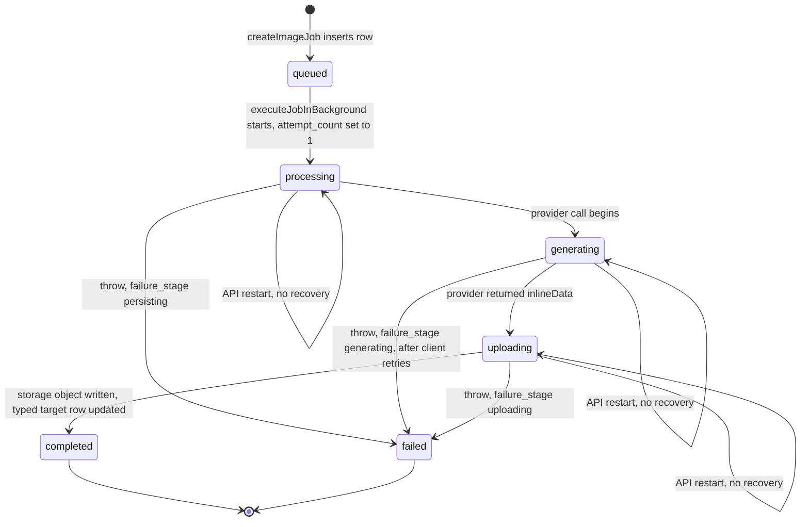
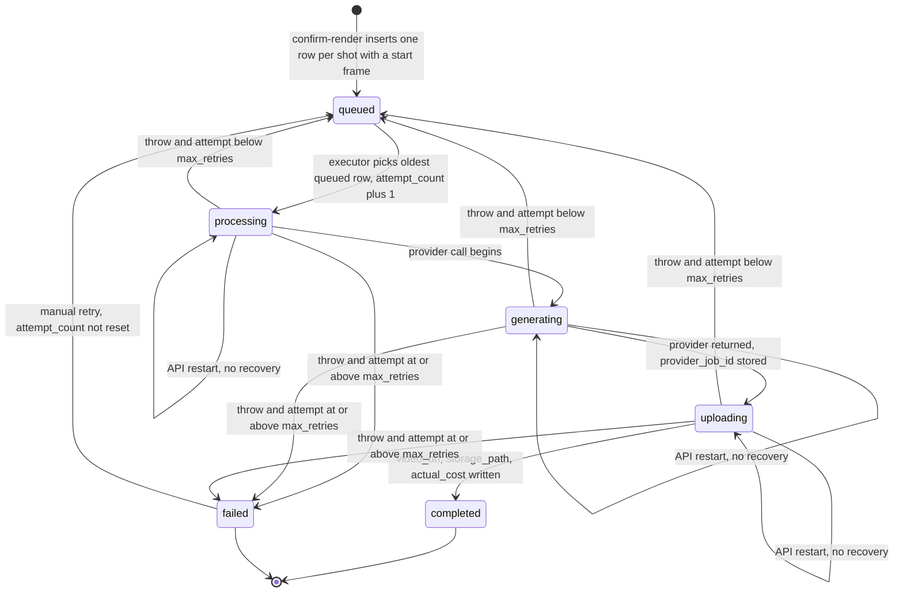
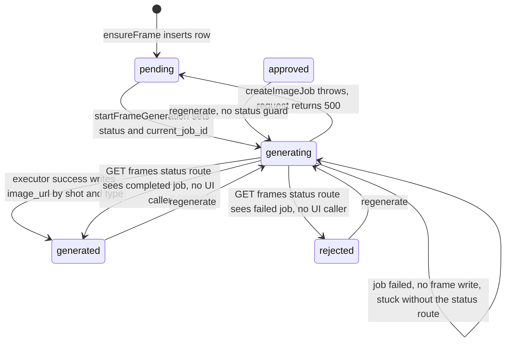

# 12. Async reliability and providers

Scope. This document records every asynchronous mechanism in the WizardDirector (Aiuteur) codebase at HEAD of `main`: image generation jobs by `job_type`, video jobs, frame generation, fire-and-forget work, client polling loops, timeouts, retries by layer, idempotency and non-idempotent commits, concurrency, behavior on API restart and browser refresh, failure surfacing, webhooks, ownership gaps on async routes, cost accrual, and a provider completeness matrix. Analysis is static. Nothing was executed, no provider was called, and no database was touched. Paths are relative to the repo root. Ledger ids are cited as `WD-IMPL-<KIND>-NNNN` from `_evidence/merged/merged.jsonl` where one exists. Reporter-local ids (`H-STATE-11`, `E-FACT-23`) are used only where no canonical id was found, and are marked as such.

Sources. Ledger kinds used: PROV, STATE, FACT, INV, ROUTE, PRESSURE. Reporter ledgers: `I-infra-async` (primary), `V9-prompts-frames`, `V10-video-checkout`, `E-ai-calls`. Merged ledger for canonical ids. Reports read in full: I-infra-async, V10-video-checkout, E-ai-calls, V9-prompts-frames. Reports read by keyword pass and ledger lookup only: V5-project-assets, V6-scene-assets, H-state-invalidation. The R1a and R1b verification reports were not consulted for verdicts.

Reading notes. Sibling documents: 00-README (document map), 01 overview, 02 capabilities, 03 workflows, 04 domain and state, 05 data model, 07 assets and continuity, 08 shots, frames and generation, 09 AI and prompts, 10 versioning, locking and invalidation, 11 architecture, 13 tests, 14 dead and duplicated code, 15 pressure, 16 coverage and unknowns, 17 ledger. Topics owned by those documents are linked, not repeated.

Coverage limit. V5, V6, and H were not read in full in this pass. Asset-job and invalidation statements below come from keyword passes over those reports, each cited to its report line. Video, checkout, frame, and provider statements rest on full reads and on direct code checks listed in section 19. Asset-job detail is less complete than the rest.

Status vocabulary. Mechanism statuses use the corpus vocabulary (IMPLEMENTED, REACHABLE, FUNCTIONAL, PERSISTED, TESTED, PARTIAL, MOCK-ONLY, DEAD, ORPHANED, LEGACY, DUPLICATED, CONTRADICTED, UNKNOWN). The provider matrix in section 16 uses the requested set: FULLY WIRED, PARTIAL, MOCKED, DEAD, UNKNOWN.

---

## 1. Asynchronous mechanism inventory

### 1.1 Background work

| # | Mechanism | Entry point | Runs where | State written | How the client observes it | Ledger |
|---|---|---|---|---|---|---|
| A1 | Image job, `start_frame` and `end_frame` | `POST .../generate-frames` (`backend/src/routes/frames.ts:227`); regenerate (`frames.ts:365`); inpaint (`frames.ts:424`); regenerate-with-correction (`frames.ts:708`); regenerate-with-prompt (`frames.ts:800`). Service: `frameGenerationService.startFrameGeneration` (`backend/src/services/frameGenerationService.ts:845-934`) | `ImageGenerationService.executeJobInBackground`, not awaited | `image_generation_jobs`, and `frames` row (`status`, `current_job_id`) | Stage 10 refetches `GET .../frames` every 2 s while any frame is `generating` (`src/components/pipeline/Stage10FrameGeneration.tsx:252-259`). `GET .../frames/:id/status` has no UI caller | WD-IMPL-STATE-0109, WD-IMPL-STATE-0112, WD-IMPL-FACT-0108 |
| A2 | Image job, `master_asset` | Project asset generate (`POST /:p/assets/:a/generate-image`, `backend/src/routes/projectAssets.ts:1210`); edit with `assetId` (`projectAssets.ts:1436`, job via `startEditImageJob`); clone-from-global regenerate (`projectAssets.ts:1756`) | Same executor | `image_generation_jobs`, `project_assets` (`image_key_url`, `style_outdated=false`), project attempts | `GET /api/images/jobs/:jobId` (`backend/src/routes/images.ts:71`) | WD-IMPL-ROUTE-0043, WD-IMPL-ROUTE-0046, WD-IMPL-ROUTE-0051, WD-IMPL-ROUTE-0065 |
| A3 | Image job, `angle_variant` | `POST /:p/assets/:a/angle-variants/generate` (`projectAssets.ts:2520`); `createAngleVariantJob` (`backend/src/services/image-generation/ImageGenerationService.ts:249-290`) | Same executor | `asset_angle_variants.status` (`pending`, `generating`, `completed`, `failed`) plus job row | `AngleVariantsDialog` polls the variant list every 2 s (`src/components/pipeline/AngleVariantsDialog.tsx:63-102`) | WD-IMPL-ROUTE-0058, WD-IMPL-STATE-0043 |
| A4 | Image job, `scene_asset` | Scene instance generate (`POST .../assets/:instanceId/generate-image`, `backend/src/routes/sceneAssets.ts:350`); scene edit (`sceneAssets.ts:408`); location-view generate (`projectAssets.ts:3298`, which uses `job_type 'scene_asset'` without `sceneId` or `assetId`) | Same executor | `image_generation_jobs`, `scene_asset_generation_attempts`, `scene_asset_instances.image_key_url` | Stage 8 pollers, 60 by 2 s (section 6) | WD-IMPL-ROUTE-0072, WD-IMPL-ROUTE-0073; V5 line 198; V6 line 290 |
| A5 | Image job, `transformation_post` | `POST .../transformation-events/:eventId/generate-post-image` (`backend/src/routes/sceneAssets.ts:1944`) | Same executor | `image_generation_jobs`, `transformation_events.post_image_key_url` (written by job and again by a frontend update, V6 line 277) | `VisualStateEditorPanel` poll, 60 by 2 s (`src/components/pipeline/Stage8/VisualStateEditorPanel.tsx:204-232`) | V6 section 8.3 and section 17 |
| A6 | Image job, global asset (`asset_id` set, `project_id` null) | `POST /api/assets/:id/generate-image` (`backend/src/routes/assets.ts:410`); `createGlobalAssetImageJob` (`ImageGenerationService.ts:736-800`) | `executeGlobalAssetJobInBackground` (`ImageGenerationService.ts:800-935`) | `image_generation_jobs`, `global_assets` (version increment, non-atomic, `ImageGenerationService.ts:862-885`) | `GET /api/images/jobs/:jobId` | I-infra-async section 3.1 (reporter id) |
| A7 | Video job, Stage 12 | `POST .../confirm-render` (`backend/src/routes/checkout.ts:91`, service `videoGenerationService.ts:318-408`); manual retry `POST .../video-jobs/:jobId/retry` (`checkout.ts:301`) | Global in-process `VideoJobExecutor` loop | `video_generation_jobs`, `scenes.status` (`video_complete`) | `GET .../video-jobs` every 3 s while any job is active (Stage 12) | WD-IMPL-STATE-0110, WD-IMPL-STATE-0111, WD-IMPL-STATE-0113 |
| A8 | Frame status reconciliation | `GET .../frames/:frameId/status` (`backend/src/routes/frames.ts:484`) calling `getFrameJobStatus` (`frameGenerationService.ts:1365-1392`) | Synchronous inside the request | Writes `frames.status` to `generated` or `rejected`, and adds to `frames.total_cost_credits` | No UI caller. Client helper `pollUntilComplete` has zero callers | WD-IMPL-STATE-0112, WD-IMPL-STATE-0116, WD-IMPL-FACT-0219 |
| A9 | Client autosave timers | `stageStateService` debounce 1000 ms; Stage 4 2000 ms | Browser | `stage_states` | None | I-infra-async H-STATE-11 (reporter id) |

Operation types that are synchronous despite looking like jobs: Stage 9 prompt generation (`POST .../generate-prompts`, two LLM calls per shot, strictly sequential, `backend/src/services/promptGenerationService.ts:1048-1121`, WD-IMPL-FACT-0119), streamline classification and formatting, shot extraction, dependency extraction, and every text LLM call. These hold the HTTP request open until they finish or until a race timer fires (section 7).

### 1.2 Fire-and-forget call sites

| Call | Awaited | Error handling on the un-awaited path | Evidence |
|---|---|---|---|
| `ImageGenerationService.createImageJob` starts `executeJobInBackground` | No | `.catch` logs, row written to `failed` | `backend/src/services/image-generation/ImageGenerationService.ts:176-181` (see also `:178-184`, WD-IMPL-FACT-0308) |
| `createGlobalAssetImageJob` starts `executeGlobalAssetJobInBackground` | No | `.catch` logs | `ImageGenerationService.ts:787` |
| `confirmAndQueueRender` calls `triggerJobProcessing` | No (`processQueuedJobs` not awaited) | None at the call site. Loop catch logs | `backend/src/services/videoGenerationService.ts:400`, `:414-423`; WD-IMPL-FACT-0307 |
| `retryJob` calls `triggerJobProcessing` | No | Same as above | `videoGenerationService.ts:594` |
| `VideoJobExecutor.processQueuedJobs` loop | No | Fatal catch logs and ends the loop | `backend/src/services/video-generation/VideoJobExecutor.ts:51-53`; WD-IMPL-STATE-0111 |

No other un-awaited background work was found in `backend/src`. Grep over non-test `backend/src` for `setInterval`, `node-cron`, and `cron` returned no matches. The only `setTimeout` sites are race timers, the executor's 500 ms gap, Veo's 10 s poll, the mock's simulated delay, and retry sleeps (I-infra-async section 1.1, verified in section 19).

### 1.3 Mechanisms that do not exist

| Mechanism | Status | Evidence |
|---|---|---|
| Webhook (inbound provider or Supabase callback) | Absent. Veo results are fetched by polling `fetchPredictOperation`. | I-infra-async section 3.5 (grep over `src`, `backend/src`, migrations, zero handlers) |
| Supabase Realtime, WebSocket, SSE, Web Worker, service worker | Absent (grep zero matches in `src`, `backend/src`, migrations) | I-infra-async section 1.1 |
| pg_cron, scheduled sweeper, startup reconciliation | Absent. No `processQueuedJobs` call at startup. No reset of `processing`, `generating`, or `uploading` rows. | WD-IMPL-INVALIDATE-0104; WD-IMPL-STATE-0111; I-infra-async H-STATE-03 |
| Job queue (Redis, pg-boss, SQS) | Absent. Work is held in process memory and in table rows. | WD-IMPL-PRESSURE-0008; WD-IMPL-FACT-0110 |
| Worker process separate from the API | Absent. The executor runs inside the API process. | WD-IMPL-PRESSURE-0008; `backend/fly.toml` (I-infra-async section 6.1) |

---

## 2. State stores and status vocabularies

| Store | Column | Allowed values | Writers | Evidence |
|---|---|---|---|---|
| `image_generation_jobs` | `status` | `queued`, `processing`, `generating`, `uploading`, `completed`, `failed` | `ImageGenerationService` (`:298-582`, `:736-935`) | `backend/migrations/007_image_generation_jobs.sql:26-34` (I-infra-async section 3.3); WD-IMPL-STATE-0109 |
| `image_generation_jobs` | `failure_stage` | `generating`, `uploading`, `persisting` | Failure branch (`ImageGenerationService.ts:559-584`) | V9 section 4; WD-IMPL-STATE-0109 |
| `image_generation_jobs` | `attempt_count` | Integer. Hard-set to 1 on start | `ImageGenerationService.ts:303` (verified), `:809` for global | WD-IMPL-STATE-0109 |
| `image_generation_jobs` | `idempotency_key` | Free text, unique partial index with `project_id` | Create path (`ImageGenerationService.ts:111-117`, `:150`, `:761`) | `007_image_generation_jobs.sql:83-84`, `010_global_asset_image_generation.sql:14-19`; WD-IMPL-STATE-0115 |
| `video_generation_jobs` | `status` | `queued`, `processing`, `generating`, `uploading`, `completed`, `failed` | `VideoJobExecutor` (`backend/src/services/video-generation/VideoJobExecutor.ts:81-172`), `retryJob` (`backend/src/services/videoGenerationService.ts:563-597`) | `backend/migrations/021_video_generation_jobs.sql:20` (V10 section 5.1); WD-IMPL-STATE-0110 |
| `video_generation_jobs` | `attempt_count`, `max_retries` | Defaults 0 and 3 | Executor (`VideoJobExecutor.ts:90-93`); `retryJob` does not reset | `021_video_generation_jobs.sql:57-58`; WD-IMPL-STATE-0103 |
| `video_generation_jobs` | `model_variant` | `veo_3_1_fast`, `veo_3_1_standard` | Confirm | `021` (V10 section 5.1) |
| `frames` | `status` | `pending`, `generating`, `generated`, `approved`, `rejected` | Frame service, executor on success, `getFrameJobStatus` (`/status` route only) | `backend/migrations/019_frames_table.sql:12-19` (H, I-infra-async section 3.3); WD-IMPL-STATE-0112 |
| `frames` | `current_job_id` | FK to `image_generation_jobs`, `ON DELETE SET NULL` | Frame service | `019_frames_table.sql:25` (H section 2) |
| `frames` | `total_cost_credits` | Numeric. Only writer in backend is `onJobCompleted` (`frameGenerationService.ts:1422`), reached only through `/status` | `frameGenerationService.ts:1397-1425` | WD-IMPL-FACT-0120; WD-IMPL-FACT-0219 |
| `asset_angle_variants` | `status` | `pending`, `generating`, `completed`, `failed` | `createAngleVariantJob`, executor | `backend/migrations/025` (V5 section 4); WD-IMPL-STATE-0043 |
| `scenes` | `status` | Includes `video_complete` | `checkAndUpdateSceneStatus` (`videoGenerationService.ts:516-537`). Never reset | WD-IMPL-STATE-0113; WD-IMPL-STATE-0104 |
| `user_credits` | `balance` | `NUMERIC(12,4)`, default 100.00 on first read | `ensureUserCredits`, `deductCredits` | `backend/migrations/020_user_credits.sql`; WD-IMPL-STATE-0114 |
| `user_credits` | `low_credit_threshold` | Default 10.00 | As above | V10 section 4 |
| `stage_states` | `langsmith_trace_id` | Column exists. No writer call reachable | `DatabaseService.updateStageStateTraceId` has no caller (`backend/src/config/database.ts:68-120`) | E-DEAD-05; I-infra-async section 7 |

Derived, not stored: render status per scene is one of `pending`, `rendering`, `complete`, `partial`, `failed` (`videoGenerationService.ts:542-558` and `:602-634`). Script Hub reacts only to `complete` and `rendering` (`src/components/pipeline/Stage6ScriptHub.tsx:311-330`). WD-IMPL-FACT-0137.

Vocabulary drift. The UI status unions for scenes and video jobs match the DB CHECK constraints (WD-IMPL-FACT-0326). The frame status union in the UI is hand-copied from the backend (WD-IMPL-PRESSURE-0019). Migration 019's `frames.status` CHECK lacks `invalidated`, which the shot-list unlock path writes (WD-IMPL-FACT-0151; V9 section 14).

---

## 3. Image job lifecycle (all `image_generation_jobs` types)

Transition detail, with code anchors from I-infra-async section 3.3 and V9 section 5:

| Step | Status written | Code | Side effects |
|---|---|---|---|
| Create | `queued` | `ImageGenerationService.ts:150-165` | Idempotency lookup first (`:111-117`), see section 9. Returns `jobId` before work starts. WD-IMPL-STATE-0109 |
| Start | `processing` | `ImageGenerationService.ts:298-306` | `processing_started_at`, `attempt_count = 1`, `last_attempt_at`. Verified line 303 |
| Provider call | `generating` | `ImageGenerationService.ts:309-318` | Reference images downloaded and base64-encoded inside the NanoBanana client (`NanoBananaClient.ts:29-169`). Failed downloads are skipped silently (V9 section 5 step 7) |
| Upload | `uploading` | `ImageGenerationService.ts:355-360` | Object key `project_
/branch_<b>/scene_<s>/shot_<shot>/<jobType>_<ts>_<rand>.png` in bucket `asset-images` (`ImageGenerationService.ts:379-383`, `buildStoragePath` `:605-626`) |
| Success | `completed` | `ImageGenerationService.ts:549-557` | `storage_path`, `public_url`, `cost_credits = actualCost \|\| estimatedCost`, `provider_metadata`, `completed_at` |
| Success, typed row | n/a | Frame: `ImageGenerationService.ts:517-536` (`UPDATE frames ... WHERE shot_id AND frame_type`). Scene asset: `ImageGenerationService.ts:484-488`. Master asset: `ImageGenerationService.ts:406-410` (clears `style_outdated`) | Frame update is keyed by shot and type, not by `current_job_id` (H F3). Last finisher wins (V9 section 9). WD-IMPL-INVALIDATE-0067 |
| Failure | `failed` | `ImageGenerationService.ts:559-584` | `error_code`, `error_message`, `failure_stage` from DB status at failure. Frame row is not updated (H F6). Catch logs only |

Job-level behavior:

- Job-level retry: none. `attempt_count` is never incremented on the image path (WD-IMPL-STATE-0109).
- Client-level retry inside a job: NanoBanana makes up to 4 attempts (section 8).
- Deadline: none. The job has no timeout (I-infra-async section 3.2).
- Concurrency: no limit. Each job is an unbounded background promise (section 10).
- Restart: a job in `queued`, `processing`, `generating`, or `uploading` at restart is never reset. No sweep exists (WD-IMPL-FACT-0110). For frame jobs, the frame stays `generating` (WD-IMPL-INVALIDATE-0090).
- Failure before `generating` is labelled `persisting` in `failure_stage`. The label is misleading for failures during `processing` (I-infra-async section 3.3; WD-IMPL-STATE-0109).

Cost on this path. `cost_credits` is an estimate at `0.01 * (w*h)/(512*512)` (`NanoBananaClient.ts:230-235`). Gemini does not return billed cost (`NanoBananaClient.ts:163`). The stored `actual` equals the estimate (E-FACT-21). No `user_credits` row is touched by image jobs (V10 section 4).

Non-provider job rows. Two paths insert `image_generation_jobs` rows that never call a provider: match-copy start frames (`frameGenerationService.ts:373-403`, zero cost, status `completed`, V9 STATE-08) and user uploads of frame variants (`frames.ts:1109-1244`, zero cost, prompt text `[User upload - zero cost]`, V9 section 6). Both appear in the generations list (`frames.ts:1282-1288`).

---

## 4. Video job lifecycle (`video_generation_jobs`)

Transition detail (V10 section 5.2 and 5.4, H section 5.1, I-infra-async section 3.3):

| Step | Status | Code | Notes |
|---|---|---|---|
| Insert | `queued` | `videoGenerationService.ts:379-386` | One row per shot with a start frame URL (`:344-369`). Prompt and frame URLs snapshotted (WD-IMPL-INVALIDATE-0072) |
| Pick | `processing` | `VideoJobExecutor.ts:62-76`, `:81-90` | Oldest `queued` row across all users. Select then update by id only, no row claim (`videoGenerationService.ts:490-500`). `processing_started_at` set |
| Attempt count | n/a | `VideoJobExecutor.ts:90-93` | `attempt_count = (job.attempt_count \|\| 0) + 1`, separate write |
| Generating | `generating` | `VideoJobExecutor.ts` step 2 | Provider called with `start_frame_url`, `end_frame_url`, `video_prompt_snapshot`, `duration_seconds`, `model_variant`, live `projects.aspect_ratio` (V10 section 5.2) |
| Uploading | `uploading` | `VideoJobExecutor.ts` step 4 | Written after the provider has already uploaded (V10 section 12). Stores `provider_job_id` and `provider_metadata` |
| Completed | `completed` | `VideoJobExecutor.ts` step 6 | `video_url`, `storage_path`, `actual_cost`, `completed_at`. Then `checkAndUpdateSceneStatus` (step 7) |
| Retry or fail | `queued` or `failed` | `VideoJobExecutor.ts:144-171` | Re-queues while `attempt_count < max_retries` (default 3). The `retryable` flag is never read (verified). PERMANENT errors are also retried |
| Manual retry | `queued` | `videoGenerationService.ts:563-597` | Requires `failed`. Clears `error_*`, `video_url`, `storage_path`, `provider_*`, timestamps. Does not reset `attempt_count`, so the next failure is final (WD-IMPL-STATE-0103, WD-IMPL-INVALIDATE-0103). Triggers executor (`:594`) |

Executor behavior (I-infra-async section 3.3 and 3.4; H-STATE-03):

- One `VideoJobExecutor` per process, created on first dynamic import. Provider is chosen once per process (`createVideoProvider.ts:15-33`).
- `isProcessing` is an in-memory flag (`VideoJobExecutor.ts:15`, `:28`). A second trigger while running is a no-op. The running loop keeps selecting queued rows until none remain.
- `pollIntervalMs = 5000` is declared at `VideoJobExecutor.ts:16` and referenced nowhere else (verified).
- 500 ms pause between jobs (`VideoJobExecutor.ts:49`). Strictly serial.
- Fatal catch at `VideoJobExecutor.ts:51-53` ends the loop. The job is left in its last written status.
- Multi-instance: no row claim, so two API instances can select the same queued row and both call the provider (I-infra-async section 3.4). Instance count is not in the repo (UNKNOWN).

Scene side effect. After each job reaches `completed` or final `failed`, `checkAndUpdateSceneStatus` reads every job row for the scene, including historical rows, and sets `scenes.status = 'video_complete'` only if all are `completed` (`videoGenerationService.ts:516-537`). Consequence: any failed historical row blocks completion permanently, because retry is the only way to change a failed row (WD-IMPL-INVALIDATE-0102; H section 5.3). Re-confirming a scene adds rows and does not remove old ones (WD-IMPL-INVALIDATE-0101).

Veo-specific duration and time budget. One Veo job can hold the serial loop for up to three attempts of 5 minutes each (WD-IMPL-FACT-0140; V10 FACT-18). The loop is shared by all users in the process.

---

## 5. Frame status lifecycle (async-coupled)

Frames are not jobs, but their status is driven by image jobs. The reconciliation that exits `generating` after a failure exists only behind a route with no UI caller (H section 4; V9 section 5 step 8).

Evidence: `frameGenerationService.ts:871-873` (generating), `:926-931` (back to pending on throw), `ImageGenerationService.ts:521-531` (generated on success), `frameGenerationService.ts:1365-1437` (reconciliation through `/status`), `frames.ts:365-410` (regenerate). WD-IMPL-STATE-0112, WD-IMPL-FACT-0108, WD-IMPL-FACT-0219. Approval is not reachable from the UI. No button calls `approve` or `reject` (V9 FACT-04; WD-IMPL-FACT-0219). Generated frames therefore satisfy Stage 10 gates (V9 section 10).

---

## 6. Client polling inventory

Polling is the orchestration mechanism for several generation views (WD-IMPL-PRESSURE-0053). Every poller below is listed with its cadence, budget, stop condition, and cleanup. Budgets are client-side only. Server jobs have no deadline (WD-IMPL-PRESSURE-0012).

| Poller | Endpoint | Cadence | Budget or ceiling | Stop condition | Cleanup | UI caller | Evidence |
|---|---|---|---|---|---|---|---|
| `projectAssetService.pollImageJob` | `GET /api/images/jobs/:id` | 1 s | 60 attempts (60 s) | Terminal status or budget exhausted | Awaited inside the service call | Stage 5 generate, edit, location view (`Stage5Assets.tsx:386`, `LocationCoveragePanel.tsx:234`) | `src/lib/services/projectAssetService.ts:385-424` (`intervalMs` default 1000 at `:389`); V5 line 130 |
| `sceneAssetService.pollBulkImageJobs` | Same | 2 s, parallel per job | 60 (120 s) | Terminal or budget | Awaited | Stage 8 bulk generate (`Stage8VisualDefinition.tsx:603`) | `src/lib/services/sceneAssetService.ts:390-431`; V6 line 147 |
| `Stage8VisualDefinition.pollSingleImageJob` | Same | 2 s | 60 (120 s) | Terminal or budget | Awaited | Stage 8 single generate | `src/components/pipeline/Stage8VisualDefinition.tsx:436-452` |
| `VisualStateEditorPanel` post-image poll | Same | 2 s | 60 (120 s) | Terminal or budget | `finally` clears state | Transformation post image | `src/components/pipeline/Stage8/VisualStateEditorPanel.tsx:204-232` |
| `EnhancedUploadModal.onPollJob` | Same (prop) | 2 s | 90 (180 s) | Terminal or budget | Cancel ref | Upload modal edit, apply style, remove background, regenerate | `src/components/pipeline/shared/EnhancedUploadModal.tsx:111-131`; V5 line 140 |
| `AssetDialog.handleGenerateImage` | Same | `setInterval` 2 s plus `setTimeout` 120 s | 120 s | Cleared on completion or timeout | Cleared on completion or timeout only. No unmount cleanup | Asset dialog | `src/components/assets/AssetDialog.tsx:129`, `:205`, `:258-266` (I-infra-async H-STATE-09) |
| `AngleVariantsDialog` effect | `GET` angle variant list | 2 s while any angle is `generating` | None | Effect cleanup, or no `generating` angle | `clearInterval` on cleanup (`:102`) | Manage Angles | `src/components/pipeline/AngleVariantsDialog.tsx:60-103` |
| Stage 6 batch render status | `GET /api/projects/:p/batch-render-status` | 10 s while mounted | None | Unmount | Cleanup on unmount (`Stage6ScriptHub.tsx:126-129`) | Script Hub badges | `src/components/pipeline/Stage6ScriptHub.tsx:114-138`; WD-IMPL-STATE-0118 |
| Stage 10 frames | `GET .../frames` | 2 s | None | No frame `generating` (React Query `refetchInterval`) | React Query | Stage 10 | `Stage10FrameGeneration.tsx:252-259`; WD-IMPL-STATE-0118 |
| Stage 12 video jobs | `GET .../video-jobs` | 3 s while any job is `queued`, `processing`, `generating`, or `uploading`. Returns 3000 when data is undefined | None | Terminal states all reached | React Query. `staleTime` 1000 | Stage 12 | `src/components/pipeline/Stage12VideoGeneration.tsx:56-68`; V10 section 5.5 |
| `AssetVersionSync` | `GET .../assets/version-sync-status` | 30 s | None | Unmount | Cleanup | Asset library | `AssetVersionSync.tsx:38-47`; V5 line 170 |
| `frameService.pollUntilComplete` | `GET .../frames/:id/status` | 2 s | 120 rounds. Marks frame complete on any error | Terminal or budget | n/a | Zero callers | `src/lib/services/frameService.ts:593-632`; WD-IMPL-STATE-0116 |
| `imageService` sleep loop | `/api/images/jobs` | n/a | n/a | n/a | n/a | Module is ORPHANED (no importers) | `src/lib/services/imageService.ts:106`, `:130`; V5 line 223 |

Notes on the table:

- Polling client code exists in four implementations, two of them dead (WD-IMPL-FACT-0277).
- The Stage 10 and Stage 12 pollers have no ceiling. A job stranded by a restart keeps them alive forever (WD-IMPL-STATE-0118; H-STATE-10). Stage 10 and 12 buttons stay disabled in that state (V9 section 5 step 8; V10 section 5.5).
- The Stage 10 list endpoint does not consult job status, so it cannot reconcile a failed job (V9 FACT-03).
- Client budgets end before server work does. The client shows a timeout toast while the job continues and may write later (V5 line 130; V6 line 146; WD-IMPL-PRESSURE-0012).
- Stage 5 `pollImageJob` is the only poller with a 60 s budget at 1 s cadence. The others use 2 s cadence.

Endpoints behind the pollers (ownership is covered in section 14):

| Endpoint | Handler | Ownership check | Evidence |
|---|---|---|---|
| `GET /api/images/jobs/:jobId` | `backend/src/routes/images.ts:71-137` | Project or global-asset ownership, 400 if neither | I-infra-async section 2.3; WD-IMPL-ROUTE-0065 |
| `GET /api/projects/:p/scenes/:s/video-jobs` | `backend/src/routes/checkout.ts:148-202` | Project, scene in branch | V10 section 2 (R4) |
| `GET /api/projects/:p/batch-render-status` | `checkout.ts:272-295` | Project | V10 section 2 (R7) |
| `GET /api/projects/:p/scenes/:s/frames` | `backend/src/routes/frames.ts:71-221` | Project | V9 section 5 step 8 |
| `GET /api/projects/:p/scenes/:s/frames/:frameId/status` | `frames.ts:484-513` | Project only | V9 section 5 step 8; H section 4 |

---

## 7. Timeouts

| Layer | Timeout | Expiry behavior | Evidence |
|---|---|---|---|
| Shot extraction (text LLM) | 20 s race | Returns empty success. Route answers 200 with zero shots. Frontend throws "Shot extraction returned no shots". The underlying call continues and is discarded | `backend/src/services/shotExtractionService.ts:97`, `:297-305`; `backend/src/routes/projects.ts:1819-1835`; WD-IMPL-FACT-0202 |
| Legacy dependency extraction (text LLM) | 15 s race | Race rejects, underlying call continues | `backend/src/services/sceneDependencyExtraction.ts:58-61` (WD-IMPL-FACT-0186) |
| Prompt generation (text LLM) | 30 s race (`PROMPT_GENERATION_TIMEOUT_MS`) | Per shot failure isolated. Timer not cleared. Request not aborted. Route answers 200 with a `failed` count | `backend/src/services/promptGenerationService.ts:143`, `:1469-1472`, `:1515`; V9 section 3.5; WD-IMPL-FACT-0186 |
| Veo poll | 5 min per attempt (`POLL_TIMEOUT_MS`) | Throws TEMPORARY. Executor may retry | `backend/src/services/video-generation/Veo3Provider.ts:26`, `:297` |
| Veo poll interval | 10 s (`POLL_INTERVAL_MS`) | Fixed interval, no backoff | `Veo3Provider.ts:28`, `:231-232` |
| Veo submit, GCS download, Supabase upload | None configured in code | No code-level expiry. Behavior on a stalled connection is runtime UNKNOWN | I-infra-async H-PROV-04 (reporter id); V10 section 6.1 |
| Gemini text, NanoBanana image, vision | None | Client retries only on classified errors (section 8) | E-FACT-07; I-infra-async section 3.2 |
| Mock video | Simulated 3000 to 8000 ms (`3000 + Math.random()*5000`) | Not a timeout. Simulated delay | `backend/src/services/video-generation/MockVideoProvider.ts:19-20` (verified) |
| Image job | None | No deadline on `executeJobInBackground` | WD-IMPL-FACT-0118 |
| Client image polls | 60 s to 180 s budgets (section 6) | Toast, job continues | Section 6 |

Cancellation. No `AbortController` and no `AbortSignal` exists in non-test `src` or `backend/src` (verified by grep). The I-infra-async and E reports say `StreamlineDropZone.tsx` contains one. It does not. The file contains only a comment that uses the word "signal" at line 108. This is a correction (section 19). WD-IMPL-FACT-0186 is consistent with the grep result.

A race timer does not cancel the underlying request (E-FACT-07). The request runs to completion on the provider side. Whether the provider bills a discarded call is runtime UNKNOWN. Token usage for that call is held only in the in-memory tracker (E-FACT-02), so no database row records it.

---

## 8. Retries by layer

| Layer | Component | Retries | Backoff | Retried classes | Evidence |
|---|---|---|---|---|---|
| Browser query | React Query | Library default. `new QueryClient()` with no options | Library default, not verified in this pass | Not configured in repo | `src/App.tsx:19`; I-infra-async section 4 |
| Browser auth | `fetch` wrappers | None. No 401 or 403 handling anywhere in `src` | n/a | n/a | I-infra-async section 2.1; WD-IMPL-FACT-0243; H-FACT-20 (reporter id) |
| Text LLM | `LLMClient.executeWithRetry` | 3 retries, 4 attempts | Base 1000 ms, multiplier 2, max 10000 ms | `RATE_LIMIT`, `SERVER_ERROR`, `NETWORK_ERROR` | `backend/src/services/llm-client.ts:45-50`, `:214-228`; WD-IMPL-FACT-0183; WD-IMPL-FACT-0105 |
| Text LLM classification | `classifyError` | Keyword matching. `auth` or `key` in message maps to non-retryable `AUTH_ERROR`. `quota`, `rate limit`, or 429 maps to `RATE_LIMIT` | n/a | n/a | `llm-client.ts:240-300` (E-FACT-04) |
| Image | `NanoBananaClient` | 3 retries, 4 attempts | `baseDelay` 1000 ms doubling, capped at 10 s | `RATE_LIMIT`, `TEMPORARY`, plus network codes | `backend/src/services/image-generation/NanoBananaClient.ts:17-18`, `:246-265`; attempt loop `:246`, retry gate `:254` (verified); WD-IMPL-FACT-0183 |
| Vision | `ImageAnalysisService` | None | n/a | n/a | WD-IMPL-PROV-0026 |
| Video, Veo submit | `Veo3Provider` | None at provider level | n/a | n/a | V10 section 6.1. Submit errors: 429 to `RATE_LIMIT`, 401 and 403 to `AUTH_ERROR`, else `TEMPORARY` |
| Video, Veo poll | `Veo3Provider` | None at provider level. 5xx continues polling. Other non-OK throws | 10 s fixed interval | n/a | V10 section 6.1; `Veo3Provider.ts:224-302` |
| Video, mock | `MockVideoProvider` | None | n/a | n/a | `MockVideoProvider.ts:23-25` (5% synthetic failure) |
| Image job | Job level | None. `attempt_count` fixed at 1 | n/a | n/a | WD-IMPL-STATE-0109 |
| Video job | `VideoJobExecutor` | Re-queues while `attempt_count < max_retries` (default 3). Effective 3 total attempts | None. Next pickup is the next loop iteration | Any thrown error. `retryable` is not read | `VideoJobExecutor.ts:144-171` (verified: the file has no reference to `retryable`); WD-IMPL-FACT-0131 |
| Video job, manual | `retryJob` | One attempt. `attempt_count` not reset, so the next failure is final | None | Any | `videoGenerationService.ts:563-597`; WD-IMPL-STATE-0103 |
| Prompt generation | Per shot | Inherits LLM retries. No job-level retry. Per shot failure isolated | None | Per LLM client | V9 section 9 |
| Shot extraction | Route | One simplified retry after malformed JSON. Runs outside the 20 s race | None | Parse failure | `shotExtractionService.ts:313-328` (E section 4) |
| Autosave | Client | None. Debounce only | n/a | n/a | I-infra-async H-STATE-11 (reporter id) |

Retry gap that matters for cost. The video executor retries any error, including PERMANENT errors such as the Veo safety filter and "no videos returned". Each retry under Veo is a billable provider call (V10 section 5.2; WD-IMPL-FACT-0131). The manual retry path adds no credit check and no charge, and it triggers the executor (`videoGenerationService.ts:594`).

Retry gap that matters for correctness. The image path has no job-level retry, so a transient provider error that survives the 4 client attempts leaves the job `failed` and the frame `generating` (section 5).

---

## 9. Idempotency, duplicates, and non-idempotent commits

Idempotency is implemented in one place and is effectively disabled for every internal caller.

### 9.1 Image job creation

`createImageJob` looks up an existing row by `(project_id, idempotency_key)` before inserting (`ImageGenerationService.ts:111-117`, `findJobByIdempotencyKey` at `:691-700`). A unique partial index backs the lookup (`007_image_generation_jobs.sql:83-84`, `010_global_asset_image_generation.sql:14-19`).

Every internal caller builds the key as a prefix followed by `Date.now()`, so the lookup never matches (WD-IMPL-STATE-0115). Verified call sites:

| Caller | Key template | Evidence |
|---|---|---|
| Project asset generate | `asset-${assetId}-${Date.now()}` | `backend/src/routes/projectAssets.ts:1271` (verified) |
| Project asset edit | `edit-asset-${assetId}-${Date.now()}` | `projectAssets.ts:1509` (verified) |
| Location view generate | `location-view-${viewId}-${Date.now()}` | `projectAssets.ts:3437` (verified) |
| Frame start or end | `frame-${frameId}-${Date.now()}` | `backend/src/services/frameGenerationService.ts:906` (verified) |
| Frame inpaint | `inpaint-${frameId}-${Date.now()}` | `frameGenerationService.ts:1303` (verified) |
| Scene asset, scene edit | Same pattern | `backend/src/routes/sceneAssets.ts:506`, `:2030` (I-infra-async section 3.2) |
| Global asset | Same pattern. Key is stored but never looked up | `backend/src/routes/assets.ts:447`; `ImageGenerationService.ts:736-800` |

The only path where a stable key could dedupe is `POST /api/images/generate` with a client-supplied `idempotencyKey` (`images.ts:23`). The frontend module that builds such a key, `imageService.ts`, has no importers (E-DEAD-04, reporter id). No live client sends a stable key (I-infra-async H-STATE-07, reporter id).

Net effect: a double submit of any image job creates a second job and a second paid provider call.

### 9.2 Non-idempotent commits and duplicates

| Operation | Guard | Effect of repeat | Cost or write impact | Ledger and evidence |
|---|---|---|---|---|
| Image job create (all internal types) | Key lookup defeated by timestamp | New job row and provider call | Provider call, storage object, `cost_credits` estimate | WD-IMPL-STATE-0115 |
| Frame regenerate, inpaint, correction | None | Two jobs for one frame. Each completion writes the frame by shot and type. Last finisher wins regardless of `current_job_id` | Two provider calls | V9 section 9; WD-IMPL-INVALIDATE-0067 |
| Confirm-render | None. No check for existing jobs or the scene's stage lock. Stage 11 confirm stays enabled while the stage is locked | Second full set of jobs, plus a second deduction for the whole scene total | Charge on every confirm, including skipped shots and frame costs | V10 sections 3.5 and 3.6; WD-IMPL-FACT-0126; WD-IMPL-FACT-0351 |
| Credit deduction | Read-modify-write on `user_credits.balance`, no transaction, no ledger | Concurrent deductions can lose an update | Lost updates are possible under concurrent deductions (code-derived) | V10 section 4; WD-IMPL-INVALIDATE-0105; WD-IMPL-STATE-0114 |
| Insert then deduct | Ordering only | If deduction throws, jobs remain queued and uncharged, and the executor is not triggered by that call | Free execution of queued rows | WD-IMPL-FACT-0129; V10 section 3.5 step 7 |
| Manual video retry | Requires `failed` | Each retry calls the provider (up to the executor limit) | Billable provider call per attempt. No credit check | V10 section 5.4; WD-IMPL-STATE-0103 |
| Asset extract-confirm (Stage 5) | None. Each call inserts new `project_assets` rows. Client replaces its list with the response | Duplicate assets | Duplicate image jobs if the user generates for each | V5 line 113; WD-IMPL-ROUTE-0033 |
| Asset edit-image result | None. Every edit result is persisted as a new selected attempt and becomes `image_key_url` immediately, whether the user later accepts or cancels | Silent replacement of the current image | Job cost | V5 line 144 |
| Edit with remove-background | Isolation suffix appended twice for isolatable types | Duplicate suffix in prompt | Prompt quality only | V5 line 141 |
| Streamline commit (`POST .../streamline/commit`) | No idempotency key. RPC is all-or-nothing | A retry after server success duplicates Stage 1 to 4 versions, `project_assets`, and `intake_resolutions` rows. Stage 1 gets two versions on every commit | Data duplication | WD-IMPL-FACT-0356; WD-IMPL-STATE-0031; WD-IMPL-INVALIDATE-0026; WD-IMPL-ROUTE-0023 |
| Streamline commit, client follow-up | Scene persistence runs after the RPC returns. Its failure leaves the RPC committed | Confirm again re-runs the whole RPC | As above | `src/components/pipeline/Stage1InputMode.tsx:474-511` (verified: commit call, then `scriptService.persistScenes`, then catch); WD-IMPL-INVALIDATE-0026 |
| Stage 4 approve | Non-atomic across scene persist and stage lock | Pending save can rewrite a locked stage | Data | WD-IMPL-INVALIDATE-0019; WD-IMPL-INVALIDATE-0077 |
| Seed prompt templates | Insert per row. Per-row catch and continue | Duplicate name and version errors are swallowed per row | None | WD-IMPL-ROUTE-0140; E-FACT-15 (reporter id) |
| Shot extraction | No guard when shots already exist. Inserts new rows | Duplicate shots | Tokens for the call | H-state-invalidation report, shot extraction row (reporter id) |
| Stage 9 generate-prompts | Overwrites all prompt fields for each shot. No guard against user edits | User edits lost. Prior text survives only as a version row | Two LLM calls per shot | V9 section 3.6 |
| Text version create | Cap check, next number, deselect, insert, and write-back are separate calls | Race can fail or duplicate | None | V9 section 3.6; WD-IMPL-INVALIDATE-0009 |

Idempotent examples that exist. Shot list lock returns success without writing when `shot_list_locked_at` is already set (`backend/src/routes/projects.ts:2888-2900`, H-state-invalidation transition S5, reporter id). Stage 7 lock is "race-guarded" (WD-IMPL-STATE-0096).

---

## 10. Concurrency limits

| Path | Limit | Evidence |
|---|---|---|
| Backend, any | No semaphore, queue, `p-limit`, or rate limiter found. No `express-rate-limit` | I-infra-async section 1.2; WD-IMPL-PRESSURE-0010 |
| Image jobs | None. Each job is an unbounded background promise. Frame jobs for one scene are created sequentially, but their provider calls run concurrently in-process | V9 section 9; WD-IMPL-FACT-0119 |
| Stage 9 prompt generation | Strictly sequential per shot, two LLM calls per shot | V9 section 3.2; WD-IMPL-FACT-0119 |
| Video executor | One loop per process. Strictly serial. Oldest queued row across all users | `VideoJobExecutor.ts:27-57`; WD-IMPL-STATE-0111 |
| Video executor, multi-instance | No row claim. Two instances can run the same job | I-infra-async section 3.4; WD-IMPL-PRESSURE-0009 |
| Veo wait time | Up to 3 attempts, each up to 5 min, holding the global serial loop | WD-IMPL-FACT-0140 |
| Client | No `AbortController`, so no client-side cancel of any request | Section 7 |
| Instances | Fly config sets `min_machines_running = 0` and `auto_stop_machines = true`. Instance count not in repo | I-infra-async section 6.1 and 10.2 (UNKNOWN) |

Cross-user effect. The video loop picks the oldest queued job across all users. One user's slow Veo job delays every other user's rendering in that process (V10 section 5.2; WD-IMPL-STATE-0111).

---

## 11. Restart and browser refresh behavior

### 11.1 API process restart

| Item | Image job | Video job | Frame | Evidence |
|---|---|---|---|---|
| Row in `processing`, `generating`, or `uploading` | Stays. No recovery | Stays. Retry refuses (requires `failed`). Scene never completes | Frame stays `generating` if its job was in flight | WD-IMPL-FACT-0110; WD-IMPL-INVALIDATE-0104; WD-IMPL-STATE-0109 |
| Row in `queued` | Stays. No executor for image jobs | Waits until any user's next confirm or retry triggers the loop. No startup hook | n/a | WD-IMPL-STATE-0111 |
| In-flight Veo operation name | Not applicable | Lost. `provider_job_id` is stored only after the provider returns (step 4) | n/a | V10 section 5.5 |
| Stage 10 and Stage 12 pollers | n/a | Poll forever. No ceiling | Stage 10 polls forever | WD-IMPL-STATE-0118 |
| In-memory `isProcessing` | n/a | Reset to false, so the next trigger starts a new loop | n/a | `VideoJobExecutor.ts:15` |
| Process signals | No `SIGTERM` or `SIGINT` handler, no `unhandledRejection` or `uncaughtException` handler, no graceful shutdown | Same | Same | I-infra-async section 4 (process level) |
| Fly auto-stop | Whether a machine stops mid-job is platform behavior, UNKNOWN from the repo | Same | Same | I-infra-async section 6.1 and 10.2 |

Recovery paths that move a stranded row out of an active state. These are the only ones found:

- Frame `generating`: the upload variant route, the select-generation route (only when at least two completed jobs exist), or `GET .../frames/:id/status` (no UI caller). V9 section 5 step 9 and section 6; WD-IMPL-INVALIDATE-0090.
- Video `processing`, `generating`, `uploading`: none. Manual DB change is the only path (H-state-invalidation transition V7, reporter id).
- Image job rows: none.

### 11.2 Browser refresh

| Item | Behavior | Evidence |
|---|---|---|
| Image job in flight | Server continues. Client poll is lost. Stage 10 and 12 resume polling from DB state on mount | I-infra-async section 3.4; WD-IMPL-STATE-0117 |
| Video job in flight | Server continues. Stage 12 refetches on mount and resumes polling | V10 section 5.5 |
| Stage 5 and Stage 8 image jobs in flight | Client poll is lost. The job completes on the server. The UI result depends on the poll's completion handler, so no result is shown after refresh unless the asset or instance is refetched (inferred from the completion handling in V5 line 130) | V5 line 130 |
| Autosave (stage content) | Edits typed inside the debounce window are lost. No `beforeunload`, `pagehide`, or `visibilitychange` handler in `src` | I-infra-async H-STATE-11 (reporter id) |
| Stage 9 debounced prompt PUT | Pending updates sit in a 500 ms debounce. Lost on refresh | V9 section 2 |
| Stage 10 end-prompt edits | Unsaved edits are local state. Lost on shot change or refresh | V9 section 6 |
| Stage 12 viewer state | React state only. Not persisted. Resets on refresh | V10 section 7 |
| Auth session | Persisted in localStorage through supabase-js and the zustand `auth-storage` key. No token-rejection handling | I-infra-async section 2.1 and 2.6; WD-IMPL-STATE-0120 |

### 11.3 Reconciliation

The only code that reconciles a frame job to a terminal frame state is `getFrameJobStatus` behind `GET .../frames/:frameId/status` (`frameGenerationService.ts:1365-1392`). It sets `generated` and adds `cost_credits` to `frames.total_cost_credits` on completion (`:1397-1425`), and sets `rejected` on failure (`:1430-1437`). Consequences:

- The route has no UI caller. `pollUntilComplete` has zero callers (WD-IMPL-STATE-0116; WD-IMPL-FACT-0219).
- The list endpoint does not consult job status, so the UI cannot reconcile a failed job (V9 FACT-03).
- If the route were polled repeatedly after completion, `onJobCompleted` would add the job cost again each time. No idempotency guard exists (V9 section 5 step 8(iii); WD-IMPL-FACT-0120). Whether this repeats in practice depends on the poll loop, UNKNOWN (V10 section 11).
- Stage 10 and Stage 11 cost figures read `frames.total_cost_credits`, which stays zero for AI-generated frames unless the route is called (V9 section 5 step 8(ii); V10 section 11).

No reconciliation exists for video jobs or image jobs. Stage 12 shows the failed state only through the row it reads (section 12).

Cross-link: frame invalidation and link propagation are covered in 08 and 10. This document covers only the async status path.

---

---

## 12. Failure surfacing

| Layer | Where the failure goes | What the user sees | Evidence |
|---|---|---|---|
| Route handler | Inline `try/catch` returns `res.status(500).json({error: message})`. About 327 `res.status(500)` sites, 88 interpolate `error.message` into the body | Toast or inline message, depending on caller | I-infra-async section 4; H-FACT-09 (reporter id) |
| Global error handler | `errorHandler` returns `{error:{message, code, stack}}`. Reached only through `next(err)`, which in practice means body-parser errors and synchronous throws | Not reached by async failures. Express 4 does not forward async rejections | `backend/src/middleware/errorHandler.ts:52-73`; `backend/src/server.ts:90`; I-infra-async section 4 |
| Error body shape | Routes return `{error: string}`. `errorHandler` returns `{error:{message}}`. Frontend reads `error.error`, so an object body produces an object-derived message | Garbled message in rare cases | `src/lib/services/checkoutService.ts:40-42`; `src/lib/services/frameService.ts:579-581`; H-FACT-10 (reporter id) |
| Image job, background | Row becomes `failed` with `error_code`, `error_message`, `failure_stage`. Promise `.catch` logs to console | Only via the poller that is watching the job. Its failure branch is not enumerated for every poller in this pass | `ImageGenerationService.ts:559-584`, `:176-181`; section 6 |
| Frame job failure | Frame row not updated. Stays `generating` | "Generating..." label and disabled buttons, indefinitely | `FramePanel.tsx:684-688` (V9 section 5 step 8); WD-IMPL-INVALIDATE-0090 |
| Video job failure | Row `failed` with `error_code` (`error.code \|\| 'GENERATION_FAILED'`) and `error_message` | Stage 12 failed overlay shows `errorMessage`, `errorCode`, and a Retry Job button. Shot card shows the same with Retry | `VideoJobExecutor.ts` catch (V10 section 5.2); V10 section 7 |
| Video executor fatal error | `console.error`. Loop ends. Row left in last status | Nothing. Stage 12 keeps polling | `VideoJobExecutor.ts:51-53`; WD-IMPL-STATE-0111 |
| Video insufficient credits | Route 500 with `Insufficient credits. Required ..., Available ...` | Toast | V10 section 3.5 step 3 |
| Confirm-render deduction failure | Route 500. Queued rows stay | Toast. Rows exist and will run on next loop trigger | V10 section 3.5 step 7; WD-IMPL-FACT-0129 |
| Frame creation failure | `createImageJob` throws. Frame set back to `pending`. Request returns 500. Earlier shots' jobs already started | Error for the whole batch | V9 section 5 step 4 |
| Shot extraction timeout | Route returns 200 with zero shots | Frontend throws "Shot extraction returned no shots" | `shotExtractionService.ts:301-305`; E-FACT-23 (reporter id); WD-IMPL-FACT-0202 |
| Prompt generation partial failure | Route returns 200 with `generated`, `failed`, and `errors[]`. `RATE_LIMIT` code maps to 429 | Per-shot errors in the response | V9 section 3.5 |
| Stage lock writes | Stage 9 lock errors swallowed. Stage 11 lock on confirm is best-effort. Lock failure only logged | No error shown | V9 section 2; V10 STATE-05 (`WD-IMPL-STATE-0081`) |
| Streamline commit | Error message shown, `isStreamlineCommitting` reset in `finally` | Error banner. Re-click re-runs the RPC | `Stage1InputMode.tsx:474-511`; WD-IMPL-INVALIDATE-0026 |
| Backend catch blocks | 290 total. 7 are comment-only (`routes/frames.ts:573`, `:2220`; `services/frameGenerationService.ts:786`; `services/promptGenerationService.ts:1493`; `utils/llmJson.ts:44`, `:80`, `:100`). 22 only log | None for silent sites | I-infra-async section 4 (H-FACT-12, reporter id) |
| Storage remove in frame delete | `remove` on bucket `frames` awaited, error not checked. Job row deleted afterward | Silent | `backend/src/routes/frames.ts:1458-1470` (I-infra-async H-FACT-13) |
| Frontend catch blocks | 202 in non-test `src`. 19 comment-only, 31 console-only | None for silent sites | I-infra-async section 4 (H-FACT-11, reporter id) |
| Toast systems | Two: `sonner` (30 files) and shadcn `use-toast` (17 files). Both `Toaster` components rendered | Two visual systems | `src/App.tsx:85-86`; WD-IMPL-FACT-0014 |
| Render errors | No `ErrorBoundary` and no `componentDidCatch`. An uncaught render error unmounts the tree | Blank screen | I-infra-async section 4 |
| Auth rejection | No 401 or 403 handling in client. Expired token surfaces only as a failed call | Failed call with no sign-out | I-infra-async section 2.1; WD-IMPL-FACT-0243 |
| Process crash | No `uncaughtException` or `unhandledRejection` handler | Process exits or stalls. Jobs left non-terminal | I-infra-async section 4 |

Failure labels that are wrong. `failure_stage` is `persisting` for any failure before `generating`, including failures during `processing` (WD-IMPL-STATE-0109). `error_code` defaults to `GENERATION_FAILED` for untyped video errors (V10 section 5.2).

Failure that never reaches a user-visible state. Frame failures (no status write), image job failures in assets whose poller has no failure branch (not enumerated), and every executor fatal path. These are the three places where a failed async operation has no visible surface beyond a log line or a stuck spinner.

---

## 13. Webhooks and push channels

Confirmed none.

- No inbound webhook route, service, or handler. Grep over `src`, `backend/src`, and migrations found none (I-infra-async section 3.5).
- No Supabase Realtime (`channel`, `subscribe`, `postgres_changes`), WebSocket, SSE, Web Worker, or service worker (I-infra-async section 1.1).
- No cron or pg_cron. Server-side `setInterval` absent in non-test `backend/src` (verified).
- Provider results are fetched by polling. Veo through `fetchPredictOperation` every 10 s with a 5 min cap (`backend/src/services/video-generation/Veo3Provider.ts:26-28`, `:231-232`). Image results are returned synchronously in the `generateContent` response (`NanoBananaClient.ts:125-126`), so no polling exists on the image provider side.

---

## 14. Ownership and authorization gaps on async routes

Method. Ownership is the per-route `user_id` check against `projects` (I-infra-async section 2.3). The service role bypasses RLS on every table, so these checks are the only tenant boundary on the API (I-infra-async section 2.4; V10 section 2).

| Route | Check present | Gap | Async consequence | Evidence |
|---|---|---|---|---|
| `GET /api/projects/:p/scenes/:s/video-jobs/:jobId` | Project only | Job id not bound to project or scene | Reads any job by id for any project the caller owns | `backend/src/routes/checkout.ts:208-237`; WD-IMPL-FACT-0135; I-infra-async section 2.5 |
| `POST /api/projects/:p/scenes/:s/video-jobs/:jobId/retry` | Project only. Verified: lines 301-316 check `projects.user_id`, then `retryJob(jobId)` | Job id not bound to project or scene | Moves any failed job to `queued` and triggers the executor (`videoGenerationService.ts:594`). No credit check. Provider call on the next pickup | `checkout.ts:301-324` (verified); WD-IMPL-FACT-0135; WD-IMPL-STATE-0103 |
| `GET .../render-status` | Project only | Scene not bound | Reads render status for any scene id | `checkout.ts:243-266`; V10 section 2 (R6) |
| `POST /api/images/generate` | Project only | `assetId`, `shotId`, `sceneId`, `branchId` from body are not bound to the project | Executor writes `project_assets` attempts, frames, `scene_asset_instances`, `global_assets` by those ids. Paid job | `backend/src/routes/images.ts:9-68`; I-infra-async section 2.5 (H-ROUTE-06, reporter id) |
| `GET /api/images/jobs/:jobId` | Project or global-asset ownership. 400 if neither | Job id not bound beyond the ownership test | Reads job status and result for owned projects or global assets | `images.ts:88-115`; I-infra-async section 2.3 |
| Frame routes: `approve`, `reject`, `regenerate`, `regenerate-with-correction`, `regenerate-with-prompt`, `inpaint`, `status`, `select-generation`, `generations` (GET), `generations/:jobId` (DELETE) | Project only. Verified for `regenerate` at `frames.ts:365-377` | `frameId` not bound to the project, scene, or shot | Paid regenerate or inpaint on any frame id. Delete of any completed generation of any frame. Status route can accrue cost | `frames.ts:297`, `:331`, `:365`, `:424`, `:484`, `:708`, `:800`, `:1250`, `:1315`, `:1406`; V9 section 6 closing paragraph |
| `transformation-events` family (`sceneAssets.ts:1813-1886`, `:1901`, `:1916`) | None on 7 of 8 routes. `generate-post-image` (`:1944`) checks | Scene UUID not checked against caller | Create, edit, confirm, delete events for any scene. `generate-post-description` and `generate-prefill` make paid LLM calls with no check | I-infra-async section 2.3 (H-ROUTE-04, reporter id); WD-IMPL-INVALIDATE-0011 CONTRADICTED per I-infra-async section 8 |
| `POST /api/llm/generate`, `POST /api/llm/estimate-cost` | Authentication only | No project check. No rate limit found | Any authenticated user can send arbitrary prompts to Gemini at operator cost | E-FACT-17 (reporter id); `backend/src/server.ts:75` |
| Prompt template PUT, DELETE, activate on rows with `created_by IS NULL` | Ownership check only when `created_by` is set | Seeded rows have null creator | Any authenticated user changes prompts used by every user's stage 2 to 4 generation, and therefore their LLM cost and output | E-FACT-16 (reporter id); WD-IMPL-FACT-0195; I-infra-async section 2.5 |
| Continuity routes (V7) | Service-role client | Authorization gaps | Not characterized in this document | WD-IMPL-FACT-0089 |
| All routes via service role | Per-route `user_id` only | RLS not applied to `video_generation_jobs`, `user_credits`, `image_generation_jobs` | Tenant isolation depends entirely on the per-route checks above | I-infra-async section 2.4 |

Cross-tenant paths are summarized in I-infra-async section 2.5 and extended here. Frame routes and transformation routes are covered in 07 and 08.

---

## 15. Cost accrual

| Cost-bearing call | Unit and recording | Charged to user balance? | Refund or reconciliation | Evidence |
|---|---|---|---|---|
| Text LLM (Gemini via LangChain) | Tokens estimated as `ceil(chars/4) + 0.5 per newline` on input and output. Dollar estimate from `GEMINI_PRICING` (four text ids only). Usage held in an unbounded in-memory array | No | None. Lost on restart. `usage_metadata` from the API not read. Unknown model id throws after the provider has answered | E-FACT-02; E-FACT-03; WD-IMPL-FACT-0181; WD-IMPL-FACT-0182 |
| Image job (all `image_generation_jobs` types) | `cost_credits = actual \|\| estimated`. Estimate `0.01 * (w*h)/(512*512)`. Gemini does not return billed cost, so actual equals estimate | No. Image jobs do not touch `user_credits` | None | `NanoBananaClient.ts:230-235`; `NanoBananaClient.ts:163`; E-FACT-21; V10 section 4 |
| Frame generation cost aggregate | `frames.total_cost_credits` accrues only through `GET .../frames/:id/status` (`onJobCompleted`). Not accrued otherwise | No | No reconciliation. Repeated status calls re-accrue | WD-IMPL-FACT-0120; V9 section 5 step 8; WD-IMPL-FACT-0219 |
| Video job, Veo | `estimated_cost = duration * rate`, rates 0.15 (fast) and 0.40 (standard). `actual_cost = clamped duration * rate`, clamped to 4, 6, or 8 s. Provider bills per call | Yes, once per confirm, for the full scene total (all shots including skipped, plus frame costs) | None. No refund for failures, skipped shots, or clamp differences | WD-IMPL-FACT-0123; WD-IMPL-FACT-0125; WD-IMPL-FACT-0127; V10 sections 3.2 and 4 |
| Video job, retries | Each executor attempt is a provider call. Auto-retry for any error. Manual retry adds one more attempt | No additional charge is recorded. Provider bills each call | No | `VideoJobExecutor.ts:144-171`; WD-IMPL-FACT-0131; V10 section 5.2 |
| Video job, mock | No provider cost. `estimateCost` reports the same per-second rates | No | n/a | `MockVideoProvider.ts:44` (V10 section 3.2) |
| Vision (Gemini `gemini-2.5-flash`) | No cost tracking | No | n/a | E section 6 |
| Stage 8 bulk generate | UI cost modal with hardcoded `COST_PER_IMAGE = 1` | Modal display. No image-job charge path exists (see the image row above) | n/a | V6 line 147 |
| Scene unlock impact | Hard-coded `framesAffected*0.05 + videosAffected*2.50`. Unrelated to 0.15 and 0.40 rates | Display only. `videos` table does not exist, so video count is 0 | n/a | V10 section 9; WD-IMPL-FACT-0222 |

Credit model.

- Initial balance 100.00 on first read. Created lazily on every Stage 11 load (`userCreditsService.ts:28-73`; WD-IMPL-STATE-0114).
- Single deduction per confirm, read-modify-write, no transaction, no ledger (`userCreditsService.ts:92-121`).
- No top-up or purchase path. `addCredits` has no caller (`userCreditsService.ts:126-150`; V10 section 4).
- Unit ambiguity. Stage 11 adds image "credits" to video "dollars" and displays both as `$` (V10 section 3.2; V10 section 12 UNKNOWN).
- Skipped shots are charged. A shot without a start-frame URL contributes its video cost to the total (`videoGenerationService.ts:329-331`, `:343-348`; WD-IMPL-FACT-0125).

Cost that is recorded but not reconciled: `actual_cost` on video jobs, and provider usage in the in-memory tracker. `projectRunningTotal` mixes actual and estimated values and is display only (V10 section 3.2).

---

---

## 16. Provider completeness matrix

Classification uses the requested set: FULLY WIRED, PARTIAL, MOCKED, DEAD, UNKNOWN. "FULLY WIRED (code)" means the code path is complete and reachable from a route. It says nothing about runtime success, which is UNKNOWN for every live provider in this pass.

| # | Modality | Path | SDK and transport | Auth | Model id | Selection | Classification | Evidence | Unknown without credentials |
|---|---|---|---|---|---|---|---|---|---|
| 1 | Text LLM | `LLMClient` (`backend/src/services/llm-client.ts`) to `ChatGoogleGenerativeAI` | `@langchain/google-genai` 2.1.3, Gemini Developer API | `GOOGLE_AI_API_KEY` | `request.model`, else `GEMINI_MODEL`, else `gemini-1.5-flash` (`:106`). Constructor default `gemini-2.5-flash-lite` (`:76`). Estimate default `gemini-2.5-flash-lite` (`:310`) | Every text call. Constructor throws unless `GOOGLE_AI_API_KEY` and `LANGSMITH_API_KEY` are both set (`:95-99`) | FULLY WIRED (code). Runtime UNKNOWN | WD-IMPL-PROV-0024; E section 2 | Key validity. Deployed `GEMINI_MODEL`. Quota. Output quality |
| 2 | Image | `NanoBananaClient` | `@google/generative-ai` 0.24.1, Gemini Developer API | `GOOGLE_AI_API_KEY`. Constructor throws if unset or `placeholder` (`NanoBananaClient.ts:21-27`) | `gemini-2.5-flash-image`, hardcoded (`:118-120`, `:179-181`) | Every image job type through `ImageGenerationService` | FULLY WIRED (code). Width and height never sent (`:125-130`). Runtime UNKNOWN | WD-IMPL-PROV-0025; WD-IMPL-PROV-0006; V9 section 7 | Whether the model id is accepted. Output dimensions (V9 UNKNOWN). Whether reference downloads succeed |
| 3 | Vision | `ImageAnalysisService` | `@google/generative-ai` | Same key. Constructor throws if unset or `placeholder` (`imageAnalysisService.ts:24-30`) | `gemini-2.5-flash`, hardcoded at `:54`, `:106`, `:136`, `:176` | Constructed per request inside handlers (not at module scope). Callers: `projectAssets.ts:1413`, `sceneAssets.ts:559`, `streamline.ts:292`, `frameGenerationService.ts:735` | FULLY WIRED (code). No retry. No cost tracking | WD-IMPL-PROV-0026; E section 1 | Model id acceptance. Runtime output |
| 4 | Video, Veo 3.1 | `Veo3Provider` | `fetch` to `https://{location}-aiplatform.googleapis.com/v1/projects/{project}/locations/{location}/publishers/google/models/{model}:predictLongRunning`, then `:fetchPredictOperation`. GCS download from `storage.googleapis.com`. Upload to Supabase bucket `videos` | ADC through `GoogleAuth`, cloud-platform scope (`Veo3Provider.ts:35-37`) | `veo-3.1-fast-generate-001` (`veo_3_1_fast`), `veo-3.1-generate-001` (`veo_3_1_standard`) (`:17-20`) | `VIDEO_PROVIDER=veo3` only (`createVideoProvider.ts:18-21`) | PARTIAL. Code complete. Env-gated. Not default. No automated test (manual script excluded by jest) | WD-IMPL-PROV-0027; WD-IMPL-PROV-0013; V10 section 6 | Live acceptance of model ids and `fetchPredictOperation`. `videos` bucket existence (no creator in repo). `GOOGLE_CLOUD_PROJECT` and ADC present. Production `VIDEO_PROVIDER`. Cost per attempt |
| 5 | Video, mock | `MockVideoProvider` | None | None | Fixed sample MP4 at `https://storage.googleapis.com/gtv-videos-bucket/sample/ForBiggerBlazes.mp4` (`MockVideoProvider.ts:10`) | Default when `VIDEO_PROVIDER` is unset or any value other than `veo3` (`createVideoProvider.ts:18`, `:25`) | MOCKED. Default active in repo configuration. `VIDEO_PROVIDER` absent from `backend/env.example` and `fly.toml` | WD-IMPL-PROV-0028; WD-IMPL-PROV-0019; WD-IMPL-FACT-0306 | Production `VIDEO_PROVIDER` value (V10 section 12 UNKNOWN) |
| 6 | Audio and speech | None | None | None | None. Only Veo `generateAudio: true` (`Veo3Provider.ts:99`) | n/a | DEAD (no code path; the only audio input is a Veo request flag) | WD-IMPL-PROV-0029; WD-IMPL-FACT-0204; E-FACT-25 | Nothing. Grep for TTS, STT, speech, ElevenLabs, Whisper returns zero matches |
| 7 | Tracing | LangSmith client plus `@langchain/core` env tracer | `langsmith` 0.4.4 | `LANGSMITH_API_KEY`, required by constructor | n/a | Explicit path needs `LANGSMITH_API_KEY` and `LANGSMITH_TRACING === 'true'` (`llm-client.ts:154-161`). Env path enabled by `LANGSMITH_TRACING` or `LANGCHAIN_TRACING_V2` equal to `true` | PARTIAL (see 16.2) | WD-IMPL-PROV-0030; WD-IMPL-PROV-0011 | Deployed `LANGSMITH_TRACING` value. Whether runs appear |
| 8 | Gemini API key auth | All Gemini clients | Client option or header with `GOOGLE_AI_API_KEY` | n/a | n/a | n/a | FULLY WIRED (code) | WD-IMPL-PROV-0017 | Key existence and value (not read by policy) |
| 9 | Vertex AI ADC | `Veo3Provider` only | `google-auth-library` `GoogleAuth`, `^10.5.0` (E section 2) | ADC, implicit. `GOOGLE_APPLICATION_CREDENTIALS` is not read by repo code (`I-infra-async` section 5.1) | n/a | With `veo3` only. Missing `GOOGLE_CLOUD_PROJECT` throws `AUTH_ERROR` at generate time, not at boot | PARTIAL | WD-IMPL-PROV-0027; E section 3 | Whether ADC resolves on the deployed machine |
| 10 | GCS result download | `Veo3Provider` (`:370`) | `fetch` to `storage.googleapis.com/storage/v1/b/<bucket>/o/<path>?alt=media` | Bearer from `GoogleAuth` | n/a | Only when Veo returns `gcsUri` rather than bytes | PARTIAL (same as row 4) | V10 section 6.1 | Whether Vertex returns `gcsUri` or inline bytes in practice |
| 11 | Supabase Auth | `auth-store.ts`, `authenticateUser` | `supabase-js` 2.89.0 in browser. `auth.getUser` on server | Anon key in browser. Service role on server | n/a | Every request | FULLY WIRED. Email and password only. No OAuth | WD-IMPL-PROV-0031; I-infra-async section 7 | Runtime behavior |
| 12 | Other LLM vendors (OpenAI, Anthropic, Perplexity, Mistral, xAI, Groq, OpenRouter, Azure OpenAI, Ollama, GitHub) | None | None | Env names only | n/a | n/a | DEAD. Names in env templates and in landing copy only (`src/pages/Landing.tsx:32`) | WD-IMPL-PROV-0021; WD-IMPL-FACT-0013 | Nothing. No code reads the names |
| 13 | Frame inpaint | `NanoBananaClient.inpaintImage` (`:171-228`); frame inpaint route `frames.ts:424` | Gemini text call without mask | As image | `gemini-2.5-flash-image` | `inpaintImage` has no caller. Frame inpaint goes through `generateImage` with one untyped reference and a text marker | `inpaintImage` DEAD. Frame inpaint PARTIAL (mask stored, not sent) | WD-IMPL-PROV-0007; V9 section 6; E-FACT-10 | Whether any mask-like behavior occurs in model output |
| 14 | Background removal | `postProcessBackground` | None | n/a | n/a | Called on the job path | MOCKED (no-op returns the buffer unchanged) | `ImageGenerationService.ts:91-103`; WD-IMPL-PROV-0008 | n/a |

### 16.1 Runtime differences per provider path

| Dimension | Text LLM | Image (NanoBanana) | Video (Veo 3.1) | Video (mock) | Vision |
|---|---|---|---|---|---|
| Invocation | Synchronous request | Background job, client poll | Background job in serial loop, provider operation poll | Background job in serial loop | Synchronous request |
| Model selection | Env `GEMINI_MODEL`, three literal fallbacks | Hardcoded | From `model_variant` | None | Hardcoded |
| Auth | API key | API key | ADC bearer | None | API key |
| Timeout | None in client. Race timers in callers (section 7) | None | 5 min poll cap. No submit or download timeout | Simulated 3 to 8 s | None |
| Retries | 4 attempts on classified errors | 4 attempts on classified errors | None at provider. Executor re-queues up to 3 attempts | 5% synthetic failure | None |
| Inputs | System and user text | Reference images (base64) and text prompt | Start frame, optional last frame, prompt, duration, aspect ratio | Ignores frames and prompt | Image and text |
| Output handling | Parsed and repaired (`llmJson.ts` and inline copies) | `inlineData` uploaded to `asset-images` | Base64 or GCS URL, uploaded to `videos` | Public sample URL. Nothing stored | Parsed text |
| Cost recorded | In-memory token estimate | `cost_credits` estimate | Estimated and actual per second | Estimated per second, reported only | None |
| Failure surfacing | Route 500 or race result | Job `failed` row | Job `failed` or `queued` | Job `failed` or `queued` | Route 500 |
| Default in repo | Yes | Yes | No | Yes | Yes |
| Tracing | LangSmith env tracer, possibly active | None | None | None | None |

Gemini request shape for images. Reference parts first, text prompt last. No `generationConfig`, no aspect, no size, no negative prompt, no seed (V9 section 5 step 7; `NanoBananaClient.ts:125-130`). The first `candidates[0].content.parts[].inlineData` is the artifact. If none, the error is PERMANENT (V9 section 5 step 7).

### 16.2 LangSmith

- Explicit path, dead in practice. `getLangchainCallbacks()` is called only when both env conditions hold (`llm-client.ts:154-161`). The langsmith implementation calls `getCurrentRunTree()`, which throws with no active traceable run (`node_modules/langsmith/dist/langchain.js:19-22`, `node_modules/langsmith/dist/singletons/traceable.js:25-31`). The throw is caught and logged (`llm-client.ts:154-161`). Callbacks are commented out in the invoke options (`:163-165`). WD-IMPL-PROV-0030.
- Env path, possibly live. `@langchain/core` enables a tracer when `LANGSMITH_TRACING` or `LANGCHAIN_TRACING_V2` resolves to `true` (`node_modules/@langchain/core/dist/utils/callbacks.js:4-13`, `callbacks/manager.js:467-482`). This happens without repo code involvement.
- Value. Tracked template `backend/env.example:13` sets `LANGSMITH_TRACING=true`. The untracked `backend/.env` value was not read by policy. E section 7 asserts `backend/.env` sets it to `true`. That claim is not verified here. Deployed value UNKNOWN.
- Trace id. The `traceId` returned to callers is the request UUID (`llm-client.ts:179`), not a LangSmith run id. `stage_states.langsmith_trace_id` has no writer call (`backend/src/config/database.ts:68-120`; E-DEAD-05). `testConnectivity` reports `langsmith: true` when `traceId` is present, without contacting LangSmith (`llm-client.ts:350`; E-FACT-06).
- Constructor coupling. The LangSmith `Client` is built in the constructor and never used (`llm-client.ts:66`, `:82-84`; E-DEAD-06). The constructor still throws without `LANGSMITH_API_KEY` (`:95-99`), so tracing being optional is not the effective behavior.

### 16.3 Vertex and ADC

- Only `Veo3Provider` uses Vertex. Gemini text, image, and vision use the API-key path.
- `GoogleAuth` is constructed with the cloud-platform scope (`Veo3Provider.ts:35-37`). A token is fetched once per generation, reused for polling, and fetched again for GCS download (V10 section 6.1).
- `GOOGLE_CLOUD_PROJECT` is required. Missing value throws `AUTH_ERROR` at generate time (`Veo3Provider.ts:14`, I-infra-async section 5.1).
- `GOOGLE_CLOUD_LOCATION` defaults to `us-central1` (`Veo3Provider.ts:15`).
- `GOOGLE_APPLICATION_CREDENTIALS` is not read by repo code. ADC resolution is implicit in `google-auth-library`. Tracked templates do not name any `GOOGLE_CLOUD_*` variable (`backend/env.example`; V10 section 6).
- Storage path mismatch. Returned `storagePath` is `videos/${projectId}/${Date.now()}.mp4` (`Veo3Provider.ts:145`). The upload key is `${projectId}/${timestamp}.mp4` (`:335`) with a separate timestamp. The recorded path matches no object (WD-IMPL-FACT-0132; WD-IMPL-FACT-0190; E-FACT-11). `projectId` here is the GCP project id, so all app projects share one folder (V10 section 6.1).

### 16.4 Provider unknowns without credentials

- Whether the Gemini key in the deployed environment is set and not `placeholder`. If it is `placeholder` or unset, the image and vision constructors throw (`NanoBananaClient.ts:21-27`, `imageAnalysisService.ts:24-30`).
- Whether `gemini-2.5-flash-image`, `gemini-2.5-flash`, `gemini-2.5-flash-lite`, and `gemini-1.5-flash` are accepted by the live API for the calls that use them.
- Whether the Veo model ids and the `fetchPredictOperation` contract are accepted (`backend/src/tests/veo3-test.ts` is a manual script).
- Whether buckets `videos` and `frames` exist. No migration or script creates either (I-infra-async section 1.4).
- Production values of `VIDEO_PROVIDER`, `GOOGLE_CLOUD_PROJECT`, `GOOGLE_CLOUD_LOCATION`, `GEMINI_MODEL`, `LANGSMITH_TRACING` (names are checkable from Fly secrets; values are not in repo).

---

## 17. Contradictions and weakly supported claims

| # | Claim (source) | Conflicting evidence | Verdict | Confidence |
|---|---|---|---|---|
| 1 | `StreamlineDropZone.tsx` contains the only `AbortController` in `src` (I-infra-async sections 3.2 and 4; E-PROV-10; H-PROV-10 reporter id) | Case-insensitive grep for `abort` in the file returns nothing. No `AbortController` or `AbortSignal` in non-test `src` or `backend/src`. Line 108 is a comment about a "batch-settled signal" | CONTRADICTED | High |
| 2 | `backend/.env` sets `LANGSMITH_TRACING=true` and `GEMINI_MODEL=gemini-1.5-flash` (E section 7 and 2; V9 section 3.4) | Untracked file values not read by policy (I-infra-async section 5.3). Tracked template `backend/env.example:13` and `:17` carries the same values | Untracked value unverified. Template verified | Medium for template, low for deployed value |
| 3 | Location-view generation is a distinct job type (I-infra-async section 3.1) | Code uses `job_type 'scene_asset'` without `sceneId` or `assetId` (V5 line 198; V6 line 290) | Resolved to `scene_asset`. Section 19 | High |
| 4 | Edit-image is job type `edit` (I-infra-async section 3.1) | Project scope uses `master_asset` (V5 line 144). Scene scope uses `scene_asset` (V6 line 54) | Resolved by scope. Section 19 | High |
| 5 | Mock video logic at `MockVideoProvider.ts:48-74`, sample URL at `:42-43`, failure at `:55-58` (E-PROV-04, E section 8) | Delay at `:19-20`, failure at `:23-25`, URL at `:10`, `:31` (verified) | Behavior agrees (3 to 8 s, 5%). Citations wrong | High |
| 6 | Frame routes checked for project ownership, "Y (project)" (I-infra-async section 2.3) | Frame-scoped routes check project only. `frameId` not bound (V9 section 6; `frames.ts:365-377` verified) | Not a contradiction. Sub-resource gap recorded in section 14 | High |
| 7 | Frame generation reads `stage_states.state_data` by `project_id` (V9 section 5 step 2) | Columns do not exist (migration 001). `visualStyleCapsuleId` always undefined for frame jobs | Reported as UNKNOWN whether PostgREST errors or returns empty. Either way the value is undefined | Medium-high (WD-IMPL-FACT-0338, WD-IMPL-PROV-0009) |
| 8 | Module-scope construction makes a missing `GOOGLE_AI_API_KEY` a boot failure (I-infra-async H-FACT-04) | Construction confirmed at `images.ts:6`, `assets.ts:8`, `projectAssets.ts:20`, `frameGenerationService.ts:131` and `:1600`. Throw itself at `NanoBananaClient.ts:21-27` per I-infra-async. Whether boot fails in deployment is runtime UNKNOWN | Code path verified. Boot consequence not executed | Medium-high |
| 9 | Image job, route-level: E-FACT-19 says "fails with a 500 per route" | I-infra-async section 10.1 refines to boot failure for module-scope callers and per-request failure for `ImageAnalysisService` | Both recorded. Refinement adopted above | Medium |
| 10 | Veo auth at `Veo3Provider.ts:30-38` (E section 3) | V10 cites `:35-37` for `GoogleAuth` construction | Line variance. Not re-checked | Low |
| 11 | Auto-retry retries PERMANENT errors (V10 section 5.2) | `retryable` never read in the executor (verified). Consistent with I-infra-async section 3.2 | Agreed | High |
| 12 | Scene `video_complete` "never reset" (I-infra-async; V10 section 5.3) | H section 5.3 adds that any historical failed row blocks completion | Agreed. Different emphasis | High |

Weakly supported, kept as stated in the source:

- Whether `frames.total_cost_credits` is re-accrued in practice. Depends on repeated `/status` calls, none in the shipped UI (V10 section 11; V9 section 5 step 8(iii)). UNKNOWN.
- Whether a stranded frame or video job is common. Depends on restarts in production, not observable from repo. UNKNOWN.
- Whether two API instances run during production. Not in repo (I-infra-async section 3.4).

---

## 18. Unknowns and what would settle them

| Unknown | Settled by |
|---|---|
| Production frontend host and whether `/api` is reverse-proxied to the Fly app | Deployment configuration outside the repo |
| Which provider env names are set in production, and whether their values are valid | Fly secret names listing. Values not read by policy |
| Whether the API boots in production (module-scope chain) | Startup log of the deployed machine |
| Whether `LANGSMITH_TRACING` is `true` and runs appear in LangSmith | One authorized call with a runtime check |
| Whether `videos` and `frames` buckets exist | Storage bucket list, read-only |
| Whether Veo model ids and `fetchPredictOperation` are accepted | Manual run of `backend/src/tests/veo3-test.ts` with credentials |
| Number of API machines (duplicate video execution) | `fly status`, or configuration outside repo |
| Whether Fly auto-stop stops a machine during an in-flight job | Platform behavior test |
| Whether Express async escapes outside try blocks crash the process | Runtime test with a forced throw |
| Whether a discarded (timed-out) LLM call is billed | Provider billing records for a timed-out call |
| Real token usage and cost vs estimate | Provider usage metadata compared with the estimator on a sample call |
| Whether `projects.visual_style_capsule_id` is ever non-null | Read-only database query (V9 UNKNOWN) |
| Whether PostgREST errors or returns empty on the missing `end_frame_thumbnail` column | Runtime call (V10 UNKNOWN) |
| Frontend 401 behavior | Runtime test with an expired token |
| Whether backend `npm run lint` runs (no backend ESLint config) | Running it (not performed) |
| Whether production has rows stranded in `processing`, `generating`, or `uploading` | Read-only status count against the job tables, outside this audit |
| Whether `frame` cost is re-accrued by polling | Request logs of the `/status` route |

---

## 19. Corrections made while synthesizing

Corrections to source claims, each verified against the repo:

1. Cancellation. I-infra-async sections 3.2 and 4, and H-PROV-10 and E-PROV-10 say `StreamlineDropZone.tsx` holds the only `AbortController` in `src`. Corrected: none exists in non-test `src` or `backend/src`. Grep for `AbortController`, `AbortSignal`, and case-insensitive `abort` returns nothing (WD-IMPL-FACT-0186 is consistent with the corrected reading). Table 17 row 1.
2. Job types. I-infra-async section 3.1 lists "location view" and "edit" as job types. Corrected: location views use `job_type 'scene_asset'` with no scene or asset id (V6 line 290; V5 line 198). Edit uses `master_asset` at project scope (V5 line 144) and `scene_asset` at scene scope (V6 line 54).
3. Mock line citations in E-PROV-04 and E section 8 corrected to `MockVideoProvider.ts:10`, `:19-20`, `:23-25`, `:31`.
4. Frame routes. I-infra-async section 2.3 marks frame routes as project-checked only. Confirmed for `regenerate` (`frames.ts:365-377`). The sub-resource gap is stated explicitly in section 14.
5. Image retry loop. NanoBanana attempt loop runs `attempt = 1 .. maxRetries + 1` with retry gate at `NanoBananaClient.ts:246-254`. Four attempts total, confirmed.
6. `pollIntervalMs` declared at `VideoJobExecutor.ts:16` and not read anywhere else. Confirmed (I-infra-async H-STATE-03; V10 section 5.2).
7. Retry flag. `retryable` is not referenced by the executor. Confirmed (I-infra-async section 3.2; V10 section 5.2).
8. Module-scope construction sites confirmed at `images.ts:6`, `assets.ts:8`, `projectAssets.ts:20`, and `frameGenerationService.ts:131` and `:1600`.
9. Video retry route ownership. Confirmed project-only check (`checkout.ts:301-316`) followed by `retryJob(jobId)` (`:318`), with `triggerJobProcessing` at `videoGenerationService.ts:594`.
10. Stage 10 poll interval (2 s) and Stage 12 (3 s) confirmed at `Stage10FrameGeneration.tsx:252` and `Stage12VideoGeneration.tsx:59`.

Spot-checks performed against the repo (at least 10): executor loop state and retry behavior (`VideoJobExecutor.ts:15-54`, `:148-152`); Veo poll constants (`Veo3Provider.ts:26-28`, `:231-232`); mock delay, failure rate, and sample URL (`MockVideoProvider.ts:10`, `:19-23`); provider selection default (`createVideoProvider.ts:18`); NanoBanana model literal, missing generation config, and retry constants (`NanoBananaClient.ts:17-18`, `:118-130`, `:179-181`, `:246-254`); LLM retry constants and loop (`llm-client.ts:45-50`, `:214-228`); LangSmith gate (`llm-client.ts:154-161`); image idempotency keys and `attempt_count = 1` (`projectAssets.ts:1271`, `:1509`, `:3437`; `frameGenerationService.ts:906`, `:1303`; `ImageGenerationService.ts:303`, `:178`); checkout route ownership and retry route (`checkout.ts:12-22`, `:208-237`, `:301-324`); confirm-render insert-then-deduct and triggers (`videoGenerationService.ts:381`, `:394`, `:400`, `:416-418`, `:594`); frame regenerate ownership (`frames.ts:365-377`); server-side interval and cron absence (grep); absence of AbortController (grep); `pollUntilComplete` having no external caller (grep); streamline RPC call (`routes/streamline.ts:45`, `:77`) and UI commit sequence (`Stage1InputMode.tsx:474-511`); Stage 10 and 12 refetch intervals (`Stage10FrameGeneration.tsx:252`, `Stage12VideoGeneration.tsx:59`); template env values (`backend/env.example:13`, `:17`); asset poll defaults (`projectAssetService.ts:388-389`).

Not re-verified in this pass: V5, V6, and H statements beyond the keyword-matched lines; R1a and R1b verdicts; retry behavior of the React Query client library; the exact behavior of Express 4 async rejections.
