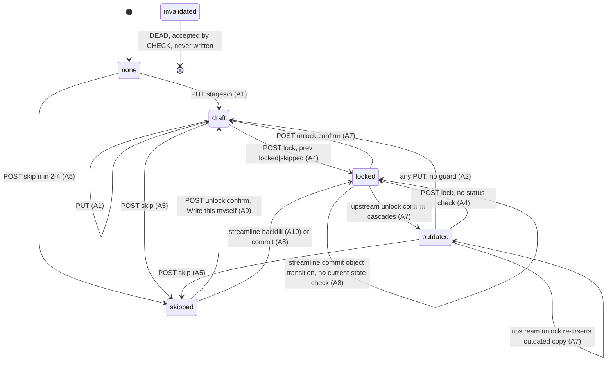
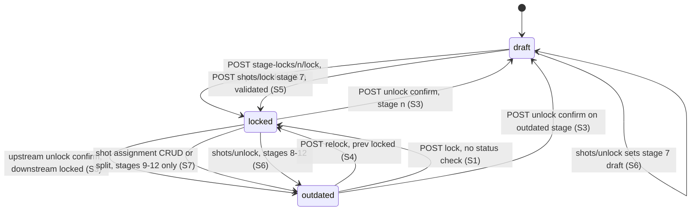
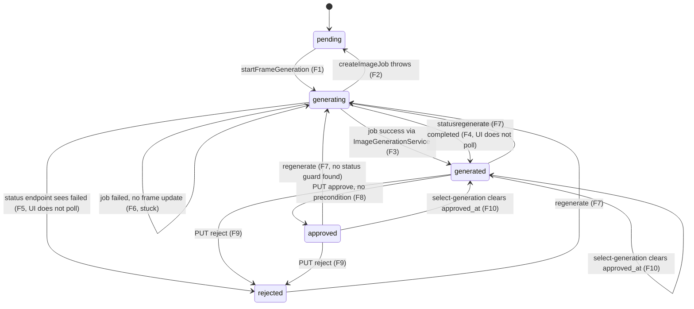
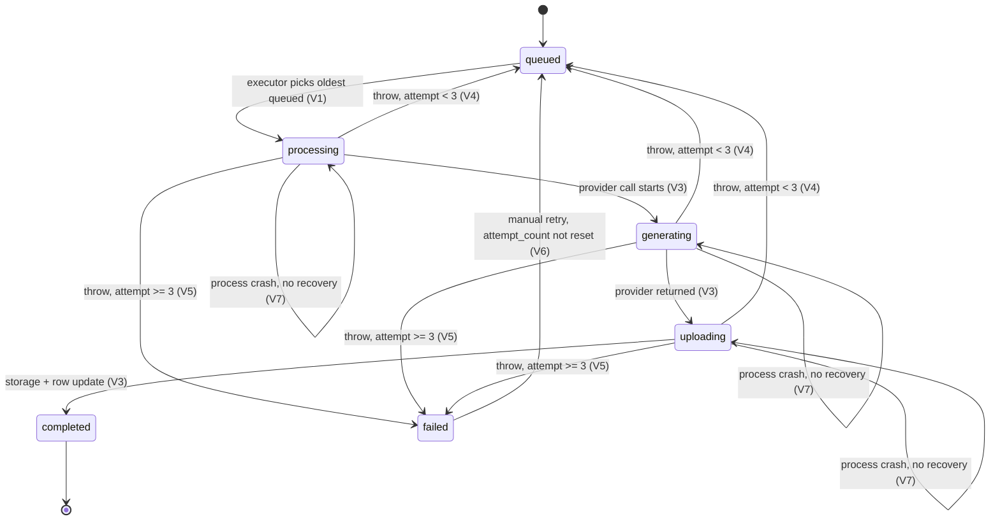
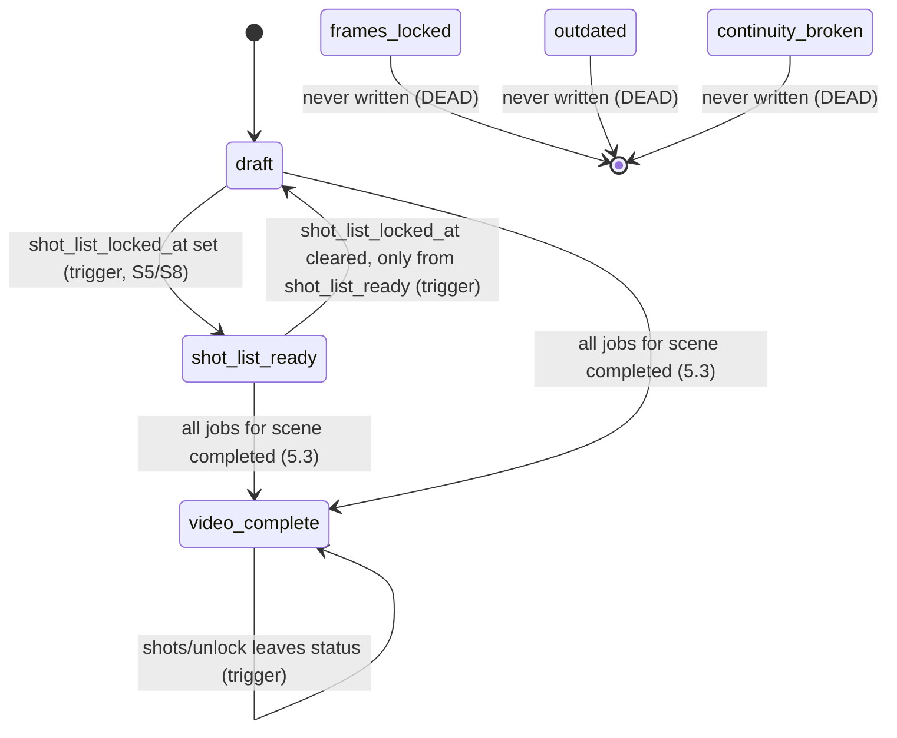

# H: Cross-cutting state machines, locking, invalidation, versioning, artifact preservation

Reporter H (wave 2). Read-only. Facts only. All paths relative to `/home/user/workspace/repo` unless stated.
Wave-1 ids are cited as `w1 WD-IMPL-*`. Anything not re-checked in code is marked `(wave1-unverified)`.
Status tags: VERIFIED = I read the cited code this wave. CODE-DERIVED = inferred from code paths I read, runtime not run. UNKNOWN = needs runtime or missing evidence.

Ledger: `reports/H-state-invalidation.ledger.jsonl` (kinds STATE, INV, FACT).

---

## 0. Summary (what a rebuilder needs to know)

1. There are four independent lock/status systems that do not reference each other by foreign key: (a) Phase A `stage_states` rows (stages 1-5, versioned, status draft/locked/outdated/skipped); (b) Phase B scene stage locks in `scenes.stage_locks` JSONB (stages 7-12, status draft/locked/outdated) plus `scenes.shot_list_locked_at`; (c) asset flags on `project_assets` (`locked`, `deferred`, `style_outdated`) and `scene_asset_instances.status_tags` containing the string `locked`; (d) per-artifact status columns (`frames.status`, `video_generation_jobs.status`, `scenes.status`).
2. Invalidation is almost entirely explicit and shallow. The only "outdated" writers are: Phase A unlock (stage_states), scene unlock (`stage_locks`), shots/unlock (`stage_locks` 8-12), and shot-assignment/split (`stage_locks` 9-12). None of them deletes or rewrites frames, prompts, videos, or assets. Every downstream generated artifact survives upstream edits unless a FK cascade removes it.
3. Cascade deletes are the real invalidation mechanism for artifacts: scene deletion (via PUT /scenes re-persist) and shot deletion remove frames, image/video jobs, transformation events and shot-asset assignments. Project asset and scene-asset-instance deletion remove attempts, assignments and transformation events. `text_field_versions` has no FK and is orphaned on delete.
4. Several intended invalidations silently do nothing. shots/unlock tries to set `frames.status='invalidated'`, which violates the CHECK constraint (frames.status allows only pending/generating/generated/approved/rejected), and writes to a `videos` table that exists in no migration. Errors are not checked. Scene-unlock impact counts from that same missing table and always reports 0 videos.
5. The Phase A unlock impact dialog is unreachable. `stageStateService.unlockStage` returns the raw 409 body, so `result.downstreamStages` is undefined in `ProjectView.handlePhaseAUnlock`, which then auto-confirms. Phase B (`sceneStageLockService`) unwraps `result.details` correctly, so its dialog works.
6. Locked content is mutable without unlock in several places: Stage 2 and Stage 3 bodies are not gated by lock state; Stage 4 autosave (TipTap setContent emits update) writes new versions under a locked status; a debounced Stage 4 save can fire after approve; Stage 1 streamline commit overwrites Phase A stage content with no lock check; Stage 5 style change clears style keys on a locked row without unlocking it.
7. Versioning exists only for stage_states (insert-only, latest = max version), text_field_versions (cap 8), scene asset generation attempts (cap 8), project asset attempts (cap 4), and image_generation_jobs (job rows; frames.current_job_id selects). Everything else is overwrite-in-place.
8. Video job state has no recovery path for jobs left in processing/generating/uploading after a process restart, and a scene can never reach video_complete while any historical job for it is failed, because `checkAndUpdateSceneStatus` reads all jobs for the scene.

---

## 1. Project-level stage_states machine (Phase A, stages 1-5 used by UI)

### 1.1 Schema facts
- `stage_states` (001:51-80): UNIQUE(branch_id, stage_number, version) at 001:77. Status CHECK initially `draft|locked|invalidated|outdated` (001:58), widened to add `skipped` (041:26-32). `origin` column added in 041:35-43 with CHECK `skipped|imported|ai-generated|authored` or NULL. Rows are never UPDATEd by app code; every change is an INSERT with version+1 (grep of writers below).
- `inherited_from_stage_id` self-FK without ON DELETE (001:61) is a lineage pointer, not a cascade.
- `style_capsule_applications.stage_state_id` ON DELETE CASCADE (004:53).
- `invalidated` is accepted by the CHECK (001:58, 041:32) and by PUT validStatuses (stageStates.ts:150), but no code path writes it to stage_states (grep: only type unions and the frames/videos filter in sceneStageLocks.ts:212,218 and projects.ts:3108,3116). Treat as DEAD value for stage_states.

### 1.2 Writers of stage_states (complete inventory)
| Writer | Where | Mechanism |
|---|---|---|
| PUT /api/projects/:id/stages/:n | stageStates.ts:120-294 | INSERT version+1, status from request (default draft) |
| POST .../stages/:n/lock | stageStates.ts:297-412 | INSERT locked copy of latest content |
| POST .../stages/:n/skip | stageStates.ts:416-519 | INSERT skipped, content {} |
| POST .../stages/:n/unlock confirm | stageStates.ts:523-667 | INSERT draft for n + INSERT outdated for each downstream locked/outdated |
| streamline_commit (SQL, called by POST /streamline/commit via RPC) | 043 streamline_commit (043:137-340); wrapper streamline_commit_atomic (044:38-85) | INSERT per stage transition, plus Stage 1 draft insert |
| POST /streamline/backfill/:n | streamline.ts:99-176 (wave1-unverified) | INSERT locked origin ai-generated, inherited_from skipped row |
| Client autosave / save | stageStateService.ts:89-141 (default status 'draft' at :113) | PUT |
| Stage 4 debounced save | Stage4MasterScript.tsx:145-168 | PUT status draft (via useStageState.save) |
| Stage 4 load (TipTap setContent) | Stage4MasterScript.tsx:186-211 + node_modules/@tiptap/core 3.15.3 setContent.ts:51 (emitUpdate defaults true) | onUpdate -> debounced PUT draft |

No DELETE and no UPDATE of stage_states rows exists in app code. Only branch/project delete removes rows (001:53 branch CASCADE).

### 1.3 Transition table (Phase A)
Legend: pre = precondition, side = side effects, pers = persistence, UI = UI signal.

| # | Transition | Trigger | Preconditions (verified) | Side effects | Evidence |
|---|---|---|---|---|---|
| A1 | none -> draft | PUT /stages/:n (autosave or manual) | project owned; active_branch_id set; stage 1..12; content object | INSERT version 1 (or latest+1), status = requested or 'draft'; origin = request or NULL; inherited_from = prior row; projects.updated_at bump; style_capsule_applications INSERT when metadata | stageStates.ts:120-294 |
| A2 | draft/outdated/skipped -> draft | any PUT with no status (or status draft) while latest is outdated or skipped | none beyond A1 | Guard at stageStates.ts:211-222 only checks `existingState.status === 'locked'`. Outdated and skipped rows are demoted to draft by any save. | stageStates.ts:211-222; stageStateService.ts:113 |
| A3 | locked -> locked (no change) | PUT with draft while latest locked | latest locked | New locked row with the submitted content (guard only forces status; content still replaced) | stageStates.ts:211-222 |
| A4 | any -> locked (copy) | POST /stages/:n/lock | n=1, or latest(n-1) status in {locked, skipped} (route check stageStates.ts:344-370; DB trigger 044:4-36 for any INSERT with status locked) | INSERT locked; content and regeneration_guidance copied from latest row regardless of its status (draft, outdated, locked, skipped all accepted); origin NULL; no projects.updated_at bump | stageStates.ts:297-412; 044:4-36 |
| A5 | draft/outdated/locked -> skipped | POST /stages/:n/skip, n in {2,3,4} | latest(n-1) in {locked, skipped}; latest(n) not locked (stageStates.ts:466-473) | INSERT skipped, origin skipped, content {}; projects.updated_at bump; no downstream effect | stageStates.ts:416-519; migration 043:258-282 (streamline skip path) |
| A6 | locked/skipped -> draft (unlock assessment) | POST unlock confirm=false | stage 1..5; latest status locked or skipped (else 400, stageStates.ts:564-566) | Writes nothing. Returns 409 with details.downstreamStages = stages n+1..5 whose latest is locked or outdated (stageStates.ts:568-610) | stageStates.ts:523-607 |
| A7 | locked/skipped -> draft, downstream locked/outdated -> outdated (unlock confirm) | POST unlock confirm=true | as A6 | INSERT draft for n (content copied, origin NULL, inherited_from = prior row); for each downstream stage in the A6 list INSERT outdated copy (content copied). Errors on the downstream inserts are not checked. projects.updated_at bump. Skipped downstream rows untouched. Phase B untouched. | stageStates.ts:609-667 |
| A8 | any -> skipped/locked/draft/outdated (commit) | POST /streamline/commit -> streamline_commit_atomic -> streamline_commit | payload stage_transitions keys 1..5 ascending; 'skip' only 2-4 and not over a locked latest; 'locked' requires an existing version and predecessor locked|skipped; object form accepts any status; object+locked checks predecessor only | INSERT per transition, append-only. No downstream outdating. Stage 1 draft INSERT happens in the atomic wrapper. FOR UPDATE on stage 1-5 rows serializes commits (043:189-192; wrapper 044:62). | 043:137-340 (skip 258-282, locked 284-307, object 308-327), 044:38-85 |
| A9 | skipped -> draft | POST unlock confirm (Write this myself) | latest skipped accepted by A6 | INSERT draft with content {} and origin NULL; ProjectView sets local status active | stageStates.ts:523-667; ProjectView.tsx:649-669 |
| A10 | skipped -> locked | POST /streamline/backfill/:n (Generate this now) | latest skipped; stage 4 with formattedScript (w1 V4); predecessor locked|skipped | INSERT locked origin ai-generated inherited_from = skipped row (wave1-unverified) | streamline.ts:99-176 (wave1-unverified) |

Derived frontend statuses (not persisted): `pending`, `active`, plus `outdated` assigned locally. Derivation: ProjectView.tsx:44-76 and 311-363 (w1 STATE-17). Navigation guard: ProjectView.tsx:365-389 (w1 STATE-18). Local outdating on unlock: ProjectView.tsx:718-747 (sets downstream locked -> outdated locally only).

### 1.4 FACT: Phase A impact dialog never shows (CONTRADICTED UI wiring)
- Backend 409 body: `{ error, details: { stage, downstreamStages, message }, requiresConfirmation: true }` (stageStates.ts:568-580).
- `stageStateService.unlockStage` returns `response.json()` on 409 unchanged (stageStateService.ts:189-191).
- `ProjectView.handlePhaseAUnlock` tests `result.downstreamStages` at top level (ProjectView.tsx:691-716). Undefined, so the else branch runs: `setPhaseAUnlockImpact(null)` then `handleConfirmPhaseAUnlock(stageNumber)`, which calls unlock with confirm=true (ProjectView.tsx:718-747).
- Result: Phase A unlock cascades to outdated with no dialog. The toast says "unlocked for editing". Contrast Phase B: sceneStageLockService.ts:105-108 returns `result.details`, and the hook opens UnlockWarningDialog.
- Runtime UNKNOWN only in the sense that no browser run was done; the code path is deterministic.

### 1.5 Phase A rules as observed (verified unless noted)
- Locked stage n>1 needs n-1 locked or skipped. Enforced twice: route check (stageStates.ts:344-370) and DB trigger (044:4-36, BEFORE INSERT WHEN status='locked').
- Outdated predecessor blocks lock of successor, because outdated is not locked|skipped (stageStates.ts:355-359).
- Outdated stage can be re-locked by POST /lock with no status check (stageStates.ts:297-412 reads only predecessor). This is the only Phase A "relock" path; there is no Phase A equivalent of scene relock.
- An outdated stage cannot be unlocked directly (A6 requires locked|skipped; outdated gives 400). It must be re-locked first.
- Save over a locked row keeps `locked` status but replaces content (A3).
- Save over an outdated row produces draft (A2). So outdated status is erased by the first save, including the load-time autosave described in 1.6.

### 1.6 Load-time and mount-time writes (verified)
- useStageState autosave effect (src/lib/hooks/useStageState.ts:99-143) fires whenever content changes with isLoading false. After loadStageState sets content and isLoading=false in the same tick (useStageState.ts:60-84), the effect fires once after load and PUTs the loaded content with status draft (stageStateService.ts:113) and origin NULL.
- Enabled for Stage 2 (Stage2Treatment.tsx:99), Stage 3 (Stage3BeatSheet.tsx:249), Stage 5 (Stage5Assets.tsx:106). Disabled for Stage 1 (Stage1InputMode.tsx:143, comment: "Disabled to prevent race condition with manual lock operation"). Stage 4 uses its own debounce with autosave false (Stage4MasterScript.tsx:89).
- Consequence: opening a locked or outdated Stage 2/3/5 writes a new row. Locked stays locked (A3). Outdated becomes draft (A2). Runtime confirmation UNKNOWN, but the path is unconditional.
- Stage 4 open: editor setContent with stored tiptapDoc (Stage4MasterScript.tsx:186-211). TipTap 3.15.3 setContent defaults emitUpdate=true (node_modules/@tiptap/core/src/commands/setContent.ts:51). onUpdate schedules a 2s debounced save with status draft (Stage4MasterScript.tsx:145-168). Result: each Stage 4 open writes one new version (w1 STATE-29 verified in code).

### 1.7 Stage 4 approve and Stage 5 finalize sequencing (verified)
- Stage 4 approve: `scriptService.persistScenes` then `stageStateService.lockStage(projectId, 4)` (Stage4MasterScript.tsx:606-626). Two requests, not atomic. The debounced save timer is only cleared on a new keystroke (Stage4MasterScript.tsx:158-160) or unmount (221-226), not on approve. A pending timer after the lock issues PUT draft, which the guard turns into locked with the new content (A3). The lock copied older content if the timer had not fired yet. Timing-dependent; the code permits both.
- Stage 5 finalize: `projectAssetService.lockAllAssets` then `stageStateService.lockStage(projectId, 5)` (Stage5Assets.tsx:777-779). Sequential, no rollback. If the second call fails, project_assets are locked and stage 5 remains draft (CODE-DERIVED).

### 1.8 Phase A style lock (Stage 5)
- Style lock content lives in stage_states.content keys `locked_visual_style_capsule_id`, `manual_visual_tone`, `manual_tone_preset`, `style_locked_at` (w1 STATE-41; read by projectAssets routes via latest stage 5 row, e.g. projectAssets.ts:297-300 and 1166-1169).
- Change Style handlers (Stage5Assets.tsx:262-300 for mark-outdated and 301-~320 for clear-all) call projectAssetService.markStyleOutdated / clearAllImages, then setContent with style keys null. setContent is the useStageState setter, so it triggers autosave (A2/A3). They do NOT call stageStateService.unlockStage. The stage 5 row stays `locked` and only its content changes (FACT, see FACT-06 in ledger).

### 1.9 Derived currentStage (verified)
- GET /api/projects (list): deduplicates to latest row per stage (projects.ts:296-330). currentStage = highest draft, else min(highest locked+1, 5) (w1 STATE-22; latest-only).
- GET /api/projects/:id: uses ALL rows with no dedupe (projects.ts:508-521). Any historical draft row counts, and every stage that was ever saved has a draft row in history, so the value is effectively the highest stage ever saved. Consumer of GET /:id currentStage in src: UNKNOWN (ProjectView keeps its own `currentStage` state at ProjectView.tsx:92; ProjectCard uses the list's project.currentStage).

### 1.10 Concurrency (verified)
- Read-then-insert version computation with UNIQUE(branch_id, stage_number, version) (001:77). Concurrent writers: one succeeds, the other gets 500 (stageStates.ts:188-256; w1 INV-9).
- streamline_commit serializes only commits (FOR UPDATE on existing stage 1-5 rows, 043 block at ~110-120). It does not block plain PUT inserts from other transactions.

### 1.11 Phase A mermaid

---

## 2. Scene-level stage locks (Phase B; `scenes.stage_locks` JSONB and `shot_list_locked_at`)

### 2.1 Schema facts
- `scenes.stage_locks` JSONB default '{}' is defined ONLY in `backend/quickies-sql/add_stage_locks.sql:1`, a manual script whose own comment says "Ran successfully on prod." No numbered migration (001-044) adds it (grep of all *.sql for stage_locks: only that file). A DB built from numbered migrations lacks this column (FACT-05).
- Backfill in that script sets key '7' from shot_list_locked_at only.
- `scenes.shot_list_locked_at` added in 014:9. Trigger `trg_sync_scene_lock_status` BEFORE UPDATE (014:31-62).
- `scenes.status` CHECK values in 014:19-27: draft, shot_list_ready, frames_locked, video_complete, outdated, continuity_broken.
- UNIQUE(branch_id, scene_number) at 003:34.

### 2.2 Writers and transitions (stage_locks entries 7-12)
Keys are strings '7'..'12'. Entry shape `{status: draft|locked|outdated, locked_at?}`. Absent key is treated as draft by routes.

| # | Transition | Trigger | Preconditions | Side effects | Evidence |
|---|---|---|---|---|---|
| S1 | draft -> locked (stage n) | POST /scenes/:s/stage-locks/:n/lock (n 7..12) | project owned; scene on active branch; n=7, or stage_locks[n-1].status === 'locked' (outdated blocks). Current status of n NOT checked. | Writes locked + locked_at; n=7 also sets shot_list_locked_at=now, which fires trigger -> scenes.status shot_list_ready (if it was null). No check against stage_locks of n-1 being outdated beyond the locked test. No validation of shots. | sceneStageLocks.ts:56-141 (predecessor 92-105, write 108-131) |
| S2 | assessment (no write) | POST .../unlock confirm=false | scene stage locked or outdated (draft or missing -> 400, sceneStageLocks.ts:183-185) | Returns 409 details {downstreamStages (locked|outdated >n), framesAffected, videosAffected, estimatedCost}. framesAffected counts frames with status != invalidated; videosAffected counts rows in table `videos` which does not exist, so always 0 (FACT-03) | sceneStageLocks.ts:145-242 |
| S3 | locked/outdated -> draft (stage n), downstream locked -> outdated | POST .../unlock confirm=true | as S2 | stage_locks[n] = {status:'draft'}; each downstream locked|outdated -> {status:'outdated'} (locked_at dropped). n=7 sets shot_list_locked_at=null (trigger reverts status shot_list_ready -> draft only if it was shot_list_ready). No frames/videos/prompt change. | sceneStageLocks.ts:244-286 |
| S4 | outdated -> locked (stage n), no content change | POST .../relock | status must be exactly 'outdated'; n=7 or stage_locks[n-1] locked | Writes locked + new locked_at; n=7 sets shot_list_locked_at=now | sceneStageLocks.ts:290-375 |
| S5 | draft -> locked (stage 7) via shot list | POST /api/projects/:id/scenes/:s/shots/lock | project owned; scene on active branch; idempotent if shot_list_locked_at already set (returns success without writing, projects.ts:2888-2900); shotValidation errors -> 400 (no force); warnings -> 409 unless force | Writes shot_list_locked_at=now, stage_locks['7']=locked (projects.ts:2968-2977), updated_at; update guarded by .is('shot_list_locked_at', null) (projects.ts:2991). stage_locks is a read-modify-write from the earlier SELECT with no guard (see INV-16). Trigger sets status shot_list_ready. | projects.ts:2845-3010 |
| S6 | locked/outdated -> draft (stage 7) and 8-12 locked|outdated -> outdated | POST /api/projects/:id/scenes/:s/shots/unlock | shot_list_locked_at must be non-null (400 otherwise, projects.ts:3050-3052). If scene.status is frames_locked or video_complete: 409 unless confirm (projects.ts:3056-3073). | Attempts frames status='invalidated' and videos status='invalidated' (projects.ts:3104-3118), both silently ineffective (FACT-02, FACT-03). Attempts invalidation_logs insert (table absent, projects.ts:3120-3131). stage_locks[7]=draft, 8..12 locked|outdated -> outdated (projects.ts:3143-3150). shot_list_locked_at=null. | projects.ts:3020-3180 |
| S7 | locked|outdated (stages 9-12) -> outdated | any successful shot-assignment create, update, delete, bulk delete, or shot split | assignments route success path | invalidateStage9AndDownstream reads scene stage_locks and sets each locked entry for 9..12 to {status:'outdated'} (drops locked_at), updates updated_at. Called fire-and-forget (not awaited before response). Stage 8 and merge/single delete do not call it. | shotAssetAssignmentService.ts:318-344; shotAssignments.ts:147,180,208,236; projects.ts:2637 |
| S8 | scenes.status draft/shot_list_ready/video_complete | DB trigger on any UPDATE that changes shot_list_locked_at null-ness | see 2.3 | see 2.3 | 014:31-62 |

Callers of S1-S4 in the UI:
- Stage 7 lock: `shotService.lockShotList` (shots/lock) and then best-effort `lockStageViaHook(7)` (stage-locks/7/lock) (Stage7ShotList.tsx:697-712). Two writes, not transactional.
- Scene complete: ProjectView.handleSceneStageComplete calls stage-locks lock for the current sceneStage (ProjectView.tsx:589-600). Stage 7 wiring: Stage7ShotList onComplete = handleSceneStageComplete (ProjectView.tsx:784).
- Stage 11 confirm success locks 11 (best-effort), Stage 12 Complete Scene locks 12 (w1 STATE-81; ProjectView.tsx:589-615 verified only partly).

### 2.3 scenes.status (verified writers)
- Writers found by grep: DEFAULT/INSERT 'draft' (projects.ts:1413 PUT /scenes insert; default in 003), trigger (014:31-62), `video_complete` (videoGenerationService.ts:516-537).
- `frames_locked`, `outdated`, `continuity_broken`: allowed by CHECK, typed in src/types, read by UI labels and projects.ts:372/3056, but NO backend or frontend writer found (grep). Treat as DEAD writes (FACT-04).
- Trigger detail (014:31-50): lock (null->non-null) sets 'shot_list_ready' unconditionally. Unlock (non-null->null) sets 'draft' only when OLD.status = 'shot_list_ready'; otherwise status is left (so video_complete remains after shots/unlock).

### 2.4 Relationship between Phase A and Phase B
- Scene stage routes (stage-locks/*, shots/lock) do not read stage_states. Grep of sceneStageLocks.ts and the shots/lock handler shows no stage_states reference. The Phase B gate on Phase A is UI-only (ProjectView renders Phase B only after Phase A; `reachedPhaseB` localStorage flag, ProjectView.tsx:108,202-221; w1 STATE-19). UNKNOWN whether any other server path enforces it.
- Phase A unlock never touches scenes or stage_locks (A7 writes stage_states only; w1 STATE-05 verified: "Phase B scene locks are not touched" holds by absence of code).
- Phase A stage 4 persist (PUT /scenes) changes the scene set and can delete scenes whose stage_locks/shots are locked (see INV-15).

### 2.5 Scene stage lock mermaid

### 2.6 Shot-list and scene status interaction (verified)
- shot_list_locked_at null/non-null drives scenes.status via trigger (2.3, S8).
- shots/unlock with scenes.status video_complete keeps the status (014 trigger leaves it), and the UI sees both stage_locks[7]=draft and status video_complete (CODE-DERIVED inconsistency).

---

## 3. Asset approval/lock states (project assets, scene asset instances, attempts)

### 3.1 project_assets flags (Stage 5 gatekeeper, Phase A)
| Flag | Set by | Cleared by | Gates | Evidence |
|---|---|---|---|---|
| locked (boolean) | lock-all: sets true on all non-deferred unlocked active assets after gate passes (projectAssets.ts:1675-1755, update at ~1729); POST /assets/:id/lock: sets true if image_key_url set (projectAssets.ts:1527-1585, update at 1565); Stage 8 create-with-project-asset inserts locked:true (sceneAssets.ts:885-935, insert at 933) | no route writes false. Clone-from-global insert uses locked:false default (projectAssets.ts:1962) | PUT text, DELETE, merge, split, sync rejected server-side (w1 STATE-36; verified only that the flag exists and lock route writes it) | 1527-1585, 1675-1755, sceneAssets.ts:933 |
| deferred (boolean) | defer/restore route | n/a | excluded from gate and lock-all (w1 STATE-37) | wave1-unverified |
| style_outdated (boolean) | mark-style-outdated sets true on all assets with image_key_url (projectAssets.ts:1587-1618, update at 1607) | successful master_asset job for that asset (ImageGenerationService.ts:406-410); clear-all sets false (projectAssets.ts:1651) | none. Only reader: Stage5Assets.tsx:1153 (badge) | as listed |
| image_key_url | any new image, select, upload, sync, clear | clear-all sets null (projectAssets.ts:1651) | lock POST requires non-null | as listed |
| visual_style_capsule_id on asset | snapshot at clone/extract | not updated by style change (w1 INV-28, consistent with projectAssets routes) | regeneration uses stored id | wave1-unverified |

FACT-09: Stage 8 manual asset creation writes `locked: true` (sceneAssets.ts:933). Wave 1 described the flag as set only by lock-all and POST lock. Newly created Stage 8 assets are therefore locked from creation.

### 3.2 Attempts (versioning of asset images)
- project_asset_generation_attempts: is_selected partial unique per asset (023:51); cap 4 with deletion of oldest non-selected and storage remove (projectAssetAttemptsService.ts:9, 168-200; remove at ~191-195).
- scene_asset_generation_attempts: is_selected partial unique per instance (022:43-45); cap 8 with DB delete + storage remove (sceneAssetAttemptsService.ts:8, 161-188). FK instance CASCADE (022:11), job SET NULL (022:22).
- Writers that set is_selected and mirror image_key_url: select route, upload, generation completion, use-master, backfill (w1 STATE-46; sceneAssetAttemptsService.ts:79-115; ImageGenerationService.ts:443-495). Select route writes image_key_url in a separate statement (non-atomic, w1 STATE-46 note).
- use_master_as_is (scene instance): set true by use-master, sets image_key_url to master url and inserts master_copy attempt; cleared by upload and select-master-reference (w1 STATE-47; sceneAssets.ts:1296-1339 wave1-unverified).

### 3.3 Scene asset instance description triplet (verified)
- description_override (user or inherited text), effective_description (stored snapshot), and text_field_versions for description_override (cap 8). Effective description is recomputed only on PUT with descriptionOverride and on create paths (sceneAssets.ts:619-631; 015:34). Version write-back changes description_override only (textFieldVersionService.ts:226-241). The two can diverge (w1 STATE-45 with write-back failure logged only).
- Project asset description edits do not propagate into instances (INV-22).

### 3.4 Transformation events
- confirmed boolean (030:46-49). Confirm route sets confirmed=true and confirmed_at (transformationEventService.ts:302-312). updateTransformationEvent never writes confirmed (transformationEventService.ts:275-299 payload list). No un-confirm route (sceneAssets.ts:1828-1901 routes: POST create, PUT update, POST confirm, DELETE, generate endpoints). Confirmed events are editable via PUT (sceneAssets.ts:1852-1869).
- Only confirmed events affect resolution, inheritance and reference chain (transformationEventService.ts:117-125; w1 INV-41).

### 3.5 Scene stage 8 "lock asset" tag (verified)
- status_tags includes the string 'locked' (VisualStateEditorPanel.tsx:433, 311-324). Disables several editor controls client-side. No backend check (w1 STATE-49).

---

## 4. Frame status machine and frame_links

### 4.1 frames table (019)
- UNIQUE(shot_id, frame_type) (019:48). frame_type start|end (w1 V9).
- status CHECK: pending, generating, generated, approved, rejected (019:12-19).
- current_job_id FK image_generation_jobs ON DELETE SET NULL (019:25). previous_frame_id SET NULL (019:32). shot_id CASCADE (019:8).

### 4.2 Writers and transitions (verified)
| # | From -> To | Trigger | Preconditions | Side effects | Evidence |
|---|---|---|---|---|---|
| F1 | pending -> generating | startFrameGeneration (regenerate, generate-frames, etc.) | frame row exists | prompt_snapshot set on job (ImageGenerationService.ts:277), frames.status generating (frameGenerationService.ts:871-875) | 845-935 |
| F2 | generating -> pending | createImageJob throws | none | frames.status pending (frameGenerationService.ts:926-931) | 926-931 |
| F3 | generating -> generated | ImageGenerationService success, job_type start_frame|end_frame | shotId present | UPDATE frames WHERE shot_id AND frame_type (not by current_job_id), sets image_url, storage_path, generated_at (ImageGenerationService.ts:521-531). No check that job is still current (race if a stale job completes). | ImageGenerationService.ts:521-531 |
| F4 | generating -> generated | GET /frames/:id/status (getFrameJobStatus) sees completed job | current_job_id non-null | onJobCompleted: sets generated and ADDS job cost to total_cost_credits on every call (no idempotence guard) | frameGenerationService.ts:1365-1427; frames.ts:480-512 |
| F5 | generating -> rejected | GET /frames/:id/status sees failed job | current_job_id non-null | onJobFailed sets rejected | frameGenerationService.ts:1430-1437 |
| F6 | generating -> (none) | ImageGenerationService job failure | none | Job row failed; angle variant failed if applicable. Frame NOT updated. Frame stays generating unless F5 runs. | ImageGenerationService.ts:560-585 |
| F7 | generated|rejected|approved -> generating | regenerate route | frame exists (no status guard found) | frame_links WHERE target = frame DELETED (frames.ts:393); startFrameGeneration; then propagateFrameLinks(frameId) at frames.ts:408 | frames.ts:365-410 |
| F8 | generated -> approved | PUT .../approve | project owned | UPDATE status approved, approved_at=now. No check of image_url, current status, or that frame belongs to sceneId (frameId only). | frames.ts:297-320; frameGenerationService.ts:939-953 |
| F9 | generated|approved -> rejected | PUT .../reject | project owned | UPDATE status rejected | frames.ts:331-356; frameGenerationService.ts:958-972 |
| F10 | any -> generated (select another job) | PUT select-generation | job completed | frame_links WHERE target deleted (frames.ts:1350); image_url, prompt_snapshot = job prompt, status generated, approved_at null; then propagateFrameLinks (frames.ts:1372) | frames.ts:1340-1372 |
| F11 | generated -> generated (delete generation) | DELETE generations/:jobId | job not current; >=2 completed jobs of same type | storage remove, image_generation_jobs row deleted, generation_count decremented | frames.ts:1436-1470 |
| F12 | generated -> generated (upload variant) | upload | none checked here | frame_links for target deleted (w1 STATE-74) | wave1-unverified |

### 4.3 Stage 10 polling (verified)
- Stage10FrameGeneration.tsx:252-258: refetchInterval 2000 ms while calculateProgress(shots).generatingFrames > 0 (frameService.ts:670-710 counts frames with status 'generating').
- The only route that performs F4/F5 is GET .../frames/:id/status (frames.ts:480-512). Its client wrapper frameService.pollFrameStatus (frameService.ts:569-587) is called only by pollUntilComplete (frameService.ts:593-629), and pollUntilComplete has no callers in src (grep). So F5 is not reached from the UI.
- Consequence: a failed frame job (F6) leaves the frame in 'generating', and the Stage 10 query polls every 2 s indefinitely. Runtime UNKNOWN; code path clear (FACT-14).

### 4.4 frame_links (verified)
- Table 034 (source_frame_id, target_frame_id both CASCADE, 034:7-8); link_type match|reference (035); UNIQUE per target per 035:49-59 (w1 INV-46; one link per target enforced in code in copy/batch/add-as-reference routes).
- Creation: copy-frame, batch-link-copy, add-frame-as-reference (delete then insert). Deletion: regenerate (frames.ts:393 incoming), upload, select-generation (frames.ts:1350 incoming), DELETE frame-links route, pull-ref replacement. Not deleted by: correction, edited-prompt regenerate, inpaint (w1 STATE-74 verified in part by reading the route lines listed).
- Propagation: propagateFrameLinks (frameGenerationService.ts:1545-1596) copies source image_url to every match target (link_type match) and rewrites target prompt_snapshot. Call sites: frames.ts:408 (regenerate, before job completes, see INV-19), 468 (inpaint/correction-like route), 1215 (route not traced in this wave), 1372 (select-generation, after image_url update).

### 4.5 Frame mermaid

---

## 5. Video job machine, scene render status, credits

### 5.1 video_generation_jobs (021)
- status CHECK: queued, processing, generating, uploading, completed, failed (021:20-27).
- attempt_count DEFAULT 0, max_retries DEFAULT 3 (021:57-58).
- FKs: project, branch, scene, shot CASCADE (021:8-11); start_frame_id REFERENCES frames(id) NO ACTION (021:30); end_frame_id NO ACTION (021:31).

### 5.2 Executor transitions (verified)
| # | Transition | Trigger | Side effects | Evidence |
|---|---|---|---|---|
| V1 | queued (pick) -> processing | processQueuedJobs loop, fetchNextQueuedJob selects status=queued oldest-first (VideoJobExecutor.ts:62-72); processJob -> updateJobStatus('processing') sets processing_started_at | in-memory isProcessing flag prevents concurrent loop in one process (VideoJobExecutor.ts:33) | VideoJobExecutor.ts:28-56, 62-72, 81-90; videoGenerationService.ts:462-510 |
| V2 | processing: attempt_count += 1 | VideoJobExecutor.ts:90-95 writes job.attempt_count+1 from pickup snapshot | | |
| V3 | processing -> generating -> uploading -> completed | provider call (VideoJobExecutor.ts:96-130). Completed writes completed_at, video_url, storage_path, actual_cost, provider ids | then checkAndUpdateSceneStatus | VideoJobExecutor.ts:130-137; videoGenerationService.ts:516-537 |
| V4 | any -> queued (retry) | throw and attemptCount < max_retries (3) | error_message, attempt_count set, status queued (VideoJobExecutor.ts:150-160) | |
| V5 | any -> failed | throw and attemptCount >= max_retries | updateJobStatus failed with error_code, error_message; checkAndUpdateSceneStatus | VideoJobExecutor.ts:161-171 |
| V6 | failed -> queued (manual retry) | POST video-jobs/:id/retry; retryJob requires status failed | nulls error_code, error_message, video_url, storage_path, provider_job_id, provider_metadata, processing_started_at, completed_at; attempt_count NOT reset; triggerJobProcessing | videoGenerationService.ts:563-597 |
| V7 | processing|generating|uploading -> (none) | process crash or restart | no sweep found: fetchNextQueuedJob only selects queued; grep shows no other reset of these statuses. Stuck until manual DB change. | VideoJobExecutor.ts:62-72 (grep of 'processing' and 'generating' writers) |

Consequence of V4 + V6 (verified arithmetic): a job that exhausted 3 attempts has attempt_count 3. Manual retry sets queued without reset. Next processJob writes attempt_count 4, and the catch computes attemptCount 4 >= max 3, so it fails after one attempt (FACT-15).

### 5.3 Scene render status
- checkAndUpdateSceneStatus (videoGenerationService.ts:516-537) reads getVideoJobs(sceneId) which returns ALL jobs for the scene with no status or render filter (videoGenerationService.ts:428-440). If every job is completed, scenes.status = video_complete. Otherwise no change.
- Re-render appends jobs. confirmAndQueueRender inserts a new job per shot without deleting or superseding prior jobs and without a duplicate-render check (videoGenerationService.ts:~326-395). Therefore video_complete is unreachable while any historical job for the scene is failed, and the only way to clear such a job is retry (V6) (FACT-15).
- getRenderStatus / batch status (videoGenerationService.ts:540-625) uses the same job set (w1 V10).

### 5.4 Credits (verified ordering)
- confirmAndQueueRender: hasSufficientCredits check (line ~334-337) -> insert jobs (~340-385) -> map inserted jobs -> deductCredits(totalCost) (~393) -> triggerJobProcessing (fire and forget). Jobs are inserted before deduction. A deduction throw leaves queued jobs and does not trigger processing (CODE-DERIVED).
- userCreditsService read-modify-write, no transaction, no ledger, no refund path (w1 STATE-79; wave1-unverified in detail).

### 5.5 Snapshots
- Prompt and frame URL snapshotted when the job is queued (w1 INV-72; videoGenerationService.ts:354-369; VideoJobExecutor.ts:110-117 wave1-unverified). Later frame or prompt edits do not change queued/completed jobs.

### 5.6 Video mermaid

Scene render status (scenes.status), for reference:

---

## 6. Invalidation and cascade catalogue

### 6.1 Application-level outdated marking (explicit)
| Rule | Trigger | Marks | Does not touch | Evidence |
|---|---|---|---|---|
| R1 Phase A unlock confirm | POST stage unlock confirm (1..5) | locked|outdated stages >n -> outdated (stage_states copy) | skipped downstream; Phase B; any artifact | stageStates.ts:609-667 |
| R2 Scene stage unlock confirm | POST stage-locks unlock confirm | locked|outdated stages >n -> outdated; n -> draft | frames, videos, prompts, shots | sceneStageLocks.ts:244-286 |
| R3 shots/unlock | POST shots/unlock confirm | stage_locks 8-12 locked|outdated -> outdated; 7 -> draft; shot_list_locked_at null; attempts frames/videos 'invalidated' (both no-op, FACT-02/03) | rows not deleted | projects.ts:3020-3180 |
| R4 shot assignment CRUD/split | success of assignment routes and split | stage_locks 9-12 locked -> outdated | stages 7-8; assignments; frames | shotAssetAssignmentService.ts:318-344; callers listed in S7 |
| R5 Stage 2/3 edits, Phase A save over locked, streamline object commit | any write | nothing | everything | stageStates.ts:211-222; 043:308-327 |
| R6 Style change (Stage 5) | mark-style-outdated | project_assets.style_outdated=true on assets with image | nothing else; stage 5 row stays locked | projectAssets.ts:1587-1618; Stage5Assets.tsx:262-300 |
| R7 Phase A unlock also sets frontend-local outdated (display only) | ProjectView local state | UI state only | DB | ProjectView.tsx:718-747 |

### 6.2 DB triggers
| Trigger | Table | Effect | Evidence |
|---|---|---|---|
| trg_streamline_stage_lock_prerequisite (BEFORE INSERT on stage_states) | stage_states | RAISE if status locked and n-1 not locked|skipped | 044:4-36 |
| trg_sync_scene_lock_status (BEFORE UPDATE on scenes) | scenes | status shot_list_ready on lock; draft on unlock only if was shot_list_ready | 014:31-62 |
| update timestamp triggers | many | updated_at only | 006, 019, 021, 022, 025, 030, 033, 003 |
| scene_asset_modification_tracker (BEFORE UPDATE scene_asset_instances, 017:43-47) | scene_asset_instances | modification_count + 1 on every UPDATE, last_modified_field for four columns | 017:22-47 (w1 STATE-51) |
| create_initial_branch (AFTER INSERT projects) | branches | Main branch, active_branch_id | 001:168-188 |

### 6.3 FK cascades and set-nulls (complete list from migrations, verified by grep)
CASCADE (child deleted with parent):
- projects -> branches (001:31), image_generation_jobs (007:11), video_generation_jobs (021:8), project_assets (008:49), other project-owned tables.
- branches -> stage_states (001:53), scenes (003:7), project_assets (008:50), video jobs (021:9), image jobs (007:12), intake resolutions (043:21).
- scenes -> shots (006:7), scene_asset_instances (015:15), image_generation_jobs (007:13), video_generation_jobs (021:10), transformation_events (030:17), scene_asset_suggestions (024:6), location_match_events (039:88).
- shots -> frames (019:8), image_generation_jobs (007:14), video_generation_jobs (021:11), transformation_events trigger_shot_id (030:20), shot_asset_assignments (033:11), location_match_events (039:89).
- frames -> frame_links source and target (034:7-8).
- scene_asset_instances -> scene_asset_generation_attempts (022:11), shot_asset_assignments (033:12), transformation_events (030:14), frames? no.
- project_assets -> project_asset_generation_attempts (023:25), asset_angle_variants (025:11), location_views (038:13), scene_asset_instances (015:16).
- location_views -> none (shots.camera_direction_id is SET NULL, 038:108).
- stage_states -> style_capsule_applications (004:53).
- image_generation_jobs -> frames (rows CASCADE via shot path only; frames.current_job_id SET NULL, 019:25).

SET NULL:
- shots.location_asset_id -> project_assets (039:30).
- shots.camera_direction_id -> location_views (038:108).
- frames.previous_frame_id -> frames (019:32); frames.generated_from_frame_id and selected_continuity_base_frame_id (040:24,39,42,79).
- scene_asset_suggestions.asset_id -> project_assets (024:7).
- scene_asset_instances.inherited_from_instance_id -> scene_asset_instances (015:27).
- scene_asset_generation_attempts.image_generation_job_id -> image_generation_jobs (022:22).
- scene_asset_instances.selected_master_reference_* instance -> SET NULL (022:68).
- transformation_events.completion_shot_id -> shots (030:26).
- location_match_events.result_location_asset_id -> project_assets (039:93).
- project_assets.visual_style_capsule_id / writing_style_capsule_id: style_capsules ON DELETE SET NULL (008:22,64); writing_style_capsule_id and visual_style_capsule_id on projects are NO ACTION (004:62-63).

NO ACTION (blocks parent delete while child references):
- video_generation_jobs.start_frame_id / end_frame_id -> frames (021:30-31).
- asset_angle_variants.image_generation_job_id -> image_generation_jobs (025:15; wave1-unverified whether this blocks job deletion).
- stage_states.inherited_from_stage_id -> stage_states (001:61).
- style_capsule_applications.style_capsule_id -> style_capsules (004:54).

Polymorphic / no FK:
- text_field_versions.entity_id (036): no FK, no cascade. Rows orphaned when shot or scene_asset_instance is deleted (FACT-11).
- project_assets.locked etc. are columns, no FK rules.

### 6.4 Application-level cascade-deletes (explicit DELETE statements)
| Operation | Deletes | Evidence |
|---|---|---|
| PUT /api/projects/:id/scenes (Stage 4 approve, streamline sync) | scenes not matched by slug+number and then number-only (projects.ts:1419-1445). Error ignored ("Continue anyway", projects.ts:~1437-1443). Matched rows keep id, stage_locks, shot_list_locked_at, status, is_deferred (projects.ts:1378-1442). Inserted rows get status draft. | projects.ts:1217-1529 |
| POST /shots/:shotId/split | original shot deleted after saving its assignments to re-insert (projects.ts:2558 and 2599 etc.) | projects.ts:2515-2640 |
| merge | two shot rows deleted (projects.ts:2713, 2715) | projects.ts:2657-2788 |
| DELETE shot | shot row (projects.ts:2833) -> cascades per 6.3 | projects.ts:2791-2840 |
| DELETE project | project row only; storage objects not removed | projects.ts:3961-4004 |
| DELETE frame generation | job row and storage object; frame current job unaffected by guard | frames.ts:1436-1470 |
| Scene attempt cap / project attempt cap | oldest non-selected attempt row and storage object | sceneAssetAttemptsService.ts:161-188; projectAssetAttemptsService.ts:168-200 |
| Text version cap | oldest non-selected text_field_versions row; no storage (not applicable) | textFieldVersionService.ts:179-199 |
| Project asset delete | project_assets row -> cascades per 6.3 (attempts, angle variants, location views, instances -> assignments, transformation events) | projectAssets.ts:673-730 + FKs |
| Location view delete | location_views row; shots.camera_direction_id SET NULL; frame image storage object deleted while frames row still references URL (w1 INV-31, wave1-unverified) | projectAssets.ts:3128-3190 (wave1-unverified) |
| Scene asset instance delete | instance row -> cascades per 6.3 | sceneAssets.ts:692 (delete call) + FKs |

### 6.5 Silent or no-op invalidations (verified)
- FACT-02: shots/unlock writes frames.status='invalidated' (projects.ts:3103-3109). frames CHECK does not include 'invalidated' (019:12-19). Error unchecked. Frames unchanged.
- FACT-03: shots/unlock and scene unlock refer to table `videos` (projects.ts:3076-3079, 3113-3118; sceneStageLocks.ts:209-219). No migration creates it. Writes unchecked. Counts 0. Table name `videos` exists as a storage bucket only (Veo3Provider.ts:338-354), which is a different API.
- FACT-10: invalidation_logs insert (projects.ts:3120-3131). No migration creates it. The try/catch does not catch Supabase error objects, so failure is silent.
- text_field_versions orphan on delete (FACT-11).

---

## 7. Versioning mechanisms

| Mechanism | What is versioned | Creation | Selection / "current" | Pruning | Evidence |
|---|---|---|---|---|---|
| stage_states (Phase A) | whole stage content, status, origin, regeneration_guidance per branch and stage | INSERT version+1 on every write (A1-A10) | latest = max(version) per (branch, stage) | never pruned; deleted only with branch/project | 001:51-80, 001:77, stageStates.ts:120-667 |
| scenes.stage_locks (Phase B) | per-stage lock state; no history | overwrite | current key | n/a (no history) | sceneStageLocks.ts |
| text_field_versions | fields frame_prompt, video_prompt, end_frame_prompt (shot), description_override (scene_asset_instance) | createVersion on save/select/AI generation | is_selected=true (partial unique 036:idx); write-back to source column | cap 8: delete oldest non-selected before insert (textFieldVersionService.ts:179-199). No storage. Not cascaded (no FK). | 036; textFieldVersionService.ts:9,62-110,179-199,226-241 |
| scene_asset_generation_attempts | images per instance | enforceAttemptCap then INSERT on generation/upload/use-master/backfill | is_selected partial unique (022:43-45); mirrored to instance.image_key_url | cap 8, delete oldest non-selected + storage remove | 022; sceneAssetAttemptsService.ts:8,79-115,161-188 |
| project_asset_generation_attempts | images per project asset | same pattern | is_selected partial unique (023:51); mirrored to project_assets.image_key_url | cap 4, delete + storage remove | 023; projectAssetAttemptsService.ts:9,168-200 |
| image_generation_jobs | each generation job (prompt, status, storage_path, cost) | every job creation | frames.current_job_id picks which job is shown | DELETE generation route (frames.ts:1436-1470) with >=2 completed guard, and storage remove; otherwise retained | 007; ImageGenerationService.ts:109-187,298-582 |
| asset_angle_variants | one row per (asset, angle) | upsert pending; job start generating; completed or failed | completed rows used by frame prompts | none | 025; w1 V5 |
| location_views | per-direction views with source (established|stage7_inferred) and is_primary | insert, update | is_primary applied by app convention (unset others) | delete route | 038; projectAssets.ts:2761-3190 |
| frames | one row per (shot, frame_type); no history table | in-place update | status field | none | 019:48 |
| frame_links | link rows per target | copy/batch/add-as-reference inserts after deleting target's prior link | match links reactive | cascades with frames | 034, 035:49-59 |
| video_generation_jobs | one row per (shot, render) | confirm-render inserts per shot; never deleted | all rows used for scene status (5.3) | none; retry resets status only | 021; videoGenerationService.ts:428-440 |
| shots.frame_prompt etc. | current prompt columns | in-place update | current column | history only via text_field_versions | projects.ts:3459-3570 |
| shots.reference_image_order, end_frame_reference_image_order | JSON arrays of references | generate-prompts and reference PUT replace wholesale | current | none | w1 STATE-60 (partially verified) |
| shots.shot_order | integer per scene | split/merge/delete shift or gap | current | no uniqueness constraint (w1 STATE-68) | wave1-unverified |
| projects.updated_at | timestamp | triggers and explicit writes (some routes skip it, INV-15) | n/a | n/a | projects.ts |

---

## 8. Dependency matrix (artifact rows x edit/regeneration actions)

Codes: `I` = status/flag marked outdated or changed; `D` = row deleted (cascade or explicit); `C` = content/column overwritten or nulled; `U` = unchanged; `X` = attempted but ineffective; `-` = not applicable. Evidence sources are the rule IDs in sections 1-6.

Columns:
- c1 Phase A unlock confirm (stage 1-5)
- c2 Phase A save / lock / streamline commit
- c3 Scene stage unlock confirm (stage-locks)
- c4 Shot-list unlock (shots/unlock)
- c5 Shot assignment CRUD / split
- c6 Shot merge / single delete
- c7 Shot PUT / prompt PUT
- c8 Generate prompts (Stage 9)
- c9 Frame regenerate / select / approve / reject
- c10 Project asset edit / delete / style change
- c11 Scene asset instance edit / attempt select / generate
- c12 PUT /scenes re-persist (Stage 4 approve, streamline scene sync)
- c13 Project delete

| Artifact | c1 | c2 | c3 | c4 | c5 | c6 | c7 | c8 | c9 | c10 | c11 | c12 | c13 |
|---|---|---|---|---|---|---|---|---|---|---|---|---|---|
| r1 Phase A stage content (stage_states 2-5) | I (downstream outdated, content copied) | C (new version; guard keeps locked) | U | U | U | U | U | U | U | C (stage 5 style keys cleared, status unchanged) | U | U | D |
| r2 Stage 1 config (projects columns) | U | C (COALESCE config update) | U | U | U | U | U | U | U | U | U | U | D |
| r3 scenes row: status | U | U | U (status not changed by unlock) | C (status trigger when shot_list_locked_at nulled from shot_list_ready only) | U | U | U | U | U | U | U | D (unmatched) / U (matched) | D |
| r3 scenes row: stage_locks | U | U | I (downstream outdated; n draft) | I (8-12 outdated; 7 draft) | I (9-12 outdated) | U | U | U | U | U | U | U (matched) | D |
| r3 scenes row: shot_list_locked_at | U | U | U (stage 7 only: C null) | C (null) | U | U | U | U | U | U | U | U (matched) | D |
| r4 shots rows | U | U | U | U (rows untouched; comment claims frames invalidated, see X) | C (split creates rows; shot_order shifts) | D (deleted row + cascade); shot_order gaps (wave1) | C (shot content fields, not downstream) | C (prompt columns overwritten) | U | U | U | D | D |
| r5 shot prompt text (frame/video/end prompts, reference arrays) | U | U | U | U | U | U | C (direct write; no downstream I) | C (overwritten; end ref order nulled; text versions added) | C (frame_prompt via select-generation sets prompt_snapshot on frame, not shot) | U | U | D | D |
| r6 frames rows | U | U | U (counted only) | X (update to 'invalidated' rejected by CHECK) | U | D (cascade via shot) | U | U | C (status, image_url, approved_at; see F1-F11) | U | U | D | D |
| r7 frame_links | U | U | U | U | U | D (cascade via shot) | U | U (preserved per wave1) | D incoming target link on regenerate/upload/select; C target image on propagation | U | U | D | D |
| r8 project_assets: image_key_url / locked / style_outdated | U | I (locked=true via lock-all/POST lock, FACT-09 for Stage 8 create) | U | U | U | U | U | U | U | C (style_outdated I; clear-all C image_key_url null) ; D on delete | U (no propagation) | D |
| r9 scene_asset_instances (effective_description, image_key_url, status_tags) | U | U | U | U | U | U | U | U | U | U (no propagation, INV-22) | C (image_key_url, attempts, selection, effective_description on PUT with override) | D | D |
| r10 shot_asset_assignments | U | U | U | U | C (CRUD; split clones) | D (cascade via shot) | U | U | U | D (cascade via instance on project asset delete) | U | D | D |
| r11 transformation_events | U | U | U | U | U | D (trigger_shot cascade) | U | U | U | D (cascade via instance) | U (confirmed events still editable) | D | D |
| r12 video_generation_jobs | U | U | U (no change; counts from missing table) | U (no change; comment claims invalidation) | U | D (cascade via shot) | U | U | U (snapshots kept) | U | U | D | D |
| r13 versioning tables: text_field_versions | U | U | U | U | U | X (orphaned; no FK, FACT-11) | U | I (new versions per field, cap 8) | U | U | I (versions and selection) | X (orphaned rows) | X (orphaned rows) |
| r13 versioning tables: attempts (scene and project) | U | U | U | U | U | D (cascade via instance/shot where FK) | U | U | U | D (project asset delete cascades attempts) | I (selection, cap delete) | D (instance cascade) | D |

Notes on the matrix:
- c1 `I` for r1 applies only to downstream stages with latest locked|outdated; skipped rows untouched.
- r4 c3/c4: scene unlock does not touch shots; shots/unlock sets stage 7 draft and 8-12 outdated but never changes shot rows.
- r9 c10: project asset description and image changes do not propagate into scene instances (INV-22, wave1 INV-37/38 unverified).

---

## 9. What survives each regenerate action (verified unless noted)

| Action | Creates / replaces | Preserves | Deletes | Marks outdated | Evidence |
|---|---|---|---|---|---|
| Shot extraction (POST /shots/extract) | INSERTs new shot rows (projects.ts:1943) | all existing shots, assignments, frames (no delete in route) | nothing | nothing | projects.ts:1711-1975. Auto-invoked on Stage 7 mount only when zero shots exist (Stage7ShotList.tsx:165-185). No backend guard against duplicates when shots exist. |
| Prompt generation (POST generate-prompts) | overwrites frame_prompt, video_prompt, requires_end_frame, compatible_models, reference order columns, end reference order (set null), start_continuity (AI value), prompts_generated_at; text_field_versions rows | frames, frame_links, shot_asset_assignments, selected continuity base, continuity_frame_prompt (per wave1, partially verified) | nothing; user reference replacements lost when assignments absent | nothing | projects.ts:3840-3863; promptGenerationService.ts:1048-1121 (w1 STATE-71; wave1-unverified in detail) |
| Frame regeneration (POST frames/:id/regenerate) | new image job; frame status generating; prompt_snapshot | prior job rows and images (job rows retained); generated_from_frame_id lineage (not cleared, w1 STATE-59) | incoming frame_links to this frame | nothing downstream; outgoing match targets immediately receive the PRE-regeneration image (INV-19) | frames.ts:365-410; frameGenerationService.ts:1545-1572; ImageGenerationService.ts:178 |
| Frame select-generation | sets current_job_id, image_url, prompt_snapshot, status generated, approved_at null | older jobs | incoming frame_links | propagateFrameLinks runs AFTER update (correct order) | frames.ts:1340-1372 |
| Asset extraction (POST assets/extract, extract-confirm) | INSERTs project_assets rows (locked false) | existing assets (no dedupe against existing names in extract/extract-confirm, FACT-16) | nothing | nothing | projectAssets.ts:44-383 |
| Scene asset population / inheritance | INSERTs scene_asset_instances for scene N from N-1 (inherit) or from project assets (populate) | existing instances (populate runs only at zero instances per w1 V6) | nothing | nothing; copies values at creation | assetInheritanceService.ts:51-82,229-286 (w1 INV-36/37; wave1-unverified) |
| Treatment / beat / script regeneration (LLM) | LLM routes are stateless (llm.ts has no DB access). Result is returned to the client and persisted only by client PUT (A1). | Phase A lock status when latest row is locked (guard A3); content replaced | Stage 4 persistence deletes unmatched scenes (c12) | Phase A downstream not touched by save or lock (I only on unlock) | llm.ts (grep: 0 supabase references); stageStateService.ts:89-141 |
| Stage 4 approve / streamline scene sync | PUT /scenes re-persist | matched scene ids, stage_locks, shot_list_locked_at, status, is_deferred on matched rows | unmatched scenes and their cascades (shots, frames, jobs, instances, events) | nothing | projects.ts:1217-1529 |

---

## 10. Contradictions and FACTS (summary; full text in ledger kind FACT)

- FACT-01: Phase A unlock impact dialog unreachable (section 1.4). Contradicts wave-1 STATE-04 "UI: none reached; frontend auto-confirms" only in that it confirms the wave-1 claim and extends it: the dialog is designed in ProjectView.tsx:691-716 but cannot display.
- FACT-02: frames.status='invalidated' not in CHECK (019:12-19); shots/unlock write ineffective (projects.ts:3103-3109).
- FACT-03: `videos` table absent from all migrations; references in projects.ts:3076-3079, 3113-3118, sceneStageLocks.ts:209-219 are no-ops; counts always 0.
- FACT-04: scenes.status values frames_locked, outdated, continuity_broken have no writers (grep of backend and src).
- FACT-05: scenes.stage_locks defined only in backend/quickies-sql/add_stage_locks.sql (manual, "Ran successfully on prod"). Numbered migrations do not create it.
- FACT-06: Stage 5 style change does not unlock stage 5; stage row stays locked; content keys cleared via autosave (Stage5Assets.tsx:262-300, 106).
- FACT-07: Stage 4 approve: non-atomic persist then lock; pending debounced PUT after lock rewrites locked content (Stage4MasterScript.tsx:145-168, 606-626).
- FACT-08: Stage 4 open writes a new version via TipTap setContent emitUpdate default true (node_modules/@tiptap/core/src/commands/setContent.ts:51; Stage4MasterScript.tsx:186-211).
- FACT-09: project_assets.locked written true by Stage 8 manual create (sceneAssets.ts:933). Wave 1 said only lock-all and POST lock.
- FACT-10: invalidation_logs table absent; insert at projects.ts:3120-3131 silently fails.
- FACT-11: text_field_versions has no FK on entity_id (036); orphaned on delete; RLS policy "Users can manage text field versions" FOR ALL USING (true) (036).
- FACT-12: GET /api/projects/:id currentStage uses all stage_states rows, list endpoint dedupes (projects.ts:508-521 vs 296-330).
- FACT-13: frames.ts reads stage_states.state_data by project_id at 6 sites (frames.ts:262, 385, 449, 767, 845). Columns do not exist (cross-reference V2-FACT-02, V9-PROV-05).
- FACT-14: Frame job failure leaves frame in generating; the only transition to rejected is the GET status endpoint, which the UI does not call (frameService.ts:569-629 unused; Stage10FrameGeneration.tsx:252-258 polls).
- FACT-15: Video scene video_complete is unreachable while any historical failed job exists; retry does not reset attempt_count, so a retried job gets one attempt (videoGenerationService.ts:428-440, 516-537, 563-597; VideoJobExecutor.ts:150-171).
- FACT-16: Asset extraction and shot extraction insert without checking existing rows in the backend (projectAssets.ts:44-383; projects.ts:1711-1975). Frontend gating: shot extraction auto-run only when zero (Stage7ShotList.tsx:165-185); asset extraction gating UNKNOWN.
- FACT-17: Scene unlock and shots/unlock estimate costs with hard-coded constants (0.05 per frame, 2.50 per video) (sceneStageLocks.ts:~225; projects.ts:3064-3070). Not persisted.
- FACT-18: Stage 1 Streamline mode UI is hidden when stage locked (Stage1InputMode.tsx:527,546,892), but whether StreamlineReviewScreen commit remains reachable on a locked project is UNKNOWN.
- FACT-19: Video render confirm inserts jobs before deducting credits and triggers processing after deduction (videoGenerationService.ts ~340-400).
- FACT-20: propagateFrameLinks on regenerate runs before generation completes (frames.ts:408; ImageGenerationService.ts:178 non-awaited background).

---

## 11. Cross-slice references (seen while verifying; belong to other slices)
- `backend/src/routes/projects.ts:3076-3079, 3113-3118` and `sceneStageLocks.ts:209-219`: references to nonexistent `videos` table; same name is a storage bucket in `backend/src/services/video-generation/Veo3Provider.ts:338-354` (V10 / C).
- `backend/migrations/019_frames_table.sql:12-19`: frames.status CHECK (V9 / C).
- `backend/quickies-sql/add_stage_locks.sql:1`: stage_locks column outside migrations (C-database).
- `backend/migrations/036_text_field_versions.sql`: RLS policy USING (true) (C-database / V8-V9).
- `backend/src/routes/frames.ts:262,385,449,767,845`: state_data reads (V2-FACT-02, V9-PROV-05).
- `backend/src/routes/projectAssets.ts:44-383`: extraction without dedupe (V5).
- `backend/src/routes/sceneAssets.ts:885-935`: Stage 8 manual asset create sets locked (V5/V6).
- `src/components/pipeline/Stage1InputMode.tsx:143`: Stage 1 autosave disabled to avoid race with lock (V4).
- `backend/src/services/shotAssetAssignmentService.ts:318-344`: stage 9-12 marking (V8).

## 12. Contradictions / unknowns
- UNKNOWN: whether any Phase B route enforces Phase A stage completion server-side (none found in stage-locks or shots routes).
- UNKNOWN: whether the Stage 7 UI path, after shots/lock, sometimes skips stage-locks/7/lock (both paths write stage_locks[7]).
- UNKNOWN: runtime effect of the stage_locks read-modify-write race under concurrent assignment and lock writes (INV-16). Code permits lost update; not exercised.
- UNKNOWN: whether `asset_angle_variants.image_generation_job_id` (NO ACTION) blocks shot deletion when a shot-scoped image job is referenced.
- UNKNOWN: whether any path clears project_assets.locked after lock-all (none found; deletion or clear route absence is verified only for writers in projectAssets.ts and sceneAssets.ts).
- UNKNOWN: whether the Stage 5 "Change Style" flow intentionally keeps the stage row locked (no unlock call found).
- UNKNOWN: runtime state of `scenes.status` 'outdated' or 'frames_locked' in existing production rows (could have been written by earlier code not in HEAD).
- Contradiction: Phase A unlock comment in ProjectView.tsx:~649-662 "un-skip ... without the impact-assessment dialog" is consistent; but the regular unlock path described as having a dialog cannot display it (FACT-01).
- Contradiction: projects.ts:3103-3109 comment "Mark frames as invalidated (not deleted)" vs frames CHECK (FACT-02).
- Contradiction: wave-1 STATE-22 vs FACT-12 about GET /:id currentStage (wave1 described it as all versions; verified).
- Contradiction: wave-1 claim that project_assets.locked is set only by lock-all and POST lock (FACT-09).

## 13. Not inspected in depth (wave1-unverified)
- streamline backfill route (streamline.ts:99-176), location view delete storage cleanup, shot merge neighbour logic, continuity fields (start_continuity none clearing continuity prompt, projects.ts:3526-3535), promptGenerationService details (1048-1121), assetInheritanceService details, userCreditsService details, Stage 3 beat regeneration client writes, Stage 9 generate-prompts client gating.
